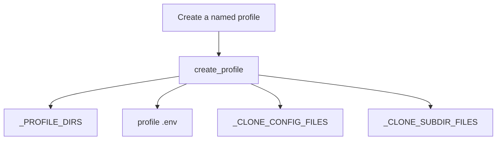
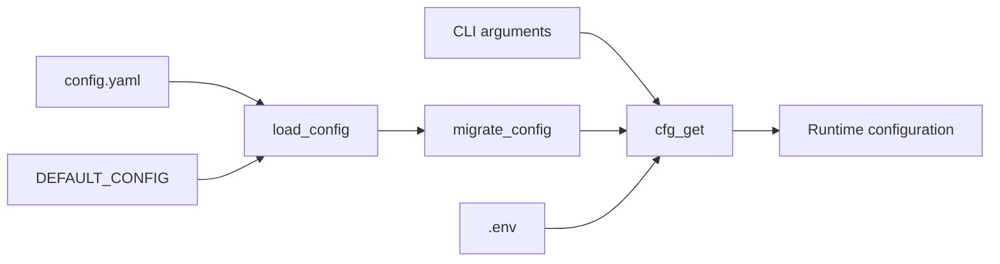
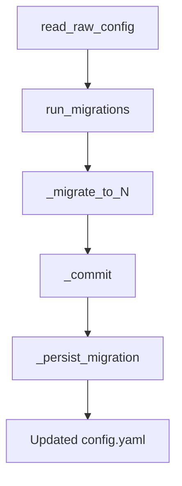
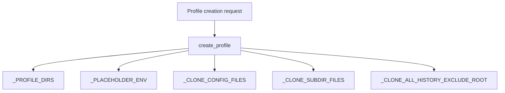

# Configuration and Setup

Relevant source files

The following files were used as context for generating this wiki page:

- [agent/secret_scope.py](agent/secret_scope.py)
- [agent/secret_sources/__init__.py](agent/secret_sources/__init__.py)
- [agent/secret_sources/_cache.py](agent/secret_sources/_cache.py)
- [agent/secret_sources/base.py](agent/secret_sources/base.py)
- [agent/secret_sources/bitwarden.py](agent/secret_sources/bitwarden.py)
- [agent/secret_sources/command.py](agent/secret_sources/command.py)
- [agent/secret_sources/onepassword.py](agent/secret_sources/onepassword.py)
- [agent/secret_sources/registry.py](agent/secret_sources/registry.py)
- [apps/desktop/scripts/click-session-helpers.mjs](apps/desktop/scripts/click-session-helpers.mjs)
- [apps/desktop/scripts/click-session-helpers.test.mjs](apps/desktop/scripts/click-session-helpers.test.mjs)
- [apps/desktop/scripts/click-session.mjs](apps/desktop/scripts/click-session.mjs)
- [cron/job_definition.py](cron/job_definition.py)
- [cron/scheduler_script.py](cron/scheduler_script.py)
- [hermes_cli/config_check_diagnostics.py](hermes_cli/config_check_diagnostics.py)
- [hermes_cli/config_key_notices.py](hermes_cli/config_key_notices.py)
- [hermes_cli/config_migrations.py](hermes_cli/config_migrations.py)
- [hermes_cli/config_migrations_browser.py](hermes_cli/config_migrations_browser.py)
- [hermes_cli/config_version_stamp.py](hermes_cli/config_version_stamp.py)
- [hermes_cli/env_loader.py](hermes_cli/env_loader.py)
- [hermes_cli/kanban_decompose.py](hermes_cli/kanban_decompose.py)
- [hermes_cli/kanban_specify.py](hermes_cli/kanban_specify.py)
- [hermes_cli/left_core_migration.py](hermes_cli/left_core_migration.py)
- [hermes_cli/memory_setup.py](hermes_cli/memory_setup.py)
- [hermes_cli/nous_subscription.py](hermes_cli/nous_subscription.py)
- [hermes_cli/plugins_registrars.py](hermes_cli/plugins_registrars.py)
- [hermes_cli/portal_cli.py](hermes_cli/portal_cli.py)
- [hermes_cli/post_update.py](hermes_cli/post_update.py)
- [hermes_cli/profile_cmd.py](hermes_cli/profile_cmd.py)
- [hermes_cli/profile_describer.py](hermes_cli/profile_describer.py)
- [hermes_cli/profile_distribution.py](hermes_cli/profile_distribution.py)
- [hermes_cli/profiles.py](hermes_cli/profiles.py)
- [hermes_cli/subcommands/profile.py](hermes_cli/subcommands/profile.py)
- [hermes_cli/subcommands/tools.py](hermes_cli/subcommands/tools.py)
- [hermes_cli/tools_config.py](hermes_cli/tools_config.py)
- [hermes_cli/tools_config_cua.py](hermes_cli/tools_config_cua.py)
- [hermes_cli/tools_config_mcp.py](hermes_cli/tools_config_mcp.py)
- [hermes_cli/tools_config_post_setup.py](hermes_cli/tools_config_post_setup.py)
- [hermes_cli/tools_config_providers.py](hermes_cli/tools_config_providers.py)
- [hermes_cli/toolset_scope.py](hermes_cli/toolset_scope.py)
- [hermes_cli/toolset_validation.py](hermes_cli/toolset_validation.py)
- [hermes_cli/venv_sync.py](hermes_cli/venv_sync.py)
- [hermes_cli/xai_retirement.py](hermes_cli/xai_retirement.py)
- [plugins/AGENTS.md](plugins/AGENTS.md)
- [pm/termux_libs.py](pm/termux_libs.py)
- [pm/termux_runtime_libs.json](pm/termux_runtime_libs.json)
- [scripts/ci/archive_inputs.py](scripts/ci/archive_inputs.py)
- [scripts/ci/check_docs_drift.py](scripts/ci/check_docs_drift.py)
- [scripts/ci/docs_drift_baseline.json](scripts/ci/docs_drift_baseline.json)
- [scripts/ci/setup_toolchain.py](scripts/ci/setup_toolchain.py)
- [scripts/docker_config_migrate.py](scripts/docker_config_migrate.py)
- [scripts/termux/wheelhouse_cache.py](scripts/termux/wheelhouse_cache.py)
- [tests/agent/test_env_loader_secret_sources.py](tests/agent/test_env_loader_secret_sources.py)
- [tests/agent/test_onepassword_secrets.py](tests/agent/test_onepassword_secrets.py)
- [tests/agent/test_secret_scope.py](tests/agent/test_secret_scope.py)
- [tests/agent/test_secret_scope_env_cache.py](tests/agent/test_secret_scope_env_cache.py)
- [tests/ci/test_docs_drift.py](tests/ci/test_docs_drift.py)
- [tests/cron/test_cron_multiplex_desktop_ticker_scope.py](tests/cron/test_cron_multiplex_desktop_ticker_scope.py)
- [tests/cron/test_cron_no_agent.py](tests/cron/test_cron_no_agent.py)
- [tests/cron/test_cron_script.py](tests/cron/test_cron_script.py)
- [tests/hermes_cli/test_agent_import_left_core.py](tests/hermes_cli/test_agent_import_left_core.py)
- [tests/hermes_cli/test_config.py](tests/hermes_cli/test_config.py)
- [tests/hermes_cli/test_config_browser_env_first_stamp.py](tests/hermes_cli/test_config_browser_env_first_stamp.py)
- [tests/hermes_cli/test_config_check_diagnostics.py](tests/hermes_cli/test_config_check_diagnostics.py)
- [tests/hermes_cli/test_config_migration_52_browser.py](tests/hermes_cli/test_config_migration_52_browser.py)
- [tests/hermes_cli/test_config_migration_nested_guards.py](tests/hermes_cli/test_config_migration_nested_guards.py)
- [tests/hermes_cli/test_desktop_cron_ticker_gateway_standdown.py](tests/hermes_cli/test_desktop_cron_ticker_gateway_standdown.py)
- [tests/hermes_cli/test_desktop_cron_ticker_profiles.py](tests/hermes_cli/test_desktop_cron_ticker_profiles.py)
- [tests/hermes_cli/test_env_loader.py](tests/hermes_cli/test_env_loader.py)
- [tests/hermes_cli/test_env_sanitize_on_load.py](tests/hermes_cli/test_env_sanitize_on_load.py)
- [tests/hermes_cli/test_install_cua_driver.py](tests/hermes_cli/test_install_cua_driver.py)
- [tests/hermes_cli/test_kanban_aux_affinity.py](tests/hermes_cli/test_kanban_aux_affinity.py)
- [tests/hermes_cli/test_kanban_decompose.py](tests/hermes_cli/test_kanban_decompose.py)
- [tests/hermes_cli/test_kanban_decompose_db.py](tests/hermes_cli/test_kanban_decompose_db.py)
- [tests/hermes_cli/test_kanban_specify.py](tests/hermes_cli/test_kanban_specify.py)
- [tests/hermes_cli/test_kanban_specify_db.py](tests/hermes_cli/test_kanban_specify_db.py)
- [tests/hermes_cli/test_kanban_worktree_isolation.py](tests/hermes_cli/test_kanban_worktree_isolation.py)
- [tests/hermes_cli/test_left_core_camofox.py](tests/hermes_cli/test_left_core_camofox.py)
- [tests/hermes_cli/test_left_core_migration.py](tests/hermes_cli/test_left_core_migration.py)
- [tests/hermes_cli/test_left_core_singularity.py](tests/hermes_cli/test_left_core_singularity.py)
- [tests/hermes_cli/test_memory_setup.py](tests/hermes_cli/test_memory_setup.py)
- [tests/hermes_cli/test_memory_setup_env_denylist.py](tests/hermes_cli/test_memory_setup_env_denylist.py)
- [tests/hermes_cli/test_memory_setup_provider_arg.py](tests/hermes_cli/test_memory_setup_provider_arg.py)
- [tests/hermes_cli/test_migrate_xai.py](tests/hermes_cli/test_migrate_xai.py)
- [tests/hermes_cli/test_nous_subscription.py](tests/hermes_cli/test_nous_subscription.py)
- [tests/hermes_cli/test_post_setup_gating.py](tests/hermes_cli/test_post_setup_gating.py)
- [tests/hermes_cli/test_post_update.py](tests/hermes_cli/test_post_update.py)
- [tests/hermes_cli/test_profile_alias_orphan_removal.py](tests/hermes_cli/test_profile_alias_orphan_removal.py)
- [tests/hermes_cli/test_profile_describer.py](tests/hermes_cli/test_profile_describer.py)
- [tests/hermes_cli/test_profile_distribution.py](tests/hermes_cli/test_profile_distribution.py)
- [tests/hermes_cli/test_profile_export_credentials.py](tests/hermes_cli/test_profile_export_credentials.py)
- [tests/hermes_cli/test_profile_export_special_files.py](tests/hermes_cli/test_profile_export_special_files.py)
- [tests/hermes_cli/test_profile_rename_service.py](tests/hermes_cli/test_profile_rename_service.py)
- [tests/hermes_cli/test_profiles.py](tests/hermes_cli/test_profiles.py)
- [tests/hermes_cli/test_secret_prompt.py](tests/hermes_cli/test_secret_prompt.py)
- [tests/hermes_cli/test_secret_source_bootstrap.py](tests/hermes_cli/test_secret_source_bootstrap.py)
- [tests/hermes_cli/test_setup.py](tests/hermes_cli/test_setup.py)
- [tests/hermes_cli/test_setup_model_provider.py](tests/hermes_cli/test_setup_model_provider.py)
- [tests/hermes_cli/test_tools_config.py](tests/hermes_cli/test_tools_config.py)
- [tests/hermes_cli/test_tools_config_post_setup.py](tests/hermes_cli/test_tools_config_post_setup.py)
- [tests/hermes_cli/test_toolset_validation.py](tests/hermes_cli/test_toolset_validation.py)
- [tests/hermes_cli/test_uninstall_shell_configs.py](tests/hermes_cli/test_uninstall_shell_configs.py)
- [tests/hermes_cli/test_update_launch_completion.py](tests/hermes_cli/test_update_launch_completion.py)
- [tests/hermes_cli/test_venv_current_launch.py](tests/hermes_cli/test_venv_current_launch.py)
- [tests/hermes_cli/test_web_profile_soul_writes.py](tests/hermes_cli/test_web_profile_soul_writes.py)
- [tests/hermes_cli/test_web_profiles_off_loop.py](tests/hermes_cli/test_web_profiles_off_loop.py)
- [tests/hermes_cli/test_xai_retirement.py](tests/hermes_cli/test_xai_retirement.py)
- [tests/pm/test_source_update_launch.py](tests/pm/test_source_update_launch.py)
- [tests/pm/test_startup_recovery.py](tests/pm/test_startup_recovery.py)
- [tests/pm/test_termux_libs.py](tests/pm/test_termux_libs.py)
- [tests/pm/test_update_artifact_refresh.py](tests/pm/test_update_artifact_refresh.py)
- [tests/pm/test_update_dependency_legs.py](tests/pm/test_update_dependency_legs.py)
- [tests/pm/test_update_failure_status.py](tests/pm/test_update_failure_status.py)
- [tests/scripts/test_archive_inputs.py](tests/scripts/test_archive_inputs.py)
- [tests/secret_sources/test_profile_secrets.py](tests/secret_sources/test_profile_secrets.py)
- [tests/tools/test_docker_config_migrate.py](tests/tools/test_docker_config_migrate.py)
- [tests/tools/test_web_picker_active_rows.py](tests/tools/test_web_picker_active_rows.py)
- [website/docs/developer-guide/secret-source-plugin.md](website/docs/developer-guide/secret-source-plugin.md)
- [website/docs/guides/cron-troubleshooting.md](website/docs/guides/cron-troubleshooting.md)
- [website/docs/reference/profile-commands.md](website/docs/reference/profile-commands.md)
- [website/docs/user-guide/features/batch-processing.md](website/docs/user-guide/features/batch-processing.md)
- [website/docs/user-guide/features/spotify.md](website/docs/user-guide/features/spotify.md)
- [website/docs/user-guide/features/tool-gateway.md](website/docs/user-guide/features/tool-gateway.md)
- [website/docs/user-guide/messaging/homeassistant.md](website/docs/user-guide/messaging/homeassistant.md)
- [website/docs/user-guide/profile-distributions.md](website/docs/user-guide/profile-distributions.md)
- [website/docs/user-guide/profiles.md](website/docs/user-guide/profiles.md)
- [website/docs/user-guide/secrets/index.md](website/docs/user-guide/secrets/index.md)
- [website/i18n/zh-Hans/docusaurus-plugin-content-docs/current/guides/cron-troubleshooting.md](website/i18n/zh-Hans/docusaurus-plugin-content-docs/current/guides/cron-troubleshooting.md)
- [website/i18n/zh-Hans/docusaurus-plugin-content-docs/current/reference/profile-commands.md](website/i18n/zh-Hans/docusaurus-plugin-content-docs/current/reference/profile-commands.md)
- [website/i18n/zh-Hans/docusaurus-plugin-content-docs/current/user-guide/features/spotify.md](website/i18n/zh-Hans/docusaurus-plugin-content-docs/current/user-guide/features/spotify.md)
- [website/i18n/zh-Hans/docusaurus-plugin-content-docs/current/user-guide/messaging/homeassistant.md](website/i18n/zh-Hans/docusaurus-plugin-content-docs/current/user-guide/messaging/homeassistant.md)
- [website/i18n/zh-Hans/docusaurus-plugin-content-docs/current/user-guide/profile-distributions.md](website/i18n/zh-Hans/docusaurus-plugin-content-docs/current/user-guide/profile-distributions.md)
- [website/i18n/zh-Hans/docusaurus-plugin-content-docs/current/user-guide/profiles.md](website/i18n/zh-Hans/docusaurus-plugin-content-docs/current/user-guide/profiles.md)

## Purpose and scope

This page describes Hermes configuration files, profile isolation, configuration loading and migration, and the setup surfaces visible in the supplied code. The configuration implementation itself is not included in the supplied file excerpts, so claims about its internal functions are limited to behavior demonstrated by the shown migration code and tests. [tests/hermes_cli/test_config.py:12-33]()

Sources: [tests/hermes_cli/test_config.py:12-33]()

---

## Directory Structure and Profiles

Hermes resolves a home directory through `get_hermes_home()`; tests verify that it uses the platform default when `HERMES_HOME` is unset and that `ensure_hermes_home()` creates a default `SOUL.md` when missing. [tests/hermes_cli/test_config.py:36-52]()

A named profile has its own directory and bootstrapped runtime subdirectories. The profile directory list includes `memories`, `sessions`, `skills`, `skins`, `logs`, `plans`, `workspace`, `cron`, and `home`. The default profile’s directory is the Hermes home; profile tests also exercise validation against path traversal and invalid names. [hermes_cli/profiles.py:32-35](), [tests/hermes_cli/test_profiles.py:113-130]()

A new profile receives a profile-scoped `.env` placeholder. Its comments distinguish secrets from behavioral settings, and tests verify that the file contains no credentials and has mode `0600`. A fresh profile can also inherit the default profile’s model selection so it has a usable provider configuration. [hermes_cli/profiles.py:96-101](), [tests/hermes_cli/test_profiles.py:137-175]()

| Path | Role evidenced in the supplied files |
|---|---|
| `config.yaml` | Structured settings; profile cloning includes it, and profile tests verify inherited model settings. [hermes_cli/profiles.py:37-41](), [tests/hermes_cli/test_profiles.py:159-175]() |
| `.env` | Profile-scoped secrets and environment settings; its placeholder says API keys and tokens override the shell environment, while behavioral settings belong in `config.yaml`. [hermes_cli/profiles.py:96-101]() |
| `SOUL.md` | Profile identity file; included in the clone file list and created by `ensure_hermes_home()` when absent. [hermes_cli/profiles.py:37-41](), [tests/hermes_cli/test_config.py:47-52]() |
| `memories/` | Profile directory; profile cloning can include `MEMORY.md` and `USER.md`. [hermes_cli/profiles.py:32-41]() |
| `sessions/`, `skills/`, `logs/`, `plans/`, `workspace/`, `cron/`, `home/`, `skins/` | Profile runtime directories bootstrapped for each new profile. [hermes_cli/profiles.py:32-35]() |
| `distribution.yaml` | Profile-distribution manifest; the distribution module defines its filename and reads it from a profile directory. [hermes_cli/profile_distribution.py:32-34](), [hermes_cli/profile_distribution.py:153-162]() |

### Profile isolation flow

**Diagram: `create_profile` inputs and profile files**

Sources: [hermes_cli/profiles.py:32-41](), [hermes_cli/profiles.py:96-101]()

`--clone-all` has separate exclusion rules for history and runtime state. The history exclusions include the session database and its SQLite sidecar files, session directories, backups, snapshots, checkpoints, and cron data. Additional default-profile exclusions cover infrastructure such as the checkout, worktrees, shared bins, and managed runtime trees. [hermes_cli/profiles.py:58-89]()

Sources: [hermes_cli/profiles.py:58-89]()

---

## Configuration Hierarchy and Resolution

The requested configuration order is **CLI arguments → `config.yaml` → `.env` → defaults**. The supplied excerpts do not include the implementation of CLI argument overlays or the `load_config()` definition, so they do not establish the full runtime resolution algorithm. The available tests do establish that `load_config()` returns defaults when no file exists, that the default configuration includes `model`, `agent.max_turns`, `terminal.backend`, and `display.interim_assistant_messages`, and that legacy root-level `max_turns` is normalized into `agent.max_turns`. [tests/hermes_cli/test_config.py:116-135]()

The `.env` loader is designed for use across entry points. Its implementation tracks dotenv-loaded names and externally supplied secret provenance, and it defines profile-managed environment keys whose values can affect provider routing. The profile placeholder states that API keys and tokens set in the profile `.env` override the shell environment. [hermes_cli/env_loader.py:1-18](), [hermes_cli/env_loader.py:32-48](), [hermes_cli/env_loader.py:86-93](), [hermes_cli/profiles.py:96-101]()

### Configuration inputs and code entities

**Diagram: settings and configuration code**

Sources: [tests/hermes_cli/test_config.py:12-33](), [tests/hermes_cli/test_config.py:116-135](), [hermes_cli/env_loader.py:1-18]()

### Configuration data flow

`config_migrations.py` reads raw configuration through `read_raw_config()` and persists migration changes through `hermes_cli.config._persist_migration()`. Its migration registry uses ordered version steps; migration commits can record added settings and print user-facing messages unless running quietly. [hermes_cli/config_migrations.py:1-7](), [hermes_cli/config_migrations.py:42-72]()

**Diagram: migration flow from raw settings to persisted configuration**

Sources: [hermes_cli/config_migrations.py:1-7](), [hermes_cli/config_migrations.py:42-72](), [hermes_cli/config_migrations.py:77-103]()

---

## Configuration Migrations

`config_migrations.py` implements a table-driven migration registry. Each step is named for its target version, and the registry owns the version gate and strict ascending order. Migration writes go through `_persist_migration()`; the module describes this persistence contract as writing values that differ from schema defaults, alongside removals and renames. [hermes_cli/config_migrations.py:1-7]()

The automatic migration support floor is version `12`. Configurations below that floor are not automatically migrated; the support-floor message advises backing up `config.yaml` and running `hermes setup`, or manually setting `_config_version` after reviewing the changelog. [hermes_cli/config_migrations.py:22-39]()

Examples shown in the registry include:

- **Version 12:** Converts legacy `custom_providers` entries into the `providers` mapping, derives keys from names or hostnames, avoids overwriting existing provider entries, and removes the old list after successful migration. [hermes_cli/config_migrations.py:116-169]()
- **Version 13:** Removes obsolete `LLM_MODEL` and `OPENAI_MODEL` values from `.env`; the migration comment identifies `config.yaml` as the model source of truth. [hermes_cli/config_migrations.py:174-181]()

`_rewrite_stale_default()` only rewrites a setting when its current value matches the old default, avoiding overwriting a user-customized value. `_commit()` persists the changed configuration and optionally records and reports the migration result. [hermes_cli/config_migrations.py:63-75](), [hermes_cli/config_migrations.py:77-109]()

Sources: [hermes_cli/config_migrations.py:1-7](), [hermes_cli/config_migrations.py:22-39](), [hermes_cli/config_migrations.py:63-109](), [hermes_cli/config_migrations.py:116-181]()

---

## Setup Wizard and Tool Configuration

The available excerpts do not include the setup wizard implementation or its command dispatcher, so this section does not assert its complete prompt sequence or write behavior. The migration support-floor message identifies `hermes setup` as a user-facing recovery path for configurations too old to migrate automatically. [hermes_cli/config_migrations.py:30-39]()

The supplied tool configuration module identifies `hermes tools` as a configuration surface. `tools_config.py` imports provider configuration, MCP configuration, and post-setup helpers, and defines a configurable toolset catalog covering categories such as web, browser, terminal, file operations, code execution, memory, delegation, and cron jobs. [hermes_cli/tools_config.py:18-35](), [hermes_cli/tools_config.py:65-94]()

The tool configuration data distinguishes default-off toolsets, including `video`, `video_gen`, `x_search`, `kanban`, and others, from configuration-only capabilities such as `stt`, which is not represented in `platform_toolsets`. [hermes_cli/tools_config.py:107-115]()

Sources: [hermes_cli/config_migrations.py:30-39](), [hermes_cli/tools_config.py:18-35](), [hermes_cli/tools_config.py:65-94](), [hermes_cli/tools_config.py:107-115]()

---

## Profiles: Multi-Instance Isolation and Identity

Profiles provide separate homes for Hermes instances. Each new profile bootstraps the directories listed in `_PROFILE_DIRS`, and its `.env` is seeded with a placeholder rather than copied credentials from another source. [hermes_cli/profiles.py:32-35](), [hermes_cli/profiles.py:96-101]()

The profile module’s clone configuration lists `config.yaml`, `.env`, and `SOUL.md` as files copied when present, and includes `memories/MEMORY.md` and `memories/USER.md` as curated subdirectory files. For `--clone-all`, runtime and history artifacts are excluded according to dedicated exclusion sets. [hermes_cli/profiles.py:37-41](), [hermes_cli/profiles.py:43-89]()

A fresh profile can inherit a usable model configuration from the default home; tests verify that both the `model` section and its provider definition can be carried over. [tests/hermes_cli/test_profiles.py:159-183]()

### Profile configuration workflow

**Diagram: profile bootstrap and optional clone inputs**

Sources: [hermes_cli/profiles.py:32-41](), [hermes_cli/profiles.py:43-89](), [hermes_cli/profiles.py:96-101]()

---

## Key Configuration Files

| File or directory | Location | Responsibility evidenced in the supplied files |
|---|---|---|
| `config.yaml` | Hermes home or profile root | Structured configuration. Migration code reads and rewrites it; profile cloning includes it. [hermes_cli/config_migrations.py:49-54](), [hermes_cli/profiles.py:37-41]() |
| `.env` | Hermes home or profile root | Environment variables and secrets. The profile placeholder describes API keys and tokens as profile-scoped values that override shell environment values. [hermes_cli/profiles.py:96-101]() |
| `SOUL.md` | Hermes home or profile root | Profile identity file; created by `ensure_hermes_home()` when absent and included in profile cloning. [tests/hermes_cli/test_config.py:47-52](), [hermes_cli/profiles.py:37-41]() |
| `auth.json` | Profile root | The profile clone-all comments identify it indirectly only through runtime context; its detailed schema and role are not shown in the supplied excerpts. [hermes_cli/profiles.py:43-56]() |
| `memories/MEMORY.md`, `memories/USER.md` | Profile root under `memories/` | Curated memory files included in the profile clone file list. [hermes_cli/profiles.py:37-41]() |
| `distribution.yaml` | Profile root | Profile-distribution manifest. The module defines the filename and parses it as a `DistributionManifest`. [hermes_cli/profile_distribution.py:32-34](), [hermes_cli/profile_distribution.py:153-162]() |
| `.env.template`, `.env.EXAMPLE` | Distribution source | Distribution-related environment template filenames. Their detailed install behavior is outside the supplied excerpt. [hermes_cli/profile_distribution.py:32-34]() |

Sources: [hermes_cli/config_migrations.py:49-54](), [hermes_cli/profile_distribution.py:32-34](), [hermes_cli/profile_distribution.py:153-162](), [hermes_cli/profiles.py:32-41](), [hermes_cli/profiles.py:43-56](), [hermes_cli/profiles.py:96-101](), [tests/hermes_cli/test_config.py:47-52]()

---

## Summary

The supplied implementation shows a configuration system centered on profile-specific homes, structured `config.yaml` settings, and profile-scoped `.env` files. Profiles bootstrap isolated directories and can clone selected configuration and identity files. [hermes_cli/profiles.py:32-41](), [hermes_cli/profiles.py:96-101]()

Configuration migrations are versioned and persisted through a common helper; migrations below the supported version floor are not automatic. The excerpts also show migration examples for custom providers and obsolete model environment variables. [hermes_cli/config_migrations.py:1-7](), [hermes_cli/config_migrations.py:22-39](), [hermes_cli/config_migrations.py:116-181]()

Sources: [hermes_cli/config_migrations.py:1-7](), [hermes_cli/config_migrations.py:22-39](), [hermes_cli/config_migrations.py:116-181](), [hermes_cli/profiles.py:32-41](), [hermes_cli/profiles.py:96-101]()