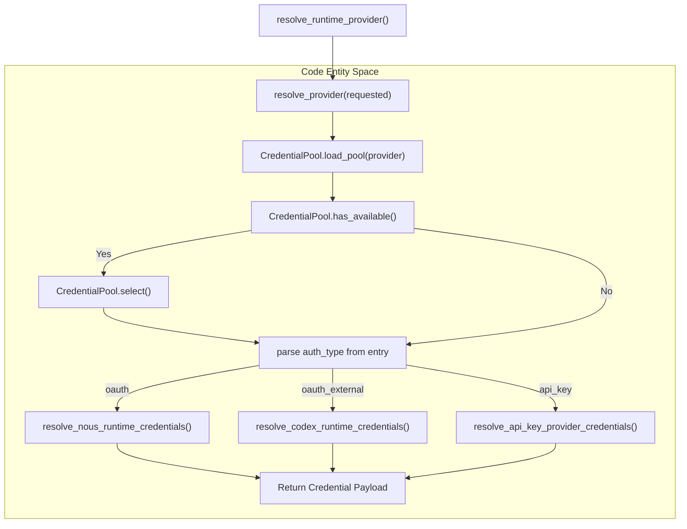
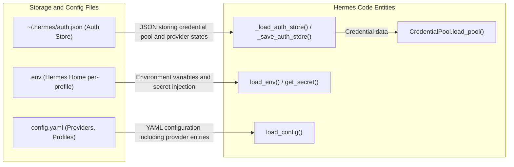
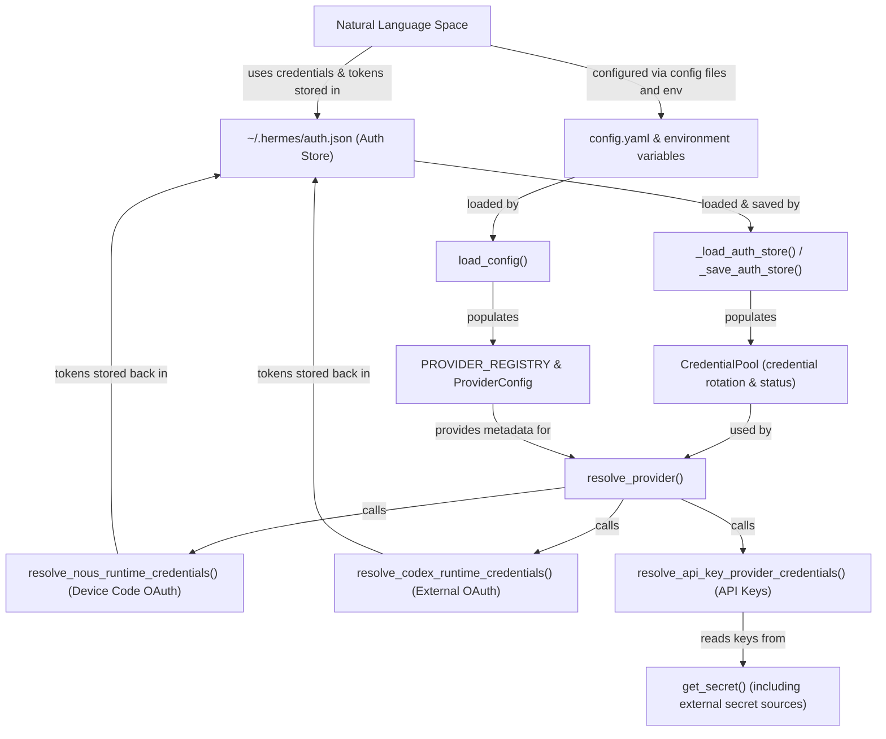

# Authentication and Providers

Relevant source files

The following files were used as context for generating this wiki page:

- [agent/credential_pool.py](agent/credential_pool.py)
- [agent/credential_pool_admin.py](agent/credential_pool_admin.py)
- [agent/credential_pool_model_cooldowns.py](agent/credential_pool_model_cooldowns.py)
- [agent/fallback_cooldown.py](agent/fallback_cooldown.py)
- [agent/secret_scope.py](agent/secret_scope.py)
- [agent/secret_sources/__init__.py](agent/secret_sources/__init__.py)
- [agent/secret_sources/_cache.py](agent/secret_sources/_cache.py)
- [agent/secret_sources/base.py](agent/secret_sources/base.py)
- [agent/secret_sources/bitwarden.py](agent/secret_sources/bitwarden.py)
- [agent/secret_sources/command.py](agent/secret_sources/command.py)
- [agent/secret_sources/onepassword.py](agent/secret_sources/onepassword.py)
- [agent/secret_sources/registry.py](agent/secret_sources/registry.py)
- [contributors/emails/eversonx100@gmail.com](contributors/emails/eversonx100@gmail.com)
- [contributors/emails/kboxstar@gmail.com](contributors/emails/kboxstar@gmail.com)
- [cron/scheduler_script.py](cron/scheduler_script.py)
- [hermes_cli/AGENTS.md](hermes_cli/AGENTS.md)
- [hermes_cli/anon_auth.py](hermes_cli/anon_auth.py)
- [hermes_cli/anon_sign_in.py](hermes_cli/anon_sign_in.py)
- [hermes_cli/anon_sign_in_cli.py](hermes_cli/anon_sign_in_cli.py)
- [hermes_cli/auth.py](hermes_cli/auth.py)
- [hermes_cli/auth_codex.py](hermes_cli/auth_codex.py)
- [hermes_cli/auth_commands.py](hermes_cli/auth_commands.py)
- [hermes_cli/auth_device_flow.py](hermes_cli/auth_device_flow.py)
- [hermes_cli/auth_error_copy.py](hermes_cli/auth_error_copy.py)
- [hermes_cli/auth_nous.py](hermes_cli/auth_nous.py)
- [hermes_cli/auth_oauth_grants.py](hermes_cli/auth_oauth_grants.py)
- [hermes_cli/env_loader.py](hermes_cli/env_loader.py)
- [hermes_cli/free_tier_bootstrap.py](hermes_cli/free_tier_bootstrap.py)
- [hermes_cli/guest_handoff.py](hermes_cli/guest_handoff.py)
- [hermes_cli/observability/shared_metrics_disabled.py](hermes_cli/observability/shared_metrics_disabled.py)
- [hermes_cli/observability/shared_metrics_setup.py](hermes_cli/observability/shared_metrics_setup.py)
- [hermes_cli/observability/shared_metrics_signals.py](hermes_cli/observability/shared_metrics_signals.py)
- [hermes_cli/profile_channels.py](hermes_cli/profile_channels.py)
- [hermes_cli/proxy/adapters/__init__.py](hermes_cli/proxy/adapters/__init__.py)
- [hermes_cli/proxy/adapters/base.py](hermes_cli/proxy/adapters/base.py)
- [hermes_cli/proxy/adapters/nous_portal.py](hermes_cli/proxy/adapters/nous_portal.py)
- [hermes_cli/proxy/adapters/xai.py](hermes_cli/proxy/adapters/xai.py)
- [hermes_cli/proxy/cli.py](hermes_cli/proxy/cli.py)
- [hermes_cli/proxy/server.py](hermes_cli/proxy/server.py)
- [hermes_cli/proxy/sse_done.py](hermes_cli/proxy/sse_done.py)
- [hermes_cli/proxy_cli.py](hermes_cli/proxy_cli.py)
- [hermes_cli/psutil_android.py](hermes_cli/psutil_android.py)
- [hermes_cli/relaunch.py](hermes_cli/relaunch.py)
- [hermes_cli/relay_plugin_cutover.py](hermes_cli/relay_plugin_cutover.py)
- [hermes_cli/resource_limits.py](hermes_cli/resource_limits.py)
- [hermes_cli/subcommands/auth.py](hermes_cli/subcommands/auth.py)
- [hermes_cli/web_server_oauth.py](hermes_cli/web_server_oauth.py)
- [hermes_cli/welcome_trial.py](hermes_cli/welcome_trial.py)
- [tests/agent/test_codex_model_entitlement_rotation.py](tests/agent/test_codex_model_entitlement_rotation.py)
- [tests/agent/test_credential_pool.py](tests/agent/test_credential_pool.py)
- [tests/agent/test_credential_pool_connectors_guest.py](tests/agent/test_credential_pool_connectors_guest.py)
- [tests/agent/test_credential_pool_profile_oauth_fork.py](tests/agent/test_credential_pool_profile_oauth_fork.py)
- [tests/agent/test_env_loader_secret_sources.py](tests/agent/test_env_loader_secret_sources.py)
- [tests/agent/test_onepassword_secrets.py](tests/agent/test_onepassword_secrets.py)
- [tests/agent/test_provider_reset_cooldown.py](tests/agent/test_provider_reset_cooldown.py)
- [tests/agent/test_secret_scope.py](tests/agent/test_secret_scope.py)
- [tests/agent/test_secret_scope_env_cache.py](tests/agent/test_secret_scope_env_cache.py)
- [tests/cron/test_cron_multiplex_desktop_ticker_scope.py](tests/cron/test_cron_multiplex_desktop_ticker_scope.py)
- [tests/cron/test_cron_no_agent.py](tests/cron/test_cron_no_agent.py)
- [tests/cron/test_cron_script.py](tests/cron/test_cron_script.py)
- [tests/hermes_cli/anon_portal.py](tests/hermes_cli/anon_portal.py)
- [tests/hermes_cli/test_anon_auth_core.py](tests/hermes_cli/test_anon_auth_core.py)
- [tests/hermes_cli/test_anon_surfaces.py](tests/hermes_cli/test_anon_surfaces.py)
- [tests/hermes_cli/test_anon_upgrade.py](tests/hermes_cli/test_anon_upgrade.py)
- [tests/hermes_cli/test_auth_commands.py](tests/hermes_cli/test_auth_commands.py)
- [tests/hermes_cli/test_auth_nous_provider.py](tests/hermes_cli/test_auth_nous_provider.py)
- [tests/hermes_cli/test_auth_profile_fallback.py](tests/hermes_cli/test_auth_profile_fallback.py)
- [tests/hermes_cli/test_auth_toctou_file_modes.py](tests/hermes_cli/test_auth_toctou_file_modes.py)
- [tests/hermes_cli/test_codex_token_writethrough.py](tests/hermes_cli/test_codex_token_writethrough.py)
- [tests/hermes_cli/test_desktop_cron_ticker_gateway_standdown.py](tests/hermes_cli/test_desktop_cron_ticker_gateway_standdown.py)
- [tests/hermes_cli/test_desktop_cron_ticker_profiles.py](tests/hermes_cli/test_desktop_cron_ticker_profiles.py)
- [tests/hermes_cli/test_device_poll_waf_backoff.py](tests/hermes_cli/test_device_poll_waf_backoff.py)
- [tests/hermes_cli/test_env_loader.py](tests/hermes_cli/test_env_loader.py)
- [tests/hermes_cli/test_env_sanitize_on_load.py](tests/hermes_cli/test_env_sanitize_on_load.py)
- [tests/hermes_cli/test_global_auth_store_memo.py](tests/hermes_cli/test_global_auth_store_memo.py)
- [tests/hermes_cli/test_guest_handoff.py](tests/hermes_cli/test_guest_handoff.py)
- [tests/hermes_cli/test_guest_handoff_refresh.py](tests/hermes_cli/test_guest_handoff_refresh.py)
- [tests/hermes_cli/test_launchd_plist_guard.py](tests/hermes_cli/test_launchd_plist_guard.py)
- [tests/hermes_cli/test_nous_nonproduction_inference_host.py](tests/hermes_cli/test_nous_nonproduction_inference_host.py)
- [tests/hermes_cli/test_oauth_status_pool_observation.py](tests/hermes_cli/test_oauth_status_pool_observation.py)
- [tests/hermes_cli/test_profile_clone_channels.py](tests/hermes_cli/test_profile_clone_channels.py)
- [tests/hermes_cli/test_provider_precedence.py](tests/hermes_cli/test_provider_precedence.py)
- [tests/hermes_cli/test_proxy.py](tests/hermes_cli/test_proxy.py)
- [tests/hermes_cli/test_relaunch.py](tests/hermes_cli/test_relaunch.py)
- [tests/hermes_cli/test_resolve_provider_custom_endpoint.py](tests/hermes_cli/test_resolve_provider_custom_endpoint.py)
- [tests/hermes_cli/test_secret_source_bootstrap.py](tests/hermes_cli/test_secret_source_bootstrap.py)
- [tests/hermes_cli/test_shared_metrics_signals.py](tests/hermes_cli/test_shared_metrics_signals.py)
- [tests/hermes_cli/test_slash_confirm_windows.py](tests/hermes_cli/test_slash_confirm_windows.py)
- [tests/hermes_cli/test_welcome_trial.py](tests/hermes_cli/test_welcome_trial.py)
- [tests/scripts/test_powershell_script_syntax.py](tests/scripts/test_powershell_script_syntax.py)
- [tests/secret_sources/test_profile_secrets.py](tests/secret_sources/test_profile_secrets.py)
- [website/docs/developer-guide/cli-internals.md](website/docs/developer-guide/cli-internals.md)
- [website/docs/developer-guide/egress-internals.md](website/docs/developer-guide/egress-internals.md)
- [website/docs/developer-guide/secret-source-plugin.md](website/docs/developer-guide/secret-source-plugin.md)
- [website/docs/guides/cron-troubleshooting.md](website/docs/guides/cron-troubleshooting.md)
- [website/docs/user-guide/egress/iron-proxy.md](website/docs/user-guide/egress/iron-proxy.md)
- [website/docs/user-guide/features/credential-pools.md](website/docs/user-guide/features/credential-pools.md)
- [website/docs/user-guide/features/subscription-proxy.md](website/docs/user-guide/features/subscription-proxy.md)
- [website/docs/user-guide/secrets/index.md](website/docs/user-guide/secrets/index.md)
- [website/i18n/zh-Hans/docusaurus-plugin-content-docs/current/guides/cron-troubleshooting.md](website/i18n/zh-Hans/docusaurus-plugin-content-docs/current/guides/cron-troubleshooting.md)
- [website/i18n/zh-Hans/docusaurus-plugin-content-docs/current/user-guide/features/subscription-proxy.md](website/i18n/zh-Hans/docusaurus-plugin-content-docs/current/user-guide/features/subscription-proxy.md)

This page documents the authentication system that enables Hermes Agent to connect to Large Language Model (LLM) inference providers. It covers the provider registry, OAuth flows, API key management, credential storage, provider resolution logic, credential pooling, and external secret sources.

**Scope**: This page focuses on authentication and provider selection for the **primary inference provider**. For details about auxiliary models used by tools (e.g., vision analysis, web scraping, context compression), see [Auxiliary Client (4.5)]().

---

## Overview

Hermes Agent supports a wide range of inference providers through a unified authentication system that includes:

- **OAuth Device Code Flows**: Used primarily by Nous Portal, xAI, and MiniMax for browser-based device authorization. These flows manage user codes, polling, and token refresh cycles, implemented via `hermes_cli.auth` and related submodules like `auth_nous`, `auth_xai`, and `auth_minimax` [hermes_cli/auth.py:1-10]().
- **OAuth External Flows**: Used by OpenAI Codex, Qwen, and Google Gemini, which rely on external CLI helpers or browser redirects for authentication [hermes_cli/auth.py:77-88]().
- **API Key Authentication**: Traditional API key use with multiple providers like OpenRouter, Google AI Studio, Z.AI/GLM, Kimi/Moonshot, MiniMax, Alibaba, DeepSeek, and xAI [hermes_cli/auth.py:36-44]().
- **Anonymous Free-Tier Identity**: The `anonymous` auth method of the `nous` provider (`hermes_cli.anon_auth`), minting ephemeral guest credentials and exchanging them for short-lived JWTs to provide out-of-the-box free inference and connector support [hermes_cli/anon_auth.py:1-13]().
- **Credential Pooling and Rotation**: Management of multiple credentials for the same provider with failover, status tracking, and automatic rotation using the `CredentialPool` system [agent/credential_pool.py:1-53]().
- **Secret Injection from External Sources**: Dynamic injection of credentials from external secret stores such as Bitwarden or 1Password via the `agent.secret_scope` module, enabling seamless integration and credential management without modifying global environment variables [agent/secret_scope.py:22-23]().
- **Provider Resolution Chain**: A layered approach that picks the active provider and credentials based on explicit input, configuration, environment variables, or autodetection heuristics.

Sources: [hermes_cli/auth.py:1-10](), [hermes_cli/auth.py:77-88](), [hermes_cli/auth.py:36-44](), [hermes_cli/anon_auth.py:1-13](), [agent/credential_pool.py:1-53](), [agent/secret_scope.py:22-23]().

---

## Provider Registry and Profiles

Hermes Agent keeps a comprehensive **provider registry** via the `PROVIDER_REGISTRY` mapping and `ProviderConfig` dataclass in `hermes_cli.auth` [hermes_cli/auth.py:3](). This registry describes known inference providers with metadata necessary for runtime resolution and authentication, including:

- **Transport Protocol Identifiers**: Tags such as `openai_chat`, `anthropic_messages`, `codex_responses` guide how requests/responses are formatted and handled.
- **Authentication Type**: Designations like `api_key`, `oauth_device_code`, `oauth_external`, or `external_process`.
- **Default and Overrideable Inference Base URLs**: URLs used for API calls, often overrideable by environment variables or config.
- **Aggregator Flags**: Identifies meta providers like MOA presets or OpenRouter aggregator proxies.
- **Anonymous or Keyless Mode Support**: Indicates if a provider allows unauthenticated queries or read-only modes.

### Common Providers and Their Authentication

| Provider ID | Authentication Scheme | Typical Env Vars / Credentials | Notes |
|---|---|---|---|
| `nous` | OAuth Device Code / Anonymous | Internal token management via device_code or `anon_` free-tier exchange | Access to Nous Portal models via `auth_nous` and `anon_auth` |
| `openai-codex` | OAuth External | Managed externally via CLI/browser helpers | OpenAI-compatible OAuth flow for Codex |
| `anthropic` | API Key or OAuth | `ANTHROPIC_API_KEY`, OAuth tokens | Supports both API key and OAuth |
| `openrouter` | API Key | `OPENROUTER_API_KEY` | Aggregator for many open-source providers |
| `xai-oauth` | OAuth Device Code | Internal token management via device_code flows | xAI direct OAuth device code via `auth_xai` |
| `minimax-oauth` | OAuth External | Internal storage | MiniMax OAuth token polling and refresh |
| Custom | API Key or external | Custom environment variables (configurable) | User-defined provider extensions |

Sources: [hermes_cli/auth.py:1-10](), [hermes_cli/anon_auth.py:1-13]().

---

## Provider Resolution Chain

Provider resolution is primarily handled by the `resolve_provider()` function in `hermes_cli.auth.py` [hermes_cli/auth.py:7](). It follows a prioritized resolution sequence that considers:

1. Explicit provider parameters passed to CLI commands or API calls.
2. Provider settings from configuration YAML (`config.yaml`).
3. Environment variables scoped to the active profile.
4. Auto-detection heuristics and fallback mechanisms, including anonymous free-tier fallbacks where applicable.

Based on the resolved provider ID, Hermes fetches credentials from one of several authentication flows:

- Device code OAuth providers resolve credentials via code-managed token stores.
- OAuth external providers use external CLI or browser token stores.
- API key providers resolve from config or environment.

### Key Functions and Classes in Resolution

| Name | Description | Source Location |
|---|---|---|
| `resolve_provider()` | Determine active LLM provider ID from inputs and configuration | `hermes_cli/auth.py:7` |
| `CredentialPool` | Load and manage multiple credentials for a provider with status | `agent/credential_pool.py:1-161` |
| `_load_auth_store()` / `_save_auth_store()` | Load and save `auth.json` credential data with atomic file locking | `hermes_cli/auth.py:4-6` |
| `resolve_nous_runtime_credentials()` | Resolve runtime credentials via Nous device code OAuth | `hermes_cli/auth.py:64` |
| `resolve_codex_runtime_credentials()` | Resolve runtime credentials via OpenAI Codex OAuth external flow | `hermes_cli/auth.py:83` |
| `ensure_guest_identity()` | Provision or reconcile anonymous guest credentials for free-tier access | `hermes_cli/anon_auth.py:1-13` |

### Provider Resolution Flow Diagram

**Figure: Provider resolution flow.**

Sources: [hermes_cli/auth.py:1-10](), [agent/credential_pool.py:1-161](), [hermes_cli/auth.py:4-6](), [hermes_cli/auth.py:64](), [hermes_cli/auth.py:83]().

---

## Credential Pool and Rotation

The `CredentialPool` in `agent.credential_pool` maintains multiple credentials for the same provider, allowing for automatic failover and rotation [agent/credential_pool.py:1-53](). It manages:

- **Credential Metadata & Status:** Credentials have states such as `STATUS_OK` (usable), `STATUS_EXHAUSTED` (temporarily unusable, e.g., rate limited), and `STATUS_DEAD` (terminally invalid and excluded from rotation) [agent/credential_pool.py:81-88]().
- **Exhaustion Cooldowns:** Implements cooldown TTLs that vary by HTTP status (e.g., 401, 429, 402) with longer waits on serious failures and shorter waits for transient throttles [agent/credential_pool.py:130-139]().
- **Rotation Strategies:** Credential selection can use different strategies:

| Strategy | Description | Reference Source |
|---|---|---|
| `fill_first` | Always use highest priority credential until exhaustion | [agent/credential_pool.py:118]() |
| `round_robin` | Rotate credentials cyclically | [agent/credential_pool.py:119]() |
| `random` | Randomly pick among available keys | [agent/credential_pool.py:120]() |
| `least_used` | Select the least used or least recently exhausted credential | [agent/credential_pool.py:121]() |

- **Terminal Auth Failure Reasons:** Recognizes certain OAuth error reasons such as `"token_invalidated"`, `"token_revoked"`, or `"refresh_token_reused"` to mark credentials dead and prevent futile retries [agent/credential_pool.py:91-98]().
- **Persistence:** All credential pool state (credentials, statuses, priorities) is persisted to the `~/.hermes/auth.json` file with safe cross-process locked writes to avoid corruption [hermes_cli/auth.py:4-6]().

Sources: [agent/credential_pool.py:1-53](), [agent/credential_pool.py:81-88](), [agent/credential_pool.py:130-139](), [agent/credential_pool.py:118-121](), [agent/credential_pool.py:91-98](), [hermes_cli/auth.py:4-6]().

---

## Authentication Implementation Details

### OAuth Device Code Flow and External Grants

- Device code OAuth flows (Nous, xAI, MiniMax) run interactive device authorization sequences that prompt users to visit a URL and enter a code. They manage polling for token issuance, token refresh, and token persistence. These mechanisms are implemented inside `hermes_cli.auth_nous`, `auth_xai`, and `auth_minimax` [hermes_cli/auth.py:50-70]().
- External OAuth providers like OpenAI Codex and Qwen implement OAuth using external CLI or browser login helpers that persist tokens in local stores. Hermes imports these tokens into its internal credential pool for runtime usage and refresh [hermes_cli/auth.py:77-88]().
- These flows also include enhanced logic for error quarantine, token healing, and refresh token management ensuring stable continuous authentication in concurrent and multi-profile scenarios.
- The single-use OAuth pattern requires meticulous cloning protection: single-use refresh tokens are never forked into named profiles to prevent reuse errors. This hygiene is implemented via `hermes_cli.auth_oauth_grants` [hermes_cli/auth_oauth_grants.py:1-156]().

### API Key Authentication

API key authentication is simple but supports multi-key rotation and status management. Keys can be specified in config files, environment variables, or credential pools. The system supports auto-detecting environment-based credentials as single-entry pools for bootstrap scenarios.

- The provider registry defines the env var keys that map to API keys.
- Keys injected from external secret sources are treated identically to manual or config-file credentials.
- If rate limits or billing errors occur, the offending key is marked exhausted and the pool rotates to alternate keys.

### Secret Injection and External Secret Sources

Hermes supports injecting secrets dynamically from external secret sources, isolating credentials by profile without global pollution of `os.environ`. This mechanism is implemented in `agent.secret_scope.py` and supports plugins:

- Bitwarden (`agent.secret_sources.bitwarden`)
- 1Password (`agent.secret_sources.onepassword`)
- Command-based secrets and caching are supported as well.

Secret injection integrates with `load_env()` [hermes_cli/env_loader.py:17]() which is used during config loading and runtime provider resolution to hydrate environment variables transparently from secret stores. The system caches loaded secrets per Hermes home path and profile. This preserves the multiplexed gateway security boundary where credentials must remain isolated in memory even if multiple profiles run concurrently in one process.

Sources: [hermes_cli/auth.py:50-70](), [hermes_cli/auth.py:77-88](), [agent/credential_pool.py:22](), [hermes_cli/auth_oauth_grants.py:1-156](), [hermes_cli/env_loader.py:17]().

---

## Auxiliary Provider Resolution

The auxiliary client system (`agent.auxiliary_client`) orchestrates the selection of LLM providers for auxiliary tasks such as vision, compression, and web extraction. Its provider resolution employs a tiered fallback chain similar to the primary provider but with domain-specific priorities:

- Starts from configured auxiliary provider, falling back through:
  - The primary provider's configured model.
  - OpenRouter as an aggregator.
  - Nous Portal for any Nous models.
  - Custom API endpoints.
  - Native Anthropic endpoint.
  - Raw API key providers.
- The vision subsystem similarly selects preferred vision backends with fallback lists.
- This ensures tools can operate reliably even when some providers fail or are unavailable.

Sources: [hermes_cli/auth.py:62-64]()

---

## Data Flow: Credential Storage and Persistence

This diagram maps how various authentication-related data files associate to in-code loaders and usage within Hermes Agent.

**Figure: Mapping of storage files to code modules handling authentication state and secrets.**

Sources: [hermes_cli/auth.py:4-6](), [agent/credential_pool.py:21](), [hermes_cli/env_loader.py:17]().

---

## Summary Diagram Bridging Natural Language Concepts to Code

**Figure: Mapping natural language provider/authentication concepts to Hermes code entities and storage mechanisms**

Sources: [hermes_cli/auth.py:4-6](), [hermes_cli/auth.py:7](), [hermes_cli/auth.py:64](), [hermes_cli/auth.py:83](), [hermes_cli/auth.py:2490](), [agent/credential_pool.py:22]().

---

# References

- Multi-provider authentication: `hermes_cli/auth.py` [1-10](), [hermes_cli/auth.py:36-44](), [hermes_cli/auth.py:50-70](), [hermes_cli/auth.py:77-88]()
- Credential pool management: `agent/credential_pool.py` [1-53]()
- Environment loading and secret injection: `hermes_cli/env_loader.py` [17]()
- Anonymous auth & free tier: `hermes_cli/anon_auth.py` [1-13]()
- Auxiliary client provider resolution: `hermes_cli/auth.py` [62-64]()
- Provider runtime resolution logic: `hermes_cli/auth.py` [7]()
- Provider registry & metadata: `hermes_cli/auth.py` [3]()

---

# End of 2.3 Authentication and Providers