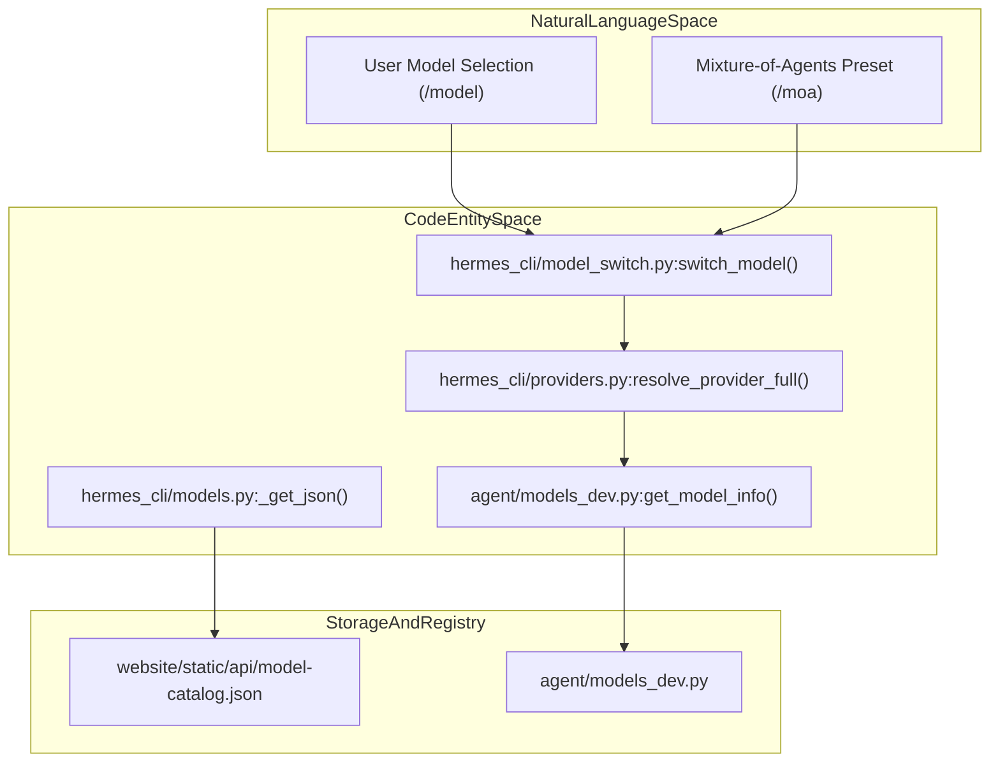
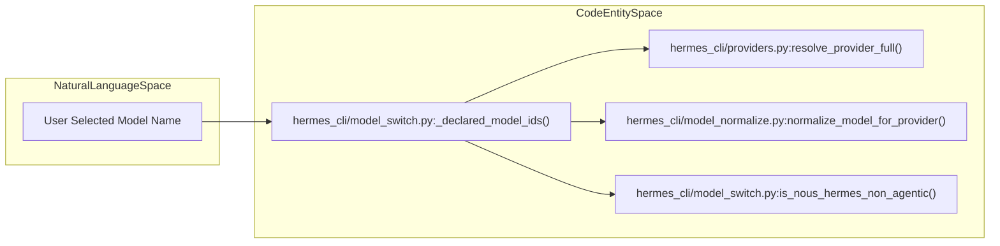
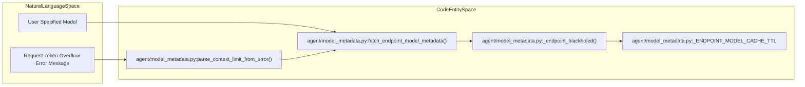

# Model Selection and Management

Relevant source files

The following files were used as context for generating this wiki page:

- [agent/image_routing.py](agent/image_routing.py)
- [agent/insights.py](agent/insights.py)
- [agent/moa_loop.py](agent/moa_loop.py)
- [agent/model_metadata.py](agent/model_metadata.py)
- [agent/models_dev.py](agent/models_dev.py)
- [agent/reasoning_effort.py](agent/reasoning_effort.py)
- [agent/reasoning_timeouts.py](agent/reasoning_timeouts.py)
- [agent/usage_pricing.py](agent/usage_pricing.py)
- [apps/desktop/src/app/settings/model-settings.test.tsx](apps/desktop/src/app/settings/model-settings.test.tsx)
- [apps/desktop/src/app/settings/model-settings.tsx](apps/desktop/src/app/settings/model-settings.tsx)
- [contributors/emails/daniil.grois@gmail.com](contributors/emails/daniil.grois@gmail.com)
- [contributors/emails/elisam@nvidia.com](contributors/emails/elisam@nvidia.com)
- [contributors/emails/kevinbanjo@gmail.com](contributors/emails/kevinbanjo@gmail.com)
- [evals/cli_deferred_notice.py](evals/cli_deferred_notice.py)
- [hermes_cli/backup.py](hermes_cli/backup.py)
- [hermes_cli/backup_restore.py](hermes_cli/backup_restore.py)
- [hermes_cli/banner.py](hermes_cli/banner.py)
- [hermes_cli/cli_auto_maintenance.py](hermes_cli/cli_auto_maintenance.py)
- [hermes_cli/codex_models.py](hermes_cli/codex_models.py)
- [hermes_cli/inventory.py](hermes_cli/inventory.py)
- [hermes_cli/local_runtime/capabilities.py](hermes_cli/local_runtime/capabilities.py)
- [hermes_cli/moa_cmd.py](hermes_cli/moa_cmd.py)
- [hermes_cli/moa_config.py](hermes_cli/moa_config.py)
- [hermes_cli/model_catalog.py](hermes_cli/model_catalog.py)
- [hermes_cli/model_cost_guard.py](hermes_cli/model_cost_guard.py)
- [hermes_cli/model_search.py](hermes_cli/model_search.py)
- [hermes_cli/model_selection_guards.py](hermes_cli/model_selection_guards.py)
- [hermes_cli/model_switch.py](hermes_cli/model_switch.py)
- [hermes_cli/model_switch_providers.py](hermes_cli/model_switch_providers.py)
- [hermes_cli/models.py](hermes_cli/models.py)
- [hermes_cli/models_catalog_static.py](hermes_cli/models_catalog_static.py)
- [hermes_cli/models_local.py](hermes_cli/models_local.py)
- [hermes_cli/models_pricing.py](hermes_cli/models_pricing.py)
- [hermes_cli/models_profile_cache.py](hermes_cli/models_profile_cache.py)
- [hermes_cli/models_reasoning_caps.py](hermes_cli/models_reasoning_caps.py)
- [hermes_cli/models_validate.py](hermes_cli/models_validate.py)
- [scripts/build_model_catalog.py](scripts/build_model_catalog.py)
- [scripts/dump_desktop_slash_registry.py](scripts/dump_desktop_slash_registry.py)
- [scripts/gen-bootstrap-pins.py](scripts/gen-bootstrap-pins.py)
- [scripts/gen_gateway_contracts.py](scripts/gen_gateway_contracts.py)
- [tests/agent/test_astra_baseline_runtime.py](tests/agent/test_astra_baseline_runtime.py)
- [tests/agent/test_cache_disabled_on_stubs.py](tests/agent/test_cache_disabled_on_stubs.py)
- [tests/agent/test_capability_probe_credentials.py](tests/agent/test_capability_probe_credentials.py)
- [tests/agent/test_image_routing.py](tests/agent/test_image_routing.py)
- [tests/agent/test_insights.py](tests/agent/test_insights.py)
- [tests/agent/test_model_metadata.py](tests/agent/test_model_metadata.py)
- [tests/agent/test_model_metadata_local_ctx.py](tests/agent/test_model_metadata_local_ctx.py)
- [tests/agent/test_models_dev.py](tests/agent/test_models_dev.py)
- [tests/agent/test_openai_ultrafast.py](tests/agent/test_openai_ultrafast.py)
- [tests/agent/test_probe_cache_followups.py](tests/agent/test_probe_cache_followups.py)
- [tests/agent/test_reasoning_effort_module.py](tests/agent/test_reasoning_effort_module.py)
- [tests/agent/test_reasoning_stale_timeout_floor.py](tests/agent/test_reasoning_stale_timeout_floor.py)
- [tests/agent/test_usage_pricing.py](tests/agent/test_usage_pricing.py)
- [tests/gateway/test_model_command_async_offload.py](tests/gateway/test_model_command_async_offload.py)
- [tests/gateway/test_model_command_custom_providers.py](tests/gateway/test_model_command_custom_providers.py)
- [tests/hermes_cli/test_backup.py](tests/hermes_cli/test_backup.py)
- [tests/hermes_cli/test_banner.py](tests/hermes_cli/test_banner.py)
- [tests/hermes_cli/test_cli_new_session.py](tests/hermes_cli/test_cli_new_session.py)
- [tests/hermes_cli/test_codex_cli_model_picker.py](tests/hermes_cli/test_codex_cli_model_picker.py)
- [tests/hermes_cli/test_codex_models.py](tests/hermes_cli/test_codex_models.py)
- [tests/hermes_cli/test_context_cache_switch_guard.py](tests/hermes_cli/test_context_cache_switch_guard.py)
- [tests/hermes_cli/test_custom_provider_model_switch.py](tests/hermes_cli/test_custom_provider_model_switch.py)
- [tests/hermes_cli/test_desktop_slash_registry.py](tests/hermes_cli/test_desktop_slash_registry.py)
- [tests/hermes_cli/test_inventory.py](tests/hermes_cli/test_inventory.py)
- [tests/hermes_cli/test_inventory_pricing.py](tests/hermes_cli/test_inventory_pricing.py)
- [tests/hermes_cli/test_list_picker_providers.py](tests/hermes_cli/test_list_picker_providers.py)
- [tests/hermes_cli/test_local_models_activate_rescan.py](tests/hermes_cli/test_local_models_activate_rescan.py)
- [tests/hermes_cli/test_managed_vision_capability.py](tests/hermes_cli/test_managed_vision_capability.py)
- [tests/hermes_cli/test_moa_config.py](tests/hermes_cli/test_moa_config.py)
- [tests/hermes_cli/test_model_catalog.py](tests/hermes_cli/test_model_catalog.py)
- [tests/hermes_cli/test_model_cost_guard.py](tests/hermes_cli/test_model_cost_guard.py)
- [tests/hermes_cli/test_model_search_alias_dedup.py](tests/hermes_cli/test_model_search_alias_dedup.py)
- [tests/hermes_cli/test_model_switch_custom_providers.py](tests/hermes_cli/test_model_switch_custom_providers.py)
- [tests/hermes_cli/test_model_validation.py](tests/hermes_cli/test_model_validation.py)
- [tests/hermes_cli/test_model_validation_managed_local.py](tests/hermes_cli/test_model_validation_managed_local.py)
- [tests/hermes_cli/test_models.py](tests/hermes_cli/test_models.py)
- [tests/hermes_cli/test_models_dev_preferred_merge.py](tests/hermes_cli/test_models_dev_preferred_merge.py)
- [tests/hermes_cli/test_multiplex_cli_cache_scope.py](tests/hermes_cli/test_multiplex_cli_cache_scope.py)
- [tests/hermes_cli/test_nous_picker_on_sale.py](tests/hermes_cli/test_nous_picker_on_sale.py)
- [tests/hermes_cli/test_nous_reasoning_metadata.py](tests/hermes_cli/test_nous_reasoning_metadata.py)
- [tests/hermes_cli/test_ollama_cloud_provider.py](tests/hermes_cli/test_ollama_cloud_provider.py)
- [tests/hermes_cli/test_opencode_go_in_model_list.py](tests/hermes_cli/test_opencode_go_in_model_list.py)
- [tests/hermes_cli/test_provider_live_curated_merge.py](tests/hermes_cli/test_provider_live_curated_merge.py)
- [tests/hermes_cli/test_reasoning_caps_disk_cache.py](tests/hermes_cli/test_reasoning_caps_disk_cache.py)
- [tests/hermes_cli/test_restore_source_integrity.py](tests/hermes_cli/test_restore_source_integrity.py)
- [tests/hermes_cli/test_sale_pricing.py](tests/hermes_cli/test_sale_pricing.py)
- [tests/hermes_cli/test_setup_provider_catalog.py](tests/hermes_cli/test_setup_provider_catalog.py)
- [tests/hermes_cli/test_snapshot_restore_oauth.py](tests/hermes_cli/test_snapshot_restore_oauth.py)
- [tests/hermes_cli/test_tencent_tokenhub_provider.py](tests/hermes_cli/test_tencent_tokenhub_provider.py)
- [tests/hermes_cli/test_user_providers_model_switch.py](tests/hermes_cli/test_user_providers_model_switch.py)
- [tests/tools/test_startup_latency_regressions.py](tests/tools/test_startup_latency_regressions.py)
- [tests/tools/test_subagent_steer.py](tests/tools/test_subagent_steer.py)
- [tests/tui_gateway/contracts/__init__.py](tests/tui_gateway/contracts/__init__.py)
- [tests/tui_gateway/test_session_create_model_provider_guard.py](tests/tui_gateway/test_session_create_model_provider_guard.py)
- [tui_gateway/contracts/__init__.py](tui_gateway/contracts/__init__.py)
- [tui_gateway/contracts/base.py](tui_gateway/contracts/base.py)
- [tui_gateway/contracts/registry.py](tui_gateway/contracts/registry.py)
- [tui_gateway/methods_session_model_guard.py](tui_gateway/methods_session_model_guard.py)
- [website/docs/reference/model-catalog.md](website/docs/reference/model-catalog.md)
- [website/docs/user-guide/configuring-models.md](website/docs/user-guide/configuring-models.md)
- [website/docs/user-guide/features/mixture-of-agents.md](website/docs/user-guide/features/mixture-of-agents.md)
- [website/i18n/zh-Hans/docusaurus-plugin-content-docs/current/reference/model-catalog.md](website/i18n/zh-Hans/docusaurus-plugin-content-docs/current/reference/model-catalog.md)
- [website/static/api/model-catalog.json](website/static/api/model-catalog.json)

This page details the implementation and data flow for model selection, validation, context length discovery, pricing/usage metadata, and the model catalog system within Hermes Agent. It explains how Hermes manages diverse LLM providers, normalizes model identifiers, pools credentials for provider failover, dynamically discovers model context lengths, and uses curated and live model catalogs to present viable model options.

---

## Model Catalog System

Hermes employs a multi-tiered model catalog system combining curated snapshots, a community-maintained registry, live API discovery, and user-defined providers to provide updated, validated, and context-aware model listings.

### The models.dev Registry and Static Catalogs

The central metadata source is the `models.dev` registry, managed and queried through the `agent/models_dev.py` module. Each model is represented by the `ModelInfo` dataclass containing detailed metadata such as:

- Capabilities (reasoning levels, tool calling)
- Supported modal types (text, vision, code)
- Context/input and output token limits
- Pricing info and experimental status

Provider metadata is similarly captured by `ProviderInfo` dataclasses describing environment variables, API endpoints, documentation links, and per-model counts [agent/models_dev.py:39-97]().

In addition to live data, Hermes ships and caches curated static catalogs for pickers and CLI defaults, such as the snapshot in `website/static/api/model-catalog.json`. This JSON catalog lists providers with their models, default flags, and textual descriptions aimed at guiding user selection (including badges such as "free" or "recommended") [website/static/api/model-catalog.json:1-252](). Internally, the `hermes_cli/models.py` module provides layered access to these curated registries and manages cache lifecycles and TTLs via functions like `_openrouter_catalog_disk_ttl()` and `_read_openrouter_catalog_disk()` [hermes_cli/models.py:156-181](). It proactively caches and merges catalogs from live sources like OpenRouter and Vercel AI Gateway, storing results to disk with TTL-based expiration for efficiency [hermes_cli/models.py:80-96]().

Live catalogs are refreshed asynchronously and merged with static data. This enables dynamic inclusion of new models, expert-curated defaults, and provider-specific feature flags, while ensuring consistent user experience across restarts and profile switches.

### Diagram: Catalog Resolution & Natural Language to Code Entity Space

**Sources:**  
[website/static/api/model-catalog.json:1-252](), [hermes_cli/models.py:80-181](), [hermes_cli/model_switch.py:29-56](), [agent/models_dev.py:39-97]()

---

## Model Selection and Normalization

Hermes performs provider-aware model normalization to ensure compatibility with diverse transport APIs, naming conventions, and credential contexts. This process is critical because model identifiers often include provider prefixes, variant tags, or alias shorthands that must be translated into canonical internal forms.

### Provider-Aware Model Normalization

Normalization rules vary by provider type:

| Provider Type        | Normalization Logic                                                                                      | Code Reference                         |
|----------------------|--------------------------------------------------------------------------------------------------------|--------------------------------------|
| **Aggregators**       | Preserve vendor prefix as a routing hint (e.g., OpenRouter models like `anthropic/claude-opus-4.6`)     | `hermes_cli/model_switch.py:29-151` |
| **Ollama**            | Strips `local:` provider prefix if suffix is not an Ollama-specific version tag (e.g., `:latest`)     | `agent/model_metadata.py:49-62`      |
| **Custom Providers**  | Support stable keys with aliases resolving to canonical internal IDs, often requiring direct `base_url`| `hermes_cli/providers.py:28-92`      |

Aliases such as `"sonnet"` or `"gpt"` are resolved dynamically against the live `models.dev` catalog, using the `MODEL_ALIASES` dictionary that maps shorthand names to vendor/family pairs (`ModelIdentity`), ensuring consistent selection and fallback [hermes_cli/model_switch.py:140-151]().

### Model Switcher Pipeline

The core of model selection is implemented in `hermes_cli/model_switch.py`. It follows these steps:

1.  **Parsing input:** Accepts string, list, or dictionary inputs to extract model IDs via `_declared_model_ids()`, supporting older formats and alias shorthands [hermes_cli/model_switch.py:30-50]().

2.  **Alias resolution:** Replaces short names with canonical vendor-family prefixes [hermes_cli/model_switch.py:140-151]().

3.  **Provider resolution:** Maps provider aliases and names to a complete `ProviderDef` dataclass including API mode, transport, and authentication types via `resolve_provider_full()` [hermes_cli/providers.py:16-19]().

4.  **Model normalization:** Uses `normalize_model_for_provider()` to transform model names depending on provider transport and conventions [hermes_cli/model_switch.py:19-19]().

5.  **Agent warning checks:** Uses regexes (`_NOUS_HERMES_NON_AGENTIC_RE`) in `is_nous_hermes_non_agentic()` and `_check_hermes_model_warning()` to detect non-agentic Nous Hermes base models and warns users that these lack tool-calling capabilities (`_HERMES_MODEL_WARNING`) [hermes_cli/model_switch.py:100-135]().

### Diagram: Model Selection Execution Flow

**Sources:**  
[hermes_cli/model_switch.py:30-151](), [hermes_cli/model_normalize.py:15-32](), [hermes_cli/model_switch.py:100-135]()

---

## Context Length Discovery and Token Estimation

To avoid request errors caused by exceeding model context windows, Hermes dynamically discovers and caches context length limits per model.

### Context Length Resolution Priority

The key functions in `agent/model_metadata.py` implement context-length discovery with caching and TTL management:

1.  **Models.dev registry lookup:** Cached or live context length metadata keyed by vendor/family or full model ID is returned when available [agent/model_metadata.py:65-72]().

2.  **Endpoint probes:** If the model is attached to a live HTTP endpoint supporting OpenAI-compatible `/models` metadata, this endpoint is asynchronously queried for up-to-date context lengths, utilizing `_endpoint_model_metadata_cache` with a TTL of 300 seconds (`_ENDPOINT_MODEL_CACHE_TTL`) [agent/model_metadata.py:68-72]().

3.  **Blackhole and Timeout Handling:** Endpoints that experience TCP connect timeouts are tracked via `_note_endpoint_blackholed()` and `_endpoint_blackholed()` to short-circuit repeated failed probe attempts for `_ENDPOINT_BLACKHOLE_TTL_SECONDS` (30s) [agent/model_metadata.py:109-128]().

4.  **Error parsing for token limit:** If prior requests fail due to context limit errors, Hermes parses error strings with `parse_context_limit_from_error()` to extract explicit context max limits [tests/agent/test_model_metadata.py:28-30]().

### Token Estimation Utilities

Hermes provides rough token estimators to aid context budgeting and prompt compression:

-   `estimate_tokens_rough()`: Estimates token count from a text string by dividing length by an approximate token-to-character ratio, returning `0` for empty strings [tests/agent/test_model_metadata.py:54-56]().

-   `estimate_messages_tokens_rough()`: Computes token counts for chat messages considering roles, tool calls (even without content keys), and multimodal content like images counted at a flat ~1500 token weight [tests/agent/test_model_metadata.py:62-113]().

-   Handles `api_content` sidecar substitution logic, ensuring sidecar sizing is counted correctly when present without double-counting standard content [tests/agent/test_model_metadata.py:115-159]().

### Diagram: Context Length Discovery Data Flow

**Sources:**  
[agent/model_metadata.py:65-128](), [tests/agent/test_model_metadata.py:28-30](), [tests/agent/test_model_metadata.py:54-159]()

---

## Pricing, Usage Metadata, and Auxiliary Resolution

Hermes tracks usage statistics and costs for each model request to provide detailed costing and budget management.

### Usage and Pricing Metadata Structures

The `CanonicalUsage` dataclass in `agent/usage_pricing.py` standardizes usage tracking across fields:
- `input_tokens`, `output_tokens`
- `cache_read_tokens`, `cache_write_tokens`
- `reasoning_tokens`, `request_count`
- `raw_usage` dictionary [agent/usage_pricing.py:66-74]()

Pricing details are encapsulated in `PricingEntry` and `CostResult` dataclasses, representing per-million-token costs segmented by input, output, and cache reads/writes. Tiered pricing parameters (`tier_threshold_tokens`, `*_above`) are supported for providers like Google [agent/usage_pricing.py:103-134](). Costs are formatted using `format_cost_label()`, incorporating sub-cent handling (`_SUBCENT_THRESHOLD = Decimal("0.01")`) to display values such as `~$0.0046` instead of rounding down to zero [agent/usage_pricing.py:32-56]().

### Auxiliary Model Resolution Chain

Hermes uses an auxiliary LLM client system (`agent/auxiliary_client.py`) to route side tasks (such as compression, vision, or subagent calls) to alternate model and provider chains seamlessly without requiring explicit configuration for auxiliary workflows [agent/auxiliary_client.py:1-25]().

**Sources:**  
[agent/usage_pricing.py:32-134](), [agent/auxiliary_client.py:1-25]()