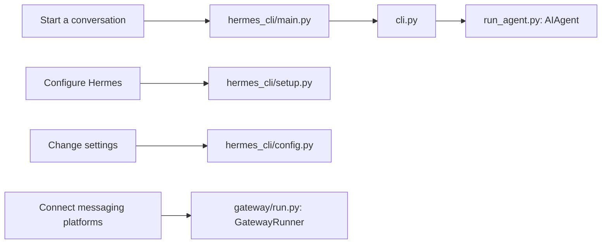
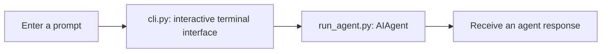

# CLI

Relevant source files

The following files were used as context for generating this wiki page:

- [agent/auxiliary_client.py](agent/auxiliary_client.py)
- [cli-config.yaml.example](cli-config.yaml.example)
- [cli.py](cli.py)
- [gateway/run.py](gateway/run.py)
- [gateway/session.py](gateway/session.py)
- [gateway/slash_commands.py](gateway/slash_commands.py)
- [hermes_cli/cli_commands_mixin.py](hermes_cli/cli_commands_mixin.py)
- [hermes_cli/commands.py](hermes_cli/commands.py)
- [hermes_cli/config.py](hermes_cli/config.py)
- [hermes_cli/config_defaults.py](hermes_cli/config_defaults.py)
- [hermes_cli/main.py](hermes_cli/main.py)
- [hermes_cli/setup.py](hermes_cli/setup.py)
- [hermes_state.py](hermes_state.py)
- [run_agent.py](run_agent.py)
- [tests/agent/test_auxiliary_client.py](tests/agent/test_auxiliary_client.py)
- [tests/gateway/test_session.py](tests/gateway/test_session.py)
- [tests/hermes_cli/test_commands.py](tests/hermes_cli/test_commands.py)
- [ui-tui/src/__tests__/details.test.ts](ui-tui/src/__tests__/details.test.ts)
- [ui-tui/src/domain/details.ts](ui-tui/src/domain/details.ts)
- [website/docs/getting-started/quickstart.md](website/docs/getting-started/quickstart.md)
- [website/docs/integrations/providers.md](website/docs/integrations/providers.md)
- [website/docs/reference/cli-commands.md](website/docs/reference/cli-commands.md)
- [website/docs/reference/environment-variables.md](website/docs/reference/environment-variables.md)
- [website/docs/reference/slash-commands.md](website/docs/reference/slash-commands.md)
- [website/docs/user-guide/cli.md](website/docs/user-guide/cli.md)
- [website/docs/user-guide/configuration.md](website/docs/user-guide/configuration.md)
- [website/docs/user-guide/features/fallback-providers.md](website/docs/user-guide/features/fallback-providers.md)
- [website/docs/user-guide/messaging/index.md](website/docs/user-guide/messaging/index.md)
- [website/docs/user-guide/tui.md](website/docs/user-guide/tui.md)
- [website/i18n/zh-Hans/docusaurus-plugin-content-docs/current/getting-started/quickstart.md](website/i18n/zh-Hans/docusaurus-plugin-content-docs/current/getting-started/quickstart.md)
- [website/i18n/zh-Hans/docusaurus-plugin-content-docs/current/reference/environment-variables.md](website/i18n/zh-Hans/docusaurus-plugin-content-docs/current/reference/environment-variables.md)
- [website/i18n/zh-Hans/docusaurus-plugin-content-docs/current/user-guide/configuration.md](website/i18n/zh-Hans/docusaurus-plugin-content-docs/current/user-guide/configuration.md)
- [website/i18n/zh-Hans/docusaurus-plugin-content-docs/current/user-guide/features/fallback-providers.md](website/i18n/zh-Hans/docusaurus-plugin-content-docs/current/user-guide/features/fallback-providers.md)

This page gives a high-level map of the Hermes Agent command-line interface: its entry point, operating modes, configuration, and command families. Detailed behavior is covered in the child pages.

Sources: [hermes_cli/main.py:1-9](), [cli.py:1-2]()

---

## Entry Point and Command Structure

The `hermes` command is the primary CLI entry point. Running it without a subcommand starts interactive chat; the CLI also exposes command groups such as `chat`, `gateway`, `setup`, `status`, `cron`, `doctor`, and `update`. The `hermes <cmd> --help` form provides command-specific help. [hermes_cli/main.py:1-9]()

The command families cover interactive use, configuration and setup, messaging, session management, and diagnostics. The table below is an orientation, not a complete reference; see [Command Reference](#3.2) for the full command list and usage.

| User goal | Command examples | Further detail |
|---|---|---|
| Start or control a chat | `hermes`, `hermes chat` | [Interactive Chat](#3.1) |
| Configure Hermes or run setup | `hermes setup`, `hermes config` | [Command Reference](#3.2) |
| Run messaging integrations | `hermes gateway` | [Command Reference](#3.2) |
| Inspect or manage sessions | `hermes sessions` | [Command Reference](#3.2) |
| Check system health | `hermes doctor`, `hermes verify` | [Command Reference](#3.2) |
| Open the browser dashboard | `hermes web` | [Web UI Dashboard](#3.4) |

Sources: [hermes_cli/main.py:4-9](), [website/docs/user-guide/configuration.md:34-50](), [gateway/run.py:1-4]()

### From command intent to code entities

This diagram associates common CLI intents with the entry-point and subsystem names present in the codebase. It is a high-level map, not a complete dispatch trace.

Sources: [hermes_cli/main.py:1-9](), [cli.py:1-2](), [run_agent.py:1-6](), [hermes_cli/setup.py:1-6](), [hermes_cli/config.py:1-2](), [gateway/run.py:1-4]()

---

## Operating Modes

The CLI’s default invocation is interactive chat; `hermes chat` is also listed as a command form. The `cli.py` module identifies itself as the interactive terminal interface, while `run_agent.py` defines `AIAgent` as the tool-calling agent runner. [hermes_cli/main.py:4-7](), [cli.py:1-2](), [run_agent.py:1-6]()

Hermes also has alternate terminal and browser interfaces. The CLI imports TUI-related mixins, and the command surface includes `hermes web`; these interfaces have their own child pages. For prompt interaction, slash commands, sessions, and conversation controls, see [Interactive Chat](#3.1). For the alternate terminal frontend, see [TUI (Terminal User Interface)](#3.3); for the browser dashboard, see [Web UI Dashboard](#3.4). [cli.py:45-49](), [hermes_cli/main.py:4-9]()

Sources: [hermes_cli/main.py:4-9](), [cli.py:1-2](), [cli.py:45-49](), [run_agent.py:1-6]()

### From conversation input to the agent

This diagram connects the user-facing chat surface to the core agent entity. It identifies the CLI module and `AIAgent` by their codebase names.

Sources: [cli.py:1-2](), [run_agent.py:1-6]()

---

## Configuration

CLI behavior is shaped by command-line arguments, the user’s configuration files, environment variables, and built-in defaults. The documented precedence is: command-line arguments, `~/.hermes/config.yaml`, `~/.hermes/.env`, then defaults. [website/docs/user-guide/configuration.md:57-68]()

`hermes config` provides commands to view, edit, get, set, unset, check, and migrate configuration. The setup wizard is organized into independently runnable sections, including model and provider, terminal backend, agent settings, messaging platforms, and tools. For details on configuration and setup flows, see [Command Reference](#3.2). [website/docs/user-guide/configuration.md:34-50](), [hermes_cli/setup.py:1-6]()

Sources: [website/docs/user-guide/configuration.md:34-68](), [hermes_cli/setup.py:1-6]()

---

## Child Pages

- [Interactive Chat](#3.1) — Covers the interactive REPL, slash commands, bang-shell mode, session management, and conversation controls.
- [Command Reference](#3.2) — Provides detailed reference for Hermes subcommands, including `chat`, `model`, `gateway`, `setup`, `config`, `skills`, `sessions`, `verify`, and `doctor`.
- [TUI (Terminal User Interface)](#3.3) — Documents the React Ink frontend, `--tui` mode, renderer package, JSON-RPC gateway server, and differences from the default CLI.
- [Web UI Dashboard](#3.4) — Documents `hermes web`, the FastAPI backend, web routers, and the React dashboard.

Sources: [hermes_cli/main.py:4-9](), [cli.py:45-49](), [hermes_cli/setup.py:1-6]()