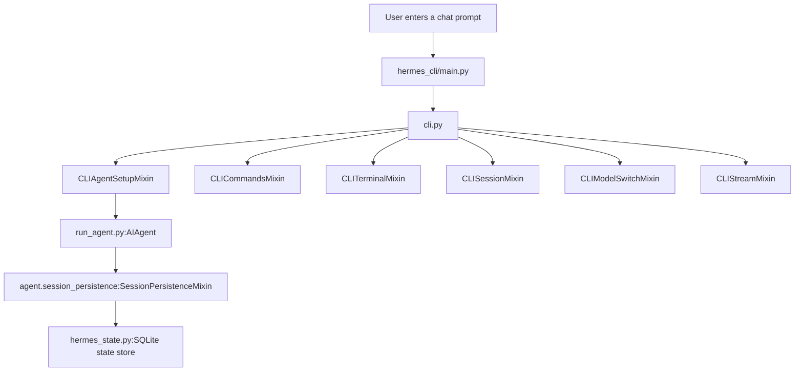
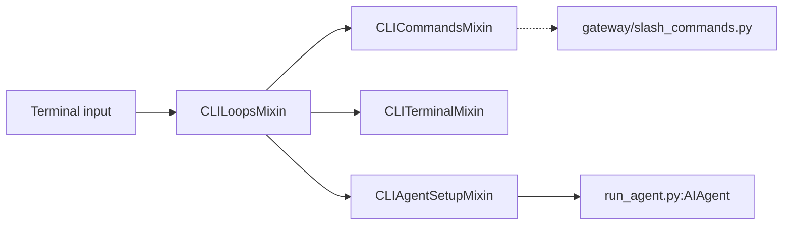
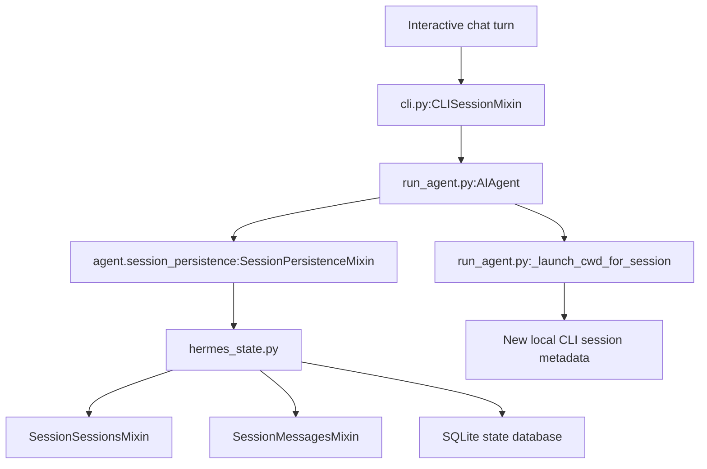

# Interactive Chat

Relevant source files

The following files were used as context for generating this wiki page:

- [agent/auxiliary_client.py](agent/auxiliary_client.py)
- [agent/display.py](agent/display.py)
- [agent/tool_guardrails.py](agent/tool_guardrails.py)
- [agent/tool_result_classification.py](agent/tool_result_classification.py)
- [apps/desktop/electron/fs-ipc.test.ts](apps/desktop/electron/fs-ipc.test.ts)
- [apps/desktop/electron/fs-ipc.ts](apps/desktop/electron/fs-ipc.ts)
- [apps/desktop/src/app/chat/index.test.tsx](apps/desktop/src/app/chat/index.test.tsx)
- [apps/desktop/src/app/right-sidebar/store.ts](apps/desktop/src/app/right-sidebar/store.ts)
- [apps/desktop/src/app/session/hooks/use-hermes-config.test.ts](apps/desktop/src/app/session/hooks/use-hermes-config.test.ts)
- [apps/desktop/src/app/session/hooks/use-hermes-config.ts](apps/desktop/src/app/session/hooks/use-hermes-config.ts)
- [apps/desktop/src/components/assistant-ui/thread/block-direction.test.tsx](apps/desktop/src/components/assistant-ui/thread/block-direction.test.tsx)
- [apps/desktop/src/components/assistant-ui/thread/message-parts.tsx](apps/desktop/src/components/assistant-ui/thread/message-parts.tsx)
- [apps/desktop/src/components/assistant-ui/thread/streaming.test.tsx](apps/desktop/src/components/assistant-ui/thread/streaming.test.tsx)
- [apps/desktop/src/components/assistant-ui/thread/user-edit-composer.tsx](apps/desktop/src/components/assistant-ui/thread/user-edit-composer.tsx)
- [apps/desktop/src/components/assistant-ui/thread/user-message-edit.test.tsx](apps/desktop/src/components/assistant-ui/thread/user-message-edit.test.tsx)
- [apps/desktop/src/components/assistant-ui/tool/fallback-model.test.ts](apps/desktop/src/components/assistant-ui/tool/fallback-model.test.ts)
- [apps/desktop/src/components/assistant-ui/tool/fallback-model/format.ts](apps/desktop/src/components/assistant-ui/tool/fallback-model/format.ts)
- [apps/desktop/src/components/assistant-ui/tool/fallback-model/index.ts](apps/desktop/src/components/assistant-ui/tool/fallback-model/index.ts)
- [apps/desktop/src/components/assistant-ui/tool/fallback-model/types.ts](apps/desktop/src/components/assistant-ui/tool/fallback-model/types.ts)
- [apps/desktop/src/components/assistant-ui/tool/fallback.test.ts](apps/desktop/src/components/assistant-ui/tool/fallback.test.ts)
- [apps/desktop/src/components/assistant-ui/tool/fallback.tsx](apps/desktop/src/components/assistant-ui/tool/fallback.tsx)
- [apps/desktop/src/components/assistant-ui/tool/hide-code-diffs.test.tsx](apps/desktop/src/components/assistant-ui/tool/hide-code-diffs.test.tsx)
- [apps/desktop/src/components/assistant-ui/tool/run-summary.test.ts](apps/desktop/src/components/assistant-ui/tool/run-summary.test.ts)
- [apps/desktop/src/components/assistant-ui/tool/run-summary.ts](apps/desktop/src/components/assistant-ui/tool/run-summary.ts)
- [apps/desktop/src/components/assistant-ui/tool/tool-group.test.tsx](apps/desktop/src/components/assistant-ui/tool/tool-group.test.tsx)
- [apps/desktop/src/lib/incremental-external-store-runtime.test.ts](apps/desktop/src/lib/incremental-external-store-runtime.test.ts)
- [apps/desktop/src/lib/incremental-external-store-runtime.ts](apps/desktop/src/lib/incremental-external-store-runtime.ts)
- [apps/desktop/src/lib/incremental-runtime-adapter-notify.test.ts](apps/desktop/src/lib/incremental-runtime-adapter-notify.test.ts)
- [apps/desktop/src/lib/tool-render-class.ts](apps/desktop/src/lib/tool-render-class.ts)
- [apps/desktop/src/lib/tool-run-continuity.test.ts](apps/desktop/src/lib/tool-run-continuity.test.ts)
- [apps/desktop/src/store/profile-rail-prefs.ts](apps/desktop/src/store/profile-rail-prefs.ts)
- [apps/desktop/src/store/reasoning-disclosure.test.ts](apps/desktop/src/store/reasoning-disclosure.test.ts)
- [apps/desktop/src/store/reasoning-disclosure.ts](apps/desktop/src/store/reasoning-disclosure.ts)
- [apps/desktop/src/store/tool-view.ts](apps/desktop/src/store/tool-view.ts)
- [cli-config.yaml.example](cli-config.yaml.example)
- [cli.py](cli.py)
- [contributors/emails/coffee@coffeebot.dev](contributors/emails/coffee@coffeebot.dev)
- [evals/desktop_bug_campaign/persistence_live.py](evals/desktop_bug_campaign/persistence_live.py)
- [evals/desktop_bug_campaign/rebuild_observer.py](evals/desktop_bug_campaign/rebuild_observer.py)
- [gateway/run.py](gateway/run.py)
- [gateway/session.py](gateway/session.py)
- [gateway/slash_commands.py](gateway/slash_commands.py)
- [hermes_cli/bundles.py](hermes_cli/bundles.py)
- [hermes_cli/cli_agent_setup_mixin.py](hermes_cli/cli_agent_setup_mixin.py)
- [hermes_cli/cli_chat_turn_mixin.py](hermes_cli/cli_chat_turn_mixin.py)
- [hermes_cli/cli_commands_mixin.py](hermes_cli/cli_commands_mixin.py)
- [hermes_cli/cli_init_mixin.py](hermes_cli/cli_init_mixin.py)
- [hermes_cli/cli_model_switch_mixin.py](hermes_cli/cli_model_switch_mixin.py)
- [hermes_cli/cli_modern_layout.py](hermes_cli/cli_modern_layout.py)
- [hermes_cli/cli_process_notifications.py](hermes_cli/cli_process_notifications.py)
- [hermes_cli/cli_stream_mixin.py](hermes_cli/cli_stream_mixin.py)
- [hermes_cli/cli_tui_runtime_mixin.py](hermes_cli/cli_tui_runtime_mixin.py)
- [hermes_cli/cli_voice_mixin.py](hermes_cli/cli_voice_mixin.py)
- [hermes_cli/commands.py](hermes_cli/commands.py)
- [hermes_cli/config.py](hermes_cli/config.py)
- [hermes_cli/config_defaults.py](hermes_cli/config_defaults.py)
- [hermes_cli/gateway_agent.py](hermes_cli/gateway_agent.py)
- [hermes_cli/gateway_connection.py](hermes_cli/gateway_connection.py)
- [hermes_cli/gateway_queue.py](hermes_cli/gateway_queue.py)
- [hermes_cli/gateway_session_store.py](hermes_cli/gateway_session_store.py)
- [hermes_cli/gateway_side.py](hermes_cli/gateway_side.py)
- [hermes_cli/gateway_tools_notify.py](hermes_cli/gateway_tools_notify.py)
- [hermes_cli/main.py](hermes_cli/main.py)
- [hermes_cli/setup.py](hermes_cli/setup.py)
- [hermes_state.py](hermes_state.py)
- [run_agent.py](run_agent.py)
- [tests/agent/test_auxiliary_client.py](tests/agent/test_auxiliary_client.py)
- [tests/agent/test_display.py](tests/agent/test_display.py)
- [tests/agent/test_display_tool_failure.py](tests/agent/test_display_tool_failure.py)
- [tests/agent/test_tool_guardrails.py](tests/agent/test_tool_guardrails.py)
- [tests/agent/test_tool_result_classification.py](tests/agent/test_tool_result_classification.py)
- [tests/gateway/test_discord_format.py](tests/gateway/test_discord_format.py)
- [tests/gateway/test_session.py](tests/gateway/test_session.py)
- [tests/hermes_cli/test_branch_command.py](tests/hermes_cli/test_branch_command.py)
- [tests/hermes_cli/test_cli_clarify_batch.py](tests/hermes_cli/test_cli_clarify_batch.py)
- [tests/hermes_cli/test_cli_first_run_setup.py](tests/hermes_cli/test_cli_first_run_setup.py)
- [tests/hermes_cli/test_cli_gateway_model_scope.py](tests/hermes_cli/test_cli_gateway_model_scope.py)
- [tests/hermes_cli/test_cli_modern_layout.py](tests/hermes_cli/test_cli_modern_layout.py)
- [tests/hermes_cli/test_cli_provider_resolution.py](tests/hermes_cli/test_cli_provider_resolution.py)
- [tests/hermes_cli/test_cli_queue_gateway_fifo.py](tests/hermes_cli/test_cli_queue_gateway_fifo.py)
- [tests/hermes_cli/test_cli_sessions_behind_newer_surfaces.py](tests/hermes_cli/test_cli_sessions_behind_newer_surfaces.py)
- [tests/hermes_cli/test_commands.py](tests/hermes_cli/test_commands.py)
- [tests/hermes_cli/test_gateway_agent.py](tests/hermes_cli/test_gateway_agent.py)
- [tests/hermes_cli/test_gateway_agent_replay_gap.py](tests/hermes_cli/test_gateway_agent_replay_gap.py)
- [tests/hermes_cli/test_gateway_connection_reconnect.py](tests/hermes_cli/test_gateway_connection_reconnect.py)
- [tests/hermes_cli/test_gateway_resume_launch_key.py](tests/hermes_cli/test_gateway_resume_launch_key.py)
- [tests/hermes_cli/test_gateway_session_store.py](tests/hermes_cli/test_gateway_session_store.py)
- [tests/hermes_cli/test_gateway_side.py](tests/hermes_cli/test_gateway_side.py)
- [tests/hermes_cli/test_gateway_tools_notify.py](tests/hermes_cli/test_gateway_tools_notify.py)
- [tests/hermes_cli/test_process_notification_display.py](tests/hermes_cli/test_process_notification_display.py)
- [tests/hermes_cli/test_resume_compressed_gateway_id.py](tests/hermes_cli/test_resume_compressed_gateway_id.py)
- [tests/hermes_cli/test_resume_model_restore.py](tests/hermes_cli/test_resume_model_restore.py)
- [tests/hermes_cli/test_single_query_exit_contract.py](tests/hermes_cli/test_single_query_exit_contract.py)
- [tests/hermes_cli/test_status_lines_held_during_stream_box.py](tests/hermes_cli/test_status_lines_held_during_stream_box.py)
- [tests/hermes_cli/test_stream_delta_think_tag.py](tests/hermes_cli/test_stream_delta_think_tag.py)
- [tests/hermes_state/test_named_profile_session_db.py](tests/hermes_state/test_named_profile_session_db.py)
- [tests/tui_gateway/test_branch_system_prompt.py](tests/tui_gateway/test_branch_system_prompt.py)
- [tests/tui_gateway/test_default_profile_session_name.py](tests/tui_gateway/test_default_profile_session_name.py)
- [tests/tui_gateway/test_heartbeat_wakes.py](tests/tui_gateway/test_heartbeat_wakes.py)
- [tests/tui_gateway/test_local_model_session_identity.py](tests/tui_gateway/test_local_model_session_identity.py)
- [tests/tui_gateway/test_profile_rebuild_commit.py](tests/tui_gateway/test_profile_rebuild_commit.py)
- [tests/tui_gateway/test_profile_target_unavailable.py](tests/tui_gateway/test_profile_target_unavailable.py)
- [tests/tui_gateway/test_secondary_profile_model_and_key.py](tests/tui_gateway/test_secondary_profile_model_and_key.py)
- [tests/tui_gateway/test_secret_capture_session.py](tests/tui_gateway/test_secret_capture_session.py)
- [tests/tui_gateway/test_show_reasoning_display_gate.py](tests/tui_gateway/test_show_reasoning_display_gate.py)
- [tui_gateway/agent_callbacks.py](tui_gateway/agent_callbacks.py)
- [tui_gateway/session_history.py](tui_gateway/session_history.py)
- [tui_gateway/tool_progress.py](tui_gateway/tool_progress.py)
- [ui-tui/src/__tests__/details.test.ts](ui-tui/src/__tests__/details.test.ts)
- [ui-tui/src/domain/details.ts](ui-tui/src/domain/details.ts)
- [website/docs/getting-started/quickstart.md](website/docs/getting-started/quickstart.md)
- [website/docs/integrations/providers.md](website/docs/integrations/providers.md)
- [website/docs/reference/cli-commands.md](website/docs/reference/cli-commands.md)
- [website/docs/reference/environment-variables.md](website/docs/reference/environment-variables.md)
- [website/docs/reference/slash-commands.md](website/docs/reference/slash-commands.md)
- [website/docs/user-guide/cli.md](website/docs/user-guide/cli.md)
- [website/docs/user-guide/configuration.md](website/docs/user-guide/configuration.md)
- [website/docs/user-guide/features/fallback-providers.md](website/docs/user-guide/features/fallback-providers.md)
- [website/docs/user-guide/messaging/index.md](website/docs/user-guide/messaging/index.md)
- [website/docs/user-guide/tui.md](website/docs/user-guide/tui.md)
- [website/i18n/zh-Hans/docusaurus-plugin-content-docs/current/getting-started/quickstart.md](website/i18n/zh-Hans/docusaurus-plugin-content-docs/current/getting-started/quickstart.md)
- [website/i18n/zh-Hans/docusaurus-plugin-content-docs/current/reference/environment-variables.md](website/i18n/zh-Hans/docusaurus-plugin-content-docs/current/reference/environment-variables.md)
- [website/i18n/zh-Hans/docusaurus-plugin-content-docs/current/user-guide/configuration.md](website/i18n/zh-Hans/docusaurus-plugin-content-docs/current/user-guide/configuration.md)
- [website/i18n/zh-Hans/docusaurus-plugin-content-docs/current/user-guide/features/fallback-providers.md](website/i18n/zh-Hans/docusaurus-plugin-content-docs/current/user-guide/features/fallback-providers.md)

## Purpose and Scope

This page describes the interactive terminal chat entry point, the CLI components that support it, and how a conversation is connected to `AIAgent` and persistent session state. It also identifies the code locations for slash-command handling and terminal execution; the available source excerpts establish those module boundaries but do not show the handlers’ full behavior. [hermes_cli/main.py:1-9](), [cli.py:34-49](), [run_agent.py:1-7](), [hermes_state.py:1-5]()

Sources: [hermes_cli/main.py:1-9](), [cli.py:34-49](), [run_agent.py:1-7](), [hermes_state.py:1-5]()

## Interactive Entry Point and Component Boundaries

Running `hermes` with no subcommand starts interactive chat by default. The CLI entry-point module describes `hermes chat` as a supported command, and its imported CLI mixins separate agent setup, command handling, terminal handling, session handling, model switching, streaming, and initialization into distinct components. [hermes_cli/main.py:1-9](), [cli.py:34-49]()

`AIAgent` is the agent runner used to process conversations. Its module documentation identifies conversation-loop, tool-execution, and session-lifecycle responsibilities; the CLI and agent are therefore distinct layers, with `cli.py` providing terminal-facing composition and `run_agent.py` providing the agent implementation. [run_agent.py:1-7](), [cli.py:34-49]()

### Diagram: Interactive Chat Components — Natural Language to Code Entity Space

Sources: [hermes_cli/main.py:1-9](), [cli.py:34-49](), [run_agent.py:1-7](), [run_agent.py:103-121](), [hermes_state.py:1-5]()

### CLI Responsibilities by Module

| Concern | Code entity | What the available source establishes |
|---|---|---|
| Command-line entry point | `hermes_cli/main.py` | Documents interactive chat as the default invocation. [hermes_cli/main.py:1-9]() |
| CLI composition | `cli.py` | Imports the CLI mixins that divide setup, command, terminal, session, model-switching, streaming, and initialization responsibilities. [cli.py:34-49]() |
| Agent orchestration | `run_agent.py:AIAgent` | Describes the agent runner as responsible for the conversation loop, tool execution, and session lifecycle. [run_agent.py:1-7]() |
| Session persistence | `agent.session_persistence:SessionPersistenceMixin` | Imported as an `AIAgent` mixin. [run_agent.py:109-121]() |
| Durable state | `hermes_state.py` | Describes a SQLite state store for session metadata, message history, and search. [hermes_state.py:1-5]() |

Sources: [hermes_cli/main.py:1-9](), [cli.py:34-49](), [run_agent.py:1-7](), [run_agent.py:109-121](), [hermes_state.py:1-5]()

## Input Routing: Chat, Slash Commands, and Bang-Shell

The CLI composition imports `CLICommandsMixin` and `CLITerminalMixin`, along with `CLILoopsMixin` and `CLISessionMixin`. These imports identify the implementation seams for command handling, terminal behavior, the CLI loop, and session operations. The provided source excerpt does not include their method bodies, so command parsing rules, individual command effects, and shell-execution details are not specified here. [cli.py:34-49]()

The project also contains `gateway/slash_commands.py`, a separate module for gateway slash-command handling. Its existence should not be confused with the terminal CLI command mixin: the available CLI excerpt imports `CLICommandsMixin`, while the gateway implementation is named separately. [cli.py:34-49]()

### Diagram: Input Handling Code Map — Natural Language to Code Entity Space

Sources: [cli.py:34-49](), [run_agent.py:1-7]()

### Slash Commands

The CLI imports `CLICommandsMixin` from `hermes_cli.cli_commands_mixin`; this is the code location identified by the available excerpt for CLI command handling. The separate `gateway/slash_commands.py` module is named in the provided file list, but its contents and line numbers are not available here. Accordingly, this page does not assert a command list, aliases, argument syntax, or handler behavior. [cli.py:34-49]()

Sources: [cli.py:34-49]()

### Bang-Shell Mode

The CLI imports `CLITerminalMixin` from `hermes_cli.cli_terminal_mixin`, identifying the terminal-facing component to consult for shell-related behavior. The available source does not show that mixin’s implementation, so this page does not specify the bang prefix, subprocess execution details, output handling, or lifecycle behavior. [cli.py:34-49]()

Sources: [cli.py:34-49]()

## Session Management and Persistence

The SQLite state store is described as holding session metadata and message history, with sessions tagged by source such as `cli` or messaging platforms. `hermes_state.py` imports session-related mixins, including `SessionSessionsMixin` and `SessionMessagesMixin`, and documents WAL mode as its database strategy. [hermes_state.py:1-5](), [hermes_state.py:48-55](), [hermes_state.py:69-83]()

`AIAgent` imports `SessionPersistenceMixin`, and its module-level helper `_launch_cwd_for_session` documents that local CLI sessions can record the launch working directory on a new session row. The helper returns no directory for non-CLI sources or non-local terminal environments, and tolerates an unavailable current working directory. [run_agent.py:39-54](), [run_agent.py:109-121]()

The state store provides configurable transcript limits for resuming and exporting sessions. `resolved_max_resume_messages()` and `resolved_max_export_messages()` read their respective settings from the `sessions` configuration section and use a default limit when the setting is absent or cannot be read. [hermes_state.py:92-113]()

### Diagram: Session Data Flow — Natural Language to Code Entity Space

Sources: [cli.py:34-49](), [run_agent.py:39-54](), [run_agent.py:109-121](), [hermes_state.py:1-5](), [hermes_state.py:48-55](), [hermes_state.py:69-83]()

## Configuration Relevant to Interactive Chat

The documented configuration precedence is: CLI arguments, `~/.hermes/config.yaml`, `~/.hermes/.env`, then built-in defaults. CLI arguments provide per-invocation overrides; the YAML file is the primary source for non-secret settings, while `.env` is required for secrets such as API keys and tokens. [website/docs/user-guide/configuration.md:57-67]()

`run_agent.py` loads Hermes environment variables during module initialization and logs whether environment files were found. The CLI also imports `load_cli_config` from `hermes_cli.cli_config_load`, establishing a dedicated configuration-loading component for the terminal interface. [run_agent.py:91-100](), [cli.py:144-157]()

Sources: [website/docs/user-guide/configuration.md:57-67](), [run_agent.py:91-100](), [cli.py:144-157]()

## Conversation Controls

The CLI composition imports `CLIModelSwitchMixin`, `CLIStreamMixin`, and `CLISessionMixin`, identifying separate implementation locations for model switching, streaming, and session operations. The provided excerpts do not include their handlers, so the precise commands, persistence semantics, or user-visible status behavior are not detailed here. [cli.py:34-49]()

The agent module imports `InterruptControlMixin`, `StreamDeliveryMixin`, `SessionPersistenceMixin`, and `TurnFacadeMixin`. These imports identify the agent-side components for interruption, streamed delivery, persistence, and turn orchestration; they do not, by themselves, establish the exact terminal keybinding or interruption lifecycle. [run_agent.py:103-123]()

Sources: [cli.py:34-49](), [run_agent.py:103-123]()

## Implementation Map

| Interactive concern | Primary code location |
|---|---|
| Default interactive invocation | `hermes_cli/main.py` [hermes_cli/main.py:1-9]() |
| CLI mixin composition | `cli.py` [cli.py:34-49]() |
| CLI configuration loading | `hermes_cli.cli_config_load` [cli.py:144-157]() |
| Agent runner | `run_agent.py:AIAgent` [run_agent.py:1-7]() |
| Agent interruption and stream delivery | `InterruptControlMixin`, `StreamDeliveryMixin` [run_agent.py:109-123]() |
| Agent session persistence | `SessionPersistenceMixin` [run_agent.py:117-121]() |
| Session source and local CLI working directory | `_launch_cwd_for_session` [run_agent.py:39-54]() |
| SQLite session and message state | `hermes_state.py`, `SessionSessionsMixin`, `SessionMessagesMixin` [hermes_state.py:1-5](), [hermes_state.py:48-55](), [hermes_state.py:69-83]() |
| Resume and export message limits | `resolved_max_resume_messages()`, `resolved_max_export_messages()` [hermes_state.py:92-113]() |

Sources: [hermes_cli/main.py:1-9](), [cli.py:34-49](), [cli.py:144-157](), [run_agent.py:1-7](), [run_agent.py:39-54](), [run_agent.py:103-123](), [hermes_state.py:1-5](), [hermes_state.py:48-55](), [hermes_state.py:69-83](), [hermes_state.py:92-113]()