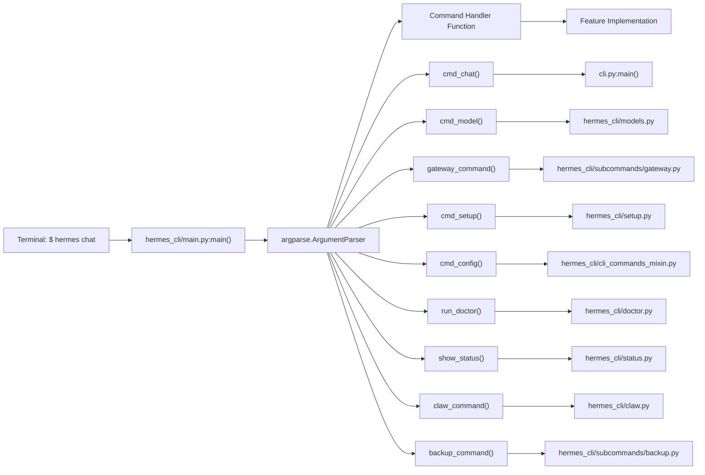
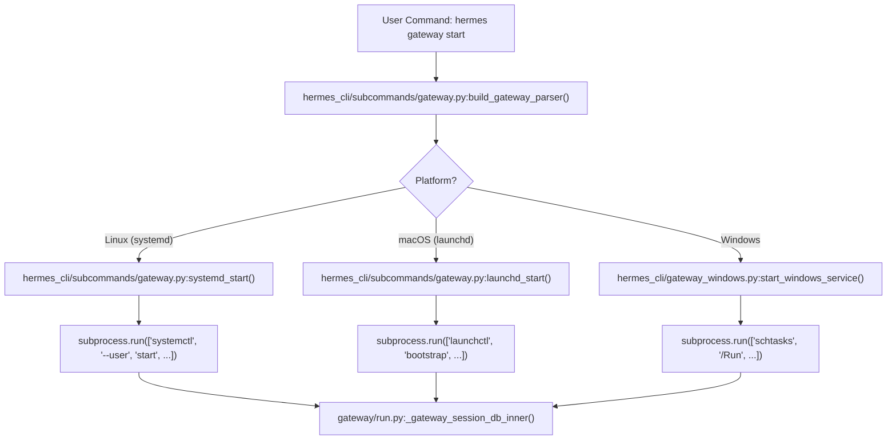

# Command Reference

Relevant source files

The following files were used as context for generating this wiki page:

- [agent/auxiliary_client.py](agent/auxiliary_client.py)
- [cli-config.yaml.example](cli-config.yaml.example)
- [cli.py](cli.py)
- [cron/job_definition.py](cron/job_definition.py)
- [gateway/run.py](gateway/run.py)
- [gateway/run_active_work_verb.py](gateway/run_active_work_verb.py)
- [gateway/session.py](gateway/session.py)
- [gateway/slash_commands.py](gateway/slash_commands.py)
- [gateway/status.py](gateway/status.py)
- [hermes_cli/cli_commands_mixin.py](hermes_cli/cli_commands_mixin.py)
- [hermes_cli/commands.py](hermes_cli/commands.py)
- [hermes_cli/config.py](hermes_cli/config.py)
- [hermes_cli/config_defaults.py](hermes_cli/config_defaults.py)
- [hermes_cli/gateway.py](hermes_cli/gateway.py)
- [hermes_cli/gateway_lifecycle_guards.py](hermes_cli/gateway_lifecycle_guards.py)
- [hermes_cli/gateway_profile_lifecycle.py](hermes_cli/gateway_profile_lifecycle.py)
- [hermes_cli/kanban_decompose.py](hermes_cli/kanban_decompose.py)
- [hermes_cli/kanban_specify.py](hermes_cli/kanban_specify.py)
- [hermes_cli/main.py](hermes_cli/main.py)
- [hermes_cli/profile_cmd.py](hermes_cli/profile_cmd.py)
- [hermes_cli/profile_describer.py](hermes_cli/profile_describer.py)
- [hermes_cli/profile_distribution.py](hermes_cli/profile_distribution.py)
- [hermes_cli/profiles.py](hermes_cli/profiles.py)
- [hermes_cli/setup.py](hermes_cli/setup.py)
- [hermes_cli/subcommands/gateway.py](hermes_cli/subcommands/gateway.py)
- [hermes_cli/subcommands/profile.py](hermes_cli/subcommands/profile.py)
- [hermes_cli/xai_retirement.py](hermes_cli/xai_retirement.py)
- [hermes_state.py](hermes_state.py)
- [run_agent.py](run_agent.py)
- [tests/agent/test_auxiliary_client.py](tests/agent/test_auxiliary_client.py)
- [tests/gateway/fixtures/lifecycle_persistence_worker.py](tests/gateway/fixtures/lifecycle_persistence_worker.py)
- [tests/gateway/test_managed_worker_images.py](tests/gateway/test_managed_worker_images.py)
- [tests/gateway/test_multiplex_hot_serve_live.py](tests/gateway/test_multiplex_hot_serve_live.py)
- [tests/gateway/test_mutation_prepare_off_loop.py](tests/gateway/test_mutation_prepare_off_loop.py)
- [tests/gateway/test_retire_settles_waiters.py](tests/gateway/test_retire_settles_waiters.py)
- [tests/gateway/test_session.py](tests/gateway/test_session.py)
- [tests/gateway/test_status.py](tests/gateway/test_status.py)
- [tests/gateway/test_terminal_commit_crash.py](tests/gateway/test_terminal_commit_crash.py)
- [tests/gateway/test_worker_lifecycle_execution.py](tests/gateway/test_worker_lifecycle_execution.py)
- [tests/hermes_cli/test_commands.py](tests/hermes_cli/test_commands.py)
- [tests/hermes_cli/test_gateway.py](tests/hermes_cli/test_gateway.py)
- [tests/hermes_cli/test_gateway_external_supervisor.py](tests/hermes_cli/test_gateway_external_supervisor.py)
- [tests/hermes_cli/test_gateway_foreign_xdg_runtime.py](tests/hermes_cli/test_gateway_foreign_xdg_runtime.py)
- [tests/hermes_cli/test_gateway_host_stop_refusal.py](tests/hermes_cli/test_gateway_host_stop_refusal.py)
- [tests/hermes_cli/test_gateway_lifecycle_guards.py](tests/hermes_cli/test_gateway_lifecycle_guards.py)
- [tests/hermes_cli/test_gateway_linger.py](tests/hermes_cli/test_gateway_linger.py)
- [tests/hermes_cli/test_gateway_multiplex_lifecycle.py](tests/hermes_cli/test_gateway_multiplex_lifecycle.py)
- [tests/hermes_cli/test_gateway_scan_home_identity.py](tests/hermes_cli/test_gateway_scan_home_identity.py)
- [tests/hermes_cli/test_gateway_service.py](tests/hermes_cli/test_gateway_service.py)
- [tests/hermes_cli/test_kanban_aux_affinity.py](tests/hermes_cli/test_kanban_aux_affinity.py)
- [tests/hermes_cli/test_kanban_decompose.py](tests/hermes_cli/test_kanban_decompose.py)
- [tests/hermes_cli/test_kanban_decompose_db.py](tests/hermes_cli/test_kanban_decompose_db.py)
- [tests/hermes_cli/test_kanban_specify.py](tests/hermes_cli/test_kanban_specify.py)
- [tests/hermes_cli/test_kanban_specify_db.py](tests/hermes_cli/test_kanban_specify_db.py)
- [tests/hermes_cli/test_kanban_worktree_isolation.py](tests/hermes_cli/test_kanban_worktree_isolation.py)
- [tests/hermes_cli/test_migrate_xai.py](tests/hermes_cli/test_migrate_xai.py)
- [tests/hermes_cli/test_profile_alias_orphan_removal.py](tests/hermes_cli/test_profile_alias_orphan_removal.py)
- [tests/hermes_cli/test_profile_describer.py](tests/hermes_cli/test_profile_describer.py)
- [tests/hermes_cli/test_profile_distribution.py](tests/hermes_cli/test_profile_distribution.py)
- [tests/hermes_cli/test_profile_export_credentials.py](tests/hermes_cli/test_profile_export_credentials.py)
- [tests/hermes_cli/test_profile_export_special_files.py](tests/hermes_cli/test_profile_export_special_files.py)
- [tests/hermes_cli/test_profile_rename_service.py](tests/hermes_cli/test_profile_rename_service.py)
- [tests/hermes_cli/test_profiles.py](tests/hermes_cli/test_profiles.py)
- [tests/hermes_cli/test_subcommands_profile_gateway.py](tests/hermes_cli/test_subcommands_profile_gateway.py)
- [tests/hermes_cli/test_uninstall_shell_configs.py](tests/hermes_cli/test_uninstall_shell_configs.py)
- [tests/hermes_cli/test_web_profile_soul_writes.py](tests/hermes_cli/test_web_profile_soul_writes.py)
- [tests/hermes_cli/test_web_profiles_off_loop.py](tests/hermes_cli/test_web_profiles_off_loop.py)
- [tests/hermes_cli/test_xai_retirement.py](tests/hermes_cli/test_xai_retirement.py)
- [tests/test_session_daemon_reaper.py](tests/test_session_daemon_reaper.py)
- [ui-tui/src/__tests__/details.test.ts](ui-tui/src/__tests__/details.test.ts)
- [ui-tui/src/domain/details.ts](ui-tui/src/domain/details.ts)
- [website/docs/getting-started/quickstart.md](website/docs/getting-started/quickstart.md)
- [website/docs/integrations/providers.md](website/docs/integrations/providers.md)
- [website/docs/reference/cli-commands.md](website/docs/reference/cli-commands.md)
- [website/docs/reference/environment-variables.md](website/docs/reference/environment-variables.md)
- [website/docs/reference/profile-commands.md](website/docs/reference/profile-commands.md)
- [website/docs/reference/slash-commands.md](website/docs/reference/slash-commands.md)
- [website/docs/user-guide/cli.md](website/docs/user-guide/cli.md)
- [website/docs/user-guide/configuration.md](website/docs/user-guide/configuration.md)
- [website/docs/user-guide/features/fallback-providers.md](website/docs/user-guide/features/fallback-providers.md)
- [website/docs/user-guide/messaging/index.md](website/docs/user-guide/messaging/index.md)
- [website/docs/user-guide/profile-distributions.md](website/docs/user-guide/profile-distributions.md)
- [website/docs/user-guide/profiles.md](website/docs/user-guide/profiles.md)
- [website/docs/user-guide/tui.md](website/docs/user-guide/tui.md)
- [website/i18n/zh-Hans/docusaurus-plugin-content-docs/current/getting-started/quickstart.md](website/i18n/zh-Hans/docusaurus-plugin-content-docs/current/getting-started/quickstart.md)
- [website/i18n/zh-Hans/docusaurus-plugin-content-docs/current/reference/environment-variables.md](website/i18n/zh-Hans/docusaurus-plugin-content-docs/current/reference/environment-variables.md)
- [website/i18n/zh-Hans/docusaurus-plugin-content-docs/current/reference/profile-commands.md](website/i18n/zh-Hans/docusaurus-plugin-content-docs/current/reference/profile-commands.md)
- [website/i18n/zh-Hans/docusaurus-plugin-content-docs/current/user-guide/configuration.md](website/i18n/zh-Hans/docusaurus-plugin-content-docs/current/user-guide/configuration.md)
- [website/i18n/zh-Hans/docusaurus-plugin-content-docs/current/user-guide/features/fallback-providers.md](website/i18n/zh-Hans/docusaurus-plugin-content-docs/current/user-guide/features/fallback-providers.md)
- [website/i18n/zh-Hans/docusaurus-plugin-content-docs/current/user-guide/profile-distributions.md](website/i18n/zh-Hans/docusaurus-plugin-content-docs/current/user-guide/profile-distributions.md)
- [website/i18n/zh-Hans/docusaurus-plugin-content-docs/current/user-guide/profiles.md](website/i18n/zh-Hans/docusaurus-plugin-content-docs/current/user-guide/profiles.md)

This page provides a comprehensive technical reference for all `hermes` terminal subcommands. It details how the command-line interface (CLI) parses arguments, dispatches to underlying subsystems, and handles runtime lifecycle management.

**Scope:** Covers all top-level `hermes` subcommands (e.g., `chat`, `model`, `gateway`, `setup`, `config`, `skills`, `sessions`, `status`, `debug`, `verify`, `doctor`, `honcho`, `update`, `uninstall`, `acp`, `claw`, `backup`). For interactive REPL slash commands (like `/help`, `/model`, `/tools`), see [Interactive Chat (3.1)]().

---

## Command Entry Point and Dispatch Architecture

All Hermes terminal commands are invoked through the `hermes` executable, which functions as a console script mapping directly to `hermes_cli.main:main()` [hermes_cli/main.py:1-9]().

At process startup, before argument parsing, the entrypoint establishes profile isolation by inspecting global flags (such as `-p` or `--profile`) and setting the `HERMES_HOME` environment variable to the active profile's directory [hermes_cli/main.py:50-52](). It also initiates early dependency recovery handlers if an interrupted installation marker is detected [hermes_cli/main.py:26-29](). Subcommand routing is managed via `argparse.ArgumentParser` sub-parsers, which map CLI strings to dedicated command handlers.

### CLI Dispatch: Natural Language to Code Mapping

Sources: `hermes_cli/main.py:1-9`, `hermes_cli/main.py:26-29`, `hermes_cli/main.py:50-52`, `hermes_cli/setup.py:1-173`, `hermes_cli/config.py:1-145`, `hermes_cli/subcommands/gateway.py:1-218`, `hermes_cli/claw.py:1-145`, `hermes_cli/subcommands/backup.py:1-30`, `hermes_cli/cli_commands_mixin.py`

---

## Command Hierarchy

The CLI supports structured, nested subcommands using Python `argparse` subparsers. This hierarchy reflects the modular division of concerns across the Hermes codebase.

### Command Structure Tree

```mermaid
graph TB
  hermes["hermes_cli/main.py"]

  hermes --> chat["chat"]
  hermes --> model["model"]
  hermes --> gateway["gateway"]
  hermes --> setup["setup"]
  hermes --> auth["auth"]
  hermes --> status["status"]
  hermes --> cron["cron"]
  hermes --> honcho["honcho"]
  hermes --> doctor["doctor"]
  hermes --> config["config"]
  hermes --> sessions["sessions"]
  hermes --> skills["skills"]
  hermes --> verify["verify"]
  hermes --> acp["acp"]
  hermes --> update["update"]
  hermes --> uninstall["uninstall"]
  hermes --> debug["debug"]
  hermes --> claw["claw"]
  hermes --> backup["backup"]

  gateway --> gw_start["start"]
  gateway --> gw_stop["stop"]
  gateway --> gw_status["status"]
  gateway --> gw_install["install"]

  honcho --> honcho_setup["setup"]
  honcho --> honcho_status["status"]
  honcho --> honcho_mode["mode"]
  honcho --> honcho_tokens["tokens"]

  config --> config_edit["edit"]
  config --> config_get["get"]
  config --> config_set["set"]
  config --> config_wizard["wizard"]

  sessions --> sessions_browse["browse"]
  sessions --> sessions_recover["recover"]
  sessions --> sessions_repair["repair"]

  cron --> cron_list["list"]
  cron --> cron_create["create"]
  cron --> cron_edit["edit"]
  cron --> cron_run["run"]
  cron --> cron_pause["pause"]
  cron --> cron_resume["resume"]
  cron --> cron_delete["delete"]

  claw --> claw_migrate["migrate"]
  claw --> claw_cleanup["cleanup"]

  backup --> backup_create["create"]
  backup --> backup_import["import"]
```

Sources: `hermes_cli/main.py:5-9`, `hermes_cli/setup.py:4-173`, `hermes_cli/config.py:1-145`, `hermes_state.py:1-151`, `hermes_cli/claw.py:1-145`, `hermes_cli/subcommands/backup.py:1-30`, `hermes_cli/cli_commands_mixin.py`

---

## Subcommand Reference

### `hermes chat`

Starts an interactive conversational REPL session or executes one-shot queries.

-   **Usage:** `hermes chat [options] [PROMPT]`
-   **Implementation Detail:** Delegates execution directly to `cli.py:main()`, which provides the main loop using `prompt_toolkit` for efficient input handling, styled prompts, and advanced keybindings [cli.py:1-78]().
-   **Features:**
    -   Interactive REPL with token streaming.
    -   Session resume and management via `-c` / `--continue`.
    -   Supports the `--tui` flag for the Ink-based terminal UI.
-   **Overrides and Environment:** Reads and respects environment variables and config settings such as model selection and active profiles.

Sources: `cli.py:1-78`, `hermes_cli/main.py:5-9`

---

### `hermes model`

Manages model selection, aliases, and catalog queries.

-   **Usage:** `hermes model [list|switch|alias]`
-   **Implementation Detail:** Maintains an offline model catalog fallback system for when network endpoints like OpenRouter or Vercel AI Gateway are unreachable. Performs validation and stamp requests with custom User-Agent headers to confirm model availability [agent/auxiliary_client.py:1-169](). The `_model_flow_named_custom` function ensures that the model selection menu is always shown for custom providers, allowing users to switch models even if one is already saved [tests/agent/test_auxiliary_client.py]().
-   **Model Configuration:** The `model:` schema in `config.yaml` can be an empty string (meaning "not configured yet") or a mapping with `provider`, `default`, `base_url`, and `api_mode` sub-keys [cli-config.yaml.example:72-108]().
-   **Mid-session Switches:** Switching models mid-session can incur a re-read cost due to prompt cache invalidation. Hermes prompts for explicit confirmation if the session context exceeds a configurable token limit (`model.switch_context_confirm_tokens`) [website/docs/user-guide/configuration.md]().
-   **Data Training Tiers:** Models with a `-contributor` suffix may train on prompts. Unattended workloads require `security.allow_data_training_tiers_noninteractive` to be set to `true` to proceed without interactive confirmation [website/docs/user-guide/configuration.md]().

Sources: `agent/auxiliary_client.py:1-169`, `cli.py:130-170`, `tests/agent/test_auxiliary_client.py`, `cli-config.yaml.example:72-108`, `website/docs/user-guide/configuration.md`

---

### `hermes gateway`

Manages messaging platform adapters and lifecycle control (Telegram, Discord, Slack, WhatsApp, Matrix, etc.).

-   **Usage:** `hermes gateway [run|start|stop|restart|status|install|uninstall|setup]`
-   **Implementation:**
    -   Managed in `hermes_cli/subcommands/gateway.py` with runtime status tracking via `gateway/status.py`.
    -   Tracks adapter PIDs, runtime locks, and state files under `HERMES_HOME` [gateway/run.py:1-129]().
    -   Implements `GatewayRuntimeSnapshot` and process supervision across systemd (Linux), launchd (macOS), and Scheduled Tasks / Startup Folders (Windows via `hermes_cli/gateway_windows.py`) [hermes_cli/subcommands/gateway.py:91-96]().
    -   Prevents respawn storms and handles graceful draining during restarts [gateway/run.py:1-129]().
    -   The `--force` flag allows starting a separate gateway for a profile even if the default multiplexer already serves it, though this is not recommended [hermes_cli/subcommands/gateway.py:13-16]().

Sources: `hermes_cli/subcommands/gateway.py:1-218`, `gateway/run.py:1-129`, `hermes_cli/gateway_windows.py`, `tests/gateway/test_session.py`

---

### `hermes config`

Performs configuration management: viewing, editing, setting, unsetting, checking, and migrating.

-   **Usage:** `hermes config [get|set|unset|edit|check|migrate] [KEY] [VALUE]`
-   **Configuration Precedence:**
    1.  CLI command-line arguments.
    2.  `~/.hermes/config.yaml`
    3.  `~/.hermes/.env`
    4.  Built-in defaults.
-   **Implementation Highlights:**
    -   Secret keys (ending in `_API_KEY`, `_TOKEN`, `_SECRET`, or explicit allowlists) automatically route to `.env`, while standard options save to `config.yaml` [hermes_cli/config.py:136-145]().
    -   Automatically redirects keys like `gateway.platforms.
.<field>` to top-level `platforms.
.<field>` blocks [hermes_cli/config.py:1-145]().

Sources: `hermes_cli/cli_commands_mixin.py`, `hermes_cli/config.py:1-145`, `website/docs/user-guide/configuration.md:7-140`

---

### `hermes setup`

Launches an interactive configuration and credential provisioning wizard.

-   **Usage:** `hermes setup [--portal]`
-   **Implementation Detail:**
    -   Uses a curses-based menu and prompt state machine handling forward and backward navigation.
    -   Strips bracketed paste terminal sequences for clean input.
    -   Organizes setup sections independently for model/provider, terminal backend, agent settings, and messaging platform configuration [hermes_cli/setup.py:30-173]().

Sources: `hermes_cli/setup.py:1-173`

---

### `hermes skills`

Manages agent skill definitions, local catalogs, and remote skill hub synchronization.

-   **Usage:** `hermes skills [list|install|sync|lint]`
-   **Implementation Overview:** Scans the `~/.hermes/skills/` directory, validates skill manifest files, and registers available skills and tool executables into Hermes’s runtime execution registry, enabling modular extension of agent capabilities.

Sources: `hermes_cli/cli_commands_mixin.py`

---

### `hermes sessions`

Enables session inspection, browsing, repair, recovery, and export of conversation histories.

-   **Usage:** `hermes sessions [list|browse|delete|export|repair|recover]`
-   **Implementation:**
    -   Handled by `hermes_cli/cli_session_mixin.py` and `hermes_state.py` [hermes_state.py:1-151]().
    -   Features pre-DB repair (`_cmd_repair`) and offline recovery (`_cmd_recover`) which copies state databases to disposable work directories and rebuilds metadata without mutating active stores.
    -   Integrates with SQLite FTS5 full-text search under `~/.hermes/state.db` [hermes_state.py:1-151]().

Sources: `hermes_state.py:1-151`, `website/docs/user-guide/configuration.md:95-137`, `hermes_cli/cli_session_mixin.py`

---

### `hermes status`

Outputs an extensive status dashboard about the agent runtime environment, including environment variables, config file locations, active models and providers, messaging platform tokens, and terminal backend states.

-   **Usage:** `hermes status`
-   **Implementation:** Queries config, environment, and runtime metrics; also observes emergency stop flags to alert users [gateway/slash_commands.py]().

Sources: `gateway/slash_commands.py`, `hermes_cli/main.py:28`, `hermes_cli/cli_commands_mixin.py`

---

### `hermes debug`

Provides debugging utilities such as log inspection, filtering, and secure uploading to paste services (`paste.rs`, `dpaste.com` fallback).

-   **Usage:** `hermes debug [share|delete|local]`
-   **Implementation:** Filters sensitive cryptographic secrets from logs while preserving context-rich metadata about system state and recent conversation turns [hermes_cli/cli_commands_mixin.py]().

Sources: `hermes_cli/cli_commands_mixin.py`, `hermes_cli/main.py:28`

---

### `hermes verify`

Runs system and integration verification tests, including database schema checks, tool backend accessibility, and secret storage integrity.

-   **Usage:** `hermes verify [--strict]`
-   **Implementation:** Executes comprehensive test suite to ensure core functionality and configuration correctness at startup.

Sources: `hermes_cli/main.py:29-35`, `hermes_cli/cli_commands_mixin.py`

---

### `hermes doctor`

Conducts diagnostic integrity checks over environment configuration, dependency presence, and file permission settings.

-   **Usage:** `hermes doctor`
-   **Implementation:** Invokes submodules performing environment sanity checks, including Python version compatibility and package installation requirements, reporting issues and corrective advice [hermes_cli/cli_commands_mixin.py]().

Sources: `hermes_cli/cli_commands_mixin.py`

---

### `hermes honcho`

Manages the Honcho AI-native memory persistence subsystem.

-   **Usage:** `hermes honcho [setup|status|mode|tokens]`
-   **Subcommands:**
    -   `setup`: Initializes connection and storage parameters.
    -   `mode`: Switches persistence strategy (hybrid/local/Honcho-based).
    -   `tokens`: Configures token window caps for sessions.

Sources: `hermes_cli/main.py:30-40`, `hermes_cli/cli_commands_mixin.py`

---

### `hermes cron`

Manages scheduled tasks and cron jobs.

-   **Usage:** `hermes cron [list|create|edit|run|pause|resume|delete]`
-   **Implementation:**
    -   Allows scheduling tasks with various options like `schedule`, `prompt`, `name`, `deliver` target, `repeat` count, `skills`, and `script` execution [hermes_cli/config_defaults.py:1-33]().
    -   Supports `--no-agent` for script-only execution without LLM involvement, useful for watchdog patterns [hermes_cli/config_defaults.py:1-33]().
    -   Includes monitoring modes (`--monitor-script`, `--monitor-url`) to trigger agent runs only on content changes [hermes_cli/config_defaults.py:1-33]().
    -   Jobs can be pinned to specific models and reasoning efforts [hermes_cli/config_defaults.py:1-33]().
    -   The `--continuity` flag enables injecting previous job output into the prompt for incremental tasks [hermes_cli/config_defaults.py:1-33]().

Sources: `hermes_cli/config_defaults.py:1-33`, `hermes_cli/cli_commands_mixin.py`

---

### `hermes claw`

Provides commands for migrating data from OpenClaw to Hermes.

-   **Usage:** `hermes claw [migrate|cleanup]`
-   **Implementation:**
    -   The `migrate` subcommand uses the `openclaw_to_hermes.py` script to transfer configurations, skills, memories, and other data [hermes_cli/claw.py:23-26]().
    -   It detects running OpenClaw processes to prevent data corruption during migration [hermes_cli/claw.py:102-143]().
    -   The `full` preset for migration does not implicitly enable secret import; `--migrate-secrets` must be explicitly provided [tests/hermes_cli/test_claw.py:150-191]().
    -   Handles unreadable `config.yaml` files gracefully, refusing to overwrite them [tests/hermes_cli/test_claw.py:1-191]().
    -   The `cleanup` subcommand helps remove OpenClaw directories after migration [hermes_cli/claw.py:490-531]().

Sources: `hermes_cli/claw.py:1-532`, `tests/hermes_cli/test_claw.py:1-191`, `hermes_cli/cli_commands_mixin.py`

---

### `hermes backup`

Manages backup and import operations for Hermes data.

-   **Usage:** `hermes backup [create|import]`
-   **Implementation:**
    -   The `create` subcommand generates a zip archive of the Hermes home directory, excluding temporary files, caches, and regenerable runtime data like `hermes-agent` source, `__pycache__`, `.git`, `node_modules`, `backups`, `state-snapshots`, `checkpoints`, `browser-profiles`, `.venv`, `venv`, `site-packages`, `.cache`, `.tox`, `.nox`, `.pytest_cache`, `.mypy_cache`, `.ruff_cache`, SQLite sidecar files (`.db-wal`, `.db-shm`, `.db-journal`), and PID files [hermes_cli/backup.py:59-134]().
    -   It includes specific subdirectories within `cache/` that contain durable artifacts like media and grounded citations [hermes_cli/backup.py:104-105]().
    -   The `import` subcommand restores data from a backup archive, with safeguards against overwriting critical runtime files and ensuring proper database restoration [hermes_cli/backup.py:140-141]().
    -   Snapshot directories (`state-snapshots/`) are excluded from backups to prevent exponential nesting of `state.db` copies [tests/hermes_cli/test_backup.py:138-149]().

Sources: `hermes_cli/subcommands/backup.py:1-30`, `hermes_cli/backup.py:1-141`, `tests/hermes_cli/test_backup.py:1-168`, `hermes_cli/cli_commands_mixin.py`

---

### `hermes update` and `hermes uninstall`

Handles package updates, virtual environment process sweeps, and clean uninstallation procedures.

-   **`update`:** Pulls latest source changes, cleans stale modules, triggers reindexing, manages dashboard process hygiene, and sweeps venv holders via `hermes_cli/update_cmd_windows.py` on Windows [hermes_cli/main.py:1-170]().
-   **`uninstall`:** Removes configuration directories and cache files safely after confirmation.

Sources: `hermes_cli/main.py:1-170`, `hermes_cli/cli_commands_mixin.py`

---

## Natural Language to Code Bridge: Gateway Service Lifecycle

The following diagram bridges user-facing gateway management commands to their corresponding backend execution units across platforms (`systemd`, `launchd`, and Windows Scheduled Tasks).

Sources: `hermes_cli/subcommands/gateway.py:91-96`, `hermes_cli/gateway_windows.py`, `gateway/run.py:116-120`

---

## Summary

This reference covers all core CLI subcommands for the Hermes agent, from conversation initiation (`chat`), model and provider management (`model`), to platform gateway control (`gateway`), configuration (`config`), skills (`skills`), and session history management (`sessions`). It also lists tools for diagnostics (`doctor`, `debug`, `verify`), updates, internal memory management (`honcho`), cron job scheduling (`cron`), OpenClaw migration (`claw`), and data backup/import (`backup`). The dispatch flow ties high-level commands to specific modules and underlying features, providing a complete navigation of Hermes's command infrastructure.

---

Sources:  
- `hermes_cli/main.py:1-170`  
- `cli.py:1-78`  
- `agent/auxiliary_client.py:1-169`  
- `hermes_cli/subcommands/gateway.py:1-218`  
- `gateway/run.py:1-129`  
- `hermes_cli/cli_commands_mixin.py`  
- `hermes_cli/config.py:1-145`  
- `website/docs/user-guide/configuration.md`  
- `hermes_cli/setup.py:1-173`  
- `hermes_state.py:1-151`  
- `website/docs/user-guide/configuration.md:95-137`  
- `gateway/slash_commands.py`  
- `hermes_cli/config_defaults.py:1-33`  
- `hermes_cli/claw.py:1-532`  
- `tests/hermes_cli/test_claw.py:1-191`  
- `hermes_cli/subcommands/backup.py:1-30`  
- `hermes_cli/backup.py:1-141`  
- `tests/hermes_cli/test_backup.py:1-168`  
- `cli-config.yaml.example:72-108`
- `hermes_cli/gateway_windows.py`
- `tests/agent/test_auxiliary_client.py`
- `tests/gateway/test_session.py`