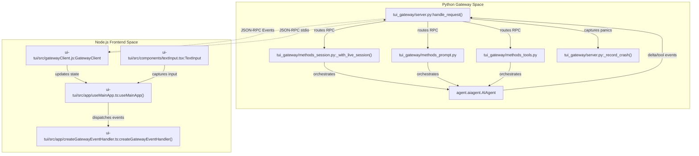
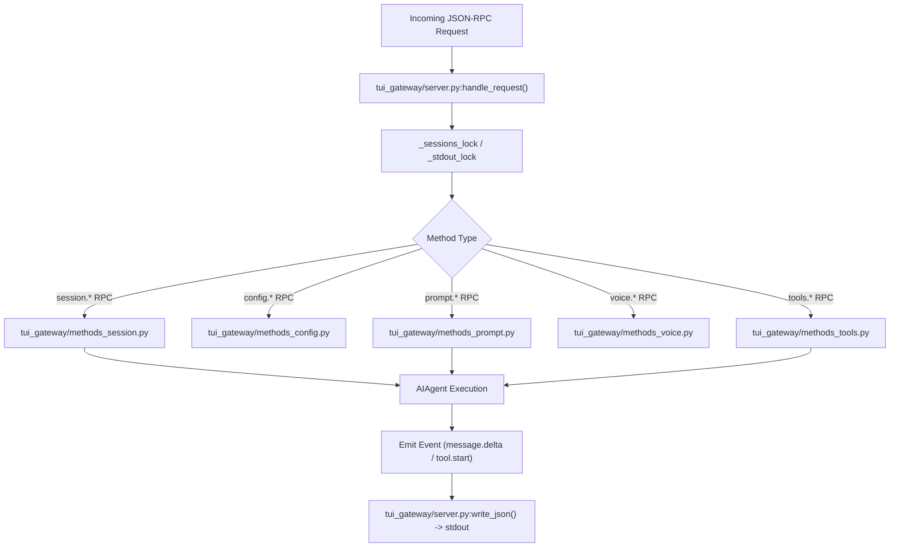

# TUI (Terminal User Interface)

Relevant source files

The following files were used as context for generating this wiki page:

- [evals/desktop_bug_campaign/leases_live.py](evals/desktop_bug_campaign/leases_live.py)
- [gateway/session_images.py](gateway/session_images.py)
- [gateway/session_tui_config.py](gateway/session_tui_config.py)
- [hermes_cli/context_switch_guard.py](hermes_cli/context_switch_guard.py)
- [hermes_cli/debug_redaction.py](hermes_cli/debug_redaction.py)
- [hermes_cli/oneshot.py](hermes_cli/oneshot.py)
- [hermes_cli/profile_model_seed.py](hermes_cli/profile_model_seed.py)
- [scripts/iso-certify.py](scripts/iso-certify.py)
- [tests/agent/test_memory_user_id.py](tests/agent/test_memory_user_id.py)
- [tests/agent/test_switch_model_reapplies_config_context_pin.py](tests/agent/test_switch_model_reapplies_config_context_pin.py)
- [tests/gateway/test_agent_cache.py](tests/gateway/test_agent_cache.py)
- [tests/gateway/test_hosted_room_replicas.py](tests/gateway/test_hosted_room_replicas.py)
- [tests/gateway/test_session_images.py](tests/gateway/test_session_images.py)
- [tests/gateway/test_session_images_profile.py](tests/gateway/test_session_images_profile.py)
- [tests/gateway/test_session_setting_commands.py](tests/gateway/test_session_setting_commands.py)
- [tests/gateway/test_session_tui_config.py](tests/gateway/test_session_tui_config.py)
- [tests/hermes_cli/test_auth_lock_timeout_diagnosis.py](tests/hermes_cli/test_auth_lock_timeout_diagnosis.py)
- [tests/hermes_cli/test_context_switch_guard.py](tests/hermes_cli/test_context_switch_guard.py)
- [tests/hermes_cli/test_custom_provider_identity.py](tests/hermes_cli/test_custom_provider_identity.py)
- [tests/hermes_cli/test_model_picker_expensive_confirm.py](tests/hermes_cli/test_model_picker_expensive_confirm.py)
- [tests/hermes_cli/test_oneshot_resume.py](tests/hermes_cli/test_oneshot_resume.py)
- [tests/hermes_cli/test_profile_model_seed.py](tests/hermes_cli/test_profile_model_seed.py)
- [tests/hermes_cli/test_tui_resume_flow.py](tests/hermes_cli/test_tui_resume_flow.py)
- [tests/hermes_cli/test_web_multi_profile_scope.py](tests/hermes_cli/test_web_multi_profile_scope.py)
- [tests/lock_contention.py](tests/lock_contention.py)
- [tests/tools/test_async_delegation_failed_surface.py](tests/tools/test_async_delegation_failed_surface.py)
- [tests/tui_gateway/_turn_marker_backend.py](tests/tui_gateway/_turn_marker_backend.py)
- [tests/tui_gateway/test_auto_continue.py](tests/tui_gateway/test_auto_continue.py)
- [tests/tui_gateway/test_busy_compression_demotion.py](tests/tui_gateway/test_busy_compression_demotion.py)
- [tests/tui_gateway/test_canonical_voice_mode_writers.py](tests/tui_gateway/test_canonical_voice_mode_writers.py)
- [tests/tui_gateway/test_compression_config_hot_reload.py](tests/tui_gateway/test_compression_config_hot_reload.py)
- [tests/tui_gateway/test_compute_host.py](tests/tui_gateway/test_compute_host.py)
- [tests/tui_gateway/test_compute_host_pending_model_switch.py](tests/tui_gateway/test_compute_host_pending_model_switch.py)
- [tests/tui_gateway/test_compute_host_phase1.py](tests/tui_gateway/test_compute_host_phase1.py)
- [tests/tui_gateway/test_deferred_model_switch_confirm.py](tests/tui_gateway/test_deferred_model_switch_confirm.py)
- [tests/tui_gateway/test_diagnostics_share_nous.py](tests/tui_gateway/test_diagnostics_share_nous.py)
- [tests/tui_gateway/test_file_attachment_allocation.py](tests/tui_gateway/test_file_attachment_allocation.py)
- [tests/tui_gateway/test_groups_replication_methods.py](tests/tui_gateway/test_groups_replication_methods.py)
- [tests/tui_gateway/test_iso_certify_seam.py](tests/tui_gateway/test_iso_certify_seam.py)
- [tests/tui_gateway/test_isolated_orphan_activity.py](tests/tui_gateway/test_isolated_orphan_activity.py)
- [tests/tui_gateway/test_live_config_context_pin_mirror.py](tests/tui_gateway/test_live_config_context_pin_mirror.py)
- [tests/tui_gateway/test_multi_profile_hosting_fail_closed.py](tests/tui_gateway/test_multi_profile_hosting_fail_closed.py)
- [tests/tui_gateway/test_out_of_band_history_adoption.py](tests/tui_gateway/test_out_of_band_history_adoption.py)
- [tests/tui_gateway/test_profile_terminal_scope_entrypoints.py](tests/tui_gateway/test_profile_terminal_scope_entrypoints.py)
- [tests/tui_gateway/test_profiles_create_env_refs.py](tests/tui_gateway/test_profiles_create_env_refs.py)
- [tests/tui_gateway/test_profiles_inherit_launch_model.py](tests/tui_gateway/test_profiles_inherit_launch_model.py)
- [tests/tui_gateway/test_profiles_list_canonical_session.py](tests/tui_gateway/test_profiles_list_canonical_session.py)
- [tests/tui_gateway/test_protocol.py](tests/tui_gateway/test_protocol.py)
- [tests/tui_gateway/test_queued_prompt_persistence.py](tests/tui_gateway/test_queued_prompt_persistence.py)
- [tests/tui_gateway/test_readiness_singleflight.py](tests/tui_gateway/test_readiness_singleflight.py)
- [tests/tui_gateway/test_remote_backend_launch_cwd.py](tests/tui_gateway/test_remote_backend_launch_cwd.py)
- [tests/tui_gateway/test_serve_exit_flush.py](tests/tui_gateway/test_serve_exit_flush.py)
- [tests/tui_gateway/test_subagent_snapshot.py](tests/tui_gateway/test_subagent_snapshot.py)
- [tests/tui_gateway/test_submit_time_user_row.py](tests/tui_gateway/test_submit_time_user_row.py)
- [tests/tui_gateway/test_tui_gateway_queue_on_busy.py](tests/tui_gateway/test_tui_gateway_queue_on_busy.py)
- [tests/tui_gateway/test_tui_gateway_server.py](tests/tui_gateway/test_tui_gateway_server.py)
- [tests/tui_gateway/test_user_messages.py](tests/tui_gateway/test_user_messages.py)
- [tests/tui_gateway/test_ws_orphan_races.py](tests/tui_gateway/test_ws_orphan_races.py)
- [tui_gateway/AGENTS.md](tui_gateway/AGENTS.md)
- [tui_gateway/compute_host.py](tui_gateway/compute_host.py)
- [tui_gateway/compute_host_bridge.py](tui_gateway/compute_host_bridge.py)
- [tui_gateway/host_supervisor.py](tui_gateway/host_supervisor.py)
- [tui_gateway/methods_complete.py](tui_gateway/methods_complete.py)
- [tui_gateway/methods_complete_helpers.py](tui_gateway/methods_complete_helpers.py)
- [tui_gateway/methods_config.py](tui_gateway/methods_config.py)
- [tui_gateway/methods_config_set.py](tui_gateway/methods_config_set.py)
- [tui_gateway/methods_groups.py](tui_gateway/methods_groups.py)
- [tui_gateway/methods_images.py](tui_gateway/methods_images.py)
- [tui_gateway/methods_profiles.py](tui_gateway/methods_profiles.py)
- [tui_gateway/methods_prompt.py](tui_gateway/methods_prompt.py)
- [tui_gateway/methods_session.py](tui_gateway/methods_session.py)
- [tui_gateway/methods_slash.py](tui_gateway/methods_slash.py)
- [tui_gateway/methods_subagents.py](tui_gateway/methods_subagents.py)
- [tui_gateway/methods_tools.py](tui_gateway/methods_tools.py)
- [tui_gateway/methods_voice.py](tui_gateway/methods_voice.py)
- [tui_gateway/prompt_attachments.py](tui_gateway/prompt_attachments.py)
- [tui_gateway/prompt_turn.py](tui_gateway/prompt_turn.py)
- [tui_gateway/render.py](tui_gateway/render.py)
- [tui_gateway/server.py](tui_gateway/server.py)
- [tui_gateway/session_auto_continue.py](tui_gateway/session_auto_continue.py)
- [tui_gateway/session_compression.py](tui_gateway/session_compression.py)
- [tui_gateway/session_lifecycle.py](tui_gateway/session_lifecycle.py)
- [tui_gateway/session_reaper.py](tui_gateway/session_reaper.py)
- [tui_gateway/session_workdir.py](tui_gateway/session_workdir.py)
- [tui_gateway/slash_fuzzy.py](tui_gateway/slash_fuzzy.py)
- [tui_gateway/synthetic_turn.py](tui_gateway/synthetic_turn.py)
- [tui_gateway/turn_marker.py](tui_gateway/turn_marker.py)
- [tui_gateway/user_messages.py](tui_gateway/user_messages.py)
- [ui-tui/README.md](ui-tui/README.md)
- [ui-tui/src/__tests__/appChromeStatusRule.test.tsx](ui-tui/src/__tests__/appChromeStatusRule.test.tsx)
- [ui-tui/src/__tests__/canonicalSlashCommands.test.ts](ui-tui/src/__tests__/canonicalSlashCommands.test.ts)
- [ui-tui/src/__tests__/clipboard.test.ts](ui-tui/src/__tests__/clipboard.test.ts)
- [ui-tui/src/__tests__/createGatewayEventHandler.test.ts](ui-tui/src/__tests__/createGatewayEventHandler.test.ts)
- [ui-tui/src/__tests__/createSlashHandler.test.ts](ui-tui/src/__tests__/createSlashHandler.test.ts)
- [ui-tui/src/__tests__/messages.test.ts](ui-tui/src/__tests__/messages.test.ts)
- [ui-tui/src/__tests__/osc52.test.ts](ui-tui/src/__tests__/osc52.test.ts)
- [ui-tui/src/__tests__/platform.test.ts](ui-tui/src/__tests__/platform.test.ts)
- [ui-tui/src/__tests__/rpc.test.ts](ui-tui/src/__tests__/rpc.test.ts)
- [ui-tui/src/__tests__/statusRule.test.ts](ui-tui/src/__tests__/statusRule.test.ts)
- [ui-tui/src/__tests__/text.test.ts](ui-tui/src/__tests__/text.test.ts)
- [ui-tui/src/__tests__/useConfigSync.test.ts](ui-tui/src/__tests__/useConfigSync.test.ts)
- [ui-tui/src/__tests__/useInputHandlers.test.ts](ui-tui/src/__tests__/useInputHandlers.test.ts)
- [ui-tui/src/__tests__/useSessionLifecycle.test.ts](ui-tui/src/__tests__/useSessionLifecycle.test.ts)
- [ui-tui/src/app.tsx](ui-tui/src/app.tsx)
- [ui-tui/src/app/createGatewayEventHandler.ts](ui-tui/src/app/createGatewayEventHandler.ts)
- [ui-tui/src/app/createSlashHandler.ts](ui-tui/src/app/createSlashHandler.ts)
- [ui-tui/src/app/interfaces.ts](ui-tui/src/app/interfaces.ts)
- [ui-tui/src/app/slash/commands/core.ts](ui-tui/src/app/slash/commands/core.ts)
- [ui-tui/src/app/slash/commands/ops.ts](ui-tui/src/app/slash/commands/ops.ts)
- [ui-tui/src/app/slash/commands/session.ts](ui-tui/src/app/slash/commands/session.ts)
- [ui-tui/src/app/turnController.ts](ui-tui/src/app/turnController.ts)
- [ui-tui/src/app/uiStore.ts](ui-tui/src/app/uiStore.ts)
- [ui-tui/src/app/useConfigSync.ts](ui-tui/src/app/useConfigSync.ts)
- [ui-tui/src/app/useInputHandlers.ts](ui-tui/src/app/useInputHandlers.ts)
- [ui-tui/src/app/useMainApp.ts](ui-tui/src/app/useMainApp.ts)
- [ui-tui/src/app/useSessionLifecycle.ts](ui-tui/src/app/useSessionLifecycle.ts)
- [ui-tui/src/components/appChrome.tsx](ui-tui/src/components/appChrome.tsx)
- [ui-tui/src/components/appLayout.tsx](ui-tui/src/components/appLayout.tsx)
- [ui-tui/src/components/messageLine.tsx](ui-tui/src/components/messageLine.tsx)
- [ui-tui/src/components/textInput.tsx](ui-tui/src/components/textInput.tsx)
- [ui-tui/src/components/thinking.tsx](ui-tui/src/components/thinking.tsx)
- [ui-tui/src/content/hotkeys.ts](ui-tui/src/content/hotkeys.ts)
- [ui-tui/src/domain/messages.ts](ui-tui/src/domain/messages.ts)
- [ui-tui/src/gatewayTypes.ts](ui-tui/src/gatewayTypes.ts)
- [ui-tui/src/i18n/en/slashCmd/ops.ts](ui-tui/src/i18n/en/slashCmd/ops.ts)
- [ui-tui/src/lib/clipboard.ts](ui-tui/src/lib/clipboard.ts)
- [ui-tui/src/lib/platform.ts](ui-tui/src/lib/platform.ts)
- [ui-tui/src/lib/rpc.ts](ui-tui/src/lib/rpc.ts)
- [ui-tui/src/lib/text.test.ts](ui-tui/src/lib/text.test.ts)
- [ui-tui/src/lib/text.ts](ui-tui/src/lib/text.ts)
- [ui-tui/src/types.ts](ui-tui/src/types.ts)

The Hermes Agent Terminal User Interface (TUI) is a high-fidelity terminal frontend implemented using **React Ink** and packaged via `hermes-ink`. Activated by the `--tui` flag, it provides an immersive, stateful interaction experience that complements the default `prompt_toolkit`-based CLI. The TUI supports live streaming of the assistant’s chain-of-thought, real-time tool execution tracking, markdown and ANSI rendering, mouse and multi-line input support, and robust session management.

This page documents the TUI architecture, its JSON-RPC gateway server, core frontend components, event handlers, and how it differs from the default CLI.

Sources: [tui_gateway/server.py:1-70](), [ui-tui/src/app/useMainApp.ts:1-170]()

---

## Architecture and Data Flow

The TUI uses a decoupled client-server architecture. The Node.js frontend communicates asynchronously via JSON-RPC 2.0 over standard I/O streams with a Python-based gateway server (`tui_gateway/server.py`) [tui_gateway/server.py:62-70]().

### Architecture Diagram: Code Entity Mapping (Backend & Gateway)

*Sources: [tui_gateway/server.py:62-82](), [tui_gateway/methods_session.py:27-35](), [tui_gateway/methods_prompt.py:1-15](), [tui_gateway/methods_tools.py:1-16](), [ui-tui/src/app/useMainApp.ts:162-190](), [ui-tui/src/app/createGatewayEventHandler.ts:1-79]()*

- The **gateway server** processes RPC requests, enforces concurrency locks, and manages agent sessions (`_sessions`) [tui_gateway/server.py:89-104]().
- Session lifecycles, branching, and recovery are coordinated by helper modules like `tui_gateway/methods_session.py` [tui_gateway/methods_session.py:1-69]().
- Prompt-related operations, including message truncation and reaction handling, are managed by `tui_gateway/methods_prompt.py` [tui_gateway/methods_prompt.py:1-150]().
- Tool and system commands are handled by `tui_gateway/methods_tools.py` [tui_gateway/methods_tools.py:1-16]().
- The frontend client (`ui-tui/`) receives notifications and updates React state stores (`uiStore.ts`, `turnStore.ts`), driving incremental React Ink re-renders [ui-tui/src/app/useMainApp.ts:162-190]().

Sources: [tui_gateway/server.py:62-104](), [tui_gateway/methods_session.py:1-69](), [tui_gateway/methods_prompt.py:1-150](), [tui_gateway/methods_tools.py:1-16](), [ui-tui/src/app/useMainApp.ts:162-190](), [ui-tui/src/app/createGatewayEventHandler.ts:1-79]()

---

## JSON-RPC Gateway Server (`tui_gateway/server.py`)

The Python gateway acts as the orchestration broker between the TUI frontend and the core agent framework.

- **Transport & Protocol**: JSON-RPC messages are transmitted over `stdout`. To prevent corrupting the protocol stream, diagnostics, logging, and crash summaries are redirected exclusively to `stderr` [tui_gateway/server.py:45-70]().
- **Panic Logging**: Unhandled exceptions and thread crashes are intercepted by custom hooks (`_panic_hook`, `_record_crash`) and logged to `_CRASH_LOG` (`~/.hermes/logs/tui_gateway_crash.log`) alongside stderr summaries [tui_gateway/server.py:53-81]().
- **Concurrency Control**: Session slots are validated against concurrent session constraints when a turn or session is created. The `_sessions_lock` and `_stdout_lock` ensure thread-safe access to shared resources [tui_gateway/server.py:94-99]().
- **Workspace CWD Binding**: Individual sessions pin their working directory (`_set_session_context`) so background operations execute relative to the specific project path rather than the global process CWD [tui_gateway/methods_session.py:78-85]().
- **Orphaned WebSocket Session Reaping**: The gateway includes logic to detect and reap orphaned WebSocket sessions after a configurable grace period (`_WS_ORPHAN_REAP_GRACE_S`) to prevent resource leaks, especially in dashboard or desktop app contexts [tui_gateway/server.py:117-137]().

### Diagram: Gateway Request Routing

*Sources: [tui_gateway/server.py:89-104](), [tui_gateway/methods_session.py:27-45](), [tui_gateway/methods_prompt.py:1-15](), [tui_gateway/methods_config.py](), [tui_gateway/methods_voice.py](), [tui_gateway/methods_tools.py:1-16](), [tests/tui_gateway/test_protocol.py:113-128]*

Sources: [tui_gateway/server.py:45-137](), [tui_gateway/methods_session.py:27-45](), [tui_gateway/methods_prompt.py:1-15](), [tui_gateway/methods_config.py](), [tui_gateway/methods_voice.py](), [tui_gateway/methods_tools.py:1-16](), [tests/tui_gateway/test_protocol.py:113-128]()

---

## React Ink Frontend & Components (`ui-tui/`)

The TUI frontend is an Ink-based React application residing under `ui-tui/src/`.

- **Root Component (`ui-tui/src/app.tsx`)**: Initializes the `GatewayProvider`, reads global UI settings from `uiStore.ts`, and mounts `App` and `AppLayout` [ui-tui/src/app.tsx:1-25]().
- **Main App Hook (`ui-tui/src/app/useMainApp.ts`)**: Manages terminal resizing via `createResizeCoalescer` (preventing remount storms during window drag), bracketed paste modes (`\x1b[?2004h`), transcript message history, and active sessions [ui-tui/src/app/useMainApp.ts:162-190](). It also handles starting new live sessions and switching models within a session [ui-tui/src/app/useMainApp.ts:115-163]().
- **Text Input Component (`ui-tui/src/components/textInput.tsx`)**: A UTF-8 aware multi-line input box supporting clipboard integration, bracketed paste detection, and helper coloring functions like `colorizeHint` and `colorizeEcho` [ui-tui/src/components/textInput.tsx:1-114]().
- **Grapheme-Aware Cursors**: Uses `Intl.Segmenter` via `graphemeStops()` to calculate precise cursor positions and selection offsets across multi-byte unicode sequences and emojis [ui-tui/src/components/textInput.tsx:127-177]().

Sources: [ui-tui/src/app.tsx:1-25](), [ui-tui/src/app/useMainApp.ts:115-190](), [ui-tui/src/components/textInput.tsx:1-177]()

---

## Event Handling and Theme Engine

Events streaming from the gateway are processed by `createGatewayEventHandler` (`ui-tui/src/app/createGatewayEventHandler.ts`), which manages state updates for tool execution, todo lists, and usage metrics.

- **Usage Stability (`usageChanged`, `mergeUsageStable`)**: Performs a shallow comparison across `Usage` keys to avoid creating redundant object references on high-frequency streaming deltas, preventing status-bar flicker [ui-tui/src/app/createGatewayEventHandler.ts:68-88]().
- **Theme Pipeline (`commitTheme`, `themeForSkin`)**: Converts gateway skins (`GatewaySkin`) into local `Theme` instances, supports dynamic light/dark polarity overlays, and persists resolved palettes to a boot cache (`writeBootTheme`) to eliminate startup flashing [ui-tui/src/app/createGatewayEventHandler.ts:96-154]().
- **Petdex Mascot (`PetPane`)**: Publishes mascot bounding boxes to `$petBox`, allowing the `TranscriptPane` to responsively reserve a right gutter (on wide screens) or bottom row bands (on narrow screens) so transcript text wraps cleanly around the mascot [ui-tui/src/components/appLayout.tsx:58-112](), [ui-tui/src/components/appLayout.tsx:149-156]().
- **Status Indicator (`FaceTicker`)**: Renders animated status indicators (kaomoji, emoji, ASCII, unicode spinners) in the status bar, with configurable styles and verbosity [ui-tui/src/components/appChrome.tsx:123-163]().

Sources: [ui-tui/src/app/createGatewayEventHandler.ts:68-154](), [ui-tui/src/components/appLayout.tsx:58-112](), [ui-tui/src/components/appLayout.tsx:149-156](), [ui-tui/src/components/appChrome.tsx:123-163]()

---

## TUI vs. Default CLI Feature Comparison

| Feature | Default CLI (`prompt_toolkit`) | TUI (`--tui` React Ink + Gateway) |
| :--- | :--- | :--- |
| **Rendering Engine** | Procedural ANSI sequences via `prompt_toolkit` | React Virtual DOM via `hermes-ink` |
| **Reasoning Display** | Buffered or hidden output | Live-streamed internal reasoning with custom spinners |
| **Tool Execution** | Sequential log text | Interactive event tree with live todo panels |
| **Input Editor** | Single/multi-line line editor | Full editor with grapheme-aware segment tracking |
| **Mascot Integration** | None | Floating Petdex mascot with responsive gutter reservation |
| **Architecture** | Single-process Python CLI | Node.js client interacting via JSON-RPC stdio with Python Gateway |
| **Session Management** | Basic session switching | Advanced session lifecycle, resume, and orphan reaping |
| **Configuration** | Direct `config.yaml` access | RPC-driven `config.set` with deferred application |

Sources: [ui-tui/src/app/useMainApp.ts:162-190](), [tui_gateway/server.py:62-70](), [ui-tui/src/components/textInput.tsx:127-177](), [ui-tui/src/components/appLayout.tsx:58-156](), [tui_gateway/server.py:117-137](), [ui-tui/src/gatewayTypes.ts:154-165]()

---

## Implementation Highlights

### 1. Grapheme-Aware Text Editing
The text input engine relies on `Intl.Segmenter` grapheme boundaries (`graphemeStops`) to guarantee proper caret navigation across complex emoji clusters and multi-byte text without splitting glyph pairs [ui-tui/src/components/textInput.tsx:127-177]().

### 2. Flash-Free Theme Bootstrap
By writing resolved theme colors and terminal backgrounds to disk via `writeBootTheme` (`ui-tui/src/lib/themeBoot.ts`), the TUI paints its first frame immediately on startup using cached values, preventing visual flashes prior to the gateway handshake [ui-tui/src/app/createGatewayEventHandler.ts:132-154]().

### 3. Responsive Layout Adaptation
The layout manager computes available terminal width (`cols`) against ambient sidebars and floating pet footprints, dynamically switching between right-gutter text wrapping and bottom-band row reservation [ui-tui/src/components/appLayout.tsx:149-156]().

### 4. Robust Session Interrupts
The `session.interrupt` RPC method handles various agent interrupt mechanisms, including `interrupt()` and `hard_interrupt()`, ensuring compatibility with different agent implementations and proper cleanup of session resources [tests/tui_gateway/test_protocol.py:96-140]().

### 5. Pending Approval Replay
When a client reconnects, the gateway replays any pending approval requests that were issued while the client was detached, ensuring no critical user confirmations are missed [tests/tui_gateway/test_protocol.py:147-187]().

Sources: [ui-tui/src/components/textInput.tsx:127-177](), [ui-tui/src/app/createGatewayEventHandler.ts:132-154](), [ui-tui/src/components/appLayout.tsx:149-156](), [tests/tui_gateway/test_protocol.py:96-187]()