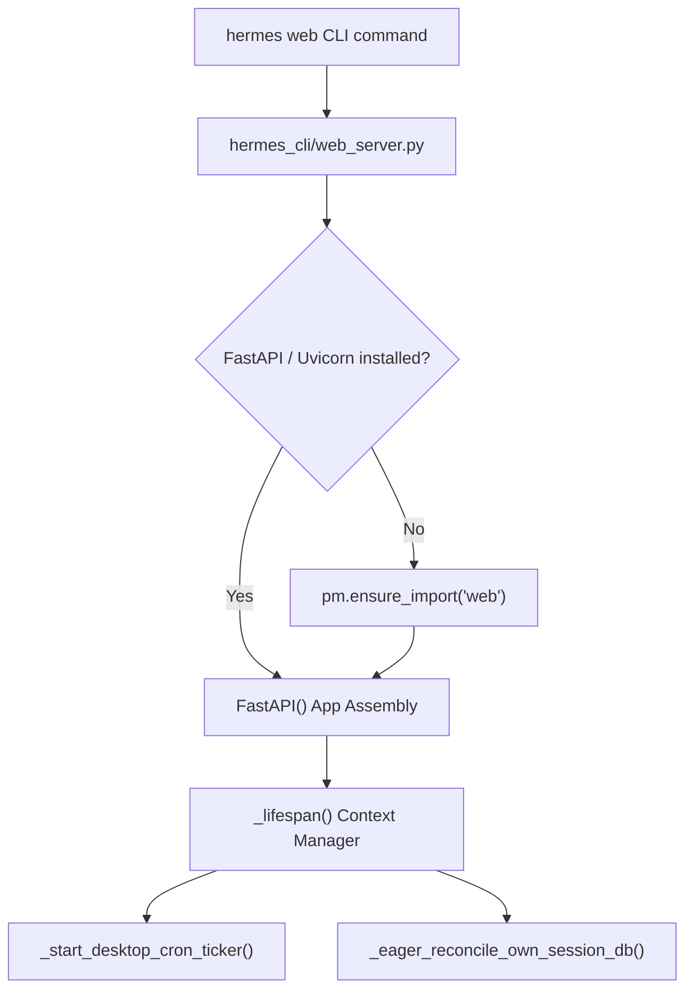
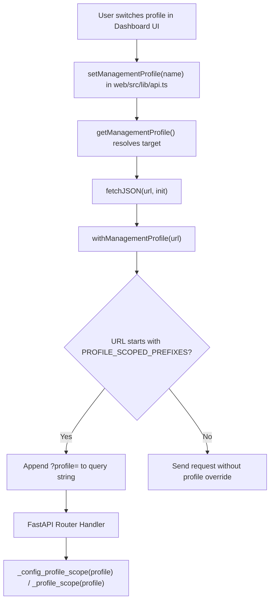

# Web UI Dashboard

Relevant source files

The following files were used as context for generating this wiki page:

- [apps/desktop/src/app/settings/fallback-models-field.test.tsx](apps/desktop/src/app/settings/fallback-models-field.test.tsx)
- [apps/desktop/src/app/settings/fallback-models-field.tsx](apps/desktop/src/app/settings/fallback-models-field.tsx)
- [apps/desktop/src/app/settings/terminal-backend-panel.test.tsx](apps/desktop/src/app/settings/terminal-backend-panel.test.tsx)
- [apps/desktop/src/app/settings/terminal-backend-panel.tsx](apps/desktop/src/app/settings/terminal-backend-panel.tsx)
- [apps/desktop/src/hermes.ts](apps/desktop/src/hermes.ts)
- [apps/desktop/src/types/hermes.ts](apps/desktop/src/types/hermes.ts)
- [gateway/status_served.py](gateway/status_served.py)
- [hermes_cli/web_routers/dashboard_ui.py](hermes_cli/web_routers/dashboard_ui.py)
- [hermes_cli/web_routers/messaging.py](hermes_cli/web_routers/messaging.py)
- [hermes_cli/web_routers/models.py](hermes_cli/web_routers/models.py)
- [hermes_cli/web_routers/ops.py](hermes_cli/web_routers/ops.py)
- [hermes_cli/web_routers/profiles.py](hermes_cli/web_routers/profiles.py)
- [hermes_cli/web_routers/status.py](hermes_cli/web_routers/status.py)
- [hermes_cli/web_server.py](hermes_cli/web_server.py)
- [hermes_cli/web_server_mcp.py](hermes_cli/web_server_mcp.py)
- [hermes_cli/web_server_profiles.py](hermes_cli/web_server_profiles.py)
- [tests/gateway/test_matrix_plugin_setup.py](tests/gateway/test_matrix_plugin_setup.py)
- [tests/hermes_cli/test_dashboard_admin_endpoints.py](tests/hermes_cli/test_dashboard_admin_endpoints.py)
- [tests/hermes_cli/test_dashboard_initial_profile_bootstrap.py](tests/hermes_cli/test_dashboard_initial_profile_bootstrap.py)
- [tests/hermes_cli/test_gateway_unnamed_default_home_verbs.py](tests/hermes_cli/test_gateway_unnamed_default_home_verbs.py)
- [tests/hermes_cli/test_moa_preset_config_warnings.py](tests/hermes_cli/test_moa_preset_config_warnings.py)
- [tests/hermes_cli/test_moa_preset_deletion.py](tests/hermes_cli/test_moa_preset_deletion.py)
- [tests/hermes_cli/test_moa_set_models_preserves_extra_keys.py](tests/hermes_cli/test_moa_set_models_preserves_extra_keys.py)
- [tests/hermes_cli/test_pooled_served_profile_backend_unscoped.py](tests/hermes_cli/test_pooled_served_profile_backend_unscoped.py)
- [tests/hermes_cli/test_profiles_sidebar_cache.py](tests/hermes_cli/test_profiles_sidebar_cache.py)
- [tests/hermes_cli/test_profiles_sidebar_scope.py](tests/hermes_cli/test_profiles_sidebar_scope.py)
- [tests/hermes_cli/test_served_profile_mirror_platforms.py](tests/hermes_cli/test_served_profile_mirror_platforms.py)
- [tests/hermes_cli/test_web_routers_destructive_profile_scope.py](tests/hermes_cli/test_web_routers_destructive_profile_scope.py)
- [tests/hermes_cli/test_web_server.py](tests/hermes_cli/test_web_server.py)
- [tests/hermes_cli/test_web_server_gateway_topology.py](tests/hermes_cli/test_web_server_gateway_topology.py)
- [tests/hermes_cli/test_web_server_messaging_profiles.py](tests/hermes_cli/test_web_server_messaging_profiles.py)
- [tests/hermes_cli/test_web_server_skills_profiles.py](tests/hermes_cli/test_web_server_skills_profiles.py)
- [tests/tools/test_delegate_liveness_timeout.py](tests/tools/test_delegate_liveness_timeout.py)
- [web/src/App.tsx](web/src/App.tsx)
- [web/src/components/OAuthLoginModal.tsx](web/src/components/OAuthLoginModal.tsx)
- [web/src/components/OAuthProvidersCard.tsx](web/src/components/OAuthProvidersCard.tsx)
- [web/src/contexts/ProfileProvider.test.tsx](web/src/contexts/ProfileProvider.test.tsx)
- [web/src/contexts/ProfileProvider.tsx](web/src/contexts/ProfileProvider.tsx)
- [web/src/i18n/en.ts](web/src/i18n/en.ts)
- [web/src/i18n/types.ts](web/src/i18n/types.ts)
- [web/src/i18n/zh.ts](web/src/i18n/zh.ts)
- [web/src/lib/api.ts](web/src/lib/api.ts)
- [web/src/lib/profile-bootstrap.test.ts](web/src/lib/profile-bootstrap.test.ts)
- [web/src/lib/profile-bootstrap.ts](web/src/lib/profile-bootstrap.ts)
- [web/src/pages/AnalyticsPage.tsx](web/src/pages/AnalyticsPage.tsx)
- [web/src/pages/ChannelsPage.tsx](web/src/pages/ChannelsPage.tsx)
- [web/src/pages/ConfigPage.tsx](web/src/pages/ConfigPage.tsx)
- [web/src/pages/CronPage.tsx](web/src/pages/CronPage.tsx)
- [web/src/pages/EnvPage.tsx](web/src/pages/EnvPage.tsx)
- [web/src/pages/LogsPage.tsx](web/src/pages/LogsPage.tsx)
- [web/src/pages/PluginsPage.tsx](web/src/pages/PluginsPage.tsx)
- [web/src/pages/SessionsPage.tsx](web/src/pages/SessionsPage.tsx)
- [web/src/pages/SkillsPage.tsx](web/src/pages/SkillsPage.tsx)
- [web/src/pages/SystemPage.tsx](web/src/pages/SystemPage.tsx)

The Hermes Web UI Dashboard provides a browser-based management interface for local and remote Hermes Agent instances [hermes_cli/web_server.py:1-7](). It exposes a React single-page application (SPA) backed by a FastAPI server implemented in `hermes_cli/web_server.py`, enabling administrators and users to configure agent settings, manage multi-profile scopes, inspect agent sessions, handle cron jobs, browse skills, view analytics, and handle API keys and credentials [hermes_cli/web_server.py:1-7](), [web/src/lib/api.ts:10-40](), [web/src/App.tsx:158-177]().

---

## FastAPI Backend Architecture (`hermes_cli/web_server.py`)

The backend entry point `hermes_cli/web_server.py` assembles the FastAPI application, manages background tickers, and coordinates lazy dependency installation [hermes_cli/web_server.py:1-60](). If required dependencies such as `fastapi` or `uvicorn` are missing, the module invokes `pm.ensure_import("web")` to provision dashboard extras dynamically [hermes_cli/web_server.py:43-59]().

Sources:
[hermes_cli/web_server.py:1-77]()

### Server Lifespan and Cron Ticker

The application lifespan is managed via `_lifespan()` in `hermes_cli/web_server.py` [hermes_cli/web_server.py:9-30](). It initializes state variables, ensures database reconciliation via `_eager_reconcile_own_session_db()`, and warms the gateway module cache [hermes_cli/web_server.py:65-77](). When running inside the desktop dashboard wrapper rather than a standalone gateway, `_start_desktop_cron_ticker()` ticks per-profile cron stores concurrently [hermes_cli/web_server.py:91-150](). It leverages `resolve_cron_scheduler()` and applies multi-profile gating (`profile_gate`) to prevent lock contention with running gateways [hermes_cli/web_server.py:106-150]().

Sources:
[hermes_cli/web_server.py:65-154]()

---

## Modular Sub-Routers (`hermes_cli/web_routers/`)

Domain logic is cleanly separated into modular routers under `hermes_cli/web_routers/` and imported by the main server module [hermes_cli/web_server.py:1-7](), [tests/hermes_cli/test_web_server.py:24-33]():

- **`profiles.py`**: Manages profile creation, renaming, active updates, session pruning scans, and profile-scoped model assignments [hermes_cli/web_routers/profiles.py:1-50](). It includes `_profile_to_dict` for serializing profile information and `_write_profile_model` for updating model configurations [hermes_cli/web_routers/profiles.py:84-143]().
- **`messaging.py`**: Manages platform onboarding (WhatsApp, Telegram) and messaging configuration fallbacks (`_MESSAGING_ENV_FALLBACKS`) [hermes_cli/web_routers/messaging.py:1-100](). It defines rules for environment variable validation via `_env_value_rules` [hermes_cli/web_routers/messaging.py:103-109]().
- **`status.py`**: Provides system health checks, `/api/health`, active session garnish counts, and host identity verification [hermes_cli/web_routers/status.py:1-144](). It includes `_count_status_active_sessions` for session metrics [hermes_cli/web_routers/status.py:78-94]().
- **`models.py`**: Handles model information, selection, auxiliary model assignments, and MoA configurations.
- **`dashboard_ui.py`**: Manages dashboard UI settings like themes, fonts, and plugin providers.
- **`ops.py`**: Provides endpoints for operational tasks, including backups, imports, and log management.

Sources:
[hermes_cli/web_routers/profiles.py:1-143](), [hermes_cli/web_routers/messaging.py:1-109](), [hermes_cli/web_routers/status.py:1-144]()

---

## Management Profile Scoping and API Client (`web/src/lib/api.ts`)

The dashboard functions as a machine-level management plane capable of controlling multiple isolated profile homes. The frontend API client in `web/src/lib/api.ts` maintains a global `_managementProfile` state via `setManagementProfile()` [web/src/lib/api.ts:87-90]().

Sources:
[web/src/lib/api.ts:70-159](), [hermes_cli/web_routers/profiles.py:142-143]()

`withManagementProfile()` inspects outgoing request URLs against `PROFILE_SCOPED_PREFIXES` (covering config, status, analytics, sessions, and credentials) and transparently appends `?profile=<name>` [web/src/lib/api.ts:109-159](). On the backend, routers ingest this query parameter and execute operations within `_config_profile_scope()` or `_profile_scope()` blocks [hermes_cli/web_routers/profiles.py:142-143](), [hermes_cli/web_server_profiles.py:1-10]().

Sources:
[web/src/lib/api.ts:109-159](), [hermes_cli/web_routers/profiles.py:142-143](), [hermes_cli/web_server_profiles.py:1-10]()

---

## React Frontend Dashboard (`web/`)

### Application Shell and Lazy Routing (`web/src/App.tsx`)

The React SPA utilizes React Router to render administrative views, leveraging `lazy()` and `Suspense` for code-splitting heavy modules such as `ConfigPage`, `SessionsPage`, `AnalyticsPage`, `ModelsPage`, `CronPage`, and `SkillsPage` [web/src/App.tsx:78-176](). The navigation structure is defined by `BUILTIN_NAV_REST` and `CHAT_NAV_ITEM` [web/src/App.tsx:140-196]().

The embedded terminal chat page (`ChatPage.tsx`) is mounted persistently outside the main router switch when enabled, ensuring that the underlying WebSocket connection and xterm.js instance remain active across tab transitions [web/src/App.tsx:138-155]().

Sources:
[web/src/App.tsx:78-196]()

### Dashboard Pages

The dashboard provides dedicated pages for managing various aspects of the Hermes Agent:

- **Sessions (`web/src/pages/SessionsPage.tsx`)**: Displays a paginated list of agent sessions, allowing filtering by type (chats, automation, all) and source, with search capabilities [web/src/i18n/en.ts:170-182](). Users can delete individual or multiple sessions, and resume sessions in the chat interface [web/src/i18n/en.ts:183-186]().
- **Configuration (`web/src/pages/ConfigPage.tsx`)**: Allows users to view and modify agent configuration settings, categorized for easier navigation [apps/desktop/src/types/hermes.ts:7-23]().
- **Cron Jobs (`web/src/pages/CronPage.tsx`)**: Manages scheduled tasks, enabling creation, editing, and monitoring of cron jobs.
- **Skills (`web/src/pages/SkillsPage.tsx`)**: Provides an interface to browse, install, and manage agent skills.
- **Analytics (`web/src/pages/AnalyticsPage.tsx`)**: Displays usage statistics, including token consumption, session counts, API calls, and top skills [web/src/i18n/en.ts:237-249]().
- **API Keys/Credentials (`web/src/components/OAuthProvidersCard.tsx`)**: Manages OAuth providers and API keys, showing login status, expiration, and options to connect or disconnect [apps/desktop/src/types/hermes.ts:79-109]().
- **Models (`web/src/pages/ModelsPage.tsx`)**: Allows selection and management of LLM models, including auxiliary models and MoA configurations.
- **Channels (`web/src/pages/ChannelsPage.tsx`)**: Configures messaging platforms like WhatsApp and Telegram, including onboarding flows.
- **System (`web/src/pages/SystemPage.tsx`)**: Provides system-level information and actions, such as updating Hermes or restarting the gateway.
- **Plugins (`web/src/pages/PluginsPage.tsx`)**: Manages installed plugins, enabling or disabling them.
- **Environment Variables (`web/src/pages/EnvPage.tsx`)**: Allows viewing and editing environment variables.
- **Logs (`web/src/pages/LogsPage.tsx`)**: Displays agent logs for debugging and monitoring.

Sources:
[web/src/pages/SessionsPage.tsx](), [web/src/i18n/en.ts:170-186](), [web/src/pages/ConfigPage.tsx](), [apps/desktop/src/types/hermes.ts:7-23](), [web/src/pages/CronPage.tsx](), [web/src/pages/SkillsPage.tsx](), [web/src/pages/AnalyticsPage.tsx](), [web/src/i18n/en.ts:237-249](), [web/src/components/OAuthProvidersCard.tsx](), [apps/desktop/src/types/hermes.ts:79-109](), [web/src/pages/ModelsPage.tsx](), [web/src/pages/ChannelsPage.tsx](), [web/src/pages/SystemPage.tsx](), [web/src/pages/PluginsPage.tsx](), [web/src/pages/EnvPage.tsx](), [web/src/pages/LogsPage.tsx]()

### Internationalization (`web/src/i18n/`)

The dashboard supports internationalization, with translations defined in `web/src/i18n/types.ts` and specific locale files like `web/src/i18n/en.ts` and `web/src/i18n/zh.ts` [web/src/i18n/types.ts:1-18](). The `Translations` interface defines keys for common UI elements, app shell, status page, sessions page, and analytics page [web/src/i18n/types.ts:20-249]().

Sources:
[web/src/i18n/types.ts:1-249](), [web/src/i18n/en.ts:1-249](), [web/src/i18n/zh.ts]()

---

## Sources

- [hermes_cli/web_server.py:1-160]()
- [tests/hermes_cli/test_web_server.py:24-33]()
- [web/src/lib/api.ts:10-159]()
- [web/src/App.tsx:78-196]()
- [hermes_cli/web_routers/profiles.py:1-143]()
- [hermes_cli/web_routers/messaging.py:1-109]()
- [hermes_cli/web_routers/status.py:1-144]()
- [hermes_cli/web_server_profiles.py:1-10]()
- [apps/desktop/src/types/hermes.ts:7-109]()
- [web/src/i18n/types.ts:1-249]()
- [web/src/i18n/en.ts:1-249]()