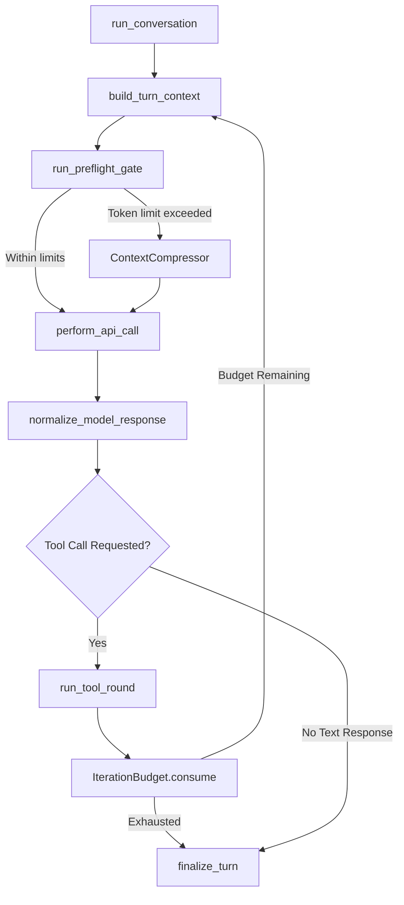
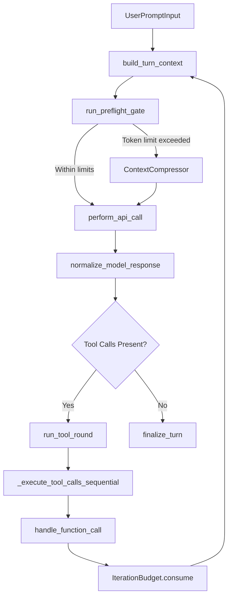
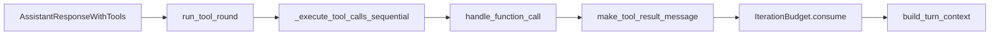

# Conversation Loop

Relevant source files

The following files were used as context for generating this wiki page:

- [agent/agent_init.py](agent/agent_init.py)
- [agent/agent_runtime_helpers.py](agent/agent_runtime_helpers.py)
- [agent/auxiliary_async_rebuild.py](agent/auxiliary_async_rebuild.py)
- [agent/chat_completion_helpers.py](agent/chat_completion_helpers.py)
- [agent/compaction_display.py](agent/compaction_display.py)
- [agent/compaction_events.py](agent/compaction_events.py)
- [agent/compression_facade.py](agent/compression_facade.py)
- [agent/context_compressor.py](agent/context_compressor.py)
- [agent/context_compressor_telemetry.py](agent/context_compressor_telemetry.py)
- [agent/conversation_compression.py](agent/conversation_compression.py)
- [agent/conversation_compression_archive.py](agent/conversation_compression_archive.py)
- [agent/conversation_compression_codex.py](agent/conversation_compression_codex.py)
- [agent/conversation_compression_manual.py](agent/conversation_compression_manual.py)
- [agent/conversation_compression_telemetry.py](agent/conversation_compression_telemetry.py)
- [agent/conversation_loop.py](agent/conversation_loop.py)
- [agent/error_classifier.py](agent/error_classifier.py)
- [agent/message_sanitization.py](agent/message_sanitization.py)
- [agent/micro_compaction.py](agent/micro_compaction.py)
- [agent/model_metadata_token_memo.py](agent/model_metadata_token_memo.py)
- [agent/portal_tags.py](agent/portal_tags.py)
- [agent/prompt_cache_scope.py](agent/prompt_cache_scope.py)
- [agent/reasoning_promotion.py](agent/reasoning_promotion.py)
- [agent/relay_compaction.py](agent/relay_compaction.py)
- [agent/repetition_guard.py](agent/repetition_guard.py)
- [agent/sdk_transform_bypass.py](agent/sdk_transform_bypass.py)
- [agent/transports/chat_completions.py](agent/transports/chat_completions.py)
- [agent/turn_api_call.py](agent/turn_api_call.py)
- [agent/turn_api_error.py](agent/turn_api_error.py)
- [agent/turn_api_request.py](agent/turn_api_request.py)
- [agent/turn_context.py](agent/turn_context.py)
- [agent/turn_context_compaction.py](agent/turn_context_compaction.py)
- [agent/turn_empty_response.py](agent/turn_empty_response.py)
- [agent/turn_final_response.py](agent/turn_final_response.py)
- [agent/turn_finalizer.py](agent/turn_finalizer.py)
- [agent/turn_iteration_prep.py](agent/turn_iteration_prep.py)
- [agent/turn_loop_errors.py](agent/turn_loop_errors.py)
- [agent/turn_overflow.py](agent/turn_overflow.py)
- [agent/turn_preflight.py](agent/turn_preflight.py)
- [agent/turn_preflight_gate.py](agent/turn_preflight_gate.py)
- [agent/turn_recovery.py](agent/turn_recovery.py)
- [agent/turn_request_assembly.py](agent/turn_request_assembly.py)
- [agent/turn_response_check.py](agent/turn_response_check.py)
- [agent/turn_response_intake.py](agent/turn_response_intake.py)
- [agent/turn_stop_gates.py](agent/turn_stop_gates.py)
- [agent/turn_tool_round.py](agent/turn_tool_round.py)
- [agent/turn_tool_validation.py](agent/turn_tool_validation.py)
- [agent/turn_truncation.py](agent/turn_truncation.py)
- [agent/turn_usage.py](agent/turn_usage.py)
- [apps/desktop/e2e/core/reply-painted-once.spec.ts](apps/desktop/e2e/core/reply-painted-once.spec.ts)
- [apps/desktop/src/app/session/hooks/use-message-stream/reused-final-after-tool.test.tsx](apps/desktop/src/app/session/hooks/use-message-stream/reused-final-after-tool.test.tsx)
- [apps/desktop/src/app/session/hooks/use-message-stream/test-harness.tsx](apps/desktop/src/app/session/hooks/use-message-stream/test-harness.tsx)
- [contributors/emails/sahabatheri@gmail.com](contributors/emails/sahabatheri@gmail.com)
- [plugins/model-providers/actual/__init__.py](plugins/model-providers/actual/__init__.py)
- [plugins/model-providers/bedrock/__init__.py](plugins/model-providers/bedrock/__init__.py)
- [plugins/model-providers/commandcode/__init__.py](plugins/model-providers/commandcode/__init__.py)
- [plugins/model-providers/commandcode/plugin.yaml](plugins/model-providers/commandcode/plugin.yaml)
- [plugins/model-providers/copilot-acp/__init__.py](plugins/model-providers/copilot-acp/__init__.py)
- [plugins/model-providers/custom/__init__.py](plugins/model-providers/custom/__init__.py)
- [plugins/model-providers/nous/__init__.py](plugins/model-providers/nous/__init__.py)
- [plugins/model-providers/openrouter/__init__.py](plugins/model-providers/openrouter/__init__.py)
- [plugins/model-providers/router/__init__.py](plugins/model-providers/router/__init__.py)
- [plugins/model-providers/router/plugin.yaml](plugins/model-providers/router/plugin.yaml)
- [providers/README.md](providers/README.md)
- [scripts/micro_compaction_report.py](scripts/micro_compaction_report.py)
- [tests/agent/test_413_compression.py](tests/agent/test_413_compression.py)
- [tests/agent/test_api_content_sidecar.py](tests/agent/test_api_content_sidecar.py)
- [tests/agent/test_auxiliary_named_custom_providers.py](tests/agent/test_auxiliary_named_custom_providers.py)
- [tests/agent/test_background_review_cache_parity.py](tests/agent/test_background_review_cache_parity.py)
- [tests/agent/test_background_review_input_budget.py](tests/agent/test_background_review_input_budget.py)
- [tests/agent/test_chat_sdk_transform_bypass.py](tests/agent/test_chat_sdk_transform_bypass.py)
- [tests/agent/test_codex_incomplete_budget_escalation.py](tests/agent/test_codex_incomplete_budget_escalation.py)
- [tests/agent/test_codex_reasoning_only_streak.py](tests/agent/test_codex_reasoning_only_streak.py)
- [tests/agent/test_compaction_events.py](tests/agent/test_compaction_events.py)
- [tests/agent/test_compression_attempt_effect.py](tests/agent/test_compression_attempt_effect.py)
- [tests/agent/test_compression_attempt_telemetry.py](tests/agent/test_compression_attempt_telemetry.py)
- [tests/agent/test_compression_commit_fence_race.py](tests/agent/test_compression_commit_fence_race.py)
- [tests/agent/test_compression_concurrent_fork.py](tests/agent/test_compression_concurrent_fork.py)
- [tests/agent/test_compression_refusal_restores_transcript.py](tests/agent/test_compression_refusal_restores_transcript.py)
- [tests/agent/test_compression_stall_fallback.py](tests/agent/test_compression_stall_fallback.py)
- [tests/agent/test_compression_stall_interrupt.py](tests/agent/test_compression_stall_interrupt.py)
- [tests/agent/test_compressor_truncated_summary_guard.py](tests/agent/test_compressor_truncated_summary_guard.py)
- [tests/agent/test_context_compressor.py](tests/agent/test_context_compressor.py)
- [tests/agent/test_continuation_ceiling_wedge.py](tests/agent/test_continuation_ceiling_wedge.py)
- [tests/agent/test_continuation_repetition_guard.py](tests/agent/test_continuation_repetition_guard.py)
- [tests/agent/test_conversation_compression_manual.py](tests/agent/test_conversation_compression_manual.py)
- [tests/agent/test_credential_pool_provider_boundary.py](tests/agent/test_credential_pool_provider_boundary.py)
- [tests/agent/test_declared_conversation_scope.py](tests/agent/test_declared_conversation_scope.py)
- [tests/agent/test_empty_response_fallback_refund.py](tests/agent/test_empty_response_fallback_refund.py)
- [tests/agent/test_empty_response_recovery_persistence.py](tests/agent/test_empty_response_recovery_persistence.py)
- [tests/agent/test_empty_terminal_reasoning_surface.py](tests/agent/test_empty_terminal_reasoning_surface.py)
- [tests/agent/test_error_classifier.py](tests/agent/test_error_classifier.py)
- [tests/agent/test_failed_turn_site_codes.py](tests/agent/test_failed_turn_site_codes.py)
- [tests/agent/test_fallback_reasoning_override.py](tests/agent/test_fallback_reasoning_override.py)
- [tests/agent/test_image_corrupt_recovery.py](tests/agent/test_image_corrupt_recovery.py)
- [tests/agent/test_image_rejection_fallback.py](tests/agent/test_image_rejection_fallback.py)
- [tests/agent/test_in_place_merged_user_rows.py](tests/agent/test_in_place_merged_user_rows.py)
- [tests/agent/test_malformed_tool_args_no_fallback.py](tests/agent/test_malformed_tool_args_no_fallback.py)
- [tests/agent/test_message_sanitization_policy.py](tests/agent/test_message_sanitization_policy.py)
- [tests/agent/test_message_sequence_repair.py](tests/agent/test_message_sequence_repair.py)
- [tests/agent/test_micro_compaction.py](tests/agent/test_micro_compaction.py)
- [tests/agent/test_partial_stream_finish_reason.py](tests/agent/test_partial_stream_finish_reason.py)
- [tests/agent/test_portal_tags.py](tests/agent/test_portal_tags.py)
- [tests/agent/test_proactive_prune_restart_safety.py](tests/agent/test_proactive_prune_restart_safety.py)
- [tests/agent/test_prompt_cache_scope.py](tests/agent/test_prompt_cache_scope.py)
- [tests/agent/test_reasoning_only_stop_persistence.py](tests/agent/test_reasoning_only_stop_persistence.py)
- [tests/agent/test_relay_compaction.py](tests/agent/test_relay_compaction.py)
- [tests/agent/test_relay_runtime_bounded_scope_ops.py](tests/agent/test_relay_runtime_bounded_scope_ops.py)
- [tests/agent/test_repetition_guard.py](tests/agent/test_repetition_guard.py)
- [tests/agent/test_review_fork_cache_scope.py](tests/agent/test_review_fork_cache_scope.py)
- [tests/agent/test_run_agent.py](tests/agent/test_run_agent.py)
- [tests/agent/test_send_path_history_isolation.py](tests/agent/test_send_path_history_isolation.py)
- [tests/agent/test_stall_guards.py](tests/agent/test_stall_guards.py)
- [tests/agent/test_stream_runaway_repetition.py](tests/agent/test_stream_runaway_repetition.py)
- [tests/agent/test_switch_model_context.py](tests/agent/test_switch_model_context.py)
- [tests/agent/test_thinking_only_sanitizer.py](tests/agent/test_thinking_only_sanitizer.py)
- [tests/agent/test_thinking_prefill_trailing_turn.py](tests/agent/test_thinking_prefill_trailing_turn.py)
- [tests/agent/test_token_memo_release_on_close.py](tests/agent/test_token_memo_release_on_close.py)
- [tests/agent/test_tool_call_args_sanitizer.py](tests/agent/test_tool_call_args_sanitizer.py)
- [tests/agent/test_turn_api_call_interrupt.py](tests/agent/test_turn_api_call_interrupt.py)
- [tests/agent/test_turn_finalizer_cleanup_guard.py](tests/agent/test_turn_finalizer_cleanup_guard.py)
- [tests/agent/test_turn_finalizer_final_response_persistence.py](tests/agent/test_turn_finalizer_final_response_persistence.py)
- [tests/agent/test_turn_finalizer_iteration_limit_exit.py](tests/agent/test_turn_finalizer_iteration_limit_exit.py)
- [tests/agent/test_unicode_ascii_codec.py](tests/agent/test_unicode_ascii_codec.py)
- [tests/agent/transports/test_chat_completions.py](tests/agent/transports/test_chat_completions.py)
- [tests/agent/transports/test_router_codex_efforts.py](tests/agent/transports/test_router_codex_efforts.py)
- [tests/gateway/test_api_server_compaction_projection.py](tests/gateway/test_api_server_compaction_projection.py)
- [tests/gateway/test_api_server_declared_conversation.py](tests/gateway/test_api_server_declared_conversation.py)
- [tests/gateway/test_discord_split_cap.py](tests/gateway/test_discord_split_cap.py)
- [tests/gateway/test_queued_native_image_session_key.py](tests/gateway/test_queued_native_image_session_key.py)
- [tests/hermes_cli/test_actual_provider.py](tests/hermes_cli/test_actual_provider.py)
- [tests/hermes_cli/test_ai_gateway_models.py](tests/hermes_cli/test_ai_gateway_models.py)
- [tests/hermes_cli/test_bedrock_mantle_key_env.py](tests/hermes_cli/test_bedrock_mantle_key_env.py)
- [tests/hermes_cli/test_bedrock_region_scoped_picker.py](tests/hermes_cli/test_bedrock_region_scoped_picker.py)
- [tests/hermes_cli/test_codex_device_login_ssl_hint.py](tests/hermes_cli/test_codex_device_login_ssl_hint.py)
- [tests/hermes_cli/test_codex_device_login_transient_retry.py](tests/hermes_cli/test_codex_device_login_transient_retry.py)
- [tests/hermes_cli/test_copilot_in_model_list.py](tests/hermes_cli/test_copilot_in_model_list.py)
- [tests/hermes_cli/test_gateway_agent_compress.py](tests/hermes_cli/test_gateway_agent_compress.py)
- [tests/hermes_cli/test_inventory_reasoning_caps.py](tests/hermes_cli/test_inventory_reasoning_caps.py)
- [tests/hermes_cli/test_kanban_comment_queries.py](tests/hermes_cli/test_kanban_comment_queries.py)
- [tests/hermes_cli/test_keyed_provider_credential_pool.py](tests/hermes_cli/test_keyed_provider_credential_pool.py)
- [tests/hermes_cli/test_model_flow_pooled_credentials.py](tests/hermes_cli/test_model_flow_pooled_credentials.py)
- [tests/hermes_cli/test_prompt_api_key.py](tests/hermes_cli/test_prompt_api_key.py)
- [tests/hermes_cli/test_router_provider.py](tests/hermes_cli/test_router_provider.py)
- [tests/hermes_state/test_conversation_root.py](tests/hermes_state/test_conversation_root.py)
- [tests/plugins/model_providers/test_commandcode_profile.py](tests/plugins/model_providers/test_commandcode_profile.py)
- [tests/plugins/model_providers/test_custom_profile.py](tests/plugins/model_providers/test_custom_profile.py)
- [tests/plugins/model_providers/test_nous_profile.py](tests/plugins/model_providers/test_nous_profile.py)
- [tests/providers/test_fetch_models_base_url.py](tests/providers/test_fetch_models_base_url.py)
- [tests/providers/test_profile_wiring.py](tests/providers/test_profile_wiring.py)
- [tests/providers/test_provider_profiles.py](tests/providers/test_provider_profiles.py)
- [tests/providers/test_transport_parity.py](tests/providers/test_transport_parity.py)
- [tests/tools/test_kanban_comment_injection.py](tests/tools/test_kanban_comment_injection.py)
- [tests/tools/test_kanban_persisted_identity.py](tests/tools/test_kanban_persisted_identity.py)
- [tests/tui_gateway/test_manual_compress_history_fence.py](tests/tui_gateway/test_manual_compress_history_fence.py)
- [tests/tui_gateway/test_turn_payload_reused_final.py](tests/tui_gateway/test_turn_payload_reused_final.py)
- [website/docs/developer-guide/adding-providers.md](website/docs/developer-guide/adding-providers.md)
- [website/docs/developer-guide/context-compression-and-caching.md](website/docs/developer-guide/context-compression-and-caching.md)
- [website/i18n/zh-Hans/docusaurus-plugin-content-docs/current/integrations/providers.md](website/i18n/zh-Hans/docusaurus-plugin-content-docs/current/integrations/providers.md)

This page details the internal mechanics of the Hermes Agent's conversation loop, implemented primarily in `agent/conversation_loop.py` [agent/conversation_loop.py:1-6]() and orchestrated by `run_agent.AIAgent` [run_agent.py:1-7](). It covers the iterative process of managing a conversational turn, tool calling flows, multi-provider model transports, error classification, iteration budgeting, and interrupt handling.

---

## Overview and Scope

The core lifecycle of a conversational turn is managed by `run_conversation` in `agent/conversation_loop.py` [agent/conversation_loop.py:1-6](). It coordinates message context construction, prompt caching plans, context compression, API calls across various model transports, tool execution, turn finalization, and error recovery.

Sources:
- `agent/conversation_loop.py:1-6`
- `run_agent.py:1-7`

---

## The Iterative Conversation Loop

The conversation loop executes iteratively for a given user prompt until a final assistant text response is produced, an error forces termination, or the iteration budget is exhausted.

### Loop Phases

1.  **Pre-flight & Turn Context Construction**: `build_turn_context` [agent/turn_context.py:1-10]() prepares system prompts, persona injection (`SOUL.md`), and ephemeral API content sidecars.
2.  **Compression Check**: `run_preflight_gate` [agent/turn_preflight_gate.py:1-35]() evaluates whether token usage exceeds thresholds, triggering history summarization via `ContextCompressor` [agent/context_compressor.py:38-51]().
3.  **API Request Assembly**: `assemble_api_request` [agent/turn_request_assembly.py:1-50]() and `build_api_request` [agent/turn_api_request.py:1-50]() construct the payload containing messages, tools, and caching headers.
4.  **Model Transport Execution**: Calls the configured LLM backend using streaming or non-streaming transports with rate-limit guards (`nous_rate_limit_guard`) [agent/turn_api_call.py:43-44]().
5.  **Response Intake & Sanitization**: `normalize_model_response` [agent/turn_response_intake.py:1-45]() parses assistant text, reasoning blocks (`<think>`), and tool call requests.
6.  **Tool Dispatch**: If the model requests tool execution, `run_tool_round` [agent/turn_tool_round.py:1-35]() executes tools sequentially or concurrently via `_execute_tool_calls_sequential` [agent/tool_executor.py:1-50]().
7.  **Iteration Budget Accounting**: `IterationBudget.consume()` [agent/iteration_budget.py:29-30]() decrements remaining allowances.
8.  **Turn Finalization**: `finalize_turn` [agent/turn_finalizer.py:1-100]() saves trajectories, logs metrics, and flushes message history to `SessionDB`.

### Conversation Loop Flow

Sources:
- `agent/conversation_loop.py:1-56`
- `agent/turn_context.py:1-10`
- `agent/turn_preflight_gate.py:1-35`
- `agent/context_compressor.py:38-51`
- `agent/turn_api_call.py:43-44`
- `agent/turn_tool_round.py:1-35`
- `agent/tool_executor.py:1-50`
- `agent/iteration_budget.py:29-30`
- `agent/turn_finalizer.py:1-100`
- `agent/turn_request_assembly.py:1-50`
- `agent/turn_api_request.py:1-50`
- `agent/turn_response_intake.py:1-45`

---

## Model Transports

Hermes Agent supports multiple model backend transports to interact with diverse LLM APIs, handling protocol translation, response streaming, and formatting differences.

### Transport Implementations

-   **Chat Completions (`chat_completions.py`):** The standard OpenAI-compatible transport handling standard streaming and non-streaming requests, function call schemas, and custom headers [agent/transports/chat_completions.py:1-100]().
-   **Codex Transport (`codex.py`):** Adapts OpenAI Codex and specialized provider schemas, mapping raw completions and responses adapters (`agent/codex_responses_adapter.py`) [agent/transports/codex.py:1-80](), [agent/codex_responses_adapter.py:1-60]().
-   **Anthropic Adapter (`anthropic_adapter.py`):** Translates standard tool definitions and message histories into Anthropic Messages API formats, supporting prompt caching headers and structured block parsing.
-   **Bedrock Adapter (`bedrock_adapter.py`):** Interfaces with AWS Bedrock inference endpoints, handling model invocation payloads and credential negotiation [agent/bedrock_adapter.py:1-90]().
-   **Gemini Native Adapter (`gemini_native_adapter.py`):** Connects directly to Google AI Studio or Vertex AI endpoints, mapping Gemini safety settings, thought parts, and native tool-calling structures [agent/gemini_native_adapter.py:1-75]().

Sources:
- `agent/transports/chat_completions.py:1-100`
- `agent/transports/codex.py:1-80`
- `agent/codex_responses_adapter.py:1-60`
- `agent/bedrock_adapter.py:1-90`
- `agent/gemini_native_adapter.py:1-75`

---

## Iteration Budget and Interrupt Handling

### Iteration Budget Management

-   **Purpose:** Prevents runaway agent loops and infinite tool recursion.
-   **Class:** `IterationBudget` tracks allowed assistant-model turns and tool roundtrips [agent/iteration_budget.py:29-30]().
-   **Sharing:** Subagent delegation (`delegate_task`) proportionally shares budget pools [agent/agent_runtime_helpers.py:93-94]().

### Interrupt Handling

-   **Hard Interrupts:** Triggered via `request_hard_interrupt()` [agent/interrupt_compat.py:40]() from the CLI or signal handlers [gateway/run.py:39]().
-   **Scaffold Markers:** When interrupted while awaiting model responses, turns insert `_INTERRUPT_SCAFFOLD_MARKER` to record user intervention [agent/conversation_loop.py:72-73](). This marker is shared with the `api_messages` ghost-row filter to ensure consistency [agent/conversation_loop.py:71-73]().
-   **Sequence Repair:** `close_interrupted_tool_sequence()` [agent/message_sanitization.py:1-154]() patches dangling tool call blocks to maintain transcript validity.
-   **Relay Teardown:** `_join_worker_for_relay_teardown` [agent/chat_completion_helpers.py:83-101]() ensures that Relay LLM scopes are properly joined before raising `InterruptedError` to prevent race conditions during turn teardown.

Sources:
- `agent/iteration_budget.py:29-30`
- `agent/agent_runtime_helpers.py:93-94`
- `agent/interrupt_compat.py:40`
- `gateway/run.py:39`
- `agent/conversation_loop.py:72-73`
- `agent/conversation_loop.py:71-73`
- `agent/message_sanitization.py:1-154`
- `agent/chat_completion_helpers.py:83-101`

---

## Error Classification and Recovery

When API errors or stream failures occur during a turn, Hermes classifies the exception to determine the recovery strategy.

### Error Classification Taxonomy

-   **ClassifiedError (`error_classifier.py`):** Evaluates provider status codes, malformed payloads, and stream disruptions [agent/error_classifier.py:70-87]().
-   **Failover Reasons:** Categorizes failures into conditions such as `rate_limit`, `context_overflow`, `auth_failure`, or `server_error` [agent/error_classifier.py:34-68]().
-   **Credential Rotation:** `resolve_runtime_pool_key` [agent/agent_runtime_helpers.py:28]() switches API keys or accounts upon encountering 429 rate limits.
-   **Model Fallbacks:** `restore_primary_runtime` and fallback chains manage automatic failover to alternative provider models when primary endpoints exhaust retries [agent/agent_runtime_helpers.py:15-40]().
-   **Provider Stream Error:** `ProviderStreamError` [agent/chat_completion_helpers.py:109-132]() is raised when a provider encodes an API error as streaming content instead of a standard SDK error. This allows for specific handling of such cases.
-   **Hygiene Cooldowns:** `_is_hygiene_preagent_only_cooldown` [agent/context_compressor.py:137-145]() identifies cooldowns that are specific to pre-agent hygiene processes (e.g., watchdog timeouts or turn-hold deferrals) and should not block the in-agent compressor.

Sources:
- `agent/error_classifier.py:70-87`
- `agent/error_classifier.py:34-68`
- `agent/agent_runtime_helpers.py:15-40`
- `agent/agent_runtime_helpers.py:28`
- `agent/chat_completion_helpers.py:109-132`
- `agent/context_compressor.py:137-145`

---

## Diagram: Natural Language to Code Entity Mapping

The following diagram bridges natural language interactions to the underlying Python classes and functions executing the conversation loop.

Sources:
- `agent/turn_context.py:1-10`
- `agent/turn_preflight_gate.py:1-35`
- `agent/conversation_compression.py:1-30`
- `agent/turn_api_call.py:1-45`
- `agent/turn_response_intake.py:1-45`
- `agent/turn_tool_round.py:1-35`
- `agent/tool_executor.py:1-50`
- `run_agent.py:1-7`
- `agent/iteration_budget.py:29-30`
- `agent/turn_finalizer.py:1-100`

---

## Diagram: Tool Execution and Response Lifecycle

Sources:
- `agent/turn_tool_round.py:1-35`
- `agent/tool_executor.py:1-50`
- `run_agent.py:1-7`
- `agent/agent_runtime_helpers.py:20-25`
- `agent/iteration_budget.py:29-30`
- `agent/turn_context.py:1-10`

---

## References and Sources

- `agent/conversation_loop.py:1-1937`
- `run_agent.py:1-1587`
- `agent/turn_context.py:1-155`
- `agent/context_compressor.py:1-5745`
- `agent/conversation_compression.py:1-4445`
- `agent/iteration_budget.py:1-117`
- `agent/tool_executor.py:1-170`
- `agent/error_classifier.py:1-1578`
- `agent/agent_runtime_helpers.py:1-3804`
- `agent/message_sanitization.py:1-154`
- `agent/transports/chat_completions.py:1-136`
- `agent/transports/codex.py:1-150`
- `agent/bedrock_adapter.py:1-180`
- `agent/gemini_native_adapter.py:1-150`
- `agent/turn_preflight_gate.py:1-35`
- `agent/turn_request_assembly.py:1-50`
- `agent/turn_api_request.py:1-50`
- `agent/turn_response_intake.py:1-45`
- `agent/turn_api_call.py:1-45`
- `agent/turn_finalizer.py:1-100`
- `agent/interrupt_compat.py:1-70`
- `gateway/run.py:1-6158`
- `agent/chat_completion_helpers.py:1-4015`