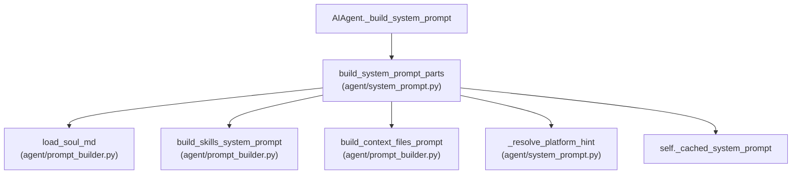
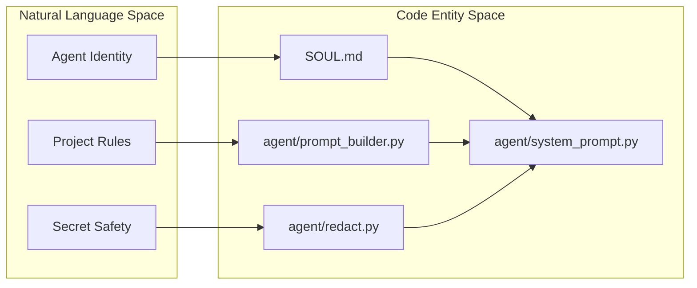
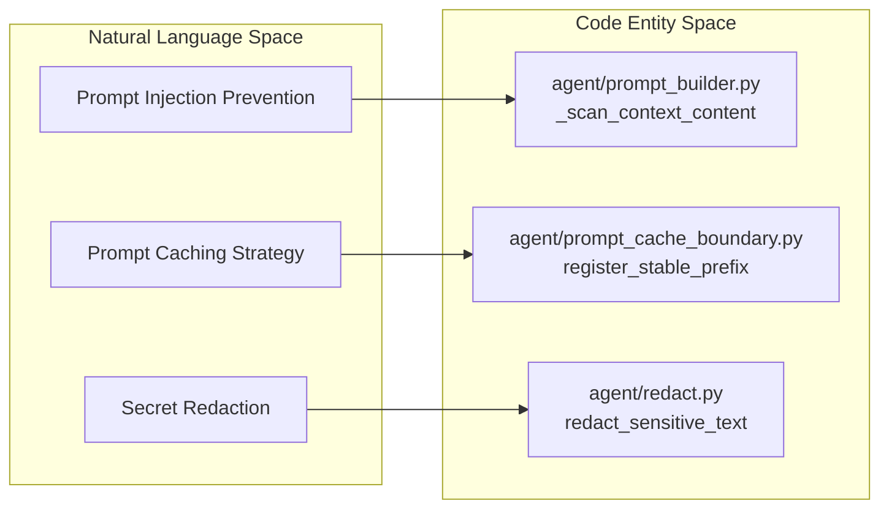

# Context and Prompt Management

Relevant source files

The following files were used as context for generating this wiki page:

- [agent/coding_context.py](agent/coding_context.py)
- [agent/prompt_builder.py](agent/prompt_builder.py)
- [agent/redact.py](agent/redact.py)
- [agent/skill_commands.py](agent/skill_commands.py)
- [agent/skill_utils.py](agent/skill_utils.py)
- [agent/surface_switch.py](agent/surface_switch.py)
- [agent/system_prompt.py](agent/system_prompt.py)
- [hermes_cli/debug.py](hermes_cli/debug.py)
- [hermes_cli/doctor.py](hermes_cli/doctor.py)
- [hermes_cli/doctor_config.py](hermes_cli/doctor_config.py)
- [hermes_cli/doctor_connectivity.py](hermes_cli/doctor_connectivity.py)
- [hermes_cli/doctor_live.py](hermes_cli/doctor_live.py)
- [hermes_cli/doctor_platform.py](hermes_cli/doctor_platform.py)
- [hermes_cli/doctor_report.py](hermes_cli/doctor_report.py)
- [hermes_cli/doctor_state.py](hermes_cli/doctor_state.py)
- [hermes_cli/doctor_tools.py](hermes_cli/doctor_tools.py)
- [hermes_cli/dump.py](hermes_cli/dump.py)
- [hermes_state_dbfile.py](hermes_state_dbfile.py)
- [hermes_state_lockguard.py](hermes_state_lockguard.py)
- [tests/agent/test_coding_context.py](tests/agent/test_coding_context.py)
- [tests/agent/test_compaction_prompt_rebuild.py](tests/agent/test_compaction_prompt_rebuild.py)
- [tests/agent/test_gemini_key_surface_guidance.py](tests/agent/test_gemini_key_surface_guidance.py)
- [tests/agent/test_prompt_builder.py](tests/agent/test_prompt_builder.py)
- [tests/agent/test_redact.py](tests/agent/test_redact.py)
- [tests/agent/test_skill_commands.py](tests/agent/test_skill_commands.py)
- [tests/agent/test_skill_utils.py](tests/agent/test_skill_utils.py)
- [tests/agent/test_system_prompt.py](tests/agent/test_system_prompt.py)
- [tests/agent/test_system_prompt_switch_invalidation.py](tests/agent/test_system_prompt_switch_invalidation.py)
- [tests/gateway/test_session_policy_coding_posture.py](tests/gateway/test_session_policy_coding_posture.py)
- [tests/hermes_cli/test_debug.py](tests/hermes_cli/test_debug.py)
- [tests/hermes_cli/test_doctor.py](tests/hermes_cli/test_doctor.py)
- [tests/hermes_cli/test_doctor_audit_remedy.py](tests/hermes_cli/test_doctor_audit_remedy.py)
- [tests/hermes_cli/test_doctor_github_token_probe.py](tests/hermes_cli/test_doctor_github_token_probe.py)
- [tests/hermes_cli/test_doctor_live.py](tests/hermes_cli/test_doctor_live.py)
- [tests/hermes_cli/test_fts_optimize_notice.py](tests/hermes_cli/test_fts_optimize_notice.py)
- [tests/hermes_cli/test_gemini_express_key_probes.py](tests/hermes_cli/test_gemini_express_key_probes.py)
- [tests/hermes_cli/test_session_system_prompt_dedup.py](tests/hermes_cli/test_session_system_prompt_dedup.py)
- [tests/hermes_state/__init__.py](tests/hermes_state/__init__.py)
- [tests/hermes_state/_wal_generation_harness.py](tests/hermes_state/_wal_generation_harness.py)
- [tests/hermes_state/test_deleted_wal_generation_guard.py](tests/hermes_state/test_deleted_wal_generation_guard.py)
- [tests/hermes_state/test_lockguard_fcntl_tolerance.py](tests/hermes_state/test_lockguard_fcntl_tolerance.py)
- [tests/hermes_state/test_retired_wal_generation_capture.py](tests/hermes_state/test_retired_wal_generation_capture.py)
- [tests/hermes_state/test_state_db_stats.py](tests/hermes_state/test_state_db_stats.py)
- [tests/hermes_state/test_wal_lock_guard.py](tests/hermes_state/test_wal_lock_guard.py)
- [tests/hermes_state/test_wal_lock_guard_lifecycle.py](tests/hermes_state/test_wal_lock_guard_lifecycle.py)
- [tests/tools/test_browser_redact_depth.py](tests/tools/test_browser_redact_depth.py)
- [tests/tools/test_skills_tool.py](tests/tools/test_skills_tool.py)
- [tools/skills_tool.py](tools/skills_tool.py)
- [website/docs/developer-guide/gateway-classic-cli.md](website/docs/developer-guide/gateway-classic-cli.md)
- [website/docs/developer-guide/gateway-local-sessions.md](website/docs/developer-guide/gateway-local-sessions.md)

## Purpose and Scope

This page explains the end-to-end prompt lifecycle within Hermes Agent (`agent/prompt_builder.py` [agent/prompt_builder.py:1-5](), `agent/system_prompt.py` [agent/system_prompt.py:1-10]()). It covers system prompt assembly into a cached structure, discovery and validation of global and project-local context files (`SOUL.md`, `AGENTS.md`, `.cursorrules`), prompt caching mechanisms, message payload sanitization, secret redaction, and dynamic prompt injection defenses.

Sources: [agent/prompt_builder.py:1-5](), [agent/system_prompt.py:1-10]()

---

## System Prompt Assembly

The core logic for system prompt construction is orchestrated by `AIAgent._build_system_prompt()`, which relies on `build_system_prompt_parts()` defined in `agent/system_prompt.py` [agent/system_prompt.py:1-24](). The system prompt is built once per session and reused across all turns to optimize upstream prefix caching; it is only rebuilt when context compression occurs [agent/system_prompt.py:3-5]().

### Three-Tier Prompt Structure
The prompt is assembled by joining three tiers with double newlines (`\n\n`) [agent/system_prompt.py:10]():

1.  **Stable Tier:** Contains the core identity (from `SOUL.md` or `DEFAULT_AGENT_IDENTITY` [agent/prompt_builder.py:160]()), tool guidance, computer-use guidance, model-specific operational instructions, and platform hints [agent/system_prompt.py:12-16]().
2.  **Context Tier:** Includes the caller-supplied `system_message`, context files (like `.hermes.md` or `.cursorrules`) discovered in the working directory, and a snapshot of the current coding workspace [agent/system_prompt.py:17-19]().
3.  **Volatile Tier:** Contains the dynamic skills index, memory snapshots, the `USER.md` profile, external memory provider blocks, and a metadata line containing the timestamp, session ID, and model provider [agent/system_prompt.py:20-22]().

### Platform Hints and Overrides
Platform-specific instructions are resolved via `_resolve_platform_hint()` [agent/system_prompt.py:54-68](). This function reads `agent._platform_hint_overrides` from the configuration and allows for `replace` or `append` operations on the default hints [agent/system_prompt.py:59-67](). For instance, if the agent is running in the desktop's embedded terminal, a specific clarifier is appended to the TUI hint [agent/system_prompt.py:77-83]().

### System Prompt Assembly Flow

Title: "System Prompt Assembly Architecture"

Sources: [agent/system_prompt.py:1-24](), [agent/system_prompt.py:54-68](), [agent/prompt_builder.py:1-46]()

---

## Context Files and Persona (SOUL.md)

### Persona Discovery
The agent's persona is defined by `DEFAULT_AGENT_IDENTITY` [agent/prompt_builder.py:160](), but can be overridden by a `SOUL.md` file located in the Hermes home directory (`HERMES_HOME`). The `load_soul_md` function [tests/agent/test_prompt_builder.py:85]() handles loading this file.

### Project Context Discovery and Timeout Protection
Hermes scans for project-specific instructions in files named `.hermes.md` or `HERMES.md` [agent/prompt_builder.py:141-150](). Context file reads use `_read_text_with_timeout()` with a strict deadline (`_CONTEXT_FILE_READ_TIMEOUT_SECS = 5.0`) on a daemon thread to prevent network-backed filesystems (e.g., iCloud Drive, OneDrive, NFS) from stalling startup [agent/prompt_builder.py:36-81]().

### Security Scanning
To prevent prompt injection, all context file content is scanned via `_scan_context_content()` [agent/prompt_builder.py:83-111]().
- It utilizes `_scan_for_threats` from `tools.threat_patterns.py` with the `context` scope [agent/prompt_builder.py:30](), [agent/prompt_builder.py:101]().
- If a threat is detected, the content is blocked and replaced with a warning placeholder in the system prompt [agent/prompt_builder.py:109-110]().
- For user-authored files like `SOUL.md` in `HERMES_HOME`, a detected threat results in a warning but the file is still loaded [agent/prompt_builder.py:103-107](). However, `SOUL.md` files owned by a profile distribution are treated as non-user-authored and will be blocked [tests/agent/test_prompt_builder.py:81-93]().
- It strips UTF-8 BOMs and YAML frontmatter using `_strip_yaml_frontmatter()` to ensure only relevant markdown reaches the LLM [agent/prompt_builder.py:98-100](), [agent/prompt_builder.py:153-158]().

### Content Truncation
Context files are subject to truncation to fit within token budgets. The character limit is either a static constant `CONTEXT_FILE_MAX_CHARS` or a dynamic value calculated based on the model's context window, retrieved by `_get_context_file_max_chars()` [tests/agent/test_prompt_builder.py:24-27](). Truncation warnings are managed per-context using `drain_truncation_warnings()` [tests/agent/test_prompt_builder.py:31-43](), [tests/agent/test_prompt_builder.py:136-163]().

Sources: [agent/prompt_builder.py:36-158](), [tests/agent/test_prompt_builder.py:24-27](), [tests/agent/test_prompt_builder.py:31-43](), [tests/agent/test_prompt_builder.py:81-93](), [tests/agent/test_prompt_builder.py:136-163]()

---

## Prompt Caching Strategy

Hermes implements an Anthropic-compatible prompt caching strategy managed by `agent/prompt_caching.py` and `agent/prompt_cache_boundary.py` [agent/prompt_cache_boundary.py:1-12]().

### Breakpoints and TTL Management
- **Layout:** Cache markers (`cache_control`) are placed at strategic breakpoints including the static system prefix boundary, the end of the system prompt, and recent non-system messages.
- **TTL Resolution:** The function `effective_cache_ttl()` clamps requested cache TTLs (`5m` or `1h`) based on destination provider capabilities and model constraints.
- **Request-Local Splitting:** `_apply_cache_marker()` dynamically injects cache control properties into message payloads at request time without mutating stored session histories.
- **Scaffold Splitting:** `_split_unmarked_scaffolds()` ensures that registered scaffold messages are always sent as `[scaffold, tail]` parts, even if they are not currently marked for caching, to maintain consistent content for provider caches. The `append_user_instruction` function [agent/skill_commands.py:92-106]() registers stable prefixes for skill scaffolds to enable cache planning.

Sources: [agent/prompt_cache_boundary.py:1-12](), [agent/skill_commands.py:92-106]()

---

## Redaction and Secret Sanitization

Hermes uses a regex-based redaction system in `agent/redact.py` [agent/redact.py:1-5]() to prevent API keys and credentials from appearing in logs or tool outputs.

### Redaction Logic
- **Vault Value Redaction:** `register_vault_redaction_value()` [agent/redact.py:45-64]() and `redact_registered_vault_values()` [agent/redact.py:72-83]() handle exact secret values that transit server-side vault fills (e.g., browser_vault). These values are stored in `_VAULT_REDACTION_VALUES` [agent/redact.py:36]() per profile and are bounded to prevent unbounded growth.
- **Sensitive Query Parameters:** `_SENSITIVE_QUERY_PARAMS` [agent/redact.py:88-93]() defines a set of common sensitive query parameter names (e.g., `access_token`, `api_key`) that are redacted.
- **Prefix Matching:** The system maintains a comprehensive list of known API key prefixes (e.g., `sk-`, `ghp_`, `AIza`, `glpat-`) [tests/agent/test_redact.py:68-97](), including dotted keys and prefix-less keys like Zhipu's [tests/agent/test_redact.py:22-47]().
- **Assignment Matching:** It identifies secrets in environment variable assignments [tests/agent/test_redact.py:143-145]() covering uppercase and lowercase secret keywords like `API_KEY`, `TOKEN`, `SECRET`, and `PASSWORD`.
- **Masking Strategy:** The `mask_secret()` function fully masks short tokens and preserves the edges of longer tokens for debugging.
- **Feature Flag:** Redaction status is governed by `_REDACT_ENABLED` [agent/redact.py:103](), initialized from the `HERMES_REDACT_SECRETS` environment variable. This can be overridden per profile via `_redact_enabled()` [agent/redact.py:113-140]().

Sources: [agent/redact.py:1-5](), [agent/redact.py:36](), [agent/redact.py:45-64](), [agent/redact.py:72-83](), [agent/redact.py:88-93](), [agent/redact.py:103](), [agent/redact.py:113-140](), [tests/agent/test_redact.py:22-47](), [tests/agent/test_redact.py:68-97](), [tests/agent/test_redact.py:143-145]()

---

## Message Sanitization

Message payloads are normalized and sanitized prior to dispatching LLM requests.
- **Tool Argument Coercion:** `coerce_tool_name()` ensures tool names conform to expected formats.
- **Tool Call Leakage:** `_leaked_tool_call_text()` detects and handles cases where tool calls are incorrectly emitted as assistant text instead of structured `function_call` objects.

---

## Plugin and Middleware Integration

Plugins can dynamically inject content into the system prompt and interact with execution loops.

### Middleware Hooks
The middleware system allows plugins to intercept and rewrite LLM requests, tool arguments, and execution callbacks across four kinds: `llm_request`, `llm_execution`, `tool_request`, and `tool_execution`.

### Plugin Context Injection
Plugins can register hooks to render custom prompt sections. The `AIAgent` resolves these via `_frozen_plugin_prompt_sections()` [agent/system_prompt.py:113-135]() and embeds them safely inside canonical XML-like framing [agent/system_prompt.py:113-135](). The `_plugin_session_info()` function [agent/system_prompt.py:86-95]() provides session metadata to plugins for rendering. Additionally, memory management modules inject external memory provider tools and prompt blocks when enabled [agent/system_prompt.py:1-32]().

Sources: [agent/system_prompt.py:1-32](), [agent/system_prompt.py:86-95](), [agent/system_prompt.py:113-135]()

---

## Dynamic Prompt Injection

Dynamic prompt injection refers to the process of inserting context-relevant information into the prompt at runtime. This includes:

-   **Skill Indexing:** The `build_skills_system_prompt()` function in `agent/prompt_builder.py` [agent/prompt_builder.py:1-5]() dynamically generates a list of available skills and their descriptions. This index is then injected into the system prompt, allowing the agent to be aware of and utilize its tools. The `_parse_skill_file()` function [tests/agent/test_prompt_builder.py:21]() extracts skill metadata, and `_skill_should_show()` [tests/agent/test_prompt_builder.py:21]() determines if a skill is relevant based on platform, environment, and application conditions using `skill_matches_platform` [agent/skill_utils.py:105-107](), `skill_matches_environment` [agent/skill_utils.py:163-170](), and `skill_matches_apps` [agent/skill_utils.py:173-175]().
    -   Skills are discovered from `~/.hermes/skills/` [tools/skills_tool.py:63](), and their readiness is checked by `SkillReadinessStatus` [tools/skills_tool.py:21]().
    -   The `_skills_scan_signature()` function [tools/skills_tool.py:42-59]() creates a signature for caching skill lists, ensuring efficient updates. `clear_skills_cache()` [tools/skills_tool.py:44-46]() allows explicit cache invalidation.
    -   `get_disabled_skill_names()` [agent/skill_utils.py:26]() checks if a skill is explicitly disabled in the configuration.
    -   `slugify_skill_name()` [agent/skill_commands.py:77-81]() normalizes skill names for command slugs.
    -   `extract_user_instruction_from_skill_message()` [agent/skill_commands.py:100-114]() recovers the user's instruction from a slash-skill-expanded turn, preventing the full skill body from being stored in memory.
-   **Environment Hints:** `PLATFORM_HINTS` [agent/system_prompt.py:24]() provides the LLM with information about the current operating environment, such as the OS, available tools, and other contextual variables.
-   **Kanban Guidance:** When the agent is operating as a Kanban worker, specific guidance is injected into the prompt via `KANBAN_GUIDANCE` [agent/system_prompt.py:24](). This is determined by `owned_kanban_task()` [agent/system_prompt.py:20]() and depends on whether the agent owns a Kanban task.
-   **Memory Guidance:** If memory tools are enabled, guidance on how to use them is injected, including notes on available write targets (implied by `agent/system_prompt.py:20-22`).
-   **Title Generation:** The `agent/title_generator.py` module dynamically generates session titles from user messages.
    -   `derive_title()` provides an instant, deterministic title.
    -   `generate_title()` uses a small LLM to upgrade the title, explicitly disabling reasoning to save tokens.
    -   `build_title_input()` prepares the input for title generation, handling paste previews and attachment references.
    -   `_title_language()` reads the configured language for title generation.
-   **Shell Hooks:** The `agent/shell_hooks.py` module allows for dynamic injection of shell scripts as hooks. These hooks can modify tool inputs or block actions based on configured rules and user approval.

Sources: [agent/prompt_builder.py:1-5](), [tools/skills_tool.py:21](), [tools/skills_tool.py:42-59](), [tools/skills_tool.py:44-46](), [tools/skills_tool.py:63](), [agent/skill_commands.py:77-81](), [agent/skill_commands.py:100-114](), [agent/skill_utils.py:26](), [agent/skill_utils.py:105-107](), [agent/skill_utils.py:163-170](), [agent/skill_utils.py:173-175](), [agent/system_prompt.py:20](), [agent/system_prompt.py:24](), [tests/agent/test_prompt_builder.py:21]()

---

## Mapping Concepts to Code Entities

The following diagrams bridge natural language concepts to the specific code entities responsible for them.

Title: "Prompt Construction Mapping"

Sources: [agent/prompt_builder.py:1-158](), [agent/redact.py:1-5](), [agent/system_prompt.py:1-24]()

Title: "Context Injection Caching and Filtering"

Sources: [agent/prompt_builder.py:81-109](), [agent/prompt_cache_boundary.py:1-12](), [agent/redact.py:1-5]()