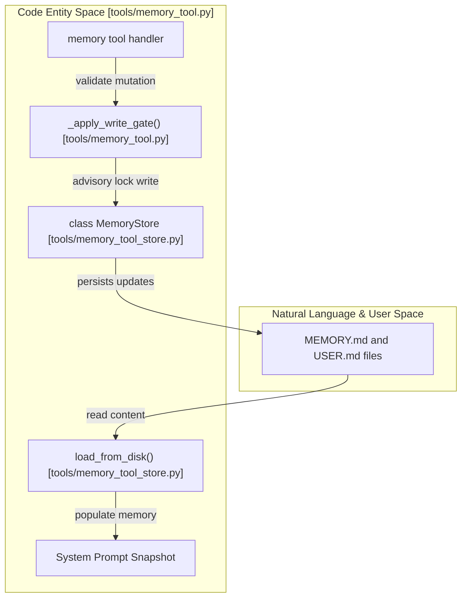
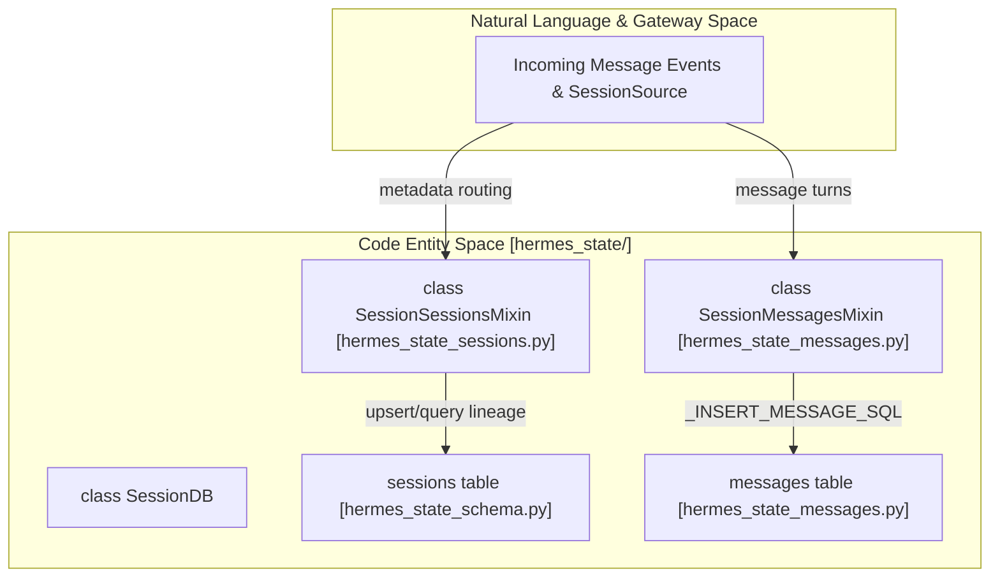

# Memory and Sessions

<details>
<summary>Relevant source files</summary>

The following files were used as context for generating this wiki page:

- [.python-version](.python-version)
- [agent/background_review.py](agent/background_review.py)
- [agent/message_metadata.py](agent/message_metadata.py)
- [agent/session_persistence.py](agent/session_persistence.py)
- [agent/transcript_repair.py](agent/transcript_repair.py)
- [gateway/session_local_title.py](gateway/session_local_title.py)
- [hermes_cli/observability/shared_metrics_connectors.py](hermes_cli/observability/shared_metrics_connectors.py)
- [hermes_cli/sessions_cmd.py](hermes_cli/sessions_cmd.py)
- [hermes_cli/sessions_cmd_journal_mode.py](hermes_cli/sessions_cmd_journal_mode.py)
- [hermes_cli/sessions_discard.py](hermes_cli/sessions_discard.py)
- [hermes_cli/subcommands/sessions.py](hermes_cli/subcommands/sessions.py)
- [hermes_cli/subcommands/skills.py](hermes_cli/subcommands/skills.py)
- [hermes_cli/write_approval_commands.py](hermes_cli/write_approval_commands.py)
- [hermes_state_common.py](hermes_state_common.py)
- [hermes_state_compression.py](hermes_state_compression.py)
- [hermes_state_fts.py](hermes_state_fts.py)
- [hermes_state_gateway.py](hermes_state_gateway.py)
- [hermes_state_maintenance.py](hermes_state_maintenance.py)
- [hermes_state_messages.py](hermes_state_messages.py)
- [hermes_state_portability.py](hermes_state_portability.py)
- [hermes_state_schema.py](hermes_state_schema.py)
- [hermes_state_search.py](hermes_state_search.py)
- [hermes_state_sessions.py](hermes_state_sessions.py)
- [hermes_state_titles.py](hermes_state_titles.py)
- [hermes_state_usage.py](hermes_state_usage.py)
- [tests/agent/test_context_engine_message_uid.py](tests/agent/test_context_engine_message_uid.py)
- [tests/agent/test_tool_call_incremental_persistence.py](tests/agent/test_tool_call_incremental_persistence.py)
- [tests/gateway/test_profile_identity_purge.py](tests/gateway/test_profile_identity_purge.py)
- [tests/gateway/test_rekey_profile_routing.py](tests/gateway/test_rekey_profile_routing.py)
- [tests/gateway/test_resume_latest_local_cli.py](tests/gateway/test_resume_latest_local_cli.py)
- [tests/hermes_cli/test_doctor_journal_modes.py](tests/hermes_cli/test_doctor_journal_modes.py)
- [tests/hermes_cli/test_profile_identity_purge_cmd.py](tests/hermes_cli/test_profile_identity_purge_cmd.py)
- [tests/hermes_cli/test_sessions_delete.py](tests/hermes_cli/test_sessions_delete.py)
- [tests/hermes_cli/test_sessions_discard.py](tests/hermes_cli/test_sessions_discard.py)
- [tests/hermes_cli/test_sessions_set_journal_mode.py](tests/hermes_cli/test_sessions_set_journal_mode.py)
- [tests/hermes_cli/test_sessions_source_local.py](tests/hermes_cli/test_sessions_source_local.py)
- [tests/hermes_cli/test_shared_metrics_connectors.py](tests/hermes_cli/test_shared_metrics_connectors.py)
- [tests/hermes_state/test_canonical_title_guard.py](tests/hermes_state/test_canonical_title_guard.py)
- [tests/hermes_state/test_compression_created_source.py](tests/hermes_state/test_compression_created_source.py)
- [tests/hermes_state/test_delete_session_write_guards.py](tests/hermes_state/test_delete_session_write_guards.py)
- [tests/hermes_state/test_fts_index_fail_open.py](tests/hermes_state/test_fts_index_fail_open.py)
- [tests/hermes_state/test_fts_layout_drift.py](tests/hermes_state/test_fts_layout_drift.py)
- [tests/hermes_state/test_fts_rebuild_corruption_class.py](tests/hermes_state/test_fts_rebuild_corruption_class.py)
- [tests/hermes_state/test_hermes_state.py](tests/hermes_state/test_hermes_state.py)
- [tests/hermes_state/test_isolation_marker_env.py](tests/hermes_state/test_isolation_marker_env.py)
- [tests/hermes_state/test_live_db_guard_ancestry.py](tests/hermes_state/test_live_db_guard_ancestry.py)
- [tests/hermes_state/test_message_uid.py](tests/hermes_state/test_message_uid.py)
- [tests/hermes_state/test_never_active_keyed_prune.py](tests/hermes_state/test_never_active_keyed_prune.py)
- [tests/hermes_state/test_orphan_gateway_session_repair.py](tests/hermes_state/test_orphan_gateway_session_repair.py)
- [tests/hermes_state/test_pinned_lineage.py](tests/hermes_state/test_pinned_lineage.py)
- [tests/hermes_state/test_placeholder_provenance.py](tests/hermes_state/test_placeholder_provenance.py)
- [tests/hermes_state/test_purge_profile_state.py](tests/hermes_state/test_purge_profile_state.py)
- [tests/hermes_state/test_rekey_profile_state.py](tests/hermes_state/test_rekey_profile_state.py)
- [tests/hermes_state/test_search_or_relaxed_fallback.py](tests/hermes_state/test_search_or_relaxed_fallback.py)
- [tests/hermes_state/test_session_import_keep_flags.py](tests/hermes_state/test_session_import_keep_flags.py)
- [tests/hermes_state/test_state_db_holders.py](tests/hermes_state/test_state_db_holders.py)
- [tests/hermes_state/test_state_db_holders_windows_live.py](tests/hermes_state/test_state_db_holders_windows_live.py)
- [tests/hermes_state/test_unaddressed_rewrite_identity.py](tests/hermes_state/test_unaddressed_rewrite_identity.py)
- [tests/test_utils_atomic_writers_deleted_profile.py](tests/test_utils_atomic_writers_deleted_profile.py)
- [tests/tools/test_connector_dispatch_policy.py](tests/tools/test_connector_dispatch_policy.py)
- [tests/tools/test_connectors_import_deadlock.py](tests/tools/test_connectors_import_deadlock.py)
- [tests/tools/test_memory_patch_action.py](tests/tools/test_memory_patch_action.py)
- [tests/tools/test_memory_tool.py](tests/tools/test_memory_tool.py)
- [tests/tools/test_session_search.py](tests/tools/test_session_search.py)
- [tests/tools/test_session_search_readonly.py](tests/tools/test_session_search_readonly.py)
- [tests/tools/test_skill_pending_diff_batch.py](tests/tools/test_skill_pending_diff_batch.py)
- [tests/tools/test_threat_patterns.py](tests/tools/test_threat_patterns.py)
- [tests/tools/test_translate_execute_context.py](tests/tools/test_translate_execute_context.py)
- [tests/tools/test_wake_word.py](tests/tools/test_wake_word.py)
- [tests/tools/test_wake_word_stream_recovery.py](tests/tools/test_wake_word_stream_recovery.py)
- [tests/tools/test_working_diff.py](tests/tools/test_working_diff.py)
- [tests/tools/test_write_approval.py](tests/tools/test_write_approval.py)
- [tests/tui_gateway/test_stranded_session_adoption.py](tests/tui_gateway/test_stranded_session_adoption.py)
- [tools/connectors/__init__.py](tools/connectors/__init__.py)
- [tools/connectors/data_use.py](tools/connectors/data_use.py)
- [tools/connectors/dispatch.py](tools/connectors/dispatch.py)
- [tools/memory_tool.py](tools/memory_tool.py)
- [tools/memory_tool_store.py](tools/memory_tool_store.py)
- [tools/session_search_tool.py](tools/session_search_tool.py)
- [tools/threat_patterns.py](tools/threat_patterns.py)
- [tools/voice_mode_transcript.py](tools/voice_mode_transcript.py)
- [tools/wake_word.py](tools/wake_word.py)
- [tools/wake_word_engines.py](tools/wake_word_engines.py)
- [tools/wakewords/README.md](tools/wakewords/README.md)
- [tools/working_diff.py](tools/working_diff.py)
- [tools/write_approval.py](tools/write_approval.py)
- [website/docs/developer-guide/context-engine-plugin.md](website/docs/developer-guide/context-engine-plugin.md)
- [website/docs/developer-guide/session-storage.md](website/docs/developer-guide/session-storage.md)
- [website/docs/user-guide/features/memory.md](website/docs/user-guide/features/memory.md)
- [website/docs/user-guide/features/wake-word.md](website/docs/user-guide/features/wake-word.md)
- [website/docs/user-guide/sessions.md](website/docs/user-guide/sessions.md)
- [website/i18n/zh-Hans/docusaurus-plugin-content-docs/current/guides/tips.md](website/i18n/zh-Hans/docusaurus-plugin-content-docs/current/guides/tips.md)
- [website/i18n/zh-Hans/docusaurus-plugin-content-docs/current/user-guide/messaging/index.md](website/i18n/zh-Hans/docusaurus-plugin-content-docs/current/user-guide/messaging/index.md)
- [website/i18n/zh-Hans/docusaurus-plugin-content-docs/current/user-guide/sessions.md](website/i18n/zh-Hans/docusaurus-plugin-content-docs/current/user-guide/sessions.md)

</details>


## Purpose and Scope
This page covers the core subsystems responsible for persistent memory management and session lifecycle persistence in Hermes Agent. It details the file-based persistent memory store (`MEMORY.md` and `USER.md`), the SQLite-backed `SessionDB` transaction and storage architecture (`SessionMessagesMixin`, `SessionSessionsMixin`), background review daemons, conversational trajectory logging, advanced full-text session search (`session_search`), and recovery workflows.

---

## Memory System (`MEMORY.md` and `USER.md`)

The agent memory system manages persistent cross-session knowledge using two markdown files located in the profile memories directory (`~/.hermes/memories/`): `MEMORY.md` (agent internal notes, heuristics, and environment facts) and `USER.md` (user preferences, profile, and communication style) [tools/memory_tool.py:38-42]().

| File | Purpose | Character Limit | Supported Tool Actions |
|---|---|---|---|
| `MEMORY.md` | Agent's internal notes & heuristics | 2,200 chars | `add`, `replace`, `remove`, `patch` |
| `USER.md` | User profile & preferences | 1,375 chars | `add`, `replace`, `remove`, `patch` |

### `MemoryStore` and Frozen Snapshot Pattern

The `MemoryStore` class manages file I/O, validations, and constraints [tools/memory_tool_store.py:1-10](). It uses a **frozen snapshot pattern**:
- **Initialization**: At startup, `load_from_disk()` parses the markdown files, validates structural integrity against injection attacks, and builds a static system prompt snapshot [tools/memory_tool_store.py:100-101]().
- **Atomic Operations**: Mid-session mutations invoked via the `memory` tool are safeguarded by advisory locking (`fcntl` on Unix systems, `msvcrt` on Windows) to prevent race conditions during concurrent multi-process access [tools/memory_tool.py:18-29]().
- **Write Gating**: The function `_apply_write_gate()` intercepts write operations, evaluating them against configured write approval rules before modifying disk storage [tools/memory_tool.py:131-138]().

### Background Review System

After conversation turns complete, Hermes can optionally spawn a background review daemon. This daemon forks the `AIAgent` instance and replays conversation snapshots asynchronously in a background thread via `prepare_background_review_run()` to evaluate whether new skills or memory updates should be persisted, without blocking the foreground interactive session [agent/background_review.py:75-89]().

### Memory System Data Flow


Sources: [tools/memory_tool.py:18-29](), [tools/memory_tool.py:38-42](), [tools/memory_tool.py:131-138](), [tools/memory_tool_store.py:1-10](), [tools/memory_tool_store.py:100-101](), [agent/background_review.py:75-89]()

---

## Session Architecture and SQLite Persistence (`SessionDB`)

Conversational histories, system prompts, routing metadata, and token usage statistics are durably stored in a SQLite database (`~/.hermes/state.db`) managed by the `SessionDB` class [website/docs/user-guide/sessions.md:17-28](). WAL (Write-Ahead Logging) mode is enabled to support multiple concurrent readers alongside a single active writer.

### Core Mixins and Tables
- **`SessionMessagesMixin`**: Implements transcript persistence, handling message appends, replacements, rewinds, and resume assembly via `_INSERT_MESSAGE_SQL` [hermes_state_messages.py:1-39]().
- **`SessionSessionsMixin`**: Manages session lifecycle operations such as row upserts, lifecycle flags (`archived`, `pinned`), model configuration updates, listing/counting queries, and auto-archive sweeps [hermes_state_sessions.py:1-12]().
- **`sessions` Table**: Stores session UUIDs, source platform tags, timestamps, model parameters, working directories (`cwd`), and branch references [hermes_state_schema.py:78-98]().
- **`messages` Table**: Links individual turns to a `session_id`, tracking role, content, tool calls, and execution dispositions [hermes_state_messages.py:33-38]().
- **Lineage Tracking**: Uses a recursive Common Table Expression (`_LINEAGE_CTE_SQL`) traversing `parent_session_id` fields to connect compression-split child sessions and delegation branches [hermes_state_sessions.py:48-72]().

### Session State Storage Flow


Sources: [hermes_state_messages.py:1-39](), [hermes_state_messages.py:33-38](), [hermes_state_sessions.py:1-12](), [hermes_state_sessions.py:48-72](), [hermes_state_schema.py:78-98](), [website/docs/user-guide/sessions.md:17-28]()

---

## Session Search, Recall, and Native CJK FTS5 Extension

Hermes provides conversational history recall through the `session_search` tool without requiring LLM generation calls [tools/session_search_tool.py:1-10]().

### Search Modes

| Mode | Trigger Arguments | Description |
|---|---|---|
| **DISCOVERY** | `query` | Full-text search across all sessions with lineage deduplication and adaptive context windows [tools/session_search_tool.py:4-7](). |
| **SCROLL** | `session_id` + `around_message_id` | Retrieves a bounded window of messages around a target anchor message [tools/session_search_tool.py:4-7](). |
| **READ** | `session_id` | Returns the full transcript or an optimized head/tail truncation of a session [tools/session_search_tool.py:4-7](). |
| **BROWSE** | None | Lists recent sessions chronologically with preview metadata [tools/session_search_tool.py:4-7](). |

### Native CJK FTS5 Tokenizer
Standard whitespace-based tokenizers cannot parse unspaced Chinese, Japanese, or Korean scripts. Hermes integrates a native CJK tokenizer extension into SQLite FTS5 virtual table schemas (`messages_fts`), enabling accurate ngram and codepoint-based full-text indexing over multilingual conversation histories [hermes_state_search.py:1-25](), [hermes_state_schema.py:1-28](). The `_is_cjk` function [hermes_state_search.py:91-92]() determines if a character is within a CJK Unicode range, which is used to decide whether to apply CJK-specific tokenization rules.

```mermaid
graph TD
    subgraph "Natural Language Query"
        UserQuery["User Search Query (e.g., 'fix bug', '修复错误')"]
    end

    subgraph "Code Entity Space [tools/session_search_tool.py, hermes_state_search.py]"
        SessionSearchTool["session_search tool [tools/session_search_tool.py]"]
        FTS5QueryBuilder["FTS5 Query Builder [hermes_state_search.py]"]
        CJKTokenizerCheck["_is_cjk() [hermes_state_search.py]"]
        MessagesFTS["messages_fts (SQLite FTS5 Virtual Table)"]
        SessionDB["SessionDB (SQLite)"]
    end

    UserQuery -->|invokes| SessionSearchTool
    SessionSearchTool -->|parses query| FTS5QueryBuilder
    FTS5QueryBuilder -->|checks for CJK characters| CJKTokenizerCheck
    CJKTokenizerCheck -- "CJK detected" -->|applies CJK tokenization| MessagesFTS
    CJKTokenizerCheck -- "CJK not detected" -->|applies standard tokenization| MessagesFTS
    MessagesFTS -->|returns matching message IDs| SessionDB
    SessionDB -->|retrieves full message content| SessionSearchTool
    SessionSearchTool -->|formats results| SearchResults["Formatted Search Results"]
```
Sources: [tools/session_search_tool.py:1-10](), [tools/session_search_tool.py:4-7](), [hermes_state_search.py:1-25](), [hermes_state_search.py:91-92](), [hermes_state_schema.py:1-28]()

---

## Lifecycle, Maintenance, and Offline Recovery

Session lifecycles are governed by metadata flags in SQLite supporting automatic archiving, manual pinning, and recovery after abrupt termination [website/docs/user-guide/sessions.md:128]().

### Database Repair and Offline Recovery CLI
When database corruption or schema drift occurs, recovery utilities can be invoked via the CLI:
- **`hermes sessions repair`**: Evaluates database schema integrity and executes safe in-place repairs accompanied by automated backups via `repair_state_db_schema()` [hermes_cli/sessions_cmd.py:102-143]().
- **`hermes sessions recover`**: Performs offline recovery by operating on a temporary isolated copy of the database, rebuilding clean canonical tables (`sessions`, `messages`) and indexing trees into a fresh SQLite output file without touching live operational data [hermes_cli/sessions_cmd.py:145-167]().

Sources: [hermes_cli/sessions_cmd.py:102-143](), [hermes_cli/sessions_cmd.py:145-167](), [website/docs/user-guide/sessions.md:128]()