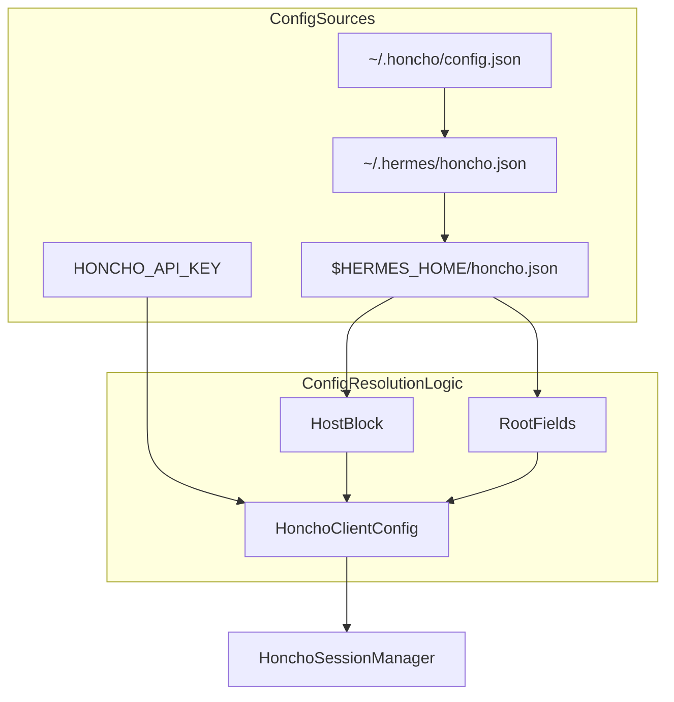
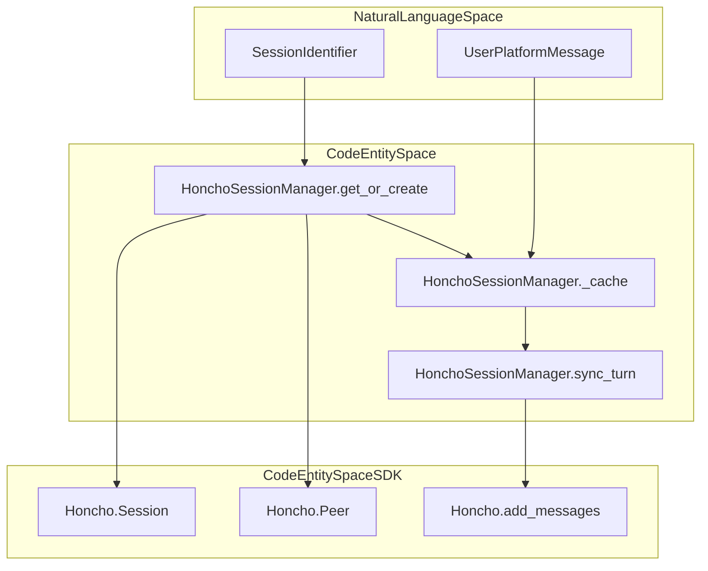
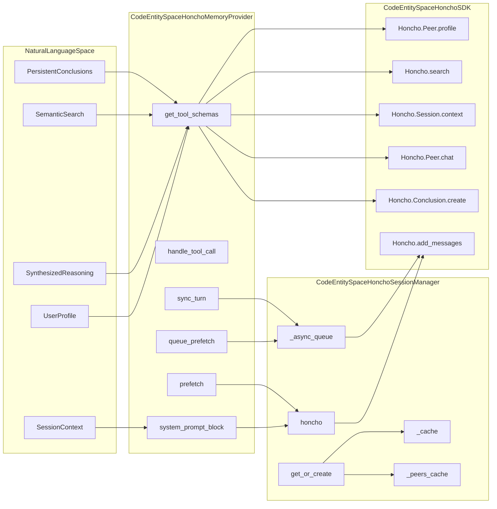

# Honcho Integration

Relevant source files

The following files were used as context for generating this wiki page:

- [agent/memory_manager.py](agent/memory_manager.py)
- [agent/memory_provider.py](agent/memory_provider.py)
- [hermes_cli/memory_provider_migration.py](hermes_cli/memory_provider_migration.py)
- [optional-skills/autonomous-ai-agents/honcho/SKILL.md](optional-skills/autonomous-ai-agents/honcho/SKILL.md)
- [tests/agent/test_memory_migration_notifications.py](tests/agent/test_memory_migration_notifications.py)
- [tests/agent/test_memory_provider.py](tests/agent/test_memory_provider.py)
- [tests/agent/test_memory_stalled_background_call.py](tests/agent/test_memory_stalled_background_call.py)
- [tests/agent/test_moa_quiet_reference_output.py](tests/agent/test_moa_quiet_reference_output.py)
- [tests/agent/test_pre_compress_checkpoint_contract.py](tests/agent/test_pre_compress_checkpoint_contract.py)
- [tests/agent/test_streaming_context_scrubber.py](tests/agent/test_streaming_context_scrubber.py)
- [tests/gateway/test_agent_cache_memory_lifecycle.py](tests/gateway/test_agent_cache_memory_lifecycle.py)
- [tests/gateway/test_vision_memory_leak.py](tests/gateway/test_vision_memory_leak.py)
- [tests/hermes_cli/test_memory_provider_migration.py](tests/hermes_cli/test_memory_provider_migration.py)
- [website/docs/developer-guide/memory-provider-plugin.md](website/docs/developer-guide/memory-provider-plugin.md)
- [website/docs/user-guide/features/honcho.md](website/docs/user-guide/features/honcho.md)
- [website/docs/user-guide/features/memory-providers.md](website/docs/user-guide/features/memory-providers.md)
- [website/i18n/zh-Hans/docusaurus-plugin-content-docs/current/developer-guide/memory-provider-plugin.md](website/i18n/zh-Hans/docusaurus-plugin-content-docs/current/developer-guide/memory-provider-plugin.md)
- [website/i18n/zh-Hans/docusaurus-plugin-content-docs/current/user-guide/features/memory-providers.md](website/i18n/zh-Hans/docusaurus-plugin-content-docs/current/user-guide/features/memory-providers.md)

Honcho is an AI-native memory system integrated into Hermes Agent as a memory provider plugin. It provides persistent cross-session user modeling by maintaining deep, evolving representations of users and their contexts across conversations [website/docs/user-guide/features/honcho.md:9](). Honcho complements or replaces traditional local file-based memory (`MEMORY.md`, `USER.md`) with rich semantic search, dialectic reasoning, peer cards, conclusions, and session summaries via its API [website/docs/user-guide/features/honcho.md:15-26]().

This page details the implementation of Honcho integration within Hermes Agent, including configuration resolution via `HonchoClientConfig`, session orchestration through `HonchoSessionManager`, write frequency modes, asynchronous prefetch/recall pipelines, and multi-pass dialectic queries.

---

## Configuration System

Honcho configuration is resolved through a prioritized hierarchy supporting isolated Hermes profiles, default paths, legacy global configurations, and environment variables [website/docs/user-guide/features/honcho.md:107-108](). The `HonchoClientConfig` class encapsulates this configuration resolution logic.

### Configuration Resolution Chain

- **Profile-local config**: `$HERMES_HOME/honcho.json` [website/docs/user-guide/features/honcho.md:108]()
- **Default profile config**: `~/.hermes/honcho.json` [website/docs/user-guide/features/honcho.md:108]()
- **Legacy global config**: `~/.honcho/config.json` [website/docs/user-guide/features/honcho.md:108]()
- **Environment variables**: `HONCHO_API_KEY`, `HONCHO_ENVIRONMENT`, `HONCHO_BASE_URL`, etc.

The active **host key** is derived from the active Hermes profile name. For instance, a profile named `"coder"` corresponds to a host key of `"hermes_coder"`.

After resolution, the effective configuration merges the profile-specific "host block" and root-level global configuration fields into a `HonchoClientConfig` instance. This configuration drives session scoping, peer identities, write frequency, memory recall modes, context token budgets, and dialectic reasoning levels.

### Configuration Resolution Diagram

Sources: [website/docs/user-guide/features/honcho.md:107-108]()

### Key Configuration Fields

| Key | Default | Description |
|-----|---------|-------------|
| `apiKey` | -- | API key from [app.honcho.dev](https://app.honcho.dev) |
| `baseUrl` | -- | Base URL for self-hosted Honcho |
| `peerName` | -- | User peer identity |
| `aiPeer` | host key | AI peer identity (one per profile) |
| `workspace` | host key | Shared workspace ID |
| `contextTokens` | `null` (uncapped) | Token budget for auto-injected context per turn. Truncates at word boundaries |
| `contextCadence` | `1` | Minimum turns between `context()` API calls (base layer refresh) |
| `dialecticCadence` | `2` | Minimum turns between `peer.chat()` LLM calls. Recommended 1–5. Only applies to `hybrid`/`context` modes |
| `dialecticDepth` | `1` | Number of `.chat()` passes per dialectic invocation. Clamped 1–3. Pass 0: cold/warm prompt, pass 1: self-audit, pass 2: reconciliation |
| `dialecticDepthLevels` | `null` | Optional array of reasoning levels per pass, e.g. `["minimal", "low", "medium"]`. Overrides proportional defaults |
| `dialecticReasoningLevel` | `'low'` | Base reasoning level: `minimal`, `low`, `medium`, `high`, `max` |
| `dialecticDynamic` | `true` | When `true`, model can override reasoning level per-call via tool param |
| `dialecticMaxChars` | `600` | Max chars of dialectic result injected into system prompt |
| `recallMode` | `'hybrid'` | `hybrid` (auto-inject + tools), `context` (inject only), `tools` (tools only) |
| `writeFrequency` | `'async'` | When to flush messages: `async` (background thread), `turn` (sync), `session` (batch on end), or integer N |
| `saveMessages` | `true` | Whether to persist messages to Honcho API |
| `observationMode` | `'directional'` | `directional` (all on) or `unified` (shared pool). Override with `observation` object |
| `messageMaxChars` | `25000` | Max chars per message (chunked if exceeded) |
| `dialecticMaxInputChars` | `10000` | Max chars for dialectic query input to `peer.chat()` |
| `sessionStrategy` | `'per-directory'`, `'per-repo'`, `'per-session'`, `'global'` | Strategy for session isolation |

Sources: [website/docs/user-guide/features/honcho.md:87-103]()

---

## HonchoSessionManager and Session Storage

The `HonchoSessionManager` class orchestrates conversation sessions backed by Honcho AI-native memory. It manages thread-safe local caches mirroring remote Honcho sessions, allowing low-latency message buffering, automatic OAuth token refreshing, and asynchronous syncing to the backend.

### HonchoSession Dataclass

- `HonchoSession` is a dataclass representing the state of an active conversation session [plugins/memory/honcho/session.py:38-51]().
- Each session holds messages locally (`messages`), creation and update timestamps (`created_at`, `updated_at`), metadata, and designated peer identifiers (`user_peer_id`, `assistant_peer_id`) [plugins/memory/honcho/session.py:42-49]().
- Messages are added locally via `add_message(role, content, **kwargs)` which appends a dictionary containing role, content, timestamp, and optional parameters [plugins/memory/honcho/session.py:53-57]().

### Core Methods and Architecture

- `honcho`: A property that returns the active `Honcho` SDK client, automatically refreshing near-expiry OAuth tokens in place using bound configuration settings.
- `get_or_create(session_key)`: Synchronously obtains or initializes a local `HonchoSession` bound to the remote Honcho session container.
- `sync_turn(session_key)`: Flushes pending buffered messages to the Honcho backend according to the configured write frequency [plugins/memory/honcho/session.py:92-100]().

### Session Data Flow Diagram

Sources: [plugins/memory/honcho/session.py:38-135]()

---

## Write Frequency Modes

`HonchoSessionManager` supports flexible message flush strategies configured via `write_frequency` [website/docs/user-guide/features/honcho.md:96]():

| Mode | Behavior |
| :--- | :--- |
| `async` (default) | Messages are queued to an internal `_async_queue` and flushed by a background daemon worker thread (`_async_thread`) [plugins/memory/honcho/session.py:114-116](). |
| `turn` | Messages are flushed synchronously after each conversation turn [plugins/memory/honcho/session.py:92-95](). |
| `session` | Messages are buffered locally and flushed only upon session termination [plugins/memory/honcho/session.py:92-95](). |
| Integer `N` | Messages are batched and flushed automatically every `N` turns using an internal turn counter [plugins/memory/honcho/session.py:101](). |

Sources: [website/docs/user-guide/features/honcho.md:96](), [plugins/memory/honcho/session.py:92-117]()

---

## Recall, Prefetch Pipeline, and Context Injection

Honcho injects aggregated context into the user message payload (rather than the system prompt) wrapped within `<memory-context>` fences, thereby preserving prompt caching [website/docs/user-guide/features/honcho.md:39-42](). The `StreamingContextScrubber` [agent/memory_context.py:9]() is responsible for removing these `<memory-context>` blocks from the output stream before it reaches the user interface, preventing sensitive information leakage [tests/agent/test_streaming_context_scrubber.py:29-32]().

### Two-Layer Context Injection

1.  **Base Context**: Refreshed every `contextCadence` turns [website/docs/user-guide/features/honcho.md:45](). It comprises the session summary (`session.context(summary=True)`), the evolving user representation, the user peer card, the AI self-representation, and the AI identity card [website/docs/user-guide/features/honcho.md:45-51]().
2.  **Dialectic Supplement**: Refreshed every `dialecticCadence` turns [website/docs/user-guide/features/honcho.md:52](). It contains multi-pass `.chat()` reasoning synthesized about the user's current context.

Both layers are joined and truncated to fit the `contextTokens` budget via `_truncate_to_budget` (safely respecting word boundaries) [website/docs/user-guide/features/honcho.md:55]().

### Session-Start Prewarm and Current-Query Recall

-   **Session-Start Prewarm**: Upon session initialization, Honcho triggers an asynchronous dialectic reasoning task at the configured `dialecticDepth` to pre-populate the context cache for turn 1 [website/docs/user-guide/features/honcho.md:98-100]().
-   **Current-Query Recall (`recallSync`)**: When `"recallSync": true` is set, active retrievals query using the user's latest request before inference.
-   **Latest-Message Query Rewrite**: When `queryRewrite: true` is enabled, dialectic pass 0 utilizes the shared `memory_query_rewrite` auxiliary task to transform the latest user message into a concise retrieval question.

Sources: [website/docs/user-guide/features/honcho.md:39-104](), [agent/memory_context.py:9](), [tests/agent/test_streaming_context_scrubber.py:29-32]()

---

## Dialectic Queries and Memory Tools

Honcho exposes five bidirectional tools through the `MemoryProvider` interface [website/docs/user-guide/features/memory-providers.md:60-61]():

| Tool Name | Description |
| :--- | :--- |
| `honcho_profile` | Read or update a Peer Card (standing biographical facts like name, role, preferences) [website/docs/user-guide/features/memory-providers.md:60]() |
| `honcho_search` | Hybrid semantic search over historical sessions for a specified peer [website/docs/user-guide/features/memory-providers.md:60]() |
| `honcho_context` | Retrieve raw peer context and session snapshots [website/docs/user-guide/features/memory-providers.md:60]() |
| `honcho_reasoning` | Query the dialectic agent for synthesized natural-language answers (`reasoning_level` customizable per call) [website/docs/user-guide/features/memory-providers.md:60]() |
| `honcho_conclude` | Create, list, or delete persistent conclusions about a peer [website/docs/user-guide/features/memory-providers.md:60]()

### Multi-Pass Dialectic Reasoning (`honcho_reasoning`)

When `dialecticDepth` > 1, each invocation executes multiple `.chat()` passes [website/docs/user-guide/features/honcho.md:85-95]():
-   **Pass 0**: Cold or warm prompt initialization [website/docs/user-guide/features/honcho.md:87-89]().
-   **Pass 1**: Self-audit to identify assessment gaps and synthesize historical evidence [website/docs/user-guide/features/honcho.md:90]().
-   **Pass 2**: Reconciliation pass to resolve contradictions across prior passes into a final synthesis [website/docs/user-guide/features/honcho.md:91]().

Sources: [website/docs/user-guide/features/honcho.md:85-95](), [website/docs/user-guide/features/memory-providers.md:60]()

---

## Natural Language Space to Code Entity Space Bridge

Sources: [agent/memory_provider.py:84-151](), [website/docs/user-guide/features/memory-providers.md:60](), [website/docs/user-guide/features/honcho.md:60](), [plugins/memory/honcho/session.py:38-135]()