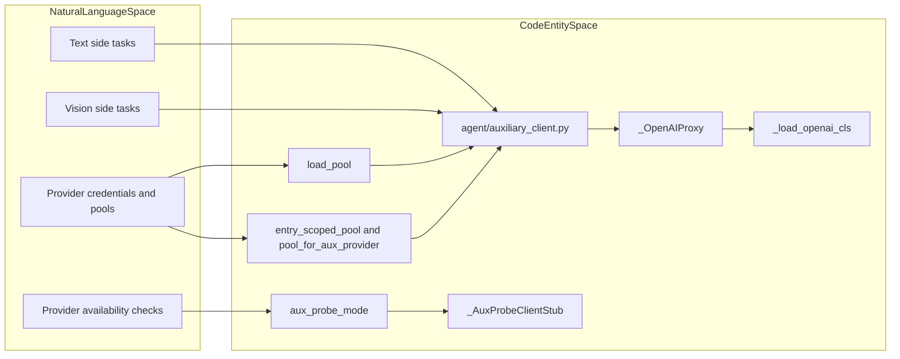
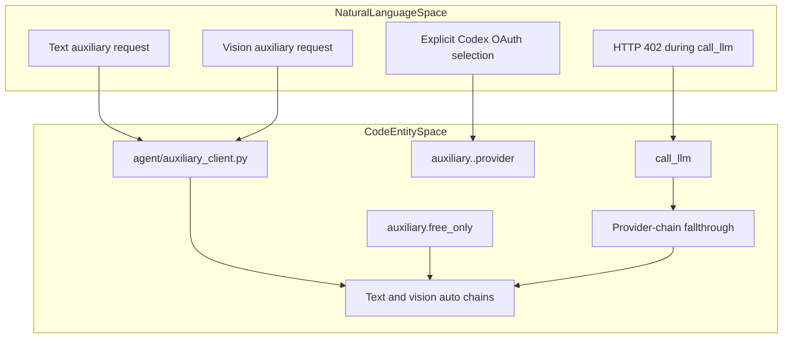

# Auxiliary Client

Relevant source files

The following files were used as context for generating this wiki page:

- [agent/acp_openai_bridge.py](agent/acp_openai_bridge.py)
- [agent/anthropic_adapter.py](agent/anthropic_adapter.py)
- [agent/anthropic_endpoints.py](agent/anthropic_endpoints.py)
- [agent/anthropic_message_convert.py](agent/anthropic_message_convert.py)
- [agent/anthropic_thinking_policy.py](agent/anthropic_thinking_policy.py)
- [agent/anthropic_thinking_replay.py](agent/anthropic_thinking_replay.py)
- [agent/auxiliary_client.py](agent/auxiliary_client.py)
- [agent/bedrock_adapter.py](agent/bedrock_adapter.py)
- [agent/codex_responses_adapter.py](agent/codex_responses_adapter.py)
- [agent/copilot_acp_client.py](agent/copilot_acp_client.py)
- [agent/gemini_long_decode.py](agent/gemini_long_decode.py)
- [agent/gemini_native_adapter.py](agent/gemini_native_adapter.py)
- [agent/gemini_schema.py](agent/gemini_schema.py)
- [agent/image_eviction_policy.py](agent/image_eviction_policy.py)
- [agent/image_replay.py](agent/image_replay.py)
- [agent/native_compaction.py](agent/native_compaction.py)
- [agent/nous_rate_guard.py](agent/nous_rate_guard.py)
- [agent/transports/codex.py](agent/transports/codex.py)
- [cli-config.yaml.example](cli-config.yaml.example)
- [cli.py](cli.py)
- [contributors/emails/272618364+MaxFreedomPollard@users.noreply.github.com](contributors/emails/272618364+MaxFreedomPollard@users.noreply.github.com)
- [contributors/emails/dickson.neoh@gmail.com](contributors/emails/dickson.neoh@gmail.com)
- [contributors/emails/qhs19950124@outlook.com](contributors/emails/qhs19950124@outlook.com)
- [evals/anthropic_proxy_thinking_replay.py](evals/anthropic_proxy_thinking_replay.py)
- [evals/gemini_type_array_probe.py](evals/gemini_type_array_probe.py)
- [evals/postmortem/forensics/logcalls.py](evals/postmortem/forensics/logcalls.py)
- [gateway/run.py](gateway/run.py)
- [gateway/session.py](gateway/session.py)
- [gateway/slash_commands.py](gateway/slash_commands.py)
- [hermes_cli/cli_commands_mixin.py](hermes_cli/cli_commands_mixin.py)
- [hermes_cli/commands.py](hermes_cli/commands.py)
- [hermes_cli/config.py](hermes_cli/config.py)
- [hermes_cli/config_defaults.py](hermes_cli/config_defaults.py)
- [hermes_cli/main.py](hermes_cli/main.py)
- [hermes_cli/setup.py](hermes_cli/setup.py)
- [hermes_cli/subcommands/computer_use.py](hermes_cli/subcommands/computer_use.py)
- [hermes_state.py](hermes_state.py)
- [run_agent.py](run_agent.py)
- [skills/autonomous-ai-agents/computer-use/SKILL.md](skills/autonomous-ai-agents/computer-use/SKILL.md)
- [tests/agent/test_acp_openai_bridge.py](tests/agent/test_acp_openai_bridge.py)
- [tests/agent/test_anthropic_adapter.py](tests/agent/test_anthropic_adapter.py)
- [tests/agent/test_anthropic_preserved_thinking_replay.py](tests/agent/test_anthropic_preserved_thinking_replay.py)
- [tests/agent/test_anthropic_signed_platform_replay.py](tests/agent/test_anthropic_signed_platform_replay.py)
- [tests/agent/test_anthropic_thinking_disable.py](tests/agent/test_anthropic_thinking_disable.py)
- [tests/agent/test_auxiliary_client.py](tests/agent/test_auxiliary_client.py)
- [tests/agent/test_bedrock_adapter.py](tests/agent/test_bedrock_adapter.py)
- [tests/agent/test_bedrock_converse_reasoning_replay.py](tests/agent/test_bedrock_converse_reasoning_replay.py)
- [tests/agent/test_bedrock_integration.py](tests/agent/test_bedrock_integration.py)
- [tests/agent/test_codex_responses_adapter.py](tests/agent/test_codex_responses_adapter.py)
- [tests/agent/test_copilot_acp_client.py](tests/agent/test_copilot_acp_client.py)
- [tests/agent/test_deepseek_anthropic_thinking.py](tests/agent/test_deepseek_anthropic_thinking.py)
- [tests/agent/test_free_tier_rate_limit_class.py](tests/agent/test_free_tier_rate_limit_class.py)
- [tests/agent/test_gemini_native_adapter.py](tests/agent/test_gemini_native_adapter.py)
- [tests/agent/test_gemini_schema.py](tests/agent/test_gemini_schema.py)
- [tests/agent/test_gemini_type_arrays.py](tests/agent/test_gemini_type_arrays.py)
- [tests/agent/test_image_eviction_policy.py](tests/agent/test_image_eviction_policy.py)
- [tests/agent/test_image_replay.py](tests/agent/test_image_replay.py)
- [tests/agent/test_native_compaction.py](tests/agent/test_native_compaction.py)
- [tests/agent/test_native_compaction_nontext_retention.py](tests/agent/test_native_compaction_nontext_retention.py)
- [tests/agent/test_native_compaction_typed_user_retention.py](tests/agent/test_native_compaction_typed_user_retention.py)
- [tests/agent/test_nous_rate_guard.py](tests/agent/test_nous_rate_guard.py)
- [tests/agent/test_outbound_stale_vision.py](tests/agent/test_outbound_stale_vision.py)
- [tests/agent/test_provider_parity.py](tests/agent/test_provider_parity.py)
- [tests/agent/test_responses_empty_tool_replay.py](tests/agent/test_responses_empty_tool_replay.py)
- [tests/agent/test_run_budget.py](tests/agent/test_run_budget.py)
- [tests/agent/test_turn_usage_log_line.py](tests/agent/test_turn_usage_log_line.py)
- [tests/agent/test_welcome_error_identity.py](tests/agent/test_welcome_error_identity.py)
- [tests/agent/test_welcome_tier_recovery.py](tests/agent/test_welcome_tier_recovery.py)
- [tests/agent/transports/test_codex_transport.py](tests/agent/transports/test_codex_transport.py)
- [tests/computer_use/test_cua_no_overlay.py](tests/computer_use/test_cua_no_overlay.py)
- [tests/computer_use/test_cua_spawn_env_sanitization.py](tests/computer_use/test_cua_spawn_env_sanitization.py)
- [tests/computer_use/test_cua_wayland_env.py](tests/computer_use/test_cua_wayland_env.py)
- [tests/computer_use/test_cua_wsl_manifest_path.py](tests/computer_use/test_cua_wsl_manifest_path.py)
- [tests/computer_use/test_doctor.py](tests/computer_use/test_doctor.py)
- [tests/fixtures/spark_failing_turn_shape.json](tests/fixtures/spark_failing_turn_shape.json)
- [tests/gateway/test_session.py](tests/gateway/test_session.py)
- [tests/hermes_cli/test_bedrock_model_picker.py](tests/hermes_cli/test_bedrock_model_picker.py)
- [tests/hermes_cli/test_commands.py](tests/hermes_cli/test_commands.py)
- [tests/hermes_cli/test_gemini_provider.py](tests/hermes_cli/test_gemini_provider.py)
- [tests/tools/test_computer_use.py](tests/tools/test_computer_use.py)
- [tests/tools/test_computer_use_ax_walk_bound.py](tests/tools/test_computer_use_ax_walk_bound.py)
- [tests/tools/test_computer_use_capture_self_window.py](tests/tools/test_computer_use_capture_self_window.py)
- [tests/tools/test_computer_use_cua_0_10_permissions.py](tests/tools/test_computer_use_cua_0_10_permissions.py)
- [tests/tools/test_computer_use_cua_0_9.py](tests/tools/test_computer_use_cua_0_9.py)
- [tests/tools/test_computer_use_cua_backend_linux.py](tests/tools/test_computer_use_cua_backend_linux.py)
- [tests/tools/test_computer_use_doctor_stale_units.py](tests/tools/test_computer_use_doctor_stale_units.py)
- [tests/tools/test_computer_use_screenshot_dedup.py](tests/tools/test_computer_use_screenshot_dedup.py)
- [tools/computer_use/__init__.py](tools/computer_use/__init__.py)
- [tools/computer_use/backend.py](tools/computer_use/backend.py)
- [tools/computer_use/cua_backend.py](tools/computer_use/cua_backend.py)
- [tools/computer_use/cua_backend_capture.py](tools/computer_use/cua_backend_capture.py)
- [tools/computer_use/cua_backend_daemon.py](tools/computer_use/cua_backend_daemon.py)
- [tools/computer_use/cua_backend_driver.py](tools/computer_use/cua_backend_driver.py)
- [tools/computer_use/cua_backend_input.py](tools/computer_use/cua_backend_input.py)
- [tools/computer_use/cua_backend_parse.py](tools/computer_use/cua_backend_parse.py)
- [tools/computer_use/cua_backend_session.py](tools/computer_use/cua_backend_session.py)
- [tools/computer_use/doctor.py](tools/computer_use/doctor.py)
- [tools/computer_use/permissions.py](tools/computer_use/permissions.py)
- [tools/computer_use/schema.py](tools/computer_use/schema.py)
- [tools/computer_use/tool.py](tools/computer_use/tool.py)
- [tools/computer_use_tool.py](tools/computer_use_tool.py)
- [ui-tui/src/__tests__/details.test.ts](ui-tui/src/__tests__/details.test.ts)
- [ui-tui/src/domain/details.ts](ui-tui/src/domain/details.ts)
- [website/docs/getting-started/quickstart.md](website/docs/getting-started/quickstart.md)
- [website/docs/guides/aws-bedrock.md](website/docs/guides/aws-bedrock.md)
- [website/docs/guides/google-gemini.md](website/docs/guides/google-gemini.md)
- [website/docs/guides/google-vertex.md](website/docs/guides/google-vertex.md)
- [website/docs/integrations/providers.md](website/docs/integrations/providers.md)
- [website/docs/reference/cli-commands.md](website/docs/reference/cli-commands.md)
- [website/docs/reference/environment-variables.md](website/docs/reference/environment-variables.md)
- [website/docs/reference/slash-commands.md](website/docs/reference/slash-commands.md)
- [website/docs/user-guide/cli.md](website/docs/user-guide/cli.md)
- [website/docs/user-guide/configuration.md](website/docs/user-guide/configuration.md)
- [website/docs/user-guide/features/computer-use.md](website/docs/user-guide/features/computer-use.md)
- [website/docs/user-guide/features/fallback-providers.md](website/docs/user-guide/features/fallback-providers.md)
- [website/docs/user-guide/features/vision.md](website/docs/user-guide/features/vision.md)
- [website/docs/user-guide/messaging/index.md](website/docs/user-guide/messaging/index.md)
- [website/docs/user-guide/tui.md](website/docs/user-guide/tui.md)
- [website/i18n/zh-Hans/docusaurus-plugin-content-docs/current/getting-started/quickstart.md](website/i18n/zh-Hans/docusaurus-plugin-content-docs/current/getting-started/quickstart.md)
- [website/i18n/zh-Hans/docusaurus-plugin-content-docs/current/reference/environment-variables.md](website/i18n/zh-Hans/docusaurus-plugin-content-docs/current/reference/environment-variables.md)
- [website/i18n/zh-Hans/docusaurus-plugin-content-docs/current/user-guide/configuration.md](website/i18n/zh-Hans/docusaurus-plugin-content-docs/current/user-guide/configuration.md)
- [website/i18n/zh-Hans/docusaurus-plugin-content-docs/current/user-guide/features/fallback-providers.md](website/i18n/zh-Hans/docusaurus-plugin-content-docs/current/user-guide/features/fallback-providers.md)

## Purpose and Scope

The auxiliary client routes secondary LLM work—such as compression, search, and vision—through a shared client system rather than treating each side task as a separate provider integration. Its documented routing policy distinguishes text tasks from vision tasks, supports automatic fallback, and excludes Codex OAuth from the automatic chains. [agent/auxiliary_client.py:1-8]()

This page covers the router’s visible configuration and availability-probe interfaces, the documented provider-chain policy, and the adapter modules named for Anthropic, Bedrock, Codex, and Gemini. The supplied source excerpts do not include the implementations of those adapters or the router’s request and fallback functions, so their internal request-conversion behavior is not specified here. [agent/auxiliary_client.py:1-8]()

Sources: [agent/auxiliary_client.py:1-8]()

---

## Architecture Overview

`agent.auxiliary_client` is the shared routing module for auxiliary LLM work. Its module documentation describes separate automatic chains for text and vision, and the file imports supporting components for credential pools, custom-provider pools, health tracking, unavailable-provider handling, Codex headers, and structured-output compatibility. [agent/auxiliary_client.py:1-8](), [agent/auxiliary_client.py:39-46](), [agent/auxiliary_client.py:122-137]()

The OpenAI SDK is loaded lazily: `_load_openai_cls()` imports and caches `openai.OpenAI`, while `_OpenAIProxy` forwards construction and instance checks to that cached class. For availability checks, `aux_probe_mode()` activates a thread-local probe flag; `_AuxProbeClientStub` is a non-functional stand-in that raises if used as a real client. [agent/auxiliary_client.py:48-80](), [agent/auxiliary_client.py:83-119]()

### Natural Language and Code Entity Mapping: Auxiliary Routing

Title: "Auxiliary Task Routing to Code Entities"

Sources: [agent/auxiliary_client.py:1-8](), [agent/auxiliary_client.py:48-80](), [agent/auxiliary_client.py:83-123]()

### Configuration and Task Resolution

The default auxiliary task block is created by `_aux()` in `hermes_cli.config_defaults`. It seeds `provider: "auto"`, an empty model, base URL, and API key, a task timeout, and an empty `extra_body`; it also includes `reasoning_effort` unless disabled by the helper’s argument. [hermes_cli/config_defaults.py:20-30]()

The test module identifies `_resolve_task_provider_model` as a resolver used with task, provider, model, base URL, and API-key inputs. Its tests cover explicit providers retaining their identity when a base URL is supplied, and a configured task endpoint supplying its URL and key when the explicit provider matches the task configuration. [tests/agent/test_auxiliary_client.py:12-40](), [tests/agent/test_auxiliary_client.py:89-138]()

| Configuration or interface | Role |
|---|---|
| `_aux()` | Builds the standard auxiliary-task defaults. [hermes_cli/config_defaults.py:20-30]() |
| `auxiliary.<task>` | Task-specific configuration is referenced by the resolver tests, including provider, model, base URL, and API key. [tests/agent/test_auxiliary_client.py:118-138]() |
| `_resolve_task_provider_model` | Test-covered task/provider/model resolution interface. [tests/agent/test_auxiliary_client.py:12-40]() |
| `aux_probe_mode()` | Temporarily enables provider-resolvability probing. [agent/auxiliary_client.py:107-119]() |

Sources: [hermes_cli/config_defaults.py:20-30](), [tests/agent/test_auxiliary_client.py:12-40](), [tests/agent/test_auxiliary_client.py:89-138](), [agent/auxiliary_client.py:107-119]()

---

## Provider Resolution Chain

### Text and Vision Automatic Chains

The module documents two automatic provider chains. For text, the order is main provider and model, OpenRouter, Nous Portal, custom endpoint, native Anthropic, then direct API-key providers; if none resolves, the chain can yield no client. The `auxiliary.free_only` setting restricts the OpenRouter lane to `:free` SKUs. [agent/auxiliary_client.py:1-8]()

For vision, the documented order is the main provider when it is a supported vision backend, OpenRouter, Nous, Anthropic, then a custom endpoint. The module documentation also states that HTTP 402 in `call_llm()` falls through the chain. [agent/auxiliary_client.py:3-8]()

Codex OAuth is not part of either automatic chain. The module documentation limits its use to the main provider or explicit `auxiliary.<task>.provider` configuration. [agent/auxiliary_client.py:6-8]()

| Task class | Documented automatic order |
|---|---|
| Text | Main provider/model → OpenRouter → Nous Portal → custom endpoint → native Anthropic → direct API-key providers → no client. [agent/auxiliary_client.py:3-4]() |
| Vision | Supported main-provider vision backend → OpenRouter → Nous → Anthropic → custom endpoint. [agent/auxiliary_client.py:4-5]() |
| Codex OAuth | Not in the automatic chains; requires the main provider or explicit task-provider selection. [agent/auxiliary_client.py:6-8]() |

### Natural Language and Code Entity Mapping: Provider Resolution

Title: "Automatic Provider Policy and Router Entities"

Sources: [agent/auxiliary_client.py:1-8]()

### Availability Probing

`aux_probe_mode()` sets a thread-local active flag for the duration of its context and restores the prior value on exit. The module describes this mode as resolving provider availability without constructing real SDK clients. `_AuxProbeClientStub` stores the API key and base URL for probe use, but raises a `RuntimeError` on other attribute access so that an availability-only stub cannot silently serve a runtime request. [agent/auxiliary_client.py:83-119]()

Sources: [agent/auxiliary_client.py:83-119]()

---

## Client Types and Adapters

### Lazy OpenAI Client

`_load_openai_cls()` imports `openai.OpenAI` on first use and caches the class in `_OPENAI_CLS_CACHE`. `_OpenAIProxy` delegates construction and `isinstance` checks to the loaded class. This keeps the SDK import out of the module’s initial import path until a client is actually needed. [agent/auxiliary_client.py:48-80]()

Sources: [agent/auxiliary_client.py:48-80]()

### Provider Adapter Modules

The provided repository inventory identifies separate adapter modules for Anthropic, Bedrock, and Gemini, as well as Codex-related adapters and transport code. The auxiliary-client test imports `CodexAuxiliaryClient` and `_CodexCompletionsAdapter` from `agent.auxiliary_client`, while the router imports Codex header and runtime helpers. The supplied excerpts do not show the adapter definitions or their call sites, so detailed protocol conversion and request behavior cannot be established from these materials. [tests/agent/test_auxiliary_client.py:12-40](), [agent/auxiliary_client.py:39-46]()

| Adapter area | Code entities identified in the supplied materials |
|---|---|
| Anthropic | `agent/anthropic_adapter.py` is listed among the related files; implementation details are not included in the supplied excerpt. |
| Bedrock | `agent/bedrock_adapter.py` is listed among the related files; implementation details are not included in the supplied excerpt. |
| Codex | `CodexAuxiliaryClient` and `_CodexCompletionsAdapter` are imported by the auxiliary-client tests. [tests/agent/test_auxiliary_client.py:12-40]() |
| Gemini | `agent/gemini_native_adapter.py` is listed among the related files; implementation details are not included in the supplied excerpt. |

Sources: [tests/agent/test_auxiliary_client.py:12-40](), [agent/auxiliary_client.py:39-46]()

---

## Credential, Endpoint, and TLS Support

The auxiliary router imports `load_pool` from `agent.credential_pool`, along with `entry_scoped_pool` and `pool_for_aux_provider` from `agent.custom_entry_pool`. It also imports health and unavailable-provider helpers, showing that credential-pool and provider-health components are part of the router’s dependencies. The supplied excerpt does not include the resolver implementation that would establish their exact selection order or retry behavior. [agent/auxiliary_client.py:122-134]()

`_resolve_aux_verify()` attempts to load custom-provider TLS settings and resolve HTTPX verification using the configured CA bundle, SSL verification option, and base URL. If that resolution raises an exception, the helper returns `True`, the HTTPX default. [agent/auxiliary_client.py:149-159]()

Sources: [agent/auxiliary_client.py:122-159]()

---

## Error Handling and Fallbacks

The auxiliary-client module imports error-classification patterns and predicates from `agent.error_classifier`, including billing and overload markers and reasoning-parameter rejection checks. It also imports helpers for unavailable-provider reporting and health-state management. These imports establish the error-handling components available to the router, but the supplied excerpt does not show the request loop or how each classification changes fallback behavior. [agent/auxiliary_client.py:29-38](), [agent/auxiliary_client.py:128-134]()

The module-level routing contract specifically states that HTTP 402 in `call_llm()` falls through the provider chain. [agent/auxiliary_client.py:6-8]()

Sources: [agent/auxiliary_client.py:29-38](), [agent/auxiliary_client.py:6-8](), [agent/auxiliary_client.py:128-134]()

---

## Summary Table: Auxiliary Client Entities

| Concept | Code entity | What the supplied source establishes |
|---|---|---|
| Shared auxiliary router | `agent.auxiliary_client` | Module purpose and documented text/vision routing policy. [agent/auxiliary_client.py:1-8]() |
| OpenAI SDK loading | `_load_openai_cls()` | Lazily imports and caches `openai.OpenAI`. [agent/auxiliary_client.py:48-63]() |
| OpenAI compatibility proxy | `_OpenAIProxy` | Delegates construction and instance checks to the loaded SDK class. [agent/auxiliary_client.py:66-80]() |
| Availability probing | `aux_probe_mode()` | Activates and restores the thread-local probe flag. [agent/auxiliary_client.py:107-119]() |
| Probe placeholder | `_AuxProbeClientStub` | Rejects use as a real runtime client. [agent/auxiliary_client.py:89-105]() |
| Default auxiliary task configuration | `_aux()` | Defines default provider, model, endpoint, key, timeout, extra body, and optional reasoning-effort fields. [hermes_cli/config_defaults.py:20-30]() |
| Task resolution | `_resolve_task_provider_model` | Identified and exercised by resolver tests. [tests/agent/test_auxiliary_client.py:12-40]() |
| Codex auxiliary client | `CodexAuxiliaryClient` | Imported by the auxiliary-client test module. [tests/agent/test_auxiliary_client.py:12-40]() |
| Auxiliary TLS verification | `_resolve_aux_verify()` | Resolves configured custom-provider TLS settings, with `True` as the exception fallback. [agent/auxiliary_client.py:149-159]() |

Sources: [agent/auxiliary_client.py:1-8](), [agent/auxiliary_client.py:48-80](), [agent/auxiliary_client.py:89-119](), [agent/auxiliary_client.py:149-159](), [hermes_cli/config_defaults.py:20-30](), [tests/agent/test_auxiliary_client.py:12-40]()