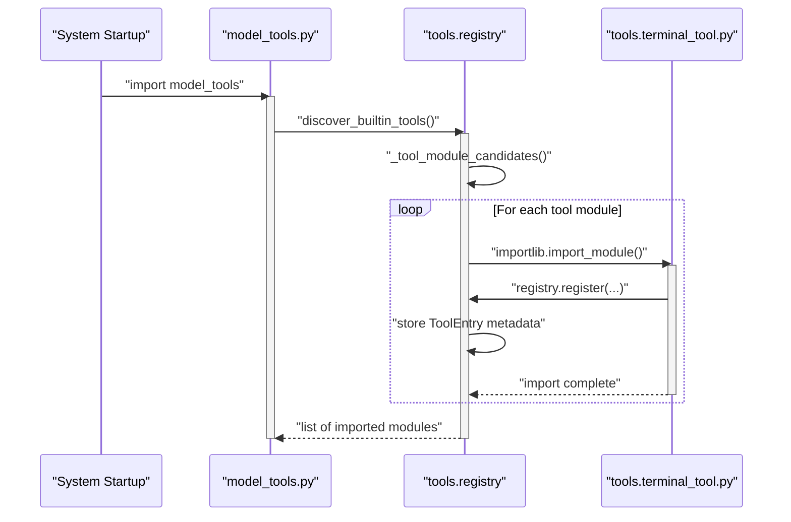

# Tool Registry and Toolsets

<details>
<summary>Relevant source files</summary>

The following files were used as context for generating this wiki page:

- [agent/tool_dispatch_helpers.py](agent/tool_dispatch_helpers.py)
- [agent/tool_executor.py](agent/tool_executor.py)
- [contributors/emails/southpawinmusic@gmail.com](contributors/emails/southpawinmusic@gmail.com)
- [model_tools.py](model_tools.py)
- [tests/agent/test_tool_arg_coercion.py](tests/agent/test_tool_arg_coercion.py)
- [tests/agent/test_tool_dispatch_helpers.py](tests/agent/test_tool_dispatch_helpers.py)
- [tests/tools/test_completed_process_results.py](tests/tools/test_completed_process_results.py)
- [tests/tools/test_plugin_guard.py](tests/tools/test_plugin_guard.py)
- [tests/tools/test_process_wait_auto_notify.py](tests/tools/test_process_wait_auto_notify.py)
- [tests/tools/test_project_tools.py](tests/tools/test_project_tools.py)
- [tests/tools/test_registry.py](tests/tools/test_registry.py)
- [tests/tools/test_schema_sanitizer.py](tests/tools/test_schema_sanitizer.py)
- [tests/tools/test_self_repo_guard.py](tests/tools/test_self_repo_guard.py)
- [tests/tools/test_skills_guard.py](tests/tools/test_skills_guard.py)
- [tests/tools/test_skills_guard_agent_config.py](tests/tools/test_skills_guard_agent_config.py)
- [tests/tools/test_terminal_requirements.py](tests/tools/test_terminal_requirements.py)
- [tests/tools/test_terminal_self_repo_guard.py](tests/tools/test_terminal_self_repo_guard.py)
- [tests/tools/test_terminal_tool_requirements.py](tests/tools/test_terminal_tool_requirements.py)
- [tests/tools/test_tts_path_traversal.py](tests/tools/test_tts_path_traversal.py)
- [tools/__init__.py](tools/__init__.py)
- [tools/arg_coercion.py](tools/arg_coercion.py)
- [tools/blueprints.py](tools/blueprints.py)
- [tools/path_security.py](tools/path_security.py)
- [tools/plugin_guard.py](tools/plugin_guard.py)
- [tools/plugin_guard_context.py](tools/plugin_guard_context.py)
- [tools/process_registry_results.py](tools/process_registry_results.py)
- [tools/process_registry_wait_policy.py](tools/process_registry_wait_policy.py)
- [tools/project_tools.py](tools/project_tools.py)
- [tools/registry.py](tools/registry.py)
- [tools/schema_sanitizer.py](tools/schema_sanitizer.py)
- [tools/self_repo_guard.py](tools/self_repo_guard.py)
- [tools/skills_guard.py](tools/skills_guard.py)
- [toolsets.py](toolsets.py)
- [website/docs/developer-guide/adding-tools.md](website/docs/developer-guide/adding-tools.md)
- [website/docs/developer-guide/tools-runtime.md](website/docs/developer-guide/tools-runtime.md)
- [website/docs/integrations/index.md](website/docs/integrations/index.md)
- [website/docs/reference/tools-reference.md](website/docs/reference/tools-reference.md)
- [website/docs/reference/toolsets-reference.md](website/docs/reference/toolsets-reference.md)
- [website/docs/user-guide/features/overview.md](website/docs/user-guide/features/overview.md)
- [website/docs/user-guide/features/tools.md](website/docs/user-guide/features/tools.md)
- [website/i18n/zh-Hans/docusaurus-plugin-content-docs/current/developer-guide/tools-runtime.md](website/i18n/zh-Hans/docusaurus-plugin-content-docs/current/developer-guide/tools-runtime.md)
- [website/i18n/zh-Hans/docusaurus-plugin-content-docs/current/reference/tools-reference.md](website/i18n/zh-Hans/docusaurus-plugin-content-docs/current/reference/tools-reference.md)
- [website/i18n/zh-Hans/docusaurus-plugin-content-docs/current/reference/toolsets-reference.md](website/i18n/zh-Hans/docusaurus-plugin-content-docs/current/reference/toolsets-reference.md)
- [website/i18n/zh-Hans/docusaurus-plugin-content-docs/current/user-guide/features/browser.md](website/i18n/zh-Hans/docusaurus-plugin-content-docs/current/user-guide/features/browser.md)
- [website/i18n/zh-Hans/docusaurus-plugin-content-docs/current/user-guide/features/tools.md](website/i18n/zh-Hans/docusaurus-plugin-content-docs/current/user-guide/features/tools.md)

</details>


This page documents the Hermes Agent tool registry system, focusing on tool registration, discovery, schema sanitization, tool search/deferral, toolset composition, and platform-specific toolset management. It details how individual tools self-register in the centralized registry, how toolsets group tools for different use cases, and dynamic aspects such as tool search/deferral and persistent per-platform configuration [model_tools.py:1-21](), [tools/registry.py:1-15](), [toolsets.py:1-7]().

---

## 1. Overview and Central Architecture

Hermes Agent uses a centralized tool registry pattern implemented in `tools/registry.py`, where each tool module self-registers its schema, handler function, toolset membership, and runtime availability check at import time [tools/registry.py:1-6](). The `ToolRegistry` class acts as a unified store for metadata and execution dispatching [tools/registry.py:1-15](). This design decouples core agent conversation orchestration (`model_tools.py`) from individual tool implementations, avoiding redundant parallel data structures.

Toolsets defined in `toolsets.py` group tools logically to enable or disable coherent feature bundles (e.g., `web`, `terminal`, `file`, `browser`) [toolsets.py:74-132](). They support hierarchical composition by incorporating other toolsets recursively [toolsets.py:50-52]().

Sources: [model_tools.py:1-21](), [tools/registry.py:1-15](), [toolsets.py:1-7]()

---

## 2. Tool Discovery and Registration

Tools are discovered dynamically by importing tool modules that execute top-level `registry.register()` calls [tools/registry.py:1-6](). The primary discovery function `discover_builtin_tools()` scans the `tools/` directory, inspects files using an AST prefilter (`_module_registers_tools()`), and imports valid modules [tools/registry.py:121-155](). Async execution bridging is managed via persistent event loops through `_get_tool_loop()` and `_get_worker_loop()` in `model_tools.py` [model_tools.py:75-92]().

### Tool Discovery Bridge (Natural Language to Code Entities)

```mermaid
graph TB
    subgraph "NaturalLanguageSpace"
        NLUser[""User Chat Session / Tool Execution""]
        NLConfig[""Requested Toolsets & Capabilities""]
    end

    subgraph "CodeEntitySpace: Discovery & Registry"
        Discover[""tools.registry.discover_builtin_tools()""]
        ASTScan[""tools.registry._module_registers_tools()""]
        RegistrySingleton[""tools.registry.registry.register()""]
    end

    subgraph "CodeEntitySpace: Orchestration"
        ModelTools[""model_tools.py""]
        AsyncBridge[""model_tools._run_async()""]
    end

    NLUser --> ModelTools
    NLConfig --> Discover
    Discover --> ASTScan
    ASTScan -->|"Import Modules"| RegistrySingleton
    RegistrySingleton --> ModelTools
    ModelTools --> AsyncBridge
```

Sources: [model_tools.py:75-150](), [tools/registry.py:94-141]()

### Registration Sequence



Sources: [model_tools.py:148-150](), [tools/registry.py:112-141]()

---

## 3. Tool Entries and Schema Sanitization

The `ToolRegistry` instance maintains collections of tool entries [tools/registry.py:1-15](). Each entry captures:
- `name`: Unique identifier string for the tool.
- `toolset`: Grouping category name.
- `schema`: JSON schema dictionary used for LLM function calling.
- `handler`: Execution callable (sync or async).
- `check_fn`: Optional callable validating runtime prerequisites (e.g., API keys, environment state).

Before delivery to language model providers, schemas undergo sanitization to ensure schema validator compliance across backends. The `sanitize_tool_schemas()` function in `tools/schema_sanitizer.py` performs deep copies and normalizes constraints such as missing `properties` for `type: object`, bare-string schemas, `type` arrays, and nullable `anyOf` unions [tools/schema_sanitizer.py:81-106](). Furthermore, error outputs are bounded by `_bound_error_text()` to prevent context window saturation from runaway tracebacks [tools/registry.py:57-64]().

Sources: [tools/registry.py:31-82](), [tools/schema_sanitizer.py:81-106]()

---

## 4. Tool Search and Deferral

To prevent context window overflow when large numbers of tools (including MCP servers and plugin tools) are loaded, Hermes implements progressive tool disclosure (`tools/tool_search.py`).

- **Deferral Configuration**: Core tools remain direct by default, while event-triggered and heavy auxiliary tools (such as `browser_vault`) are deferred [toolsets.py:21]().
- **Bridge Tools**: Deferred tools are replaced in the model-visible schema array by discovery bridge tools (`tool_search`, `tool_describe`, `tool_call`).
- **Catalog**: A stateless catalog is rebuilt from live tool definitions during prompt assembly, allowing the agent to dynamically search for and invoke tools on demand.

Sources: [toolsets.py:21](), [tools/registry.py:1-15]()

---

## 5. Toolset Composition and Categories

Toolsets are defined in `toolsets.py` as a dictionary of named tool groups (`TOOLSETS`) [toolsets.py:74-132](). Each entry specifies explicit tool names or includes other toolsets recursively via `_ts()` [toolsets.py:50-52]().

The core set of tools (`_HERMES_CORE_TOOLS`) establishes the baseline capabilities shared across standard configurations [toolsets.py:11-39](). The function `resolve_toolset()` flattens and expands composite toolset selections [model_tools.py:23]().

### Toolset Composition Mapping (Natural Language to Code Entities)

```mermaid
graph TB
    subgraph "NaturalLanguageSpace"
        NLBundle[""Composite Toolsets (e.g., coding, debugging, web)""]
    end

    subgraph "CodeEntitySpace: Toolsets & Core Definitions"
        ToolsetsDict[""toolsets.py: TOOLSETS""]
        CoreTools[""toolsets.py: _HERMES_CORE_TOOLS""]
        ResolveFunc[""toolsets.py: resolve_toolset()""]
    end

    subgraph "CodeEntitySpace: Model Orchestration"
        ModelToolsGetDefs[""model_tools.py: get_tool_definitions()""]
    end

    NLBundle --> ToolsetsDict
    ToolsetsDict --> ResolveFunc
    CoreTools --> ResolveFunc
    ResolveFunc --> ModelToolsGetDefs
```

Sources: [model_tools.py:23](), [toolsets.py:11-132]()

---

## 6. Platform-Specific Toolsets and Configuration

Users configure toolsets per platform (e.g., CLI, Discord, Telegram) via preferences persisting in configuration files managed by `hermes_cli/tools_config.py`.

- **Configurable Toolsets**: `CONFIGURABLE_TOOLSETS` lists all user-manageable toolsets such as `web`, `browser`, `terminal`, `file`, `code_execution`, `vision`, `video`, `image_gen`, `video_gen`, `x_search`, `tts`, `skills`, `todo`, `kanban`, `memory`, `context_engine`, `session_search`, `connections`, `clarify`, `delegation`, `cronjob`, and `computer_use` [website/docs/reference/toolsets-reference.md:54-75]().
- **Default-Off Toolsets**: Certain toolsets such as `spotify`, `discord`, `discord_admin`, `video`, `video_gen`, `x_search`, `a2a`, and `kanban` are disabled by default for new installs (`_DEFAULT_OFF_TOOLSETS`) [website/docs/reference/toolsets-reference.md:54-75]().
- **Platform Restrictions**: Layer-4 security guards and platform scoping functions (`_toolset_allowed_for_platform`) enforce that platform-restricted toolsets (such as `discord` and `discord_admin`) never leak to non-applicable platforms [website/docs/reference/toolsets-reference.md:54-75]().

Sources: [website/docs/reference/toolsets-reference.md:54-75]()