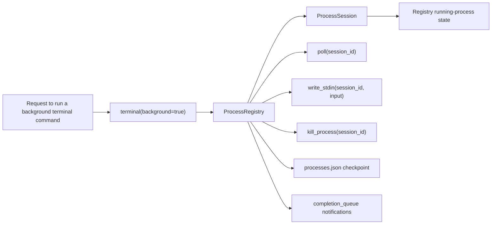
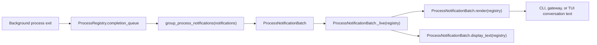
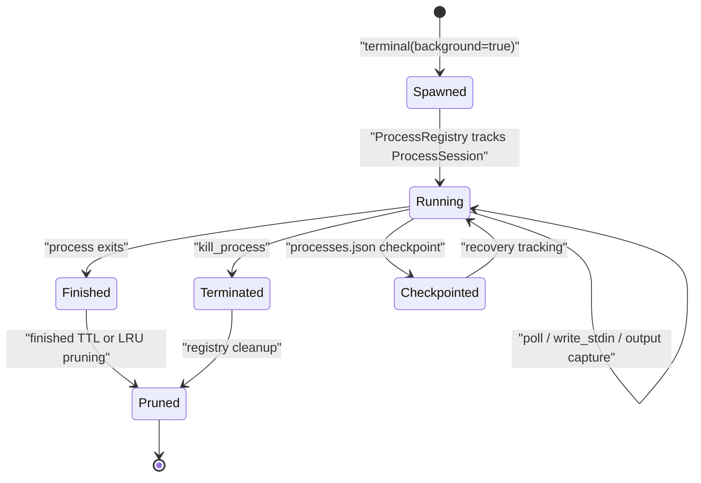
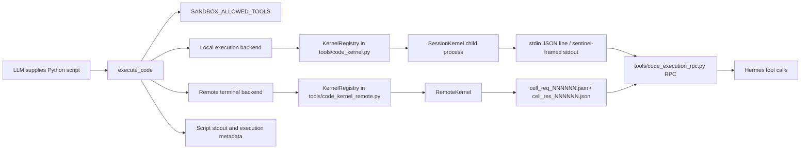

# Process Management

Relevant source files

The following files were used as context for generating this wiki page:

- [optional-skills/email/agentmail/SKILL.md](optional-skills/email/agentmail/SKILL.md)
- [optional-skills/email/agentmail/references/core.md](optional-skills/email/agentmail/references/core.md)
- [optional-skills/email/agentmail/references/mcp.md](optional-skills/email/agentmail/references/mcp.md)
- [optional-skills/email/agentmail/references/signup.md](optional-skills/email/agentmail/references/signup.md)
- [optional-skills/email/agentmail/references/webhooks.md](optional-skills/email/agentmail/references/webhooks.md)
- [optional-skills/email/agentmail/references/websockets.md](optional-skills/email/agentmail/references/websockets.md)
- [scripts/check_no_tmp_literals.py](scripts/check_no_tmp_literals.py)
- [tests/gateway/test_internal_event_bypass_pairing.py](tests/gateway/test_internal_event_bypass_pairing.py)
- [tests/scripts/test_check_no_tmp_literals.py](tests/scripts/test_check_no_tmp_literals.py)
- [tests/tools/test_code_execution.py](tests/tools/test_code_execution.py)
- [tests/tools/test_code_execution_file_rpc.py](tests/tools/test_code_execution_file_rpc.py)
- [tests/tools/test_code_execution_hermes_home.py](tests/tools/test_code_execution_hermes_home.py)
- [tests/tools/test_code_execution_pm_runtime.py](tests/tools/test_code_execution_pm_runtime.py)
- [tests/tools/test_code_execution_windows_env.py](tests/tools/test_code_execution_windows_env.py)
- [tests/tools/test_code_kernel.py](tests/tools/test_code_kernel.py)
- [tests/tools/test_code_kernel_remote.py](tests/tools/test_code_kernel_remote.py)
- [tests/tools/test_env_passthrough.py](tests/tools/test_env_passthrough.py)
- [tests/tools/test_env_probe.py](tests/tools/test_env_probe.py)
- [tests/tools/test_local_env_blocklist.py](tests/tools/test_local_env_blocklist.py)
- [tests/tools/test_notify_on_complete.py](tests/tools/test_notify_on_complete.py)
- [tests/tools/test_process_registry.py](tests/tools/test_process_registry.py)
- [tests/tools/test_skill_env_passthrough.py](tests/tools/test_skill_env_passthrough.py)
- [tests/tools/test_terminal_background_spawn_failure.py](tests/tools/test_terminal_background_spawn_failure.py)
- [tests/tools/test_watch_patterns.py](tests/tools/test_watch_patterns.py)
- [tools/code_execution_env.py](tools/code_execution_env.py)
- [tools/code_execution_rpc.py](tools/code_execution_rpc.py)
- [tools/code_execution_tool.py](tools/code_execution_tool.py)
- [tools/code_kernel.py](tools/code_kernel.py)
- [tools/code_kernel_remote.py](tools/code_kernel_remote.py)
- [tools/env_passthrough.py](tools/env_passthrough.py)
- [tools/env_probe.py](tools/env_probe.py)
- [tools/environments/local.py](tools/environments/local.py)
- [tools/environments/local_env_policy.py](tools/environments/local_env_policy.py)
- [tools/environments/local_pythonpath.py](tools/environments/local_pythonpath.py)
- [tools/process_registry.py](tools/process_registry.py)
- [tools/process_registry_notifications.py](tools/process_registry_notifications.py)

## Purpose and Scope

Process Management covers two related execution lifecycles: background commands started through the terminal tool and persistent Python kernels used by `execute_code`. The process registry tracks background work and its output; the kernel registries reuse interpreters across code-execution calls. Both paths are designed to bound resource use and to avoid leaving managed work running after its owning session or host ends. [tools/process_registry.py:1-5](), [tools/code_execution_tool.py:1-12](), [tools/code_kernel.py:1-16]()

Sources: [tools/process_registry.py:1-5](), [tools/code_execution_tool.py:1-12](), [tools/code_kernel.py:1-16]()

---

## Background vs Foreground Execution

A background terminal command is registered for ongoing management rather than being treated only as a single run-to-completion call. The registry module describes support for output buffering, polling, logging, waiting, killing, checkpointing, and session-scoped tracking. For non-local terminal environments, the command runs in the configured sandbox; the registry’s module documentation states that host execution occurs only when `TERMINAL_ENV=local`. [tools/process_registry.py:1-5]()

`execute_code` is a separate execution path: it runs a Python script that can call a restricted set of Hermes tools through RPC. Its local backend uses a persistent conversation-scoped kernel; remote backends use a remote kernel when available and can fall back to shipping a script for a per-call run. [tools/code_execution_tool.py:1-12]()

Sources: [tools/process_registry.py:1-5](), [tools/code_execution_tool.py:1-12]()

---

## Process Registry

`tools.process_registry` describes an in-memory registry for background processes started with `terminal(background=true)`. Its documented responsibilities include a rolling output buffer, process polling and control, JSON checkpointing for crash recovery, and session-scoped tracking. The module imports separate mixins and helpers for checkpointing, termination, output logs, results, notifications, and WSL command handling. [tools/process_registry.py:1-5](), [tools/process_registry.py:35-42]()

The module defines a 200,000-character output-buffer limit, a 30-minute finished-process retention period, and a maximum of 64 tracked processes before LRU pruning. It also defines limits for process-completion output and for watch-pattern and heartbeat notifications. [tools/process_registry.py:58-98]()

Tests import `ProcessRegistry` and `ProcessSession`, construct sessions with process identity, command, task ID, start time, exit state, exit code, and output, and exercise registry operations such as `poll`, `write_stdin`, and `kill_started_since`. These tests show that process tracking is scoped by task/session identity in relevant operations. [tests/tools/test_process_registry.py:16-21](), [tests/tools/test_process_registry.py:45-64](), [tests/tools/test_process_registry.py:74-108](), [tests/tools/test_process_registry.py:211-218]()

### Process Registry: Natural Language to Code Entities

Title: "Background Process Management Mapped to Registry Entities"

Sources: [tools/process_registry.py:1-5](), [tools/process_registry.py:35-47](), [tests/tools/test_process_registry.py:16-21](), [tests/tools/test_process_registry.py:45-64](), [tests/tools/test_process_registry.py:74-108](), [tests/tools/test_process_registry.py:211-218]()

### Checkpoint Location and Profile Scoping

The default checkpoint path is `processes.json` under the Hermes home. `_checkpoint_path()` resolves the active profile’s path at call time when the import-time constant has not been patched; the module documents this behavior as necessary because a multiplexed gateway serves multiple profiles from one process. [tools/process_registry.py:46-56]()

Sources: [tools/process_registry.py:46-56]()

---

## Process Output and Notifications

Background-process output is bounded by `MAX_OUTPUT_CHARS`; completion notifications have a separate default output-tail limit. Watch-pattern notifications have per-session cooldown, strike, and lifetime limits, as well as a global rate limit. The module also sets a minimum heartbeat interval for opt-in periodic progress events. [tools/process_registry.py:58-98]()

`tools.process_registry_notifications` renders events from the registry’s completion queue into text for surfaces such as the CLI drain loop, gateway, and TUI. `ProcessNotificationBatch` filters out events whose completion has already been consumed and combines consecutive completion events into a batch; watch and delegation events act as barriers between completion batches. [tools/process_registry_notifications.py:1-4](), [tools/process_registry_notifications.py:14-37](), [tools/process_registry_notifications.py:39-51]()

### Notification Flow

Title: "Process Completion Events and Rendering"

Sources: [tools/process_registry_notifications.py:1-4](), [tools/process_registry_notifications.py:14-37](), [tools/process_registry_notifications.py:39-51]()

---

## Spawn Modes and Environment Management

### Local Process Spawning and Environment Policy

`tools.process_registry` imports local execution helpers including `_find_shell`, `_resolve_safe_cwd`, `_sanitize_subprocess_env`, and `_terminal_env`. The local environment module also provides child-environment builders and terminal cleanup facilities. [tools/process_registry.py:28-29](), [tools/environments/local.py:1-3](), [tools/environments/local.py:19-30]()

The child-process environment policy derives a blocklist from provider credentials, optional environment-variable declarations, and other Hermes-managed secrets. It explicitly distinguishes Hermes-managed inference credentials from general AWS credentials, which remain available to local operator tools by design. [tools/environments/local_env_policy.py:12-27](), [tools/environments/local_env_policy.py:63-98]()

`tools.env_passthrough` supports forwarding selected environment-variable names to sandboxed children, but filters out Hermes-managed credentials both when names are registered and when the allowlist is consumed. Values are resolved per profile rather than being shared simply because a name was registered process-wide. [tools/env_passthrough.py:1-5](), [tools/env_passthrough.py:15-32](), [tools/env_passthrough.py:46-80](), [tools/env_passthrough.py:127-140]()

Sources: [tools/process_registry.py:28-29](), [tools/environments/local.py:1-3](), [tools/environments/local.py:19-30](), [tools/environments/local_env_policy.py:12-27](), [tools/environments/local_env_policy.py:63-98](), [tools/env_passthrough.py:1-5](), [tools/env_passthrough.py:15-32](), [tools/env_passthrough.py:46-80](), [tools/env_passthrough.py:127-140]()

### Terminal Temporary-Artifact Cleanup

The local environment module places managed terminal temporary artifacts under `HERMES_HOME/cache/terminal` when the home can be resolved. `cleanup_terminal_temp_cache()` removes idle entries from that managed directory and does not prune a user-configured `terminal.temp_dir`. Background artifacts with the `hermes_bg_<id>` stem are treated as groups of `.log`, `.pid`, and `.exit` files, so a recent write to the group can preserve its members. [tools/environments/local.py:37-48](), [tools/environments/local.py:51-65](), [tools/environments/local.py:76-119]()

Sources: [tools/environments/local.py:37-48](), [tools/environments/local.py:51-65](), [tools/environments/local.py:76-119]()

### Linux Systemd Scope Isolation

The process registry includes a Linux-only systemd-scope path for local background executors. Its module documentation explains the purpose: avoid placing memory-heavy workers in the gateway’s cgroup, where memory pressure could cause systemd-oomd to kill the gateway. The availability probe is cached with a bounded TTL because `systemd-run` may be installed while the user D-Bus session is unavailable. Worker memory-limit constants and `_worker_memory_max_bytes()` are defined alongside this isolation logic. [tools/process_registry.py:101-127]()

Sources: [tools/process_registry.py:101-127]()

---

## Background Process Lifecycle

The registry’s documented lifecycle surface includes spawning, polling, waiting, logging, termination, checkpointing, and session-scoped tracking. The process output, termination, and checkpoint responsibilities are separated into mixins imported by `tools.process_registry`. The visible tests establish that the registry can snapshot running IDs for a task and kill processes started after that snapshot, while preserving pre-existing and foreign-task processes. [tools/process_registry.py:1-5](), [tools/process_registry.py:35-42](), [tests/tools/test_process_registry.py:74-108]()

The registry also defines limits for how many processes it tracks and how long finished processes remain available. These limits bound in-memory retention; the checkpoint path is separately profile-scoped. [tools/process_registry.py:46-64]()

### Background Process Lifecycle: Natural Language to Code Entities

Title: "Background Process Lifecycle and Registry Components"

Sources: [tools/process_registry.py:1-5](), [tools/process_registry.py:46-64](), [tests/tools/test_process_registry.py:74-108](), [tests/tools/test_process_registry.py:211-218]()

---

## Code Execution Kernels

`execute_code` implements Programmatic Tool Calling: a Python script calls Hermes tools through RPC, and the script’s standard output is returned to the LLM. The tool module defines the allowed sandbox tools and resource limits, including a default execution timeout, a maximum tool-call count, and caps for captured stdout, stderr, and spilled stdout. [tools/code_execution_tool.py:1-12](), [tools/code_execution_tool.py:39-53]()

The local kernel is session-persistent: one child is associated with an owner, mode, interpreter, working directory, and tool set, and its Python state survives across code cells. The kernel module documents a JSON-lines request protocol on stdin and sentinel-framed JSON replies on stdout. It also documents that calls are serialized per kernel and that the security envelope retains child-environment scrubbing, an RPC token and per-cell tool budget, output sanitization, and secret redaction. [tools/code_kernel.py:1-16]()

The generated runner executes each cell in a persistent `GLOBALS` namespace. An ordinary exception is returned as an error payload; the runner also handles `SystemExit` as an explicit exit status. [tools/code_kernel.py:45-74]()

### Local Kernel Lifecycle

The local kernel’s lifecycle contract is to discard a wedged kernel rather than hang the agent: a timeout or interrupt kills the process tree and removes the registry entry, so state loss is deliberate. The kernel environment is frozen at spawn; later environment passthrough changes are not visible until a reset. [tools/code_kernel.py:1-10]()

The runner includes parent-death watchdogs for POSIX and Windows. On POSIX, a pipe watcher exits the kernel when the host process closes its write end; on Windows, a process-handle watcher exits when the parent process object is signaled. [tools/code_kernel.py:94-123](), [tools/code_kernel.py:126-177]()

Tests verify state persistence between cells, explicit state reset, preservation of the kernel after a cell exception, timeout-driven state loss, and kernel termination after `sys.exit()`. [tests/tools/test_code_kernel.py:68-97](), [tests/tools/test_code_kernel.py:152-171]()

Sources: [tools/code_execution_tool.py:1-12](), [tools/code_execution_tool.py:39-53](), [tools/code_kernel.py:1-16](), [tools/code_kernel.py:45-74](), [tools/code_kernel.py:94-123](), [tools/code_kernel.py:126-177](), [tests/tools/test_code_kernel.py:68-97](), [tests/tools/test_code_kernel.py:152-171]()

### Remote Kernels

Remote terminal backends provide run-to-completion execution rather than a host-owned persistent child. `tools.code_kernel_remote` adapts this model with a detached runner, PID-based liveness checks, and a file-based cell protocol using `cell_req_*.json` and `cell_res_*.json`. Tool RPC uses a separate request/response file protocol. Remote waits are bounded by the cell timeout; a failed liveness probe is treated as kernel death and the next call can respawn. [tools/code_kernel_remote.py:1-16]()

`RemoteKernel` stores the remote environment, environment type, kernel directory, PID, RPC token, owner, execution count, cell sequence, and attachment/pinning state. Its `kill()` method best-effort terminates the runner and children, then removes the kernel directory. The registry is a `KernelRegistry` configured with that kill operation, and owner-scoped shutdown is available for session-boundary disposal. [tools/code_kernel_remote.py:107-152](), [tools/code_kernel_remote.py:154-173]()

The remote runner polls the `cells` directory for request files, executes cells in the persistent namespace, writes result files using a temporary file followed by replacement, and exits after its idle timeout or a cell-level `SystemExit`. [tools/code_kernel_remote.py:39-98]()

Sources: [tools/code_kernel_remote.py:1-16](), [tools/code_kernel_remote.py:39-98](), [tools/code_kernel_remote.py:107-152](), [tools/code_kernel_remote.py:154-173]()

### Code Execution: Natural Language to Code Entities

Title: "execute_code Request Flow Across Local and Remote Kernels"

Sources: [tools/code_execution_tool.py:1-12](), [tools/code_execution_tool.py:39-53](), [tools/code_kernel.py:1-16](), [tools/code_kernel_remote.py:1-16](), [tools/code_kernel_remote.py:107-123]()

---

## Output Limits and Recovery

`execute_code` caps inline stdout at 50,000 bytes and stderr at 10,000 bytes. If stdout is too large, `_truncate_stdout_text()` keeps a head-and-tail excerpt and records byte-count metadata. It attempts to spill the full output under the Hermes `cache/exec` directory, with a separate 5,000,000-byte cap; the returned metadata can identify the spill path so output can be read without rerunning the script. [tools/code_execution_tool.py:47-53](), [tools/code_execution_tool.py:56-80](), [tools/code_execution_tool.py:83-102]()

For kernels, the runner also captures Python-level output with its own one-megabyte capture limit. The host applies its own output limit as well, so runner capture and tool-result truncation are separate bounds. [tools/code_kernel.py:42-46]()

Sources: [tools/code_execution_tool.py:47-53](), [tools/code_execution_tool.py:56-80](), [tools/code_execution_tool.py:83-102](), [tools/code_kernel.py:42-46]()