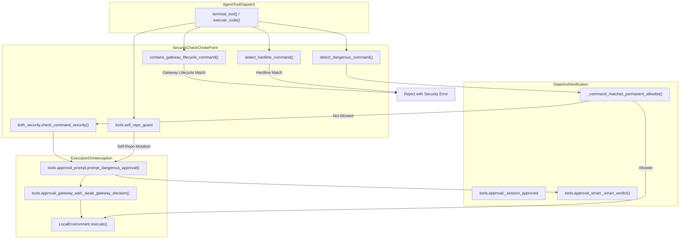

# Security and Command Approval

Relevant source files

The following files were used as context for generating this wiki page:

- [contributors/emails/jethachan@gmail.com](contributors/emails/jethachan@gmail.com)
- [contributors/emails/southpawinmusic@gmail.com](contributors/emails/southpawinmusic@gmail.com)
- [evals/approval_deny_dispatch.py](evals/approval_deny_dispatch.py)
- [hermes_state_repair.py](hermes_state_repair.py)
- [hermes_state_wal.py](hermes_state_wal.py)
- [tests/agent/test_tool_arg_coercion.py](tests/agent/test_tool_arg_coercion.py)
- [tests/gateway/test_approve_deny_commands.py](tests/gateway/test_approve_deny_commands.py)
- [tests/gateway/test_local_turn_origin_execute_code_gate.py](tests/gateway/test_local_turn_origin_execute_code_gate.py)
- [tests/gateway/test_matrix_project_context_isolation.py](tests/gateway/test_matrix_project_context_isolation.py)
- [tests/gateway/test_session_boundary_security_state.py](tests/gateway/test_session_boundary_security_state.py)
- [tests/gateway/test_yolo_command.py](tests/gateway/test_yolo_command.py)
- [tests/hermes_state/test_cross_vm_fs_wal_refusal.py](tests/hermes_state/test_cross_vm_fs_wal_refusal.py)
- [tests/hermes_state/test_hermes_state_readonly_preflight.py](tests/hermes_state/test_hermes_state_readonly_preflight.py)
- [tests/hermes_state/test_state_db_write_durability.py](tests/hermes_state/test_state_db_write_durability.py)
- [tests/hermes_state/test_state_synchronous_pragma.py](tests/hermes_state/test_state_synchronous_pragma.py)
- [tests/tools/test_approval.py](tests/tools/test_approval.py)
- [tests/tools/test_approval_bun_deno_eval.py](tests/tools/test_approval_bun_deno_eval.py)
- [tests/tools/test_approval_cancelled_attribution.py](tests/tools/test_approval_cancelled_attribution.py)
- [tests/tools/test_approval_config_readonly.py](tests/tools/test_approval_config_readonly.py)
- [tests/tools/test_approval_deny_rules.py](tests/tools/test_approval_deny_rules.py)
- [tests/tools/test_approval_gateway_wait_coalesce_race.py](tests/tools/test_approval_gateway_wait_coalesce_race.py)
- [tests/tools/test_approval_grep_in_substitution.py](tests/tools/test_approval_grep_in_substitution.py)
- [tests/tools/test_approval_interrupt.py](tests/tools/test_approval_interrupt.py)
- [tests/tools/test_approval_plugin_hooks.py](tests/tools/test_approval_plugin_hooks.py)
- [tests/tools/test_cli_approval_exec_ask_leak.py](tests/tools/test_cli_approval_exec_ask_leak.py)
- [tests/tools/test_cron_approval_mode.py](tests/tools/test_cron_approval_mode.py)
- [tests/tools/test_execute_code_local_session_approval.py](tests/tools/test_execute_code_local_session_approval.py)
- [tests/tools/test_hardline_blocklist.py](tests/tools/test_hardline_blocklist.py)
- [tests/tools/test_mcp_trust_gating.py](tests/tools/test_mcp_trust_gating.py)
- [tests/tools/test_plugin_guard.py](tests/tools/test_plugin_guard.py)
- [tests/tools/test_project_tools.py](tests/tools/test_project_tools.py)
- [tests/tools/test_registry.py](tests/tools/test_registry.py)
- [tests/tools/test_schema_sanitizer.py](tests/tools/test_schema_sanitizer.py)
- [tests/tools/test_self_repo_guard.py](tests/tools/test_self_repo_guard.py)
- [tests/tools/test_skills_guard.py](tests/tools/test_skills_guard.py)
- [tests/tools/test_skills_guard_agent_config.py](tests/tools/test_skills_guard_agent_config.py)
- [tests/tools/test_smart_approval_injection.py](tests/tools/test_smart_approval_injection.py)
- [tests/tools/test_smart_approval_policy.py](tests/tools/test_smart_approval_policy.py)
- [tests/tools/test_terminal_requirements.py](tests/tools/test_terminal_requirements.py)
- [tests/tools/test_terminal_self_repo_guard.py](tests/tools/test_terminal_self_repo_guard.py)
- [tests/tools/test_terminal_tool_requirements.py](tests/tools/test_terminal_tool_requirements.py)
- [tests/tools/test_tts_path_traversal.py](tests/tools/test_tts_path_traversal.py)
- [tests/tools/test_yolo_mode.py](tests/tools/test_yolo_mode.py)
- [tools/approval.py](tools/approval.py)
- [tools/approval_context.py](tools/approval_context.py)
- [tools/approval_detection.py](tools/approval_detection.py)
- [tools/approval_floors.py](tools/approval_floors.py)
- [tools/approval_gateway_wait.py](tools/approval_gateway_wait.py)
- [tools/approval_human_wait.py](tools/approval_human_wait.py)
- [tools/approval_prompt.py](tools/approval_prompt.py)
- [tools/approval_smart.py](tools/approval_smart.py)
- [tools/arg_coercion.py](tools/arg_coercion.py)
- [tools/blueprints.py](tools/blueprints.py)
- [tools/path_security.py](tools/path_security.py)
- [tools/plugin_guard.py](tools/plugin_guard.py)
- [tools/plugin_guard_context.py](tools/plugin_guard_context.py)
- [tools/project_tools.py](tools/project_tools.py)
- [tools/registry.py](tools/registry.py)
- [tools/schema_sanitizer.py](tools/schema_sanitizer.py)
- [tools/self_repo_guard.py](tools/self_repo_guard.py)
- [tools/skills_guard.py](tools/skills_guard.py)
- [website/docs/developer-guide/observer-hooks.md](website/docs/developer-guide/observer-hooks.md)
- [website/docs/user-guide/security.md](website/docs/user-guide/security.md)
- [website/i18n/zh-Hans/docusaurus-plugin-content-docs/current/reference/mcp-config-reference.md](website/i18n/zh-Hans/docusaurus-plugin-content-docs/current/reference/mcp-config-reference.md)
- [website/i18n/zh-Hans/docusaurus-plugin-content-docs/current/user-guide/security.md](website/i18n/zh-Hans/docusaurus-plugin-content-docs/current/user-guide/security.md)

## Purpose and Scope

The Security and Command Approval system in Hermes Agent provides a defense-in-depth architecture designed to protect the host system from destructive, malicious, or inadvertent commands generated by the AI agent or users. It intercepts tool executions and terminal invocations, enforcing strict security policies before any external side effects occur.

The system combines pattern-based threat analysis, external binary security scanning (`Tirith`), hardline blocking rules, gateway lifecycle protection, self-repository mutation guards, context-local session tracking, and interactive/async approval workflows.

Key mechanisms include:
- **Dangerous Command Detection**: Regex-based heuristics identifying risky operations such as recursive deletions or forced overrides [tools/approval_detection.py:20-43]().
- **Hardline Blocklist**: Unconditional vetoes for catastrophic commands (e.g., root wipes) that bypass all override toggles [tools/approval_detection.py:88-109]().
- **Gateway Lifecycle Guard**: Specialized detection preventing infinite restart loops caused by agent-scheduled tasks or commands targeting the gateway itself [website/docs/user-guide/security.md:97-103]().
- **Tirith Security Integration**: An external security binary (`tirith`) that analyzes command strings for homograph URLs, pipe-to-interpreter risks, and terminal injection [tools/skills_guard.py:1-8]().
- **Self-Repo Guards**: Specialized detection preventing Git operations (like `checkout`, `switch`, `rebase`, or `bisect`) from mutating the specific source checkout backing the running process [tools/self_repo_guard.py:1-24]().
- **Per-Session Approval State**: Thread-safe state tracking keyed by session identifiers and pattern hashes [tools/approval.py:50-57]().
- **Circuit Breaker for Smart Approvals**: Consecutive-denial tracking that escalates guardian LLM rejections into hard-stop instructions [tools/approval.py:58-111]().

Sources: [tools/approval.py:1-42](), [tools/approval_detection.py:1-109](), [tools/skills_guard.py:1-8](), [tools/self_repo_guard.py:1-24](), [website/docs/user-guide/security.md:97-103]().

---

## System Architecture and Data Flow

The security gate sits directly between agent tool dispatchers (such as `terminal_tool` or `execute_code`) and environment execution layers.

**Diagram: Security Check Flow**

- **Hardline & Lifecycle Checks**: Evaluated first. Any match results in immediate rejection [tools/approval_detection.py:88-109](), [website/docs/user-guide/security.md:97-103]().
- **Allowlist Filtering**: Permanent and per-session allowlists check if the command pattern is pre-approved [tools/approval.py:52-56](), [tools/approval_floors.py:33-36]().
- **Tirith Scanner**: If un-allowlisted, the command is passed to `tirith` for deep static inspection [tools/skills_guard.py:1-8](), [tests/tools/test_approval.py:67-69]().
- **Approval Gate**: If flagged, the system invokes either CLI prompts, smart LLM verdict evaluation (`_smart_approve`), or gateway queue waiting loops [tools/approval.py:37-39](), [tests/tools/test_approval.py:40-50]().

Sources: [tools/approval.py:1-40](), [tools/approval_detection.py:1-109](), [tools/skills_guard.py:1-8](), [tools/self_repo_guard.py:1-24](), [website/docs/user-guide/security.md:97-103]().

---

## Dangerous Command Detection and Guards

Hermes categorizes command hazards into several distinct enforcement tiers.

### 1. Hardline Blocklist
Commands that match catastrophic patterns (such as unconditional root destruction or device node writes) are rejected unconditionally. These cannot be overridden via YOLO mode or user prompts. The `HARDLINE_PATTERNS` list in `tools/approval_detection.py` defines these patterns, including recursive deletes of root or system directories, formatting filesystems (`mkfs`), and direct writes to raw block devices (`dd of=/dev/sda`) [tools/approval_detection.py:88-109]().

### 2. Gateway Lifecycle Guard
This layer prevents an agent from issuing commands that would stop or restart its own gateway process, which could lead to an infinite restart loop or service disruption. This guard is non-overridable by user approval, YOLO mode, or `force=True` [website/docs/user-guide/security.md:97-103](). The `cron.lifecycle_guard` module contains the `_GATEWAY_LIFECYCLE_PATTERN` regex that detects these commands [cron/lifecycle_guard.py:30-67](). It also includes specific patterns for killing the host interpreter image (e.g., `pkill python`) [cron/lifecycle_guard.py:69-108]().

### 3. Pattern-Based Detection
`detect_dangerous_command` in `tools/approval_detection.py` uses regular expressions to identify risky utility flags and command structures [tools/approval_detection.py:20-43]():
- **GNU `rm`**: Permuted flags (e.g., `rm build/ -rf`) are correctly flagged [tests/tools/test_approval.py:101-104]().
- **Windows Shells**: Identifies destructive deletions in `cmd.exe` (`del /f /q`, `rmdir /s /q`) and PowerShell (`Remove-Item -Recurse -Force`, `ri`, encoded commands) [tests/hermes_cli/test_gateway_restart_loop.py:28-53]().
- **Package Manager Uninstall**: Commands like `npm uninstall`, `pip uninstall`, `brew rm` are flagged as dangerous because they remove software outside the project [tests/tools/test_approval.py:22-34]().
- **Sensitive File Writes**: Detection for writes to sensitive files like `~/.ssh/`, `~/.hermes/.env`, `~/.hermes/config.yaml`, shell RC files, and credential files [tools/approval_detection.py:20-43]().

Sources: [tools/approval_detection.py:1-109](), [tests/tools/test_approval.py:22-34](), [tests/tools/test_approval.py:101-104](), [tests/hermes_cli/test_gateway_restart_loop.py:28-53](), [website/docs/user-guide/security.md:97-103](), [cron/lifecycle_guard.py:30-108]().

---

## Tirith Security Integration

The `tirith` security wrapper (`tools/skills_guard.py`) executes an external binary to perform content-level security scanning (homograph detection, pipe-to-interpreter attacks, and terminal injections) [tools/skills_guard.py:1-8](). The `tools.skills_guard` module itself defines a comprehensive set of threat patterns for static analysis of skill code, covering exfiltration, injection, destructive operations, and persistence [tools/skills_guard.py:61-105]().

- **Execution Model**: The `tools.skills_guard.scan_file` function performs pattern matching against file content [tests/tools/test_skills_guard.py:157-162]().
- **Verdict Determination**: `_determine_verdict` maps findings severity (critical, high, medium, low) to an overall skill verdict (safe, caution, dangerous) [tests/tools/test_skills_guard.py:70-79]().
- **Install Policy**: `should_allow_install` enforces installation policies based on trust level (builtin, trusted, community, agent-created) and verdict [tests/tools/test_skills_guard.py:27-30](). For example, a "dangerous" community skill is blocked, while a "caution" community skill requires `--force` to override [tests/tools/test_skills_guard.py:102-105]().
- **Plugin Guard**: `tools.plugin_guard.py` extends `skills_guard` for plugin installation, with specific exemptions for patterns common in legitimate plugin code (e.g., reading environment variables) [tools/plugin_guard.py:1-10](), [tools/plugin_guard.py:57-65]().

Sources: [tools/skills_guard.py:1-8](), [tests/tools/test_skills_guard.py:27-105](), [tools/plugin_guard.py:1-10](), [tools/plugin_guard.py:57-65]().

---

## Per-Session State, Circuit Breaker, and Approval Callbacks

Command approvals are managed via thread-safe runtime state stored in `tools/approval.py` [tools/approval.py:48-66]().

### Session State Dictionaries
- `_pending`: Active approval requests waiting for resolution [tools/approval.py:51]().
- `_session_approved`: Session-scoped sets of approved pattern hashes [tools/approval.py:52]().
- `_session_yolo`: Sessions operating under YOLO override mode [tools/approval.py:53]().
- `_permanent_approved`: Global permanent allowlist entries [tools/approval.py:54]().
- `_permanent_approved_by_home`: Routed multiplex profiles have their own permanent allowlist [tools/approval.py:56-57]().

### Consecutive-Denial Circuit Breaker
When smart approvals (`_smart_approve`) reject a command repeatedly, a consecutive-denial circuit breaker tracks failures per session [tools/approval.py:58-66](). Controlled by `approvals.denial_breaker_threshold` (default: 3) [tools/approval.py:72-77](). When tripped, an escalated hard-stop instruction is appended to the tool error response, instructing the agent to cease variations and report the block to the user [tools/approval.py:97-115]().

### Approval Callbacks
The system supports various approval callbacks and transports:
- **CLI Approval**: For interactive CLI sessions, `_resolve_cli_approval_callback` determines the appropriate prompt mechanism [tools/approval_context.py:28]().
- **Gateway Approval**: For gateway-connected sessions, `register_gateway_notify` registers a callback to send approval requests to the gateway, and `_await_gateway_decision` blocks until a decision is received [tools/approval.py:126-140]().
- **Unattended Modes**: `cron_mode`, `single_query_mode`, and `unattended_mode` configurations define behavior for non-interactive contexts (e.g., cron jobs, single-query CLI runs, webhooks) when a dangerous command is detected [website/docs/user-guide/security.md:36-51]().

Sources: [tools/approval.py:48-140](), [tools/approval_context.py:28](), [website/docs/user-guide/security.md:36-51]().

---

## Self-Repo Guards and Allowlist System

The self-repository guard (`tools/self_repo_guard.py`) detects Git operations that threaten to rewrite the specific repository checkout currently backing the agent process. This is crucial for preventing the agent from corrupting its own source code or configuration.

- **Worktree Mutations**: Flags commands executing `checkout`, `switch`, `rebase`, `merge`, `pull`, `restore`, `clean`, `cherry-pick`, `revert`, or `bisect` against the running source root [tools/self_repo_guard.py:19-21]().
- **Shell Word Deobfuscation**: Parses complex shell scripts, variable assignments, environment wrappers (`sudo`, `env`), heredocs, and command substitutions to ensure obfuscated invocations cannot bypass checks [tools/self_repo_guard.py:109]().
- **Running Source Root**: The guard determines the agent's running source root by inspecting `Path(__file__).resolve().parent.parent` and checking for a `.git` directory [tools/self_repo_guard.py:72-77]().

### Allowlist System
Commands matching permanent or session allowlists bypass interactive gates [tools/approval.py:54-56](), [tools/approval_floors.py:33-36]().
- **Permanent Allowlist**: Defined by `_command_matches_permanent_allowlist`, this allows specific commands to always execute without approval [tools/approval_floors.py:33-36]().
- **Session Allowlist**: Commands approved during a session are added to `_session_approved` and will not require re-approval for the duration of that session [tools/approval.py:52]().

Sources: [tools/approval.py:52-56](), [tools/approval_floors.py:33-36](), [tools/self_repo_guard.py:19-21](), [tools/self_repo_guard.py:72-77](), [tools/self_repo_guard.py:109]().

---

## Code Entity Reference Diagram

```mermaid
classDiagram
    class ApprovalModule {
        <<tools/approval.py>>
        +_lock: Lock
        +_pending: dict
        +_session_approved: dict
        +_session_yolo: set
        +_permanent_approved: set
        +_permanent_approved_by_home: dict
        +_denial_tally: dict
        +_gateway_queues: dict
        +_gateway_notify_cbs: dict
        +check_all_command_guards(command, env_type)
        +approve_session(session_key)
        +resolve_gateway_approval(session_key, choice, resolve_all, reason, request_id)
    }

    class ApprovalDetection {
        <<tools/approval_detection.py>>
        +detect_dangerous_command(command)
        +detect_hardline_command(command)
        +HARDLINE_PATTERNS: list
    }

    class ApprovalFloors {
        <<tools/approval_floors.py>>
        +_command_matches_permanent_allowlist(command)
        +_match_user_deny_rule(command)
    }

    class ApprovalGatewayWait {
        <<tools/approval_gateway_wait.py>>
        +_await_gateway_decision(session_key, entry_id, timeout)
    }

    class ApprovalPrompt {
        <<tools/approval_prompt.py>>
        +prompt_dangerous_approval(command, description, session_key, is_dangerous, is_hardline, is_self_repo)
    }

    class ApprovalSmart {
        <<tools/approval_smart.py>>
        +_smart_verdict(command, description)
    }

    class SkillsGuard {
        <<tools/skills_guard.py>>
        +scan_file(file_path, file_name)
        +should_allow_install(scan_result, force)
    }

    class SelfRepoGuard {
        <<tools/self_repo_guard.py>>
        +check_self_repo_guard(command)
        +get_running_source_root()
    }

    class CronLifecycleGuard {
        <<cron/lifecycle_guard.py>>
        +_GATEWAY_LIFECYCLE_PATTERN: re
        +contains_gateway_lifecycle_command(command)
    }

    ApprovalModule --> ApprovalDetection : "uses for command classification"
    ApprovalModule --> ApprovalFloors : "checks allowlists and deny rules"
    ApprovalModule --> ApprovalGatewayWait : "waits for gateway decisions"
    ApprovalModule --> ApprovalPrompt : "presents interactive prompts"
    ApprovalModule --> ApprovalSmart : "requests LLM-based verdicts"
    ApprovalModule --> SkillsGuard : "integrates external scanner"
    ApprovalModule --> SelfRepoGuard : "applies self-repo protection"
    ApprovalModule --> CronLifecycleGuard : "checks for gateway lifecycle commands"
```

**Diagram: Detailed Security Module Interactions**

Sources: [tools/approval.py:1-144](), [tools/approval_detection.py:1-112](), [tools/approval_floors.py:1-37](), [tools/approval_gateway_wait.py:1-38](), [tools/approval_prompt.py:1-40](), [tools/approval_smart.py:1-41](), [tools/skills_guard.py:1-60](), [cron/lifecycle_guard.py:24-68]().