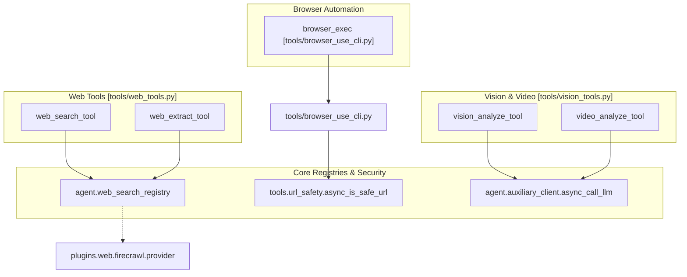
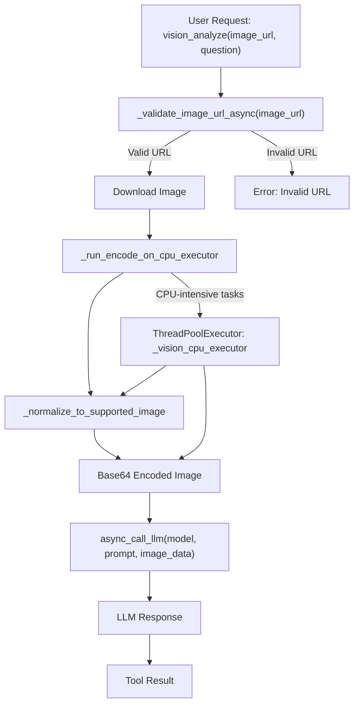
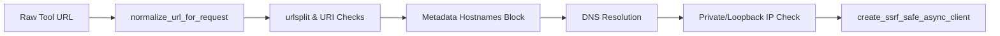

# Web, Browser, and Vision Tools

Relevant source files

The following files were used as context for generating this wiki page:

- [contributors/emails/kuangmi@nudge.com.cn](contributors/emails/kuangmi@nudge.com.cn)
- [contributors/emails/yinz7032@gmail.com](contributors/emails/yinz7032@gmail.com)
- [hermes_cli/browser_connect.py](hermes_cli/browser_connect.py)
- [hermes_cli/browser_runtime.py](hermes_cli/browser_runtime.py)
- [hermes_cli/observability/shared_metrics_loop.py](hermes_cli/observability/shared_metrics_loop.py)
- [plugins/video_gen/deepinfra/__init__.py](plugins/video_gen/deepinfra/__init__.py)
- [plugins/video_gen/fal/__init__.py](plugins/video_gen/fal/__init__.py)
- [plugins/video_gen/xai/__init__.py](plugins/video_gen/xai/__init__.py)
- [plugins/video_gen/xai/plugin.yaml](plugins/video_gen/xai/plugin.yaml)
- [plugins/web/__init__.py](plugins/web/__init__.py)
- [plugins/web/_common.py](plugins/web/_common.py)
- [plugins/web/brave_free/__init__.py](plugins/web/brave_free/__init__.py)
- [plugins/web/brave_free/plugin.yaml](plugins/web/brave_free/plugin.yaml)
- [plugins/web/brave_free/provider.py](plugins/web/brave_free/provider.py)
- [plugins/web/ddgs/__init__.py](plugins/web/ddgs/__init__.py)
- [plugins/web/ddgs/_search_worker.py](plugins/web/ddgs/_search_worker.py)
- [plugins/web/ddgs/plugin.yaml](plugins/web/ddgs/plugin.yaml)
- [plugins/web/ddgs/provider.py](plugins/web/ddgs/provider.py)
- [plugins/web/exa/__init__.py](plugins/web/exa/__init__.py)
- [plugins/web/exa/plugin.yaml](plugins/web/exa/plugin.yaml)
- [plugins/web/firecrawl/__init__.py](plugins/web/firecrawl/__init__.py)
- [plugins/web/firecrawl/plugin.yaml](plugins/web/firecrawl/plugin.yaml)
- [plugins/web/firecrawl/provider.py](plugins/web/firecrawl/provider.py)
- [plugins/web/searxng/__init__.py](plugins/web/searxng/__init__.py)
- [plugins/web/searxng/plugin.yaml](plugins/web/searxng/plugin.yaml)
- [plugins/web/searxng/provider.py](plugins/web/searxng/provider.py)
- [plugins/web/tavily/__init__.py](plugins/web/tavily/__init__.py)
- [plugins/web/tavily/plugin.yaml](plugins/web/tavily/plugin.yaml)
- [plugins/web/tavily/provider.py](plugins/web/tavily/provider.py)
- [plugins/web/xai/__init__.py](plugins/web/xai/__init__.py)
- [plugins/web/xai/plugin.yaml](plugins/web/xai/plugin.yaml)
- [plugins/web/xai/provider.py](plugins/web/xai/provider.py)
- [tests/agent/test_sequential_tool_interrupt.py](tests/agent/test_sequential_tool_interrupt.py)
- [tests/agent/test_vision_tool_messages.py](tests/agent/test_vision_tool_messages.py)
- [tests/hermes_cli/test_browser_connect_default_chromium.py](tests/hermes_cli/test_browser_connect_default_chromium.py)
- [tests/hermes_cli/test_browser_runtime.py](tests/hermes_cli/test_browser_runtime.py)
- [tests/hermes_cli/test_shared_metrics_loop.py](tests/hermes_cli/test_shared_metrics_loop.py)
- [tests/plugins/video_gen/test_fal_plugin.py](tests/plugins/video_gen/test_fal_plugin.py)
- [tests/plugins/video_gen/test_xai_plugin.py](tests/plugins/video_gen/test_xai_plugin.py)
- [tests/plugins/video_gen/test_xai_plugin_integration.py](tests/plugins/video_gen/test_xai_plugin_integration.py)
- [tests/plugins/web/test_web_search_provider_plugins.py](tests/plugins/web/test_web_search_provider_plugins.py)
- [tests/tools/conftest.py](tests/tools/conftest.py)
- [tests/tools/test_bot_desktop_browser.py](tests/tools/test_bot_desktop_browser.py)
- [tests/tools/test_bot_desktop_launcher_seed.py](tests/tools/test_bot_desktop_launcher_seed.py)
- [tests/tools/test_bot_desktop_resources.py](tests/tools/test_bot_desktop_resources.py)
- [tests/tools/test_bot_desktop_runtime.py](tests/tools/test_bot_desktop_runtime.py)
- [tests/tools/test_browser_cdp_override.py](tests/tools/test_browser_cdp_override.py)
- [tests/tools/test_browser_cdp_tool.py](tests/tools/test_browser_cdp_tool.py)
- [tests/tools/test_browser_cleanup.py](tests/tools/test_browser_cleanup.py)
- [tests/tools/test_browser_cleanup_owner_scope.py](tests/tools/test_browser_cleanup_owner_scope.py)
- [tests/tools/test_browser_cloud_fallback.py](tests/tools/test_browser_cloud_fallback.py)
- [tests/tools/test_browser_cloud_provider_cache.py](tests/tools/test_browser_cloud_provider_cache.py)
- [tests/tools/test_browser_command_timeout_race.py](tests/tools/test_browser_command_timeout_race.py)
- [tests/tools/test_browser_config_effective.py](tests/tools/test_browser_config_effective.py)
- [tests/tools/test_browser_env_loopback_no_proxy.py](tests/tools/test_browser_env_loopback_no_proxy.py)
- [tests/tools/test_browser_hardening.py](tests/tools/test_browser_hardening.py)
- [tests/tools/test_browser_headed_mode.py](tests/tools/test_browser_headed_mode.py)
- [tests/tools/test_browser_hybrid_routing.py](tests/tools/test_browser_hybrid_routing.py)
- [tests/tools/test_browser_launcher.py](tests/tools/test_browser_launcher.py)
- [tests/tools/test_browser_launcher_holders_lock.py](tests/tools/test_browser_launcher_holders_lock.py)
- [tests/tools/test_browser_launcher_identity.py](tests/tools/test_browser_launcher_identity.py)
- [tests/tools/test_browser_launcher_pidns.py](tests/tools/test_browser_launcher_pidns.py)
- [tests/tools/test_browser_launcher_shared_profile.py](tests/tools/test_browser_launcher_shared_profile.py)
- [tests/tools/test_browser_launcher_shared_start.py](tests/tools/test_browser_launcher_shared_start.py)
- [tests/tools/test_browser_lightpanda.py](tests/tools/test_browser_lightpanda.py)
- [tests/tools/test_browser_lightpanda_serve.py](tests/tools/test_browser_lightpanda_serve.py)
- [tests/tools/test_browser_orphan_reaper.py](tests/tools/test_browser_orphan_reaper.py)
- [tests/tools/test_browser_pm.py](tests/tools/test_browser_pm.py)
- [tests/tools/test_browser_profile_live_cdp.py](tests/tools/test_browser_profile_live_cdp.py)
- [tests/tools/test_browser_profile_scope_edges.py](tests/tools/test_browser_profile_scope_edges.py)
- [tests/tools/test_browser_real_profile.py](tests/tools/test_browser_real_profile.py)
- [tests/tools/test_browser_real_profile_copy_lock.py](tests/tools/test_browser_real_profile_copy_lock.py)
- [tests/tools/test_browser_sandbox_stop_identity.py](tests/tools/test_browser_sandbox_stop_identity.py)
- [tests/tools/test_browser_secret_exfil.py](tests/tools/test_browser_secret_exfil.py)
- [tests/tools/test_browser_session_profile_keys.py](tests/tools/test_browser_session_profile_keys.py)
- [tests/tools/test_browser_ssrf_local.py](tests/tools/test_browser_ssrf_local.py)
- [tests/tools/test_browser_supervisor.py](tests/tools/test_browser_supervisor.py)
- [tests/tools/test_browser_supervisor_reconnect.py](tests/tools/test_browser_supervisor_reconnect.py)
- [tests/tools/test_browser_use_cli.py](tests/tools/test_browser_use_cli.py)
- [tests/tools/test_browser_use_harness.py](tests/tools/test_browser_use_harness.py)
- [tests/tools/test_browser_use_session_expiry.py](tests/tools/test_browser_use_session_expiry.py)
- [tests/tools/test_browser_windows_headless.py](tests/tools/test_browser_windows_headless.py)
- [tests/tools/test_ensure_task_env.py](tests/tools/test_ensure_task_env.py)
- [tests/tools/test_fal_common.py](tests/tools/test_fal_common.py)
- [tests/tools/test_fal_sdk.py](tests/tools/test_fal_sdk.py)
- [tests/tools/test_image_generation.py](tests/tools/test_image_generation.py)
- [tests/tools/test_image_generation_image_to_image.py](tests/tools/test_image_generation_image_to_image.py)
- [tests/tools/test_image_generation_interrupt.py](tests/tools/test_image_generation_interrupt.py)
- [tests/tools/test_image_source.py](tests/tools/test_image_source.py)
- [tests/tools/test_managed_browserbase_and_modal.py](tests/tools/test_managed_browserbase_and_modal.py)
- [tests/tools/test_managed_media_gateways.py](tests/tools/test_managed_media_gateways.py)
- [tests/tools/test_sandbox_port_forward.py](tests/tools/test_sandbox_port_forward.py)
- [tests/tools/test_url_safety.py](tests/tools/test_url_safety.py)
- [tests/tools/test_video_generation_dispatch.py](tests/tools/test_video_generation_dispatch.py)
- [tests/tools/test_video_generation_dynamic_schema.py](tests/tools/test_video_generation_dynamic_schema.py)
- [tests/tools/test_video_generation_tool_surface_matrix.py](tests/tools/test_video_generation_tool_surface_matrix.py)
- [tests/tools/test_vision_native_fast_path.py](tests/tools/test_vision_native_fast_path.py)
- [tests/tools/test_vision_region.py](tests/tools/test_vision_region.py)
- [tests/tools/test_vision_tools.py](tests/tools/test_vision_tools.py)
- [tests/tools/test_web_providers.py](tests/tools/test_web_providers.py)
- [tests/tools/test_web_providers_brave_free.py](tests/tools/test_web_providers_brave_free.py)
- [tests/tools/test_web_providers_ddgs.py](tests/tools/test_web_providers_ddgs.py)
- [tests/tools/test_web_providers_searxng.py](tests/tools/test_web_providers_searxng.py)
- [tests/tools/test_web_providers_xai.py](tests/tools/test_web_providers_xai.py)
- [tests/tools/test_web_tools_config.py](tests/tools/test_web_tools_config.py)
- [tests/tools/test_web_tools_tavily.py](tests/tools/test_web_tools_tavily.py)
- [tests/tui_gateway/test_served_profile_child_env.py](tests/tui_gateway/test_served_profile_child_env.py)
- [tests/tui_gateway/test_served_profile_child_env_authority.py](tests/tui_gateway/test_served_profile_child_env_authority.py)
- [tools/bot_desktop/browser.py](tools/bot_desktop/browser.py)
- [tools/bot_desktop/launcher.sh](tools/bot_desktop/launcher.sh)
- [tools/bot_desktop/resources.py](tools/bot_desktop/resources.py)
- [tools/bot_desktop/runtime.py](tools/bot_desktop/runtime.py)
- [tools/bot_desktop/sandbox_host.py](tools/bot_desktop/sandbox_host.py)
- [tools/bot_desktop/wallpaper.png](tools/bot_desktop/wallpaper.png)
- [tools/browser_cdp_tool.py](tools/browser_cdp_tool.py)
- [tools/browser_dialog_tool.py](tools/browser_dialog_tool.py)
- [tools/browser_harness_dirs.py](tools/browser_harness_dirs.py)
- [tools/browser_launcher.py](tools/browser_launcher.py)
- [tools/browser_launcher_holders.py](tools/browser_launcher_holders.py)
- [tools/browser_lightpanda.py](tools/browser_lightpanda.py)
- [tools/browser_session.py](tools/browser_session.py)
- [tools/browser_session_cdp.py](tools/browser_session_cdp.py)
- [tools/browser_session_cloud.py](tools/browser_session_cloud.py)
- [tools/browser_session_lifecycle.py](tools/browser_session_lifecycle.py)
- [tools/browser_session_real_profile.py](tools/browser_session_real_profile.py)
- [tools/browser_session_sandbox.py](tools/browser_session_sandbox.py)
- [tools/browser_supervisor.py](tools/browser_supervisor.py)
- [tools/browser_supervisor_dialogs.py](tools/browser_supervisor_dialogs.py)
- [tools/browser_supervisor_frames.py](tools/browser_supervisor_frames.py)
- [tools/browser_tool.py](tools/browser_tool.py)
- [tools/browser_use_cli.py](tools/browser_use_cli.py)
- [tools/browser_vault_tool.py](tools/browser_vault_tool.py)
- [tools/environments/streams.py](tools/environments/streams.py)
- [tools/fal_common.py](tools/fal_common.py)
- [tools/image_generation_catalog.py](tools/image_generation_catalog.py)
- [tools/image_generation_tool.py](tools/image_generation_tool.py)
- [tools/image_source.py](tools/image_source.py)
- [tools/url_safety.py](tools/url_safety.py)
- [tools/video_generation_tool.py](tools/video_generation_tool.py)
- [tools/vision_tools.py](tools/vision_tools.py)
- [tools/vision_tools_image_prep.py](tools/vision_tools_image_prep.py)
- [tools/web_tools.py](tools/web_tools.py)
- [tools/xai_video_tools.py](tools/xai_video_tools.py)
- [website/docs/developer-guide/browser-supervisor.md](website/docs/developer-guide/browser-supervisor.md)
- [website/docs/user-guide/features/bot-screen.md](website/docs/user-guide/features/bot-screen.md)
- [website/docs/user-guide/features/browser.md](website/docs/user-guide/features/browser.md)

This page documents the technical architecture, implementation details, and provider plugins for Hermes Agent's web tools (`web_search`, `web_extract`), browser automation (`browser_exec`), URL safety and SSRF protection, as well as visual analysis (`vision_analyze` and `video_analyze`). These subsystems leverage auxiliary clients and dedicated executors to perform intensive side tasks without exhausting the main conversation context or blocking the main event loop.

---

## Architecture Overview

The system routes natural language tool calls through plugin registries, URL safety validation layers, and specialized executors.

### Natural Language to Code Entity and Backend Mapping

Sources: [tools/web_tools.py:10-37](), [tools/browser_use_cli.py:1-6](), [tools/vision_tools.py:1-29]()

---

## Web Tools and Provider Plugins

The web tools subsystem provides model-callable functions for web search and content extraction. Backends are dynamically loaded via provider plugins under `plugins/web/` and registered through `agent.web_search_registry` [tools/web_tools.py:4-8]().

### Backend Providers and Keyless Rotation
Hermes supports multiple search and extraction providers, including Firecrawl, Exa, Tavily, Parallel, SearXNG, and Brave Search.

- **Keyless Fallback Ring**: When no web credentials are supplied, Hermes automatically rotates through public free tiers (Exa, Parallel, Firecrawl, Keenable) using round-robin requests with multi-hop retry behavior. The keyless tier can be disabled with `web.keyless_fallback: false`.
- **Per-Capability Split**: Users can configure separate providers for search vs. extraction (e.g., SearXNG for search and Firecrawl for extraction) via `config.yaml`.

### Backend Selection Logic
The `_get_backend()` function in `tools/web_tools.py` determines the active web backend. It prioritizes explicitly configured backends, then checks for a shared selection, and finally falls back to an autodetected backend or a keyless option [tools/web_tools.py:100-116](). The `_autodetect_backend()` function probes for available credentials for various providers like Tavily, Perplexity, Exa, Parallel, Keenable, Firecrawl, SearXNG, Brave Search, and DDGS [tools/web_tools.py:118-138](). Plugin-contributed providers are also considered [tools/web_tools.py:135-138]().

### Caching and Coalescing Pipeline
- **Search Memoization**: `web_search` calls are memoized in-memory per process for identical queries and providers. Concurrent identical searches are coalesced into a single backend request.
- **Extract Persistence**: `web_extract` results are cached on disk under `~/.hermes/cache/web/`.
- **Truncation Strategy**: Long markdown responses exceeding `web.extract_char_limit` (default 15,000 characters) are trimmed using a head-and-tail window strategy (~75% head, ~25% tail), with the full clean text stored to disk for downstream paging via `read_file`. The truncation budget is configurable via `web.extract_char_limit` for web extraction.

Sources: [tools/web_tools.py:1-148]()

---

## Browser Automation Tools

Hermes supports multiple browser automation execution models, ranging from direct script execution via the Browser Use CLI to native CDP and cloud-managed sessions [website/docs/user-guide/features/browser.md:10-20]().

### Browser Use CLI Mode (`browser_exec`)
The `browser_exec` tool drives a real browser through the Browser Use CLI engine [tools/browser_use_cli.py:1-3]().
- **Browser Resolution**: The harness speaks CDP to whatever `tools.browser_session` resolved for the call: an operator `BU_CDP_*` endpoint, a `/browser connect` override, a cloud provider's session, or a local browser (real profile, Lightpanda, or packaged Chromium) [tools/browser_use_cli.py:3-7]().
- **Process Isolation**: Each named session (`session=<name>`) spins up a dedicated harness daemon with its own IPC socket and isolated browser context [tools/browser_use_cli.py:30-32](), [website/docs/user-guide/features/browser.md:82-82]().
- **Script Guardrails**: Code snippets executed within the browser undergo static safety inspection to verify URL literals against navigation policies using `_code_url_verdict` [tools/browser_use_cli.py:142-162]().
- **Environment Setup**: The `_base_subprocess_env()` function in `tools/browser_use_cli.py` prepares the environment for the `browser-use` subprocess, ensuring `PYTHONPATH` and `PYTHONHOME` are correctly set for the harness [tests/tools/test_browser_use_cli.py:86-101](). It also floors the `PATH` to include standard system binaries like `/usr/bin` and `/bin` to prevent issues with version manager-only paths [tests/tools/test_browser_use_cli.py:103-131]().
- **Tool Surface**: `browser_exec` is only available when the `terminal` toolset is also enabled, as it executes model-written Python on the user's machine [tests/tools/test_browser_use_cli.py:135-162]().

### Browser Providers and Session Management
- **Local Chromium (Default)**: Hermes launches its own packaged Chromium, headless by default, with one browser per session [website/docs/user-guide/features/browser.md:96-105](). The `tools.browser_launcher` module handles launching, tracking, and stopping these Chromium processes [tools/browser_launcher.py:1-15](). It uses flags like `--no-sandbox` and `--disable-dev-shm-usage` when necessary (e.g., in Docker or as root) [tools/browser_launcher.py:41-42]().
- **Cloud Browsers**: Integrates with cloud providers like Browserbase and Browser Use Cloud [website/docs/user-guide/features/browser.md:26-27]().
- **Lightpanda Engine**: A lightweight headless engine for text-first browsing on small machines [website/docs/user-guide/features/browser.md:28-28]().
- **Your Own Browser**: Attaches to a running Chrome, Brave, Chromium, or Edge with `/browser connect` [website/docs/user-guide/features/browser.md:29-29](). The `hermes_cli.browser_connect` module provides helpers for this, including resolving default Chromium browsers and discovering/launching debug browsers [hermes_cli/browser_connect.py:1-6]().
- **Your Real Profile**: A managed copy of the user's everyday browser profile, including logins, with opt-in consent [website/docs/user-guide/features/browser.md:30-30](). The `snapshot_real_profile` function in `hermes_cli.browser_connect` handles copying and securing user profiles, ensuring only owner-only permissions (0600 for files, 0700 for directories) [tests/tools/test_browser_real_profile.py:74-87](), [tests/tools/test_browser_real_profile.py:135-146]().

Sources: [tools/browser_use_cli.py:1-165](), [tools/browser_launcher.py:1-155](), [hermes_cli/browser_connect.py:1-143](), [tests/tools/test_browser_use_cli.py:1-169](), [tests/tools/test_browser_real_profile.py:1-146](), [tests/tools/test_browser_launcher.py:1-146](), [website/docs/user-guide/features/browser.md:1-131]()

---

## Vision and Video Analysis Tools

Visual and multimodal capabilities are implemented in `tools/vision_tools.py` and rely on the auxiliary client framework [tools/vision_tools.py:1-35]().

### Vision Analysis (`vision_analyze`)
- **Image Resolution & Ingest**: Images are resolved via `tools.image_source`, which supports data URIs, HTTP(S) links, and local filesystem paths [tools/vision_tools.py:4-7]().
- **CPU Burst Throttling**: To prevent saturation during intensive base64 encoding and Pillow resizing operations, tasks run on a dedicated bounded `ThreadPoolExecutor` (`_vision_cpu_executor`) sized to host core counts [tools/vision_tools.py:94-116](). The number of workers is determined by `_resolve_vision_cpu_workers()` which checks environment variables and configuration [tools/vision_tools.py:106-109]().
- **Payload Limits**: Ingest bounds enforce a 50 MB hard cap on downloads [tools/vision_tools.py:88-89](), while raster images are validated and downscaled to comply with model embedding dimensions [tools/vision_tools.py:47-54]().
- **URL Validation**: `_validate_image_url_async()` performs shape checks and SSRF guards for image URLs [tools/vision_tools.py:126-133]().
- **Auxiliary LLM Integration**: Uses the auxiliary client to call the LLM (`async_call_llm` and `extract_content_or_reasoning`) [tools/vision_tools.py:22-34](). The model used for vision analysis can be configured via `auxiliary.vision.model` in `config.yaml` or the `AUXILIARY_VISION_MODEL` environment variable [tests/tools/test_vision_tools.py:130-165]().

### Video Analysis (`video_analyze`)
The video analysis subsystem chunks video files or streams into discrete frame sequences using local tools, applies sequential frame sampling, and coordinates with `vision_analyze` to perform spatio-temporal reasoning across video timelines [tools/vision_tools.py:2-7]().

### Vision Tool Data Flow

Sources: [tools/vision_tools.py:1-144](), [tests/tools/test_vision_tools.py:1-165]()

---

## URL Safety and SSRF Protection

All network-bound requests across web, browser, and vision tools pass through strict validation gates implemented in `tools/url_safety.py` to prevent Server-Side Request Forgery (SSRF) [tools/web_tools.py:22-22](), [tools/vision_tools.py:126-132]().

### Data Flow for URL Safety

Sources: [tools/url_safety.py:1-150]()

- **Metadata Blocking**: Cloud metadata IP addresses (e.g., `169.254.169.254`) and restricted hostnames are unconditionally blocked, regardless of configuration settings [tools/url_safety.py:1-150]().
- **DNS Rebinding Prevention**: `create_ssrf_safe_async_client()` re-validates IP bindings at TCP connection time and dials validated addresses directly while preserving proper HTTP Host/SNI headers [tools/url_safety.py:1-150]().
- **Credential Scrubbing**: Inspects query strings for sensitive keys (`api_key`, `token`, `authorization`, etc.) to prevent accidental token exfiltration [tools/url_safety.py:1-150]().
- **Website Policy**: The `check_website_access` function from `tools.website_policy` is used to enforce access policies for URLs [tools/vision_tools.py:38-38]().

Sources: [tools/url_safety.py:1-150](), [tools/vision_tools.py:38-38]()

---

## Summary of Main Tools

| Category | Tool Name | Description | Code Location |
|---|---|---|---|
| Web Tools | `web_search_tool` | Ranked web search via pluggable backends | `tools/web_tools.py` |
| Web Tools | `web_extract_tool` | Markdown content extraction with size budgets | `tools/web_tools.py` |
| Browser Automation | `browser_exec` | Python-driven script execution via Browser Use CLI | `tools/browser_use_cli.py` |
| Vision Tools | `vision_analyze` | Image ingestion and visual question answering | `tools/vision_tools.py` |
| Video Tools | `video_analyze` | Multimodal temporal video reasoning | `tools/vision_tools.py` |

Sources: [tools/web_tools.py:1-30](), [tools/browser_use_cli.py:1-10](), [tools/vision_tools.py:2-8]()