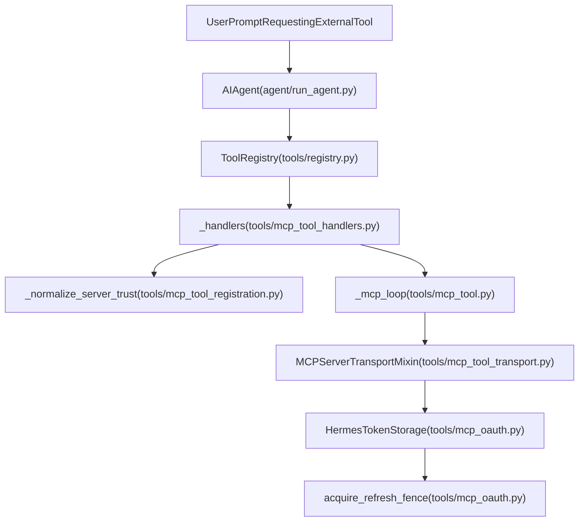
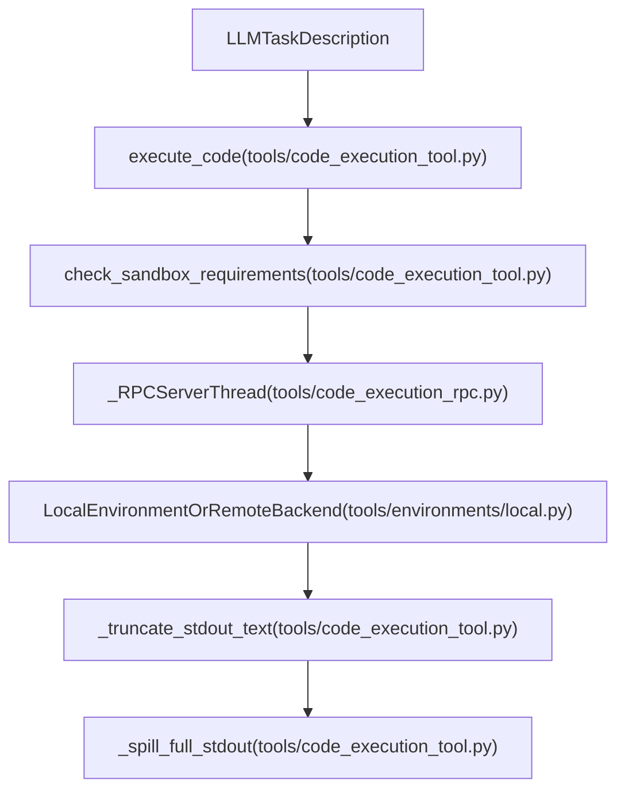

# Code Execution and MCP Tools

Relevant source files

The following files were used as context for generating this wiki page:

- [apps/desktop/electron/mcp-oauth-callback-ipc.test.ts](apps/desktop/electron/mcp-oauth-callback-ipc.test.ts)
- [apps/desktop/electron/mcp-oauth-callback-ipc.ts](apps/desktop/electron/mcp-oauth-callback-ipc.ts)
- [apps/desktop/src/lib/mcp-dashboard-oauth.test.ts](apps/desktop/src/lib/mcp-dashboard-oauth.test.ts)
- [apps/desktop/src/lib/mcp-dashboard-oauth.ts](apps/desktop/src/lib/mcp-dashboard-oauth.ts)
- [contributors/emails/ken.thompson@outlook.com.au](contributors/emails/ken.thompson@outlook.com.au)
- [contributors/emails/n931@qq.com](contributors/emails/n931@qq.com)
- [evals/mcp_device_flow.py](evals/mcp_device_flow.py)
- [gateway/platforms/webhook_mcp_events.py](gateway/platforms/webhook_mcp_events.py)
- [hermes_cli/mcp_config.py](hermes_cli/mcp_config.py)
- [hermes_cli/subcommands/mcp.py](hermes_cli/subcommands/mcp.py)
- [scripts/check_no_tmp_literals.py](scripts/check_no_tmp_literals.py)
- [tests/computer_use/test_cua_perf_knobs.py](tests/computer_use/test_cua_perf_knobs.py)
- [tests/e2e/__init__.py](tests/e2e/__init__.py)
- [tests/e2e/conftest.py](tests/e2e/conftest.py)
- [tests/e2e/test_discord_adapter.py](tests/e2e/test_discord_adapter.py)
- [tests/e2e/test_platform_commands.py](tests/e2e/test_platform_commands.py)
- [tests/gateway/test_multiplex_mcp_discovery.py](tests/gateway/test_multiplex_mcp_discovery.py)
- [tests/gateway/test_webhook_mcp_events.py](tests/gateway/test_webhook_mcp_events.py)
- [tests/hermes_cli/test_mcp_config.py](tests/hermes_cli/test_mcp_config.py)
- [tests/hermes_cli/test_mcp_dashboard_oauth.py](tests/hermes_cli/test_mcp_dashboard_oauth.py)
- [tests/hermes_cli/test_mcp_tools_config.py](tests/hermes_cli/test_mcp_tools_config.py)
- [tests/scripts/test_check_no_tmp_literals.py](tests/scripts/test_check_no_tmp_literals.py)
- [tests/tools/test_code_execution.py](tests/tools/test_code_execution.py)
- [tests/tools/test_code_execution_file_rpc.py](tests/tools/test_code_execution_file_rpc.py)
- [tests/tools/test_code_execution_hermes_home.py](tests/tools/test_code_execution_hermes_home.py)
- [tests/tools/test_code_execution_pm_runtime.py](tests/tools/test_code_execution_pm_runtime.py)
- [tests/tools/test_code_execution_windows_env.py](tests/tools/test_code_execution_windows_env.py)
- [tests/tools/test_code_kernel.py](tests/tools/test_code_kernel.py)
- [tests/tools/test_code_kernel_remote.py](tests/tools/test_code_kernel_remote.py)
- [tests/tools/test_computer_use_capture_routing.py](tests/tools/test_computer_use_capture_routing.py)
- [tests/tools/test_mcp_capability_gating.py](tests/tools/test_mcp_capability_gating.py)
- [tests/tools/test_mcp_circuit_breaker.py](tests/tools/test_mcp_circuit_breaker.py)
- [tests/tools/test_mcp_client_cert.py](tests/tools/test_mcp_client_cert.py)
- [tests/tools/test_mcp_connect_secret_scope.py](tests/tools/test_mcp_connect_secret_scope.py)
- [tests/tools/test_mcp_dashboard_oauth.py](tests/tools/test_mcp_dashboard_oauth.py)
- [tests/tools/test_mcp_device_flow.py](tests/tools/test_mcp_device_flow.py)
- [tests/tools/test_mcp_elicitation.py](tests/tools/test_mcp_elicitation.py)
- [tests/tools/test_mcp_events.py](tests/tools/test_mcp_events.py)
- [tests/tools/test_mcp_google_offline_access.py](tests/tools/test_mcp_google_offline_access.py)
- [tests/tools/test_mcp_http_body_cap.py](tests/tools/test_mcp_http_body_cap.py)
- [tests/tools/test_mcp_http_proxy.py](tests/tools/test_mcp_http_proxy.py)
- [tests/tools/test_mcp_image_content.py](tests/tools/test_mcp_image_content.py)
- [tests/tools/test_mcp_lazy_start.py](tests/tools/test_mcp_lazy_start.py)
- [tests/tools/test_mcp_multiplex_connection_keys.py](tests/tools/test_mcp_multiplex_connection_keys.py)
- [tests/tools/test_mcp_oauth.py](tests/tools/test_mcp_oauth.py)
- [tests/tools/test_mcp_oauth_issuer_origin.py](tests/tools/test_mcp_oauth_issuer_origin.py)
- [tests/tools/test_mcp_oauth_manager.py](tests/tools/test_mcp_oauth_manager.py)
- [tests/tools/test_mcp_oauth_missing_iss.py](tests/tools/test_mcp_oauth_missing_iss.py)
- [tests/tools/test_mcp_park_log_dedupe.py](tests/tools/test_mcp_park_log_dedupe.py)
- [tests/tools/test_mcp_probe.py](tests/tools/test_mcp_probe.py)
- [tests/tools/test_mcp_schema_cache.py](tests/tools/test_mcp_schema_cache.py)
- [tests/tools/test_mcp_shared_connection_resolved_identity.py](tests/tools/test_mcp_shared_connection_resolved_identity.py)
- [tests/tools/test_mcp_stability.py](tests/tools/test_mcp_stability.py)
- [tests/tools/test_mcp_stdio_env_unset_ref.py](tests/tools/test_mcp_stdio_env_unset_ref.py)
- [tests/tools/test_mcp_tool.py](tests/tools/test_mcp_tool.py)
- [tests/tools/test_mcp_tool_client_info.py](tests/tools/test_mcp_tool_client_info.py)
- [tests/tools/test_mcp_tool_errors.py](tests/tools/test_mcp_tool_errors.py)
- [tests/tools/test_mcp_tool_issue_948.py](tests/tools/test_mcp_tool_issue_948.py)
- [tests/tools/test_mcp_tool_session_expired.py](tests/tools/test_mcp_tool_session_expired.py)
- [tests/tools/test_pgid_starttime_drift.py](tests/tools/test_pgid_starttime_drift.py)
- [tests/tools/test_refresh_agent_mcp_tools.py](tests/tools/test_refresh_agent_mcp_tools.py)
- [tests/tui_gateway/test_mcp_oauth_cancel.py](tests/tui_gateway/test_mcp_oauth_cancel.py)
- [tests/tui_gateway/test_mcp_oauth_client_callback.py](tests/tui_gateway/test_mcp_oauth_client_callback.py)
- [tools/code_execution_env.py](tools/code_execution_env.py)
- [tools/code_execution_rpc.py](tools/code_execution_rpc.py)
- [tools/code_execution_tool.py](tools/code_execution_tool.py)
- [tools/code_kernel.py](tools/code_kernel.py)
- [tools/code_kernel_remote.py](tools/code_kernel_remote.py)
- [tools/mcp_dashboard_oauth.py](tools/mcp_dashboard_oauth.py)
- [tools/mcp_oauth.py](tools/mcp_oauth.py)
- [tools/mcp_oauth_device.py](tools/mcp_oauth_device.py)
- [tools/mcp_oauth_manager.py](tools/mcp_oauth_manager.py)
- [tools/mcp_oauth_provider.py](tools/mcp_oauth_provider.py)
- [tools/mcp_schema_cache.py](tools/mcp_schema_cache.py)
- [tools/mcp_tool.py](tools/mcp_tool.py)
- [tools/mcp_tool_agent.py](tools/mcp_tool_agent.py)
- [tools/mcp_tool_common.py](tools/mcp_tool_common.py)
- [tools/mcp_tool_config.py](tools/mcp_tool_config.py)
- [tools/mcp_tool_content.py](tools/mcp_tool_content.py)
- [tools/mcp_tool_discovery.py](tools/mcp_tool_discovery.py)
- [tools/mcp_tool_errors.py](tools/mcp_tool_errors.py)
- [tools/mcp_tool_events.py](tools/mcp_tool_events.py)
- [tools/mcp_tool_handlers.py](tools/mcp_tool_handlers.py)
- [tools/mcp_tool_health.py](tools/mcp_tool_health.py)
- [tools/mcp_tool_lifecycle.py](tools/mcp_tool_lifecycle.py)
- [tools/mcp_tool_loop.py](tools/mcp_tool_loop.py)
- [tools/mcp_tool_registration.py](tools/mcp_tool_registration.py)
- [tools/mcp_tool_sampling.py](tools/mcp_tool_sampling.py)
- [tools/mcp_tool_schema.py](tools/mcp_tool_schema.py)
- [tools/mcp_tool_server_run.py](tools/mcp_tool_server_run.py)
- [tools/mcp_tool_transport.py](tools/mcp_tool_transport.py)
- [tui_gateway/mcp_oauth_sessions.py](tui_gateway/mcp_oauth_sessions.py)
- [ui-tui/src/__tests__/connectorAccounts.test.ts](ui-tui/src/__tests__/connectorAccounts.test.ts)
- [ui-tui/src/components/connectorsOverlay.tsx](ui-tui/src/components/connectorsOverlay.tsx)
- [ui-tui/src/domain/connectorAccounts.ts](ui-tui/src/domain/connectorAccounts.ts)
- [web/src/lib/mcp-dashboard-oauth.test.ts](web/src/lib/mcp-dashboard-oauth.test.ts)
- [web/src/lib/mcp-dashboard-oauth.ts](web/src/lib/mcp-dashboard-oauth.ts)
- [website/docs/reference/mcp-config-reference.md](website/docs/reference/mcp-config-reference.md)
- [website/docs/user-guide/features/mcp.md](website/docs/user-guide/features/mcp.md)

This page covers the advanced extensibility and execution mechanisms in Hermes Agent: the **Code Execution Sandbox** for programmatic tool calling (PTC), the **Model Context Protocol (MCP)** integration layer (transports, session management, discovery, trust gates, health checks, and circuit breakers), **MCP OAuth 2.1** authentication, the **Managed Tool Gateway**, and the **Optional MCPs Catalog**.

---

## 1. Code Execution Sandbox (Programmatic Tool Calling)

The Code Execution Sandbox enables the LLM to write a Python script that invokes Hermes tools programmatically via RPC [tools/code_execution_tool.py:3-7](). This Programmatic Tool Calling (PTC) collapses multi-step tool loops into a single inference turn, returning only the final execution output to the conversation context [tools/code_execution_tool.py:3-7]().

### 1.1 Architecture and Data Flow

The sandbox employs two distinct transport patterns depending on the execution environment backend [tools/code_execution_tool.py:8-29]():

- **Local Backend (Unix Domain Sockets / Loopback TCP on Windows):**
  1. The parent runtime generates a `hermes_tools.py` stub module exposing UDS RPC functions [tools/code_execution_tool.py:11-11]().
  2. A dedicated RPC server thread opens a Unix domain socket to handle client connections from the child process [tools/code_execution_tool.py:12-12]().
  3. The parent spawns the child execution process running the script, which communicates over the UDS [tools/code_execution_tool.py:13-14]().
  4. Intermediate tool outputs remain off the context window; only final stdout is returned [tools/code_execution_tool.py:24-25]().

- **Remote Backend (File-based RPC):**
  1. The parent generates file-based RPC stubs in `hermes_tools.py` and syncs them to the remote environment (Docker, SSH, Modal, etc.) [tools/code_execution_tool.py:16-19]().
  2. The script writes request files; a parent polling thread reads them via `env.execute()`, performs the dispatch, and writes response files [tools/code_execution_tool.py:20-21]().

Sources: [tools/code_execution_tool.py:1-29]()

### 1.2 Key Functions and Limits

- `execute_code(code: str, ...)`: Entry point for executing arbitrary Python scripts in the sandbox [tools/code_execution_tool.py:54-54]().
- `SANDBOX_ALLOWED_TOOLS`: Whitelist of permitted tools (`web_search`, `web_extract`, `read_file`, `write_file`, `search_files`, `patch`, `terminal`) [tools/code_execution_tool.py:43-45]().
- **Output Management**: `_truncate_stdout_text` caps standard output at `MAX_STDOUT_BYTES` (50 KB) using a head/tail split strategy [tools/code_execution_tool.py:56-80](). Excess output spills to a cache file via `_spill_full_stdout` under `cache/exec/` [tools/code_execution_tool.py:83-102]().
- **Environment Scrubbing**: Sensitive environment variables matching patterns like `KEY`, `TOKEN`, or `PASSWORD` are scrubbed before process spawn.

Sources: [tools/code_execution_tool.py:30-134]()

---

## 2. Model Context Protocol (MCP) Integration

Hermes integrates external MCP servers (local stdio subprocesses or remote HTTP/SSE endpoints) to dynamically discover and register toolsets [tools/mcp_tool.py:2-10]().

### 2.1 Core Subsystems and Transports

- **Background Event Loop (`_mcp_loop`)**: Runs in a daemon thread, maintaining persistent transport tasks (`MCPServerTask`) with `_lock`-synchronized state [tools/mcp_tool.py:8-10]().
- **Transports**: Managed via `MCPServerTransportMixin` supporting Stdio (with OSV malware preflight [tools/mcp_tool.py:39-67]() and cached npx binary resolution [tools/mcp_tool.py:59-65]()), Streamable HTTP, and SSE [tools/mcp_tool_transport.py:1-4]().
- **Protocol Negotiation**: Handshakes and initial tool discovery are handled through robust transport layers and header injectors [tools/mcp_tool_transport.py:1-29]().

Sources: [tools/mcp_tool.py:1-141](), [tools/mcp_tool_transport.py:1-132]()

### 2.2 Tool Registration, Filters, and Trust Gates

Tools discovered from an MCP server pass through registration filters and security checks before entering the tool registry [tools/mcp_tool_registration.py:1-5]():
- **Include/Exclude Filters**: Evaluates `tools.include` and `tools.exclude` rules [hermes_cli/mcp_config.py:63-72]().
- **Trust Tiers**: `_normalize_server_trust` classifies servers as `full` or `untrusted` [tools/mcp_tool_registration.py:37-46](). `_annotation_read_only_hint` checks tool-level `readOnlyHint` annotations to determine write capabilities [tools/mcp_tool_registration.py:49-58]().
- **Utility Tools**: Optional capabilities (`resources`, `prompts`) map to utility schemas and handlers (`list_resources`, `read_resource`, `list_prompts`, `get_prompt`) [tools/mcp_tool_registration.py:30-35]().

Sources: [tools/mcp_tool_registration.py:1-145](), [hermes_cli/mcp_config.py:63-72]()

### 2.3 Health Management and Error Classification

- **Circuit Breaker & Health**: Tracks consecutive failures and enforces cooldown windows when a server exceeds error thresholds [tools/mcp_tool_handlers.py:69-125]().
- **Error Classification**: Separates permanent auth failures from transient errors that trigger backoff retries [tools/mcp_tool_errors.py:1-137]().
- **Stdio Lifecycle**: Supports idle timeouts, max lifetimes, and dynamic tool refresh upon receiving notification messages [tools/mcp_tool_lifecycle.py:1-74]().

Sources: [tools/mcp_tool_handlers.py:1-126](), [tools/mcp_tool_lifecycle.py:1-74](), [tools/mcp_tool_errors.py:1-137]()

---

## 3. MCP OAuth 2.1 Support

Hermes provides OAuth 2.1 authorization code flow with PKCE for remote authenticated MCP servers [tools/mcp_oauth.py:1-9]().

### 3.1 Implementation and Storage

- **HermesTokenStorage**: Persists tokens and client metadata per profile under `HERMES_HOME/mcp-tokens/` with strict `0o600` file permissions to prevent token exposure [tools/mcp_oauth.py:75-130](), [tests/tools/test_mcp_oauth.py:75-124]().
- **Refresh Fence**: `acquire_refresh_fence` manages cross-process advisory file locking (`.refresh.lock`) across the token-endpoint POST to prevent single-use refresh token race conditions [tools/mcp_oauth.py:77-152]().
- **Localhost Callback**: An ephemeral HTTP callback listener captures redirect authorization codes with non-interactive fallback support [tools/mcp_oauth.py:1-44]().

Sources: [tools/mcp_oauth.py:1-158](), [tests/tools/test_mcp_oauth.py:1-162]()

---

## 4. Managed Tool Gateway

The Managed Tool Gateway coordinates external tool backends and abstracts lifecycle complexities across different execution contexts [tools/mcp_tool_agent.py:1-50](). It provides unified RPC multiplexing and health supervision for managed child processes and plugin tool providers.

Sources: [tools/mcp_tool_agent.py:1-50]()

---

## 5. Optional MCPs Catalog

Hermes includes a curated catalog of optional MCP servers under `optional-mcps/`, providing streamlined installation and configuration via the CLI (`hermes mcp`) [hermes_cli/mcp_config.py:1-189]().

### 5.1 Catalog Management and Security

- **CLI Interface**: Users browse, install, enable, disable, and uninstall catalog entries using `hermes mcp` commands [hermes_cli/mcp_config.py:1-40]().
- **Credential Handling**: Server manifests declare required environment variables or OAuth parameters, safely stored in configuration or credential vaults [hermes_cli/mcp_config.py:100-166]().
- **Probe Redaction**: `redact_mcp_probe_text` and `redact_mcp_header_display` ensure credential-shaped headers and authorization tokens are redacted from logs and debug displays [hermes_cli/mcp_config.py:121-166]().

Sources: [hermes_cli/mcp_config.py:1-189]()

---

## Diagrams

### Diagram: Natural Language Space to Code Entity Space: MCP & OAuth Integration

Sources: [tools/mcp_tool.py:1-10](), [tools/mcp_tool_handlers.py:41-97](), [tools/mcp_tool_transport.py:1-4](), [tools/mcp_oauth.py:77-152]()

### Diagram: Natural Language Space to Code Entity Space: Code Execution Sandbox

Sources: [tools/code_execution_tool.py:54-102](), [tools/environments/local.py:1-30]()

---

## Configuration Reference

| Key | Description | Location |
|---|---|---|
| `mcp_servers` | Map of external MCP server definitions (stdio, http, sse) | `config.yaml` |
| `mcp_servers.<name>.trust` | Trust tier (`full` or `untrusted`) | `config.yaml` |
| `mcp_servers.<name>.tools.include` | Whitelist of allowed tool names / globs | `config.yaml` |
| `mcp_servers.<name>.tools.exclude` | Blacklist of excluded tool names / globs | `config.yaml` |
| `code_execution.timeout` | Default execution timeout for `execute_code` | `config.yaml` |

Sources: [tools/mcp_tool_config.py](), [tools/code_execution_tool.py:48-52]()

---

# References
- [tools/code_execution_tool.py:1-134]()
- [tools/mcp_tool.py:1-141]()
- [tools/mcp_tool_transport.py:1-132]()
- [tools/mcp_tool_handlers.py:1-126]()
- [tools/mcp_tool_registration.py:1-145]()
- [tools/mcp_tool_errors.py:1-137]()
- [tools/mcp_tool_health.py:1-133]()
- [tools/mcp_oauth.py:1-158]()
- [hermes_cli/mcp_config.py:1-189]()
- [tools/environments/local.py:1-169]()