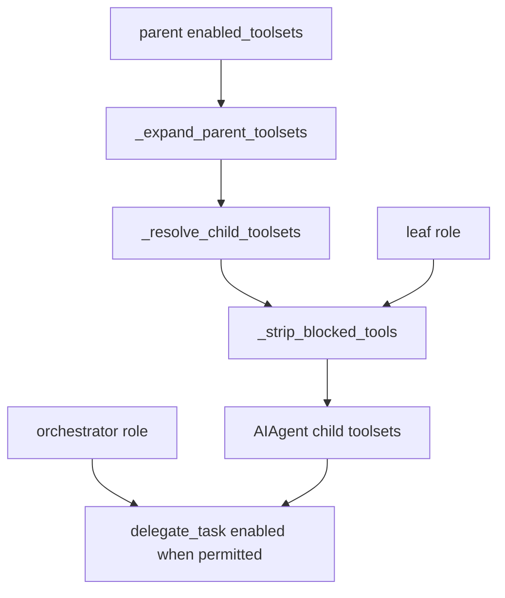
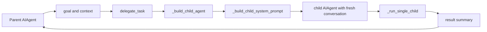
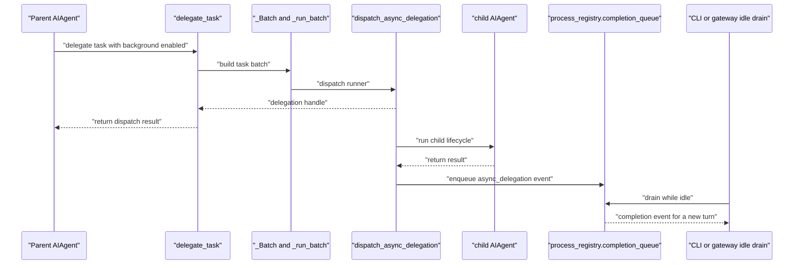

# Subagent Delegation

Relevant source files

The following files were used as context for generating this wiki page:

- [agent/delegation_backends.py](agent/delegation_backends.py)
- [agent/delegation_provider.py](agent/delegation_provider.py)
- [agent/delegation_registry.py](agent/delegation_registry.py)
- [agent/managed_worker.py](agent/managed_worker.py)
- [gateway/run_runtime.py](gateway/run_runtime.py)
- [gateway/session_db_recovery.py](gateway/session_db_recovery.py)
- [gateway/session_kanban.py](gateway/session_kanban.py)
- [gateway/session_managed_worker.py](gateway/session_managed_worker.py)
- [gateway/session_runtime_workers.py](gateway/session_runtime_workers.py)
- [gateway/session_tui_side.py](gateway/session_tui_side.py)
- [gateway/session_unattended_unknown.py](gateway/session_unattended_unknown.py)
- [gateway/session_worker_construct.py](gateway/session_worker_construct.py)
- [hermes_cli/gateway_chat_startup.py](hermes_cli/gateway_chat_startup.py)
- [hermes_cli/kanban_owner_recovery.py](hermes_cli/kanban_owner_recovery.py)
- [hermes_cli/kanban_worker_client.py](hermes_cli/kanban_worker_client.py)
- [tests/agent/test_delegation_switch_next_session.py](tests/agent/test_delegation_switch_next_session.py)
- [tests/agent/test_sequential_deadline_delegate_exempt.py](tests/agent/test_sequential_deadline_delegate_exempt.py)
- [tests/gateway/fixtures/kanban_owner_probe.py](tests/gateway/fixtures/kanban_owner_probe.py)
- [tests/gateway/fixtures/kanban_recovery_probe.py](tests/gateway/fixtures/kanban_recovery_probe.py)
- [tests/gateway/fixtures/local_session_peer.py](tests/gateway/fixtures/local_session_peer.py)
- [tests/gateway/fixtures/session_policy_peer.py](tests/gateway/fixtures/session_policy_peer.py)
- [tests/gateway/test_api_pending_daemon.py](tests/gateway/test_api_pending_daemon.py)
- [tests/gateway/test_authority_turn_error_surface.py](tests/gateway/test_authority_turn_error_surface.py)
- [tests/gateway/test_docker_session_workspace.py](tests/gateway/test_docker_session_workspace.py)
- [tests/gateway/test_kanban_auto_decompose_secret_scope.py](tests/gateway/test_kanban_auto_decompose_secret_scope.py)
- [tests/gateway/test_kanban_finite_admission.py](tests/gateway/test_kanban_finite_admission.py)
- [tests/gateway/test_local_session.py](tests/gateway/test_local_session.py)
- [tests/gateway/test_managed_worker_bypass.py](tests/gateway/test_managed_worker_bypass.py)
- [tests/gateway/test_managed_worker_construct.py](tests/gateway/test_managed_worker_construct.py)
- [tests/gateway/test_managed_worker_finished_exit.py](tests/gateway/test_managed_worker_finished_exit.py)
- [tests/gateway/test_managed_worker_hard_stop_frame_fence.py](tests/gateway/test_managed_worker_hard_stop_frame_fence.py)
- [tests/gateway/test_managed_worker_kill_escalation.py](tests/gateway/test_managed_worker_kill_escalation.py)
- [tests/gateway/test_managed_worker_launch.py](tests/gateway/test_managed_worker_launch.py)
- [tests/gateway/test_managed_worker_reservation_off_loop.py](tests/gateway/test_managed_worker_reservation_off_loop.py)
- [tests/gateway/test_managed_worker_result_usage.py](tests/gateway/test_managed_worker_result_usage.py)
- [tests/gateway/test_managed_worker_route_key.py](tests/gateway/test_managed_worker_route_key.py)
- [tests/gateway/test_profile_authority_park_reason.py](tests/gateway/test_profile_authority_park_reason.py)
- [tests/gateway/test_run_runtime_hot_serve_cleanup.py](tests/gateway/test_run_runtime_hot_serve_cleanup.py)
- [tests/gateway/test_runtime_worker_shutdown.py](tests/gateway/test_runtime_worker_shutdown.py)
- [tests/gateway/test_session_config_loaders.py](tests/gateway/test_session_config_loaders.py)
- [tests/gateway/test_session_db_handle_sharing.py](tests/gateway/test_session_db_handle_sharing.py)
- [tests/gateway/test_session_db_recovery.py](tests/gateway/test_session_db_recovery.py)
- [tests/gateway/test_session_kanban.py](tests/gateway/test_session_kanban.py)
- [tests/gateway/test_session_kanban_run_off_loop.py](tests/gateway/test_session_kanban_run_off_loop.py)
- [tests/gateway/test_session_tui_side.py](tests/gateway/test_session_tui_side.py)
- [tests/gateway/test_unknown_automation_settles.py](tests/gateway/test_unknown_automation_settles.py)
- [tests/hermes_cli/gateway_client_options.py](tests/hermes_cli/gateway_client_options.py)
- [tests/hermes_cli/test_gateway_chat_native.py](tests/hermes_cli/test_gateway_chat_native.py)
- [tests/hermes_cli/test_gateway_chat_unknown.py](tests/hermes_cli/test_gateway_chat_unknown.py)
- [tests/hermes_cli/test_gateway_first_run_live.py](tests/hermes_cli/test_gateway_first_run_live.py)
- [tests/hermes_cli/test_gateway_startup_validation.py](tests/hermes_cli/test_gateway_startup_validation.py)
- [tests/hermes_cli/test_kanban_managed_result_pid.py](tests/hermes_cli/test_kanban_managed_result_pid.py)
- [tests/hermes_cli/test_kanban_owner_receipt_reclaim.py](tests/hermes_cli/test_kanban_owner_receipt_reclaim.py)
- [tests/hermes_cli/test_kanban_worker_admission_wait.py](tests/hermes_cli/test_kanban_worker_admission_wait.py)
- [tests/hermes_cli/test_kanban_worker_spawn_toolsets.py](tests/hermes_cli/test_kanban_worker_spawn_toolsets.py)
- [tests/hermes_cli/test_plugin_host_delegation.py](tests/hermes_cli/test_plugin_host_delegation.py)
- [tests/hermes_cli/test_runtime_maintenance_exclusion.py](tests/hermes_cli/test_runtime_maintenance_exclusion.py)
- [tests/hermes_cli/test_safe_mode.py](tests/hermes_cli/test_safe_mode.py)
- [tests/tools/test_async_delegation.py](tests/tools/test_async_delegation.py)
- [tests/tools/test_delegate.py](tests/tools/test_delegate.py)
- [tests/tools/test_delegate_composite_toolsets.py](tests/tools/test_delegate_composite_toolsets.py)
- [tests/tools/test_delegate_depth_prompt.py](tests/tools/test_delegate_depth_prompt.py)
- [tests/tools/test_delegate_images.py](tests/tools/test_delegate_images.py)
- [tests/tools/test_delegate_summary_budget.py](tests/tools/test_delegate_summary_budget.py)
- [tests/tools/test_delegated_output_redaction.py](tests/tools/test_delegated_output_redaction.py)
- [tests/tools/test_delegation_backends.py](tests/tools/test_delegation_backends.py)
- [tests/tools/test_delegation_profile_route.py](tests/tools/test_delegation_profile_route.py)
- [tests/tools/test_delegation_route_fields.py](tests/tools/test_delegation_route_fields.py)
- [tools/AGENTS.md](tools/AGENTS.md)
- [tools/async_delegation.py](tools/async_delegation.py)
- [tools/delegate_tool.py](tools/delegate_tool.py)
- [tools/delegate_tool_child_run.py](tools/delegate_tool_child_run.py)
- [tools/delegate_tool_config.py](tools/delegate_tool_config.py)
- [tools/delegate_tool_dispatch.py](tools/delegate_tool_dispatch.py)
- [tools/delegate_tool_progress.py](tools/delegate_tool_progress.py)
- [tools/delegate_tool_registry.py](tools/delegate_tool_registry.py)
- [tools/delegate_tool_results.py](tools/delegate_tool_results.py)
- [tools/delegate_tool_routes.py](tools/delegate_tool_routes.py)
- [tools/delegate_tool_tasks.py](tools/delegate_tool_tasks.py)
- [tools/delegate_tool_toolsets.py](tools/delegate_tool_toolsets.py)
- [tools/delegate_tool_tuning.py](tools/delegate_tool_tuning.py)
- [tools/delegation_redaction.py](tools/delegation_redaction.py)
- [tools/terminal_tool_lifecycle.py](tools/terminal_tool_lifecycle.py)
- [ui-tui/src/__tests__/canonicalSideAgents.test.ts](ui-tui/src/__tests__/canonicalSideAgents.test.ts)
- [website/docs/developer-guide/delegation-provider-plugin.md](website/docs/developer-guide/delegation-provider-plugin.md)
- [website/docs/user-guide/features/delegation.md](website/docs/user-guide/features/delegation.md)

## Purpose and scope

This page describes how Hermes Agent delegates work to child `AIAgent` instances through `delegate_task`, including synchronous batches, background execution, child isolation, review-engine integration, and iteration limits. Delegation keeps a child’s intermediate tool calls and reasoning out of the parent’s conversation; the parent receives a result summary instead. [tools/delegate_tool.py:5-11]()

Sources: [tools/delegate_tool.py:5-11]()

---

## 1. Overview and purpose

`delegate_task` creates child agents with fresh conversations, separate task identifiers, and toolsets derived from the parent’s toolsets after child-specific filtering. It supports single-task and batch execution. In a batch, children can run concurrently; the parent receives assembled results rather than their intermediate tool activity. [tools/delegate_tool.py:5-11]()

The implementation is divided across modules:

| Concern | Code entity | Role |
|---|---|---|
| Tool entry point and module facade | `tools/delegate_tool.py` | Re-exports delegation helpers and defines delegation-wide constants and utilities. [tools/delegate_tool.py:25-58]() |
| Child setup and cleanup | `tools/delegate_tool_child_run.py` | Handles an individual child’s lifecycle, registration, interrupts, and result entries. [tools/delegate_tool_child_run.py:1-24]() |
| Batch dispatch | `tools/delegate_tool_dispatch.py` | Represents a call as `_Batch` and runs child tasks synchronously or as detached background units. [tools/delegate_tool_dispatch.py:1-4]() |
| Async lifecycle | `tools/async_delegation.py` | Dispatches background work and publishes completion events. [tools/async_delegation.py:1-8]() |
| Route selection | `tools/delegate_tool_routes.py` | Converts the active delegation provider’s per-task route into inputs for child construction. [tools/delegate_tool_routes.py:1-7]() |
| Child toolset selection | `tools/delegate_tool_toolsets.py` | Provides child toolset resolution and blocked-tool filtering, re-exported by the facade. [tools/delegate_tool.py:54-56]() |

Sources: [tools/delegate_tool.py:25-58](), [tools/delegate_tool_child_run.py:1-24](), [tools/delegate_tool_dispatch.py:1-4](), [tools/async_delegation.py:1-8](), [tools/delegate_tool_routes.py:1-7]()

### Natural-language request to implementation entities

A model expresses a delegation request through the `delegate_task` tool. The code path separates task intent, child construction, and dispatch rather than exposing lifecycle internals as model-facing controls. The facade imports task-normalization, routing, toolset, child-run, and dispatch components. [tools/delegate_tool.py:27-58]()

**Diagram: Delegation request mapped to code entities**

```mermaid
flowchart LR
    Intent["Natural language task intent"]
    Schema["DELEGATE_TASK_SCHEMA"]
    Handler["delegate_task"]
    Normalize["_normalize_task_list"]
    Route["TaskRoute"]
    Build["_build_child_agent"]
    Batch["_Batch"]
    Dispatch["_run_batch"]
    Result["Summary result"]

    Intent --> Schema
    Schema --> Handler
    Handler --> Normalize
    Normalize --> Route
    Route --> Build
    Build --> Batch
    Batch --> Dispatch
    Dispatch --> Result
```

Sources: [tools/delegate_tool.py:27-58](), [tools/delegate_tool_tasks.py](), [tools/delegate_tool_routes.py:29-53](), [tools/delegate_tool_dispatch.py:28-67]()

---

## 2. Tool schema and registration

The tool’s task normalization and schema helpers live in `tools/delegate_tool_tasks.py`; the main module re-exports `_normalize_task_list`, `_coerce_task_schemas`, and image-normalization helpers. [tools/delegate_tool.py:50-52]() The toolset module is responsible for resolving child toolsets and stripping blocked tools; the facade imports `DELEGATE_BLOCKED_TOOLS`, `_resolve_child_toolsets`, and `_strip_blocked_tools` from it. [tools/delegate_tool.py:54-56]()

Children do not receive an unrestricted copy of the parent’s tools. Tests exercise the filter with a mixed `hermes-cli` composite: blocked tools remain disabled after composite expansion, while allowed tools such as terminal and file tools remain available. The tests also verify that an orchestrator can regain `delegate_task` when orchestrator delegation is enabled and spawn depth permits it. [tests/tools/test_delegate.py:58-75](), [tests/tools/test_delegate.py:77-127](), [tests/tools/test_delegate.py:129-168]()

**Diagram: Child toolset assembly mapped to code entities**

Sources: [tools/delegate_tool.py:54-56](), [tests/tools/test_delegate.py:58-75](), [tests/tools/test_delegate.py:77-127](), [tests/tools/test_delegate.py:129-168]()

| Toolset behavior | Implementation detail |
|---|---|
| Blocked tools | `DELEGATE_BLOCKED_TOOLS` and `_strip_blocked_tools` define the filtering boundary exposed by the facade. [tools/delegate_tool.py:54-56]() |
| Composite toolsets | Tests check that a mixed parent bundle does not re-expose blocked leaf tools after toolset resolution. [tests/tools/test_delegate.py:77-127]() |
| Orchestrator role | Tests verify the orchestrator case can expose `delegate_task` when the feature and depth configuration allow it. [tests/tools/test_delegate.py:129-168]() |

Sources: [tools/delegate_tool.py:54-56](), [tests/tools/test_delegate.py:58-75](), [tests/tools/test_delegate.py:77-127](), [tests/tools/test_delegate.py:129-168]()

---

## 3. Subagent isolation and context management

Each child starts with a fresh conversation. The delegation module’s architecture describes a focused system prompt assembled from the task’s goal and context, and the parent receives a summary rather than the child’s intermediate tool calls or reasoning. [tools/delegate_tool.py:5-11]()

The child’s task identifier separates resources such as its terminal session and file-operations cache. Child construction and cleanup are handled by the child-run lifecycle module, while `_attach_child` and `_detach_child` maintain the parent’s active-child relationship for interrupt propagation. [tools/delegate_tool.py:5-7](), [tools/delegate_tool_child_run.py:1-2](), [tools/delegate_tool_child_run.py:93-130]()

The delegation user guide describes an additional workspace-context behavior: when the parent has a resolved workspace, project context files are incorporated into the child’s system prompt. [website/docs/user-guide/features/delegation.md:80-105]()

**Diagram: Parent context and child construction mapped to code entities**

Sources: [tools/delegate_tool.py:5-11](), [tools/delegate_tool.py:27-42](), [tools/delegate_tool_child_run.py:1-2](), [website/docs/user-guide/features/delegation.md:80-105]()

---

## 4. Execution modes and async delegation

### Synchronous execution

A delegation call is represented by `_Batch`, which carries the task list, constructed children, parent agent, origin-session information, and result-assembly state. `_Batch.run_child` calls `_run_single_child`; batch execution then runs children and assembles their entries. [tools/delegate_tool_dispatch.py:28-67]()

The dispatch module supports synchronous execution and detached async units. Its module documentation notes that background batches are split by task `group`; each ungrouped task is its own unit, allowing a completed group’s review not to wait for the slowest sibling. [tools/delegate_tool_dispatch.py:1-4]()

### Background execution

The async path returns a handle while work runs on a module-level daemon executor. When the child run completes, an `async_delegation` event is placed on the shared `process_registry.completion_queue`. Consumers drain the event while idle so the result is delivered as a new turn, not inserted mid-turn. [tools/async_delegation.py:1-8]()

Async state includes in-memory records and a durable ledger in `state.db`. The module defines retention, delivery-attempt, replay-age, and claim-lease limits, and `_connect` opens the shared state database for ledger operations. [tools/async_delegation.py:31-59](), [tools/async_delegation.py:106-138]()

Background work also has progress-based stale detection. The async module documents a monitor that samples per-dispatch progress, interrupts a frozen child, gives it time to finish through the normal finalization path, and force-finalizes only if it does not return. The documented idle and in-tool thresholds are 450 and 1200 seconds, respectively. [tools/async_delegation.py:78-88]()

**Diagram: Async delegation request and completion delivery**

Sources: [tools/delegate_tool_dispatch.py:1-4](), [tools/delegate_tool_dispatch.py:28-67](), [tools/async_delegation.py:1-8](), [tools/async_delegation.py:31-59]()

---

## 5. Review engine (`/review` integration)

The supplied code excerpts identify `agent/background_review.py` as the implementation associated with background reviews, but do not include that file’s contents. The available material therefore does not establish its precise call flow, snapshot format, credential handling, or how `/review` is wired to delegation. [agent/background_review.py:1-6]()

The delegation code does document that batch units can be grouped so a finished review need not wait for the slowest sibling. That is a dispatch-level property; it does not, by itself, specify the background review engine’s internal implementation. [tools/delegate_tool_dispatch.py:1-4]()

Sources: [agent/background_review.py:1-6](), [tools/delegate_tool_dispatch.py:1-4]()

---

## 6. Security, approval handling, and iteration budgets

### Child capability and lifecycle controls

Child toolsets are filtered before use, and delegation roles are normalized to `leaf` or `orchestrator`; unknown role values are coerced to `leaf`. [tools/delegate_tool.py:61-104]() Child construction and configuration helpers are imported from dedicated modules, including helpers for spawn depth, concurrent-child limits, approval callbacks, and worktree isolation. [tools/delegate_tool.py:31-36]()

A child is attached to the parent’s active-child list so parent interruption can propagate. If an interrupt arrives before attachment completes, `_attach_child` checks the parent’s pending interrupt state and signals the new child accordingly. [tools/delegate_tool_child_run.py:93-121]()

### Iteration limits and sharing

`DEFAULT_MAX_ITERATIONS` is `250`. The delegation module also imports configuration and child-construction helpers, while the tests show `_build_child_agent` receiving a task-specific `max_iterations` argument. [tools/delegate_tool.py:31-36](), [tools/delegate_tool.py:106](), [tests/tools/test_delegate.py:91-103]()

The available excerpts establish a per-child iteration limit input and a default constant, but do not show an algorithm that decrements a single shared parent-and-child iteration pool. In particular, they do not establish that unused iterations are transferred between siblings or that a child’s iterations reduce the parent’s remaining budget. Treat iteration budgets as child-construction limits unless configuration or implementation code elsewhere specifies additional sharing semantics. [tools/delegate_tool.py:106](), [tests/tools/test_delegate.py:91-103]()

### Operational limits

The delegation facade imports helpers for maximum concurrent children, maximum async children, child timeout, spawn depth, and oneshot child limits. Their concrete defaults and configuration semantics are not shown in the supplied excerpts. [tools/delegate_tool.py:31-36]()

Sources: [tools/delegate_tool.py:31-36](), [tools/delegate_tool.py:61-117](), [tools/delegate_tool_child_run.py:93-121](), [tests/tools/test_delegate.py:91-103]()

---

## 7. Execution data flow

This diagram connects the model-visible delegation concept to implementation entities: the tool handler builds a batch, dispatches child work, and async completion is delivered through the shared completion queue. The parent sees the result, not the child’s intermediate reasoning and tool calls. [tools/delegate_tool.py:5-11](), [tools/delegate_tool_dispatch.py:28-67](), [tools/async_delegation.py:1-8]()

**Diagram: Natural-language delegation to async code path**

```mermaid
flowchart LR
    Intent["Natural language request"]
    Tool["delegate_task"]
    ChildBuild["_build_child_agent"]
    Batch["_Batch"]
    Dispatch["_run_batch"]
    Async["dispatch_async_delegation"]
    Worker["child run"]
    Event["async_delegation event"]
    Queue["process_registry.completion_queue"]
    Delivery["new turn receives summary"]

    Intent --> Tool
    Tool --> ChildBuild
    ChildBuild --> Batch
    Batch --> Dispatch
    Dispatch --> Async
    Async --> Worker
    Worker --> Event
    Event --> Queue
    Queue --> Delivery
```

Sources: [tools/delegate_tool.py:5-11](), [tools/delegate_tool.py:27-58](), [tools/delegate_tool_dispatch.py:28-67](), [tools/async_delegation.py:1-8]()