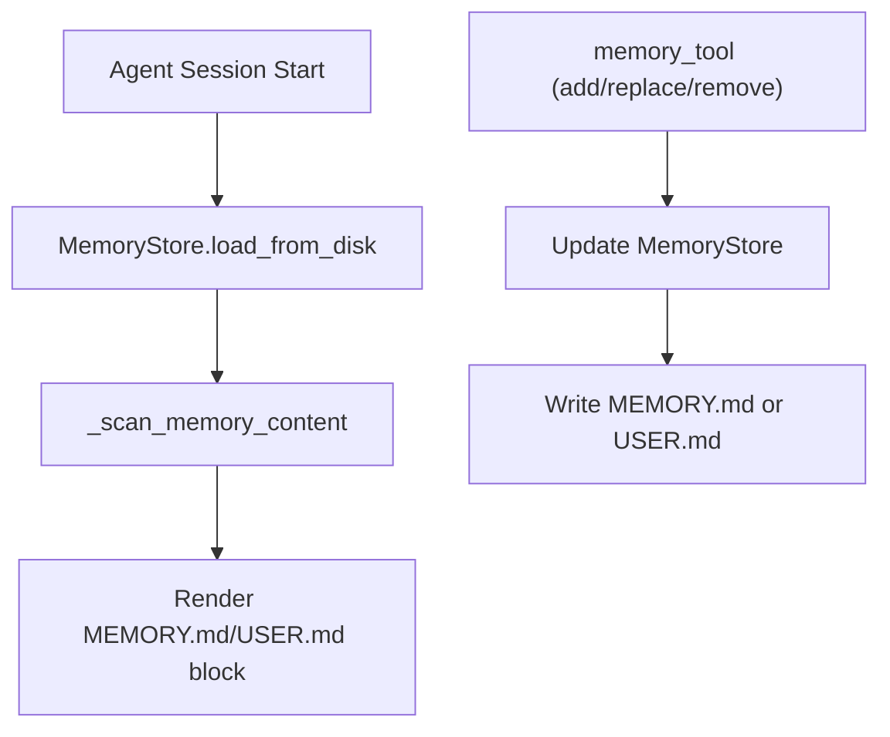
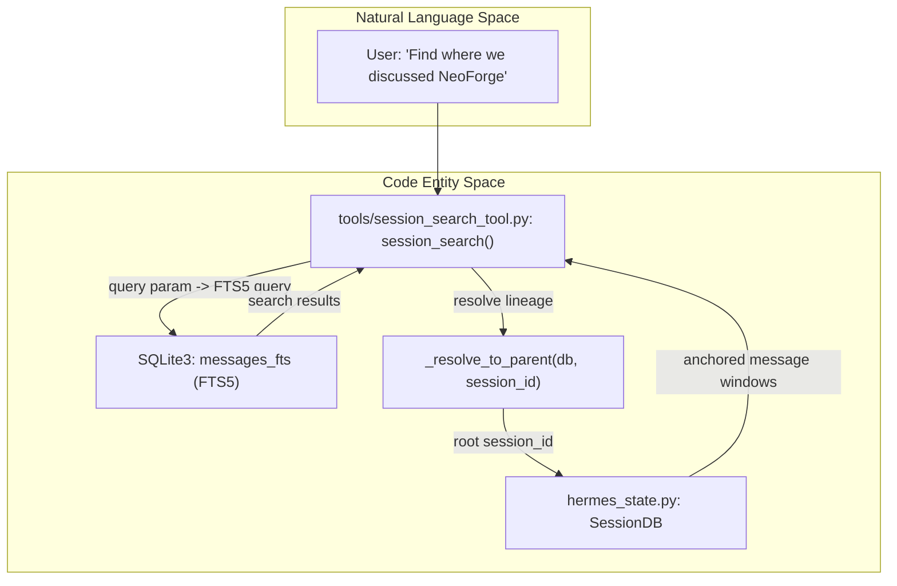
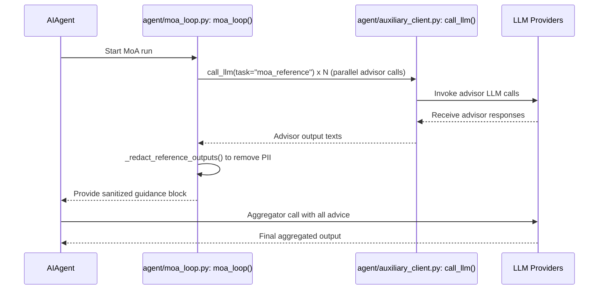
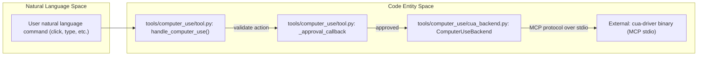

# Other Tools

<details>
<summary>Relevant source files</summary>

The following files were used as context for generating this wiki page:

- [.python-version](.python-version)
- [agent/anthropic_adapter.py](agent/anthropic_adapter.py)
- [agent/anthropic_endpoints.py](agent/anthropic_endpoints.py)
- [agent/anthropic_message_convert.py](agent/anthropic_message_convert.py)
- [agent/anthropic_thinking_policy.py](agent/anthropic_thinking_policy.py)
- [agent/anthropic_thinking_replay.py](agent/anthropic_thinking_replay.py)
- [agent/background_review.py](agent/background_review.py)
- [agent/image_eviction_policy.py](agent/image_eviction_policy.py)
- [contributors/emails/dickson.neoh@gmail.com](contributors/emails/dickson.neoh@gmail.com)
- [evals/anthropic_proxy_thinking_replay.py](evals/anthropic_proxy_thinking_replay.py)
- [hermes_cli/subcommands/computer_use.py](hermes_cli/subcommands/computer_use.py)
- [hermes_cli/write_approval_commands.py](hermes_cli/write_approval_commands.py)
- [plugins/video_gen/deepinfra/__init__.py](plugins/video_gen/deepinfra/__init__.py)
- [plugins/video_gen/fal/__init__.py](plugins/video_gen/fal/__init__.py)
- [plugins/video_gen/xai/__init__.py](plugins/video_gen/xai/__init__.py)
- [plugins/video_gen/xai/plugin.yaml](plugins/video_gen/xai/plugin.yaml)
- [skills/autonomous-ai-agents/computer-use/SKILL.md](skills/autonomous-ai-agents/computer-use/SKILL.md)
- [tests/agent/test_anthropic_adapter.py](tests/agent/test_anthropic_adapter.py)
- [tests/agent/test_anthropic_preserved_thinking_replay.py](tests/agent/test_anthropic_preserved_thinking_replay.py)
- [tests/agent/test_anthropic_signed_platform_replay.py](tests/agent/test_anthropic_signed_platform_replay.py)
- [tests/agent/test_anthropic_thinking_disable.py](tests/agent/test_anthropic_thinking_disable.py)
- [tests/agent/test_deepseek_anthropic_thinking.py](tests/agent/test_deepseek_anthropic_thinking.py)
- [tests/agent/test_image_eviction_policy.py](tests/agent/test_image_eviction_policy.py)
- [tests/agent/test_outbound_stale_vision.py](tests/agent/test_outbound_stale_vision.py)
- [tests/agent/test_sequential_tool_interrupt.py](tests/agent/test_sequential_tool_interrupt.py)
- [tests/agent/test_vision_tool_messages.py](tests/agent/test_vision_tool_messages.py)
- [tests/computer_use/test_cua_no_overlay.py](tests/computer_use/test_cua_no_overlay.py)
- [tests/computer_use/test_cua_spawn_env_sanitization.py](tests/computer_use/test_cua_spawn_env_sanitization.py)
- [tests/computer_use/test_cua_wayland_env.py](tests/computer_use/test_cua_wayland_env.py)
- [tests/computer_use/test_cua_wsl_manifest_path.py](tests/computer_use/test_cua_wsl_manifest_path.py)
- [tests/computer_use/test_doctor.py](tests/computer_use/test_doctor.py)
- [tests/hermes_state/test_search_or_relaxed_fallback.py](tests/hermes_state/test_search_or_relaxed_fallback.py)
- [tests/plugins/video_gen/test_fal_plugin.py](tests/plugins/video_gen/test_fal_plugin.py)
- [tests/plugins/video_gen/test_xai_plugin.py](tests/plugins/video_gen/test_xai_plugin.py)
- [tests/plugins/video_gen/test_xai_plugin_integration.py](tests/plugins/video_gen/test_xai_plugin_integration.py)
- [tests/tools/test_computer_use.py](tests/tools/test_computer_use.py)
- [tests/tools/test_computer_use_ax_walk_bound.py](tests/tools/test_computer_use_ax_walk_bound.py)
- [tests/tools/test_computer_use_capture_self_window.py](tests/tools/test_computer_use_capture_self_window.py)
- [tests/tools/test_computer_use_cua_0_10_permissions.py](tests/tools/test_computer_use_cua_0_10_permissions.py)
- [tests/tools/test_computer_use_cua_0_9.py](tests/tools/test_computer_use_cua_0_9.py)
- [tests/tools/test_computer_use_cua_backend_linux.py](tests/tools/test_computer_use_cua_backend_linux.py)
- [tests/tools/test_computer_use_doctor_stale_units.py](tests/tools/test_computer_use_doctor_stale_units.py)
- [tests/tools/test_computer_use_screenshot_dedup.py](tests/tools/test_computer_use_screenshot_dedup.py)
- [tests/tools/test_ensure_task_env.py](tests/tools/test_ensure_task_env.py)
- [tests/tools/test_fal_common.py](tests/tools/test_fal_common.py)
- [tests/tools/test_fal_sdk.py](tests/tools/test_fal_sdk.py)
- [tests/tools/test_image_generation.py](tests/tools/test_image_generation.py)
- [tests/tools/test_image_generation_image_to_image.py](tests/tools/test_image_generation_image_to_image.py)
- [tests/tools/test_image_generation_interrupt.py](tests/tools/test_image_generation_interrupt.py)
- [tests/tools/test_image_source.py](tests/tools/test_image_source.py)
- [tests/tools/test_managed_media_gateways.py](tests/tools/test_managed_media_gateways.py)
- [tests/tools/test_memory_patch_action.py](tests/tools/test_memory_patch_action.py)
- [tests/tools/test_memory_tool.py](tests/tools/test_memory_tool.py)
- [tests/tools/test_session_search.py](tests/tools/test_session_search.py)
- [tests/tools/test_session_search_readonly.py](tests/tools/test_session_search_readonly.py)
- [tests/tools/test_skill_pending_diff_batch.py](tests/tools/test_skill_pending_diff_batch.py)
- [tests/tools/test_threat_patterns.py](tests/tools/test_threat_patterns.py)
- [tests/tools/test_translate_execute_context.py](tests/tools/test_translate_execute_context.py)
- [tests/tools/test_video_generation_dispatch.py](tests/tools/test_video_generation_dispatch.py)
- [tests/tools/test_video_generation_dynamic_schema.py](tests/tools/test_video_generation_dynamic_schema.py)
- [tests/tools/test_video_generation_tool_surface_matrix.py](tests/tools/test_video_generation_tool_surface_matrix.py)
- [tests/tools/test_vision_native_fast_path.py](tests/tools/test_vision_native_fast_path.py)
- [tests/tools/test_vision_region.py](tests/tools/test_vision_region.py)
- [tests/tools/test_vision_tools.py](tests/tools/test_vision_tools.py)
- [tests/tools/test_wake_word.py](tests/tools/test_wake_word.py)
- [tests/tools/test_wake_word_stream_recovery.py](tests/tools/test_wake_word_stream_recovery.py)
- [tests/tools/test_working_diff.py](tests/tools/test_working_diff.py)
- [tests/tools/test_write_approval.py](tests/tools/test_write_approval.py)
- [tools/computer_use/__init__.py](tools/computer_use/__init__.py)
- [tools/computer_use/backend.py](tools/computer_use/backend.py)
- [tools/computer_use/cua_backend.py](tools/computer_use/cua_backend.py)
- [tools/computer_use/cua_backend_capture.py](tools/computer_use/cua_backend_capture.py)
- [tools/computer_use/cua_backend_daemon.py](tools/computer_use/cua_backend_daemon.py)
- [tools/computer_use/cua_backend_driver.py](tools/computer_use/cua_backend_driver.py)
- [tools/computer_use/cua_backend_input.py](tools/computer_use/cua_backend_input.py)
- [tools/computer_use/cua_backend_parse.py](tools/computer_use/cua_backend_parse.py)
- [tools/computer_use/cua_backend_session.py](tools/computer_use/cua_backend_session.py)
- [tools/computer_use/doctor.py](tools/computer_use/doctor.py)
- [tools/computer_use/permissions.py](tools/computer_use/permissions.py)
- [tools/computer_use/schema.py](tools/computer_use/schema.py)
- [tools/computer_use/tool.py](tools/computer_use/tool.py)
- [tools/computer_use_tool.py](tools/computer_use_tool.py)
- [tools/fal_common.py](tools/fal_common.py)
- [tools/image_generation_catalog.py](tools/image_generation_catalog.py)
- [tools/image_generation_tool.py](tools/image_generation_tool.py)
- [tools/image_source.py](tools/image_source.py)
- [tools/memory_tool.py](tools/memory_tool.py)
- [tools/memory_tool_store.py](tools/memory_tool_store.py)
- [tools/session_search_tool.py](tools/session_search_tool.py)
- [tools/threat_patterns.py](tools/threat_patterns.py)
- [tools/video_generation_tool.py](tools/video_generation_tool.py)
- [tools/vision_tools.py](tools/vision_tools.py)
- [tools/vision_tools_image_prep.py](tools/vision_tools_image_prep.py)
- [tools/voice_mode_transcript.py](tools/voice_mode_transcript.py)
- [tools/wake_word.py](tools/wake_word.py)
- [tools/wake_word_engines.py](tools/wake_word_engines.py)
- [tools/wakewords/README.md](tools/wakewords/README.md)
- [tools/working_diff.py](tools/working_diff.py)
- [tools/write_approval.py](tools/write_approval.py)
- [tools/xai_video_tools.py](tools/xai_video_tools.py)
- [website/docs/user-guide/features/computer-use.md](website/docs/user-guide/features/computer-use.md)
- [website/docs/user-guide/features/memory.md](website/docs/user-guide/features/memory.md)
- [website/docs/user-guide/features/wake-word.md](website/docs/user-guide/features/wake-word.md)

</details>


## Purpose and Scope

This page documents auxiliary tools and transparent infrastructure that support specialized agent capabilities within the Hermes Agent framework: persistent memory, todo list management, image and video generation, mixture of agents (MoA), session search, skill management tools, computer use (`cua-driver`), persistent goals (`/goal`), checkpoint manager, and the Petdex animated pet system.

---

## Memory and Session Search

Hermes provides two distinct layers of conversation recall: curated persistent memory via file-backed storage (`MEMORY.md` / `USER.md`), and high-performance search over conversation transcripts stored in SQLite.

### Curated Memory Tools

The `memory` tool manages bounded, file-backed storage that persists across sessions. It maintains two parallel memory files:

- `MEMORY.md`: for personal notes and observations about the environment, project conventions, and tool quirks [website/docs/user-guide/features/memory.md:17]().
- `USER.md`: for agent knowledge about the user’s preferences, communication style, and workflow habits [website/docs/user-guide/features/memory.md:18]().

Both files use a §-delimited entry format allowing multiline memory entries [website/docs/user-guide/features/memory.md:54](). The `MemoryStore` class encapsulates operations to load, parse, and mutate these entries [tools/memory_tool_store.py:1-4]() and [tools/memory_tool.py:43-44](). Key operations include adding new entries, replacing, or removing entries matching a short substring [tools/memory_tool.py:104-118]().

**Frozen Snapshot Pattern**:  
At session start, memory contents are loaded into the system prompt as a frozen snapshot (immutable during the session) to preserve prefix cache stability [website/docs/user-guide/features/memory.md:56-57](). During the session, updates by calls to the `memory` tool immediately alter the backing files on disk and update the live memory store, but they do **not** alter the current session's system prompt [website/docs/user-guide/features/memory.md:56-57](). The snapshot and prompt refresh at the next session start.

**Drift Detection and Safe Writes**:  
When updating memory files, the tool guards against content drift—a mismatch between expected and actual file contents that can arise from external edits or race conditions. If detected, writes are validated or gated [tools/memory_tool_store.py:49-61]() and [tools/memory_tool.py:64-78]().

Title: MemoryStore Key Functions and Flow

Sources: [tools/memory_tool.py:43-44](), [tools/memory_tool.py:64-118](), [tools/memory_tool_store.py:1-61](), [website/docs/user-guide/features/memory.md:1-122]()

### Session Search Tool

The `session_search_tool` enables long-term recall over all past conversations by querying the SQLite session database. It operates as a single-shape tool with four calling modes, inferred from the presence or absence of arguments [tools/session_search_tool.py:2-9]():

- **DISCOVERY** — `query` provided: runs full-text search (FTS5) on messages, deduplicates hits by session lineage root, and hydrates top matches with a window plus bookends [tools/session_search_tool.py:4-7]().
- **SCROLL** — `session_id` and `around_message_id` provided: returns a message slice around an anchor from that session [tools/session_search_tool.py:4-7]().
- **READ** — `session_id` provided alone: returns the entire conversation history of that session [tools/session_search_tool.py:4-7]().
- **BROWSE** — no args: returns a list of recent sessions with metadata [tools/session_search_tool.py:4-7]().

The tool excludes or demotes non-interactive sessions (e.g., automation, kanban, subagents) from query results to avoid recall blindness [tools/session_search_tool.py:21-32]().

**Key Code Entities:**

- `session_search()` is the main entry point [tests/tools/test_session_search.py:23]().
- Works with `SessionDB` class from `hermes_state` for database interaction [tests/tools/test_session_search.py:17]().
- Uses SQLite FTS5 virtual table `messages_fts` for fast text search [tools/session_search_tool.py:49]().
- `_resolve_to_parent(db, session_id)` resolves lineage roots for deduplication [tools/session_search_tool.py:107-120]().

Title: Session Search Data Flow

Sources: [tools/session_search_tool.py:1-120](), [tests/tools/test_session_search.py:1-26]()

---

## Todo Tool

The todo tool (`tools/todo_tool.py`) provides structured task list management during agent execution.

- Allows agents to create, update, check off, and remove task items within the current context.
- Maintains a clean todo state representation that can be surfaced in UI components and status bars.

Sources: [tools/todo_tool.py]()

---

## Image and Video Generation

### Image Generation

The image generation tool provides access to FAL.ai image synthesis models [tools/image_generation_tool.py:1-7]().

- Supports multiple FAL models, each with defined size styles and capabilities [tools/image_generation_catalog.py]().
- The payload builder translates user prompts and aspect ratios into the request shape expected by the FAL API [tools/image_generation_tool.py:1-7]().
- The `_resolve_managed_fal_gateway()` function determines whether to use a direct FAL.ai connection or the Nous Subscription managed tool gateway for image generation [tools/image_generation_tool.py:55-75]().
- `_get_managed_fal_client()` reuses the managed FAL client to prevent `httpx.Client` leaks [tools/image_generation_tool.py:78-90]().
- `_wait_fal_result()` provides an interrupt-aware mechanism for waiting on FAL job results, polling for user interruptions [tools/image_generation_tool.py:93-120]().
- `_submit_fal_request()` handles submitting requests to FAL, either directly or via the managed gateway, including error handling for gateway rejections [tools/image_generation_tool.py:123-150]().

### Video Generation

Video generation is implemented as a plugin wrapping video models on FAL.ai (such as Luma and Kling) [plugins/video_gen/fal/__init__.py](). These tools use a managed client that polls job queues and delivers generated video media.

Sources: [tools/image_generation_tool.py:1-150]()

---

## Mixture of Agents (MoA)

MoA is a runtime mode that runs multiple expert "advisor" LLM calls concurrently, aggregates their outputs, and synthesizes a final concise answer [agent/moa_loop.py:1-6]().

### Architectural Highlights

- The `moa_loop()` function coordinates MoA operation [agent/moa_loop.py:1-6]().
- Advisor LLM calls execute in parallel using a `ThreadPoolExecutor`, producing reference context blocks [agent/moa_loop.py:16-18]().
- A filtering method `_redact_reference_outputs()` removes PII (emails, phone numbers) and sensitive credentials from advisor outputs before injection [agent/moa_loop.py:57-60]().
- The aggregator model receives the sanitized advice blocks in one prompt to produce the final response [agent/moa_loop.py:6-7]().
- A short-lived cache bounds credential staleness and reduces call latency [agent/moa_loop.py:144-149]().

Title: MoA Execution Flow

Sources: [agent/moa_loop.py:1-149](), [tests/run_agent/test_moa_loop_mode.py:15-72]()

---

## Skill Management and Self-Improvement

The `skill_manage` tool handles agent-managed skill lifecycle: creation, editing, patching, deletion, and file management for skills stored on disk.

### Core Concepts and Structure

- Skills are procedural knowledge units stored in `~/.hermes/skills/` directories.
- Each skill directory contains a `SKILL.md` file with YAML frontmatter describing the skill and a markdown procedural description [skills/autonomous-ai-agents/computer-use/SKILL.md]().
- The `_validate_name()` and `_validate_category()` functions enforce naming conventions for skills and categories, ensuring filesystem-safe and URL-friendly identifiers [tools/skill_manager_tool.py:126-143]().
- `_validate_frontmatter()` checks for correct YAML frontmatter and non-empty skill content, with an option to enforce description length limits for new skills [tools/skill_manager_tool.py:146-154]().
- `_security_scan_skill()` performs a post-write security scan on agent-created skills, blocking dangerous findings [tools/skill_manager_tool.py:50-64]().
- `_skill_mutation_lock()` and `_skill_mutation_locks()` provide exclusive locks for single or batch skill mutations to prevent race conditions [tools/skill_manager_tool.py:93-105]().
- The `skill_ledger` module records every skill mutation, storing before/after manifests and content-addressed blobs for audit and rollback [tools/skill_ledger.py:1-9]().

### Background Review and Curator

- After every turn, `prepare_background_review_run` may fire a daemon thread that replays the conversation in a forked `AIAgent` to evaluate if any skill or memory should be saved [agent/background_review.py:75-89]().
- The `Curator` auxiliary agent manages background maintenance of agent-created skills [agent/curator.py:1-10]().
- The `_BackgroundReviewRun` class manages per-review cancellation and request-completion handshakes [agent/background_review.py:27-33]().
- `cancel_background_review_for_live_turn` handles interrupting a background review if a new live turn begins, prioritizing foreground operations [agent/background_review.py:129-150]().
- The curator's state is persisted in `~/.hermes/skills/.curator_state` [agent/curator.py:40-41](), and `load_state()`/`save_state()` manage its reading and writing [agent/curator.py:44-65]().
- `should_run_now()` determines if the curator should execute based on configuration, idle time, and last run timestamp [agent/curator.py:160-175]().
- Configuration settings like `interval_hours`, `min_idle_hours`, `stale_after_days`, `archive_after_days`, and `consolidate` control the curator's behavior [agent/curator.py:106-149]().

Title: Skill Management Data Flow
```mermaid
graph TD
    A[Agent Action] --> B{Skill Mutation?};
    B -- Yes --> C[tools/skill_manager_tool.py: skill_manage()];
    C --> D{Validate Name/Category/Frontmatter};
    D -- Valid --> E{Acquire Skill Lock};
    E --> F[Perform File Operations (SKILL.md, etc.)];
    F --> G[tools/skill_ledger.py: Record Mutation];
    G --> H{Security Scan Skill};
    H -- Blocked --> I[Refuse Operation];
    H -- Allowed --> J[Release Skill Lock];
    J --> K[Return Result];

    subgraph Background Processes
        L[agent/background_review.py: prepare_background_review_run()] --> M[Fork AIAgent for Review];
        M --> N[agent/curator.py: maybe_run_curator()];
        N --> O{Check Curator State/Config};
        O -- Run Now --> P[Apply Automatic Transitions (Stale/Archive)];
        P --> Q[Optionally: LLM Consolidation];
        Q --> G;
    end
```
Sources: [agent/curator.py:1-175](), [agent/background_review.py:27-150](), [tools/skill_manager_tool.py:50-154](), [tools/skill_ledger.py:1-9]()

---

## Computer Use (Desktop Control)

The `computer_use` toolset exposes multi-platform GUI desktop control for macOS, Windows, and Linux using the external `cua-driver` backend [tools/computer_use/cua_backend.py:1-7]().

### Backend and Communication

- The `cua_backend.py` module implements an MCP client that communicates over stdio with `cua-driver` [tools/computer_use/cua_backend.py:1-3]().
- It runs a dedicated asyncio event loop on a background thread to marshal synchronous Python calls into async MCP requests [tools/computer_use/cua_backend.py:1-3]().
- Supported actions include mouse clicks, typing text, dragging, scrolling, window listing, and screenshots [tools/computer_use/schema.py:44-51]().

### Safety and Approval

- Actions that do not mutate user-visible state (`capture`, `wait`, `list_apps`, `list_windows`) are allowed [tools/computer_use/tool.py:81-83]().
- Mutative input actions (`click`, `type`, `key`, etc.) require user approval via a registered callback [tools/computer_use/tool.py:30-34]().
- Hard-blocked key combinations and dangerous shell patterns in typing actions are rejected outright [tools/computer_use/tool.py:39-66]().
- The `_computer_use_cfg()` function loads configuration settings for `computer_use` from `config.yaml`, including `no_overlay`, `cua_telemetry`, and `permission_mode` [tools/computer_use/cua_backend.py:38-43]().
- `_cua_no_overlay()` determines whether to pass `--no-overlay` to `cua-driver` based on configuration and platform [tools/computer_use/cua_backend.py:45-66]().
- `_cua_telemetry_disabled()` checks if `cua-driver` telemetry should be disabled [tools/computer_use/cua_backend.py:68-71]().
- `_cua_configured_permission_mode()` retrieves the configured permission mode [tools/computer_use/cua_backend.py:73-78]().
- `_cua_configured_ax_max_elements()` sets a bound on the accessibility-tree walk [tools/computer_use/cua_backend.py:83-99]().

Title: Computer Use Dispatch Flow

Sources: [tools/computer_use/cua_backend.py:1-99](), [tools/computer_use/tool.py:30-83](), [tests/tools/test_computer_use.py:1-60]()

---

## Persistent Goals (`/goal`) and Checkpoint Manager

The `/goal` feature allows setting and tracking persistent agent objectives within a conversation. Goals are stored in session state, persist across turns, and reflect their progress in UI dashboards [agent/conversation_orchestration.py]().

### Checkpoint Manager

The Checkpoint Manager (`tools/checkpoint_manager.py`) tracks session state checkpoints via a shared shadow git repository under `~/.hermes/checkpoints/` [tools/checkpoint_manager.py:1-11]().
- Snapshots working directories before file-mutating tool calls (once per directory per turn) [tools/checkpoint_manager.py:1-7]().
- Runs git commands with `GIT_DIR`, `GIT_WORK_TREE`, and `GIT_INDEX_FILE` explicitly set so no git state leaks into user repositories [tools/checkpoint_manager.py:9-39]().
- Applies standard exclude patterns (`DEFAULT_EXCLUDES`) to skip dependencies, build output, caches, and large binary files [tools/checkpoint_manager.py:97-158]().
- The `_resolve_checkpoint_base()` function ensures the correct checkpoint root is used in multiplexed gateway environments [tools/checkpoint_manager.py:78-83]().
- `_validate_commit_hash()` and `_validate_file_path()` provide safety checks for git commit hashes and file paths to prevent command injection or path traversal vulnerabilities [tools/checkpoint_manager.py:173-197]().

Sources: [agent/conversation_orchestration.py](), [tools/checkpoint_manager.py:1-197]()

---

## Petdex Animated Pet System

The Petdex system under `agent/pet/` provides an interactive animated pet companion that responds to agent activities:
- Manages internal states such as hunger, happiness, and mood.
- Supports frame-based animations integrated with supported UIs.
- Interacts via dedicated tools to enhance agent engagement.

Sources: [agent/pet/]()

---

## Summary Table of Other Tools

| Feature | Purpose | Key Files |
|---|---|---|
| Memory | Curated persistent notes and user preferences | `tools/memory_tool.py`, `tools/memory_tool_store.py` |
| Session Search | Multi-mode conversation recall via SQLite FTS5 | `tools/session_search_tool.py` |
| Todo | Task list tracking during execution | `tools/todo_tool.py` |
| Image/Video Gen | FAL.ai integrated media synthesis | `tools/image_generation_tool.py` |
| Mixture of Agents | Parallel expert reasoning with privacy filtering | `agent/moa_loop.py` |
| Skill Management | Agent-managed procedural knowledge creation/editing/deletion | `tools/skill_manager_tool.py`, `agent/curator.py` |
| Computer Use | Multi-platform desktop control via `cua-driver` | `tools/computer_use/tool.py`, `tools/computer_use/cua_backend.py` |
| Persistent Goals | Goal tracking across agent conversations | `agent/conversation_orchestration.py` |
| Checkpoint Manager | Transparent filesystem snapshots via shared shadow git store | `tools/checkpoint_manager.py` |
| Petdex | Animated pet companion for agent personality | `agent/pet/` |

Sources: [tools/memory_tool.py:1-44](), [tools/session_search_tool.py:1-40](), [agent/moa_loop.py:1-120](), [tools/computer_use/tool.py:1-115](), [tools/checkpoint_manager.py:1-20]()