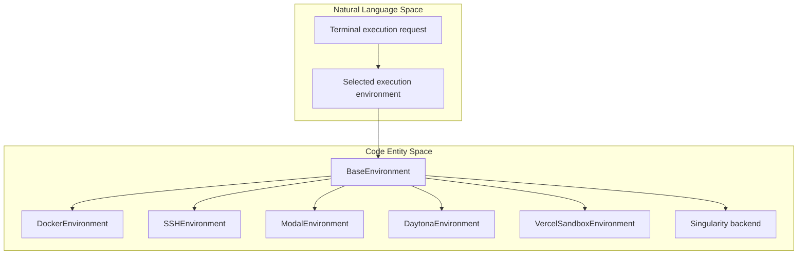
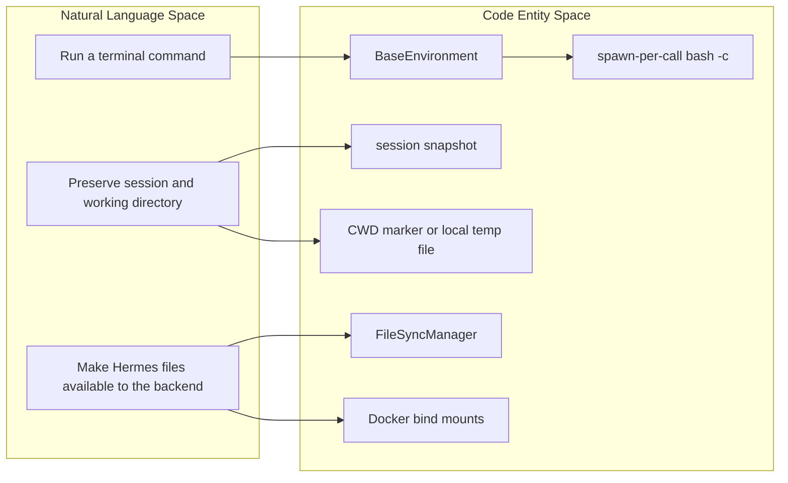

# Execution Environments

Relevant source files

The following files were used as context for generating this wiki page:

- [tests/agent/test_generated_media_durable.py](tests/agent/test_generated_media_durable.py)
- [tests/tools/test_base_environment.py](tests/tools/test_base_environment.py)
- [tests/tools/test_daytona_environment.py](tests/tools/test_daytona_environment.py)
- [tests/tools/test_docker_environment.py](tests/tools/test_docker_environment.py)
- [tests/tools/test_file_sync.py](tests/tools/test_file_sync.py)
- [tests/tools/test_file_sync_back.py](tests/tools/test_file_sync_back.py)
- [tests/tools/test_file_sync_upload_snapshot.py](tests/tools/test_file_sync_upload_snapshot.py)
- [tests/tools/test_file_write_surrogate_roundtrip.py](tests/tools/test_file_write_surrogate_roundtrip.py)
- [tests/tools/test_image_generation_artifacts.py](tests/tools/test_image_generation_artifacts.py)
- [tests/tools/test_local_background_child_hang.py](tests/tools/test_local_background_child_hang.py)
- [tests/tools/test_local_shell_init.py](tests/tools/test_local_shell_init.py)
- [tests/tools/test_managed_modal_environment.py](tests/tools/test_managed_modal_environment.py)
- [tests/tools/test_modal_bulk_upload.py](tests/tools/test_modal_bulk_upload.py)
- [tests/tools/test_modal_snapshot_isolation.py](tests/tools/test_modal_snapshot_isolation.py)
- [tests/tools/test_protected_instruction_cli_channel.py](tests/tools/test_protected_instruction_cli_channel.py)
- [tests/tools/test_snapshot_multiline_session_env_injection.py](tests/tools/test_snapshot_multiline_session_env_injection.py)
- [tests/tools/test_snapshot_session_id_leak.py](tests/tools/test_snapshot_session_id_leak.py)
- [tests/tools/test_ssh_bulk_upload.py](tests/tools/test_ssh_bulk_upload.py)
- [tests/tools/test_ssh_environment.py](tests/tools/test_ssh_environment.py)
- [tests/tools/test_subagent_sudo_prompt.py](tests/tools/test_subagent_sudo_prompt.py)
- [tests/tools/test_sync_back_backends.py](tests/tools/test_sync_back_backends.py)
- [tests/tools/test_terminal_output_transform_hook.py](tests/tools/test_terminal_output_transform_hook.py)
- [tests/tools/test_terminal_tool.py](tests/tools/test_terminal_tool.py)
- [tests/tools/test_vercel_sandbox_environment.py](tests/tools/test_vercel_sandbox_environment.py)
- [tests/tools/test_vercel_sandbox_transient_errors.py](tests/tools/test_vercel_sandbox_transient_errors.py)
- [tests/tui_gateway/test_sudo_command_context.py](tests/tui_gateway/test_sudo_command_context.py)
- [tools/environments/base.py](tools/environments/base.py)
- [tools/environments/base_session_env.py](tools/environments/base_session_env.py)
- [tools/environments/base_wait.py](tools/environments/base_wait.py)
- [tools/environments/daytona.py](tools/environments/daytona.py)
- [tools/environments/docker.py](tools/environments/docker.py)
- [tools/environments/docker_egress.py](tools/environments/docker_egress.py)
- [tools/environments/file_sync.py](tools/environments/file_sync.py)
- [tools/environments/managed_modal.py](tools/environments/managed_modal.py)
- [tools/environments/modal.py](tools/environments/modal.py)
- [tools/environments/path_utils.py](tools/environments/path_utils.py)
- [tools/environments/remote_common.py](tools/environments/remote_common.py)
- [tools/environments/ssh.py](tools/environments/ssh.py)
- [tools/environments/vercel_sandbox.py](tools/environments/vercel_sandbox.py)
- [tools/terminal_tool_result.py](tools/terminal_tool_result.py)
- [tools/terminal_tool_sudo.py](tools/terminal_tool_sudo.py)

## Purpose and Scope

Execution environments provide a shared shell-execution model for terminal commands across local, container, remote, and cloud sandbox backends. The environment abstraction standardizes command execution while allowing backend-specific handling of process creation, persistence, and file transfer. [tools/environments/base.py:1-7]()

This parent page gives an architectural overview and links to child pages for details on the abstraction and individual backends.

Sources: [tools/environments/base.py:1-7]()

---

## Environment Selection

Hermes has backend implementations for local execution, Docker, SSH, Singularity, and cloud sandboxes. The backends share the environment abstraction but differ in where commands run and how files and sandbox state are managed. For details, see [Backend Implementations](#6.2). [tools/environments/base.py:1-7]()[tools/environments/docker.py:1-6]()[tools/environments/ssh.py:45-51]()[tools/environments/modal.py:131-133]()[tools/environments/daytona.py:24-29]()[tools/environments/vercel_sandbox.py:179-182]()

### Natural Language to Code Entities: Environment Backends

Sources: [tools/environments/base.py:1-7]()[tools/environments/docker.py:1-6]()[tools/environments/ssh.py:45-51]()[tools/environments/modal.py:131-133]()[tools/environments/daytona.py:24-29]()[tools/environments/vercel_sandbox.py:179-182]()

---

## Environment Abstraction

`BaseEnvironment` establishes a spawn-per-call shell model: each command runs in a fresh `bash -c` process, with a session snapshot re-sourced to preserve shell state between calls. The abstraction also tracks the working directory across commands; the mechanism varies by backend. [tools/environments/base.py:1-7]()

The base layer includes shared process and output handling, and distinguishes infrastructure failures with `EnvironmentConnectionError`. It also provides process-exit cleanup for foreground commands. For details on the interface, lifecycle, session reuse, credential files, and cleanup, see [Environment Abstraction](#6.1). [tools/environments/base.py:24-32]()[tools/environments/base.py:95-109]()[tools/environments/base.py:140-154]()

Sources: [tools/environments/base.py:1-7]()[tools/environments/base.py:24-32]()[tools/environments/base.py:95-109]()[tools/environments/base.py:140-154]()

---

## Backend Implementations

Backend classes adapt the shared execution contract to their execution target. For example, `SSHEnvironment` runs commands on a remote machine, while `DockerEnvironment` provides containerized execution. Modal, Daytona, and Vercel Sandbox provide cloud sandbox implementations. [tools/environments/ssh.py:45-51]()[tools/environments/docker.py:1-6]()[tools/environments/modal.py:131-133]()[tools/environments/daytona.py:24-29]()[tools/environments/vercel_sandbox.py:179-182]()

Remote backends can also differ in how Hermes files reach the execution environment: `FileSyncManager` supports syncing remote backends, while Docker uses bind mounts instead. The child page covers backend configuration, resource limits, and implementation-specific behavior. For details, see [Backend Implementations](#6.2). [tools/environments/file_sync.py:1-6]()

### Natural Language to Code Entities: Shared Execution and File Transfer

Sources: [tools/environments/base.py:1-7]()[tools/environments/file_sync.py:1-6]()

Sources: [tools/environments/ssh.py:45-51]()[tools/environments/docker.py:1-6]()[tools/environments/modal.py:131-133]()[tools/environments/daytona.py:24-29]()[tools/environments/vercel_sandbox.py:179-182]()[tools/environments/file_sync.py:1-6]()

---

## Related Child Pages

- [Environment Abstraction](#6.1) — Covers the environment interface, lifecycle management, session reuse, credential file handling, and cleanup.
- [Backend Implementations](#6.2) — Documents local, Docker, SSH, Singularity, Modal, Vercel Sandbox, and Daytona backends, including configuration and resource limits.

Sources: [tools/environments/base.py:1-7]()[tools/environments/docker.py:1-6]()[tools/environments/ssh.py:45-51]()[tools/environments/modal.py:131-133]()[tools/environments/daytona.py:24-29]()[tools/environments/vercel_sandbox.py:179-182]()