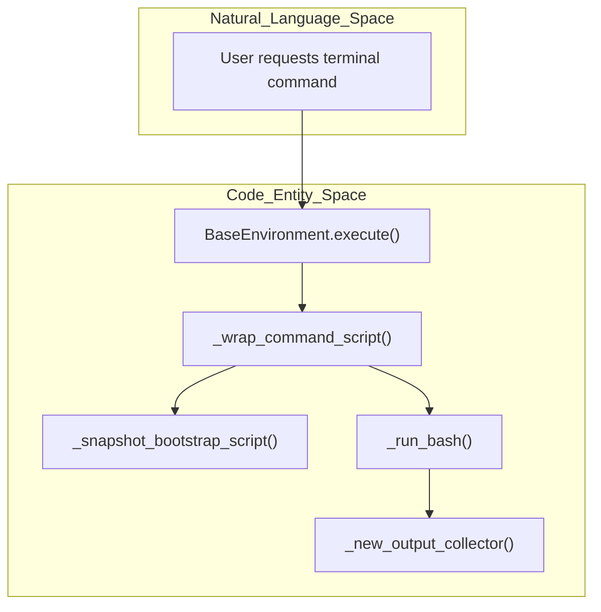
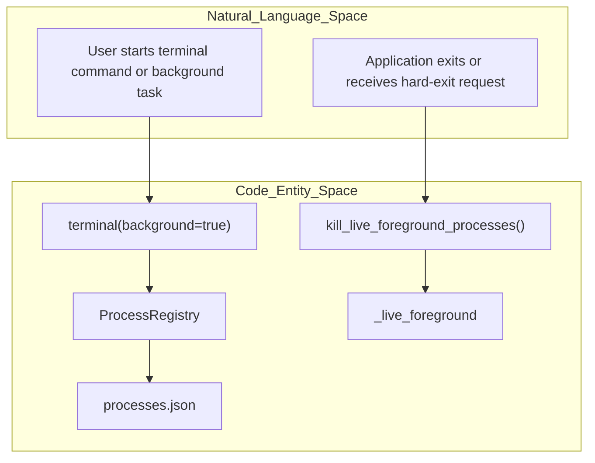
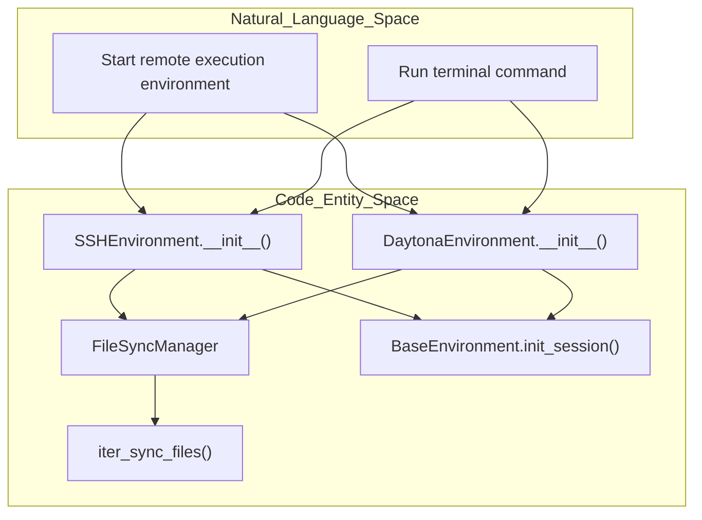
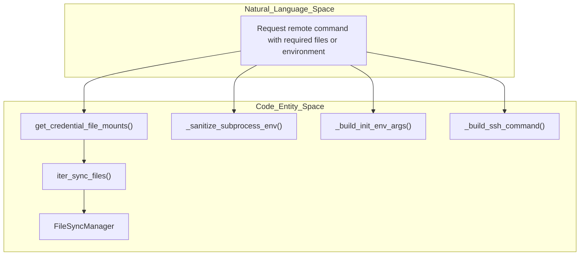

# Environment Abstraction

Relevant source files

The following files were used as context for generating this wiki page:

- [optional-skills/email/agentmail/SKILL.md](optional-skills/email/agentmail/SKILL.md)
- [optional-skills/email/agentmail/references/core.md](optional-skills/email/agentmail/references/core.md)
- [optional-skills/email/agentmail/references/mcp.md](optional-skills/email/agentmail/references/mcp.md)
- [optional-skills/email/agentmail/references/signup.md](optional-skills/email/agentmail/references/signup.md)
- [optional-skills/email/agentmail/references/webhooks.md](optional-skills/email/agentmail/references/webhooks.md)
- [optional-skills/email/agentmail/references/websockets.md](optional-skills/email/agentmail/references/websockets.md)
- [tests/agent/test_generated_media_durable.py](tests/agent/test_generated_media_durable.py)
- [tests/gateway/test_internal_event_bypass_pairing.py](tests/gateway/test_internal_event_bypass_pairing.py)
- [tests/tools/test_base_environment.py](tests/tools/test_base_environment.py)
- [tests/tools/test_daytona_environment.py](tests/tools/test_daytona_environment.py)
- [tests/tools/test_docker_environment.py](tests/tools/test_docker_environment.py)
- [tests/tools/test_env_passthrough.py](tests/tools/test_env_passthrough.py)
- [tests/tools/test_env_probe.py](tests/tools/test_env_probe.py)
- [tests/tools/test_file_sync.py](tests/tools/test_file_sync.py)
- [tests/tools/test_file_sync_back.py](tests/tools/test_file_sync_back.py)
- [tests/tools/test_file_sync_upload_snapshot.py](tests/tools/test_file_sync_upload_snapshot.py)
- [tests/tools/test_file_write_surrogate_roundtrip.py](tests/tools/test_file_write_surrogate_roundtrip.py)
- [tests/tools/test_image_generation_artifacts.py](tests/tools/test_image_generation_artifacts.py)
- [tests/tools/test_local_background_child_hang.py](tests/tools/test_local_background_child_hang.py)
- [tests/tools/test_local_env_blocklist.py](tests/tools/test_local_env_blocklist.py)
- [tests/tools/test_local_shell_init.py](tests/tools/test_local_shell_init.py)
- [tests/tools/test_managed_modal_environment.py](tests/tools/test_managed_modal_environment.py)
- [tests/tools/test_modal_bulk_upload.py](tests/tools/test_modal_bulk_upload.py)
- [tests/tools/test_modal_snapshot_isolation.py](tests/tools/test_modal_snapshot_isolation.py)
- [tests/tools/test_notify_on_complete.py](tests/tools/test_notify_on_complete.py)
- [tests/tools/test_process_registry.py](tests/tools/test_process_registry.py)
- [tests/tools/test_protected_instruction_cli_channel.py](tests/tools/test_protected_instruction_cli_channel.py)
- [tests/tools/test_skill_env_passthrough.py](tests/tools/test_skill_env_passthrough.py)
- [tests/tools/test_snapshot_multiline_session_env_injection.py](tests/tools/test_snapshot_multiline_session_env_injection.py)
- [tests/tools/test_snapshot_session_id_leak.py](tests/tools/test_snapshot_session_id_leak.py)
- [tests/tools/test_ssh_bulk_upload.py](tests/tools/test_ssh_bulk_upload.py)
- [tests/tools/test_ssh_environment.py](tests/tools/test_ssh_environment.py)
- [tests/tools/test_subagent_sudo_prompt.py](tests/tools/test_subagent_sudo_prompt.py)
- [tests/tools/test_sync_back_backends.py](tests/tools/test_sync_back_backends.py)
- [tests/tools/test_terminal_background_spawn_failure.py](tests/tools/test_terminal_background_spawn_failure.py)
- [tests/tools/test_terminal_output_transform_hook.py](tests/tools/test_terminal_output_transform_hook.py)
- [tests/tools/test_terminal_tool.py](tests/tools/test_terminal_tool.py)
- [tests/tools/test_vercel_sandbox_environment.py](tests/tools/test_vercel_sandbox_environment.py)
- [tests/tools/test_vercel_sandbox_transient_errors.py](tests/tools/test_vercel_sandbox_transient_errors.py)
- [tests/tools/test_watch_patterns.py](tests/tools/test_watch_patterns.py)
- [tests/tui_gateway/test_sudo_command_context.py](tests/tui_gateway/test_sudo_command_context.py)
- [tools/env_passthrough.py](tools/env_passthrough.py)
- [tools/env_probe.py](tools/env_probe.py)
- [tools/environments/base.py](tools/environments/base.py)
- [tools/environments/base_session_env.py](tools/environments/base_session_env.py)
- [tools/environments/base_wait.py](tools/environments/base_wait.py)
- [tools/environments/daytona.py](tools/environments/daytona.py)
- [tools/environments/docker.py](tools/environments/docker.py)
- [tools/environments/docker_egress.py](tools/environments/docker_egress.py)
- [tools/environments/file_sync.py](tools/environments/file_sync.py)
- [tools/environments/local.py](tools/environments/local.py)
- [tools/environments/local_env_policy.py](tools/environments/local_env_policy.py)
- [tools/environments/local_pythonpath.py](tools/environments/local_pythonpath.py)
- [tools/environments/managed_modal.py](tools/environments/managed_modal.py)
- [tools/environments/modal.py](tools/environments/modal.py)
- [tools/environments/path_utils.py](tools/environments/path_utils.py)
- [tools/environments/remote_common.py](tools/environments/remote_common.py)
- [tools/environments/ssh.py](tools/environments/ssh.py)
- [tools/environments/vercel_sandbox.py](tools/environments/vercel_sandbox.py)
- [tools/process_registry.py](tools/process_registry.py)
- [tools/process_registry_notifications.py](tools/process_registry_notifications.py)
- [tools/terminal_tool_result.py](tools/terminal_tool_result.py)
- [tools/terminal_tool_sudo.py](tools/terminal_tool_sudo.py)

## Purpose and Scope

Hermes Agent uses an environment abstraction to run terminal commands across local and remote execution backends. This page covers the shared execution model, session state, environment and process cleanup, credential-file synchronization, and subprocess environment handling. Backend-specific configuration and resource limits are covered in [6.2 Backend Implementations]. [tools/environments/base.py:1-7]()

Sources: [tools/environments/base.py:1-7]()

---

## The `BaseEnvironment` Interface and Execution Flow

`BaseEnvironment` is the abstract base class for execution backends. Its documented model starts a fresh `bash -c` process for each command, while preserving selected session state between calls: environment variables, functions, aliases, and the current working directory. [tools/environments/base.py:1-7]()

| Concern | Shared mechanism |
|---|---|
| Command process | Spawn-per-call execution starts a fresh shell process for each command. [tools/environments/base.py:1-7]() |
| Session environment | The environment snapshot is captured at initialization and re-sourced before subsequent commands. [tools/environments/base.py:3-5]() |
| Working directory | CWD persists through in-band stdout markers on remote backends or a temporary file on local execution. [tools/environments/base.py:3-6]() |
| Backend contract | Concrete backends provide backend-specific execution and cleanup behavior; `SSHEnvironment` and `DaytonaEnvironment` call the base initializer and provide their own command-running methods. [tools/environments/base.py:1-7](), [tools/environments/ssh.py:45-62](), [tools/environments/daytona.py:24-36]() |

### Session snapshot and command execution

`BaseEnvironment` delegates snapshot-script construction and CWD marker handling to helpers in `base_session_env`, including `_snapshot_bootstrap_script`, `_cwd_marker`, `_split_cwd_marker`, and `_wrap_command_script`. Output collection and process handles are provided by `base_output`. [tools/environments/base.py:24-32]()

Session snapshot writes are atomic: the tests require the initial bootstrap and subsequent wrapped commands to write to a temporary file and publish it with `mv -f`, rather than writing directly to the snapshot file. This prevents a concurrent command from sourcing a partially written snapshot. [tests/tools/test_base_environment.py:106-167]()

**Diagram: Natural language command request mapped to `BaseEnvironment` helpers**

Sources: [tools/environments/base.py:1-32](), [tests/tools/test_base_environment.py:106-167]()

---

## Environment Lifecycle and Process Cleanup

### Foreground process cleanup

`BaseEnvironment` maintains a process-wide `_live_foreground` registry for foreground commands running across environments. `_enter_foreground_spawn` checks an exit fence and accounts for spawns in flight; `_leave_foreground_spawn` publishes a successfully spawned process to the registry. [tools/environments/base.py:56-85]()

`kill_live_foreground_processes` signals registered foreground processes. Its hard-exit mode raises the exit fence, waits for in-flight spawns within a bounded budget, force-kills local `subprocess.Popen` processes, and dispatches remote process kills on daemon threads. [tools/environments/base.py:95-129]()

### Background process tracking

`ProcessRegistry` is the in-memory registry for background processes created through `terminal(background=true)`. Its module documentation describes a rolling 200 KB output buffer, process polling and termination operations, checkpointing for crash recovery, and session-scoped tracking. It also distinguishes host execution from sandbox execution: the host is used only when `TERMINAL_ENV=local`. [tools/process_registry.py:1-5]()

The registry defines a finished-process retention period of 30 minutes and a maximum of 64 tracked processes. [tools/process_registry.py:58-64]()

**Diagram: Natural language process request mapped to lifecycle entities**

Sources: [tools/process_registry.py:1-5](), [tools/process_registry.py:46-64](), [tools/environments/base.py:56-129]()

### Local temporary-artifact cleanup

The local backend stores managed terminal temporary artifacts under `HERMES_HOME/cache/terminal`. `cleanup_terminal_temp_cache` removes entries idle beyond its retention threshold, which defaults to 24 hours. It only prunes that managed default directory, not a user-configured `terminal.temp_dir`. [tools/environments/local.py:37-64]()

Background artifacts are grouped by a shared `hermes_bg_<id>` stem. The cleanup code considers the newest modification time across the `.log`, `.pid`, and `.exit` files, and rechecks the group before deletion so a recently active process keeps its related files. `_prune_terminal_temp_once` provides a best-effort one-time prune for CLI-only installs. [tools/environments/local.py:45-48](), [tools/environments/local.py:76-119](), [tools/environments/local.py:122-132]()

Sources: [tools/environments/local.py:37-64](), [tools/environments/local.py:76-132]()

---

## Backend Implementations and Session Reuse

The shared base class provides the spawn-per-call session model; backend implementations supply the execution transport and backend-specific lifecycle behavior. [tools/environments/base.py:1-7]()

| Backend | Class or mechanism | Session and lifecycle behavior |
|---|---|---|
| Local | `LocalEnvironment` | Executes locally using the local backend. The module also provides local terminal temporary-cache cleanup. [tools/environments/local.py:1-2](), [tools/environments/local.py:37-64]() |
| Docker | `DockerEnvironment` | Provides Docker execution; its module describes hardened containers, configurable resource limits, and optional filesystem persistence. [tools/environments/docker.py:1-5]() |
| SSH | `SSHEnvironment` | Creates an SSH ControlMaster connection for reuse on supported platforms. Each command still starts a fresh remote shell; the base session snapshot preserves selected state across calls. [tools/environments/ssh.py:1-2](), [tools/environments/ssh.py:45-52](), [tools/environments/ssh.py:59-90]() |
| Daytona | `DaytonaEnvironment` | Can resume a sandbox associated with a task when persistent mode is enabled; otherwise, or when no reusable sandbox is found, it creates one. [tools/environments/daytona.py:1-5](), [tools/environments/daytona.py:33-75]() |
| Other cloud backends | Modal and Vercel Sandbox | These backends are present in the environment package, but their implementations are not included in the supplied excerpts. |

### Remote file synchronization

`FileSyncManager` is shared by remote execution backends including SSH, Modal, and Daytona; Docker uses bind mounts instead. [tools/environments/file_sync.py:1-6]()

For SSH, `SSHEnvironment` constructs a `FileSyncManager` when `sync_files` is enabled, supplies transport callbacks, requests an initial forced sync, and initializes the session. [tools/environments/ssh.py:59-90]() Daytona similarly constructs a sync manager, performs a forced initial sync, and initializes its session. [tools/environments/daytona.py:86-92]()

`iter_sync_files` combines credential-file mounts, skill files, and cache files into host-to-remote path pairs. Credential paths are remapped from the `/root/.hermes` prefix to the selected remote home. [tools/environments/file_sync.py:131-144]()

**Diagram: Remote backend setup mapped to sync and session entities**

Sources: [tools/environments/ssh.py:45-90](), [tools/environments/daytona.py:24-36](), [tools/environments/daytona.py:86-92](), [tools/environments/file_sync.py:131-144]()

---

## Credential Files and Subprocess Environment Security

### Credential-file synchronization

`iter_sync_files` obtains credential-file mount entries from `get_credential_file_mounts`, and adds skill and cache files from `iter_skills_files` and `iter_cache_files`. It returns `(host_path, remote_path)` pairs for remote synchronization. [tools/environments/file_sync.py:131-144]()

`file_sync.py` also defines `_credential_host_paths`, which resolves credential host paths and returns them as a set. The supplied excerpt does not show the subsequent use of that set, so its effects on sync-back behavior are not specified here. [tools/environments/file_sync.py:147-163]()

### Local subprocess environment policy

The local backend imports environment-policy helpers from `local_env_policy`, including provider-secret blocklist and stripping functions. It also imports `_sanitize_subprocess_env`, which is used by `ProcessRegistry` when constructing local background processes. [tools/environments/local.py:23-28](), [tools/process_registry.py:28-29]()

Tests verify that provider and adapter secrets do not reach local foreground, background, and non-terminal child processes, while operator-owned variables can remain available. They also verify that a caller-provided custom variable is preserved in the tested local terminal environment. [tests/tools/test_local_env_blocklist.py:70-93](), [tests/tools/test_local_env_blocklist.py:96-127]()

Docker’s environment initialization supports explicitly forwarded names. Its tests establish that shell environment values take precedence over `.env` values, and that the resolved secret value is not embedded in Docker command arguments. [tools/environments/docker.py:60-93](), [tests/tools/test_docker_environment.py:124-153]()

SSH environment forwarding uses SSH `SendEnv` options for variable names; the values travel through the SSH client environment rather than the remote command text. The SSH code also supports separate ControlMaster sockets for different forwarded-name sets. [tools/environments/ssh.py:92-127]()

Sources: [tools/environments/file_sync.py:131-163](), [tools/environments/local.py:23-30](), [tools/process_registry.py:28-29](), [tests/tools/test_local_env_blocklist.py:70-127](), [tools/environments/docker.py:60-97](), [tests/tools/test_docker_environment.py:124-153](), [tools/environments/ssh.py:92-127]()

### Credential and environment data flow

Sources: [tools/environments/file_sync.py:131-144](), [tools/environments/local.py:23-28](), [tools/environments/docker.py:60-97](), [tools/environments/ssh.py:92-127]()