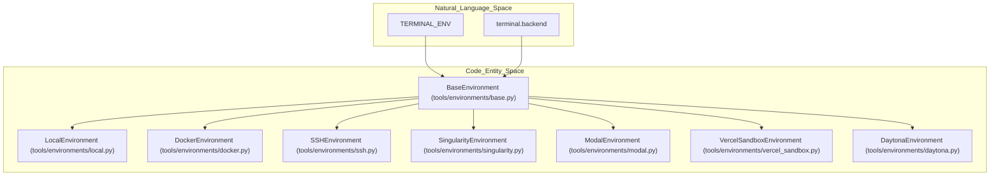
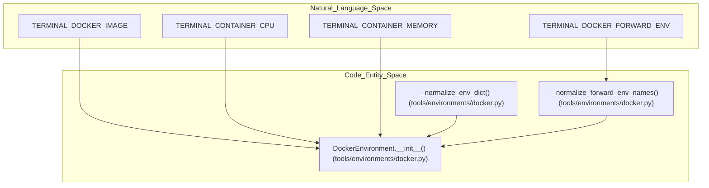
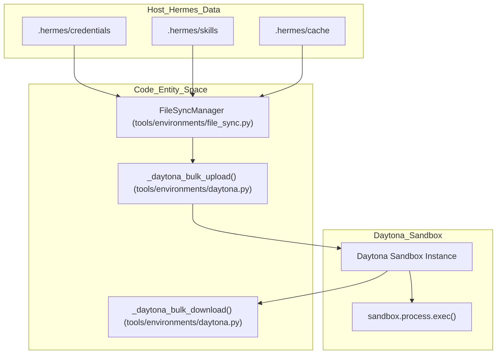

# Backend Implementations

Relevant source files

The following files were used as context for generating this wiki page:

- [.dockerignore](.dockerignore)
- [.gitignore](.gitignore)
- [.hadolint.yaml](.hadolint.yaml)
- [Dockerfile](Dockerfile)
- [contributors/emails/dstkwll@users.noreply.github.com](contributors/emails/dstkwll@users.noreply.github.com)
- [docker-compose.yml](docker-compose.yml)
- [docker/cont-init.d/02-reconcile-profiles](docker/cont-init.d/02-reconcile-profiles)
- [docker/entrypoint-dispatch.sh](docker/entrypoint-dispatch.sh)
- [docker/entrypoint.sh](docker/entrypoint.sh)
- [docker/main-wrapper.sh](docker/main-wrapper.sh)
- [docker/s6-rc.d/dashboard/run](docker/s6-rc.d/dashboard/run)
- [docker/stage2-hook.sh](docker/stage2-hook.sh)
- [hermes_cli/container_boot.py](hermes_cli/container_boot.py)
- [hermes_cli/copilot_auth.py](hermes_cli/copilot_auth.py)
- [hermes_cli/dashboard_register.py](hermes_cli/dashboard_register.py)
- [hermes_cli/main_profile_recovery.py](hermes_cli/main_profile_recovery.py)
- [hermes_cli/service_manager.py](hermes_cli/service_manager.py)
- [hermes_time.py](hermes_time.py)
- [registration_lifecycle.py](registration_lifecycle.py)
- [scripts/docker_rebootstrap_nous_session.py](scripts/docker_rebootstrap_nous_session.py)
- [setup.py](setup.py)
- [tests/agent/test_generated_media_durable.py](tests/agent/test_generated_media_durable.py)
- [tests/cron/test_timezone.py](tests/cron/test_timezone.py)
- [tests/dashboard/test_ws_client_host.py](tests/dashboard/test_ws_client_host.py)
- [tests/docker/__init__.py](tests/docker/__init__.py)
- [tests/docker/conftest.py](tests/docker/conftest.py)
- [tests/docker/test_container_restart.py](tests/docker/test_container_restart.py)
- [tests/docker/test_dashboard.py](tests/docker/test_dashboard.py)
- [tests/docker/test_gateway_run_supervised.py](tests/docker/test_gateway_run_supervised.py)
- [tests/docker/test_interactive_logging.py](tests/docker/test_interactive_logging.py)
- [tests/docker/test_main_invocation.py](tests/docker/test_main_invocation.py)
- [tests/docker/test_profile_gateway.py](tests/docker/test_profile_gateway.py)
- [tests/docker/test_s6_profile_gateway_integration.py](tests/docker/test_s6_profile_gateway_integration.py)
- [tests/docker/test_tui_passthrough.py](tests/docker/test_tui_passthrough.py)
- [tests/docker/test_zombie_reaping.py](tests/docker/test_zombie_reaping.py)
- [tests/hermes_cli/test_apply_profile_override.py](tests/hermes_cli/test_apply_profile_override.py)
- [tests/hermes_cli/test_container_boot.py](tests/hermes_cli/test_container_boot.py)
- [tests/hermes_cli/test_copilot_auth.py](tests/hermes_cli/test_copilot_auth.py)
- [tests/hermes_cli/test_copilot_token_exchange.py](tests/hermes_cli/test_copilot_token_exchange.py)
- [tests/hermes_cli/test_credential_pool_off_loop.py](tests/hermes_cli/test_credential_pool_off_loop.py)
- [tests/hermes_cli/test_dashboard_register.py](tests/hermes_cli/test_dashboard_register.py)
- [tests/hermes_cli/test_doctor_terminal_backends.py](tests/hermes_cli/test_doctor_terminal_backends.py)
- [tests/hermes_cli/test_gateway_s6_dispatch.py](tests/hermes_cli/test_gateway_s6_dispatch.py)
- [tests/hermes_cli/test_profile_export_default_path.py](tests/hermes_cli/test_profile_export_default_path.py)
- [tests/hermes_cli/test_profiles_s6_hooks.py](tests/hermes_cli/test_profiles_s6_hooks.py)
- [tests/hermes_cli/test_service_manager.py](tests/hermes_cli/test_service_manager.py)
- [tests/hermes_cli/test_setup_terminal.py](tests/hermes_cli/test_setup_terminal.py)
- [tests/hermes_cli/test_terminal_backend_docker_probe.py](tests/hermes_cli/test_terminal_backend_docker_probe.py)
- [tests/hermes_cli/test_update_flat_install_state_gitignore.py](tests/hermes_cli/test_update_flat_install_state_gitignore.py)
- [tests/tools/test_base_environment.py](tests/tools/test_base_environment.py)
- [tests/tools/test_daytona_environment.py](tests/tools/test_daytona_environment.py)
- [tests/tools/test_docker_environment.py](tests/tools/test_docker_environment.py)
- [tests/tools/test_docker_find.py](tests/tools/test_docker_find.py)
- [tests/tools/test_docker_rebootstrap_nous_session.py](tests/tools/test_docker_rebootstrap_nous_session.py)
- [tests/tools/test_file_sync.py](tests/tools/test_file_sync.py)
- [tests/tools/test_file_sync_back.py](tests/tools/test_file_sync_back.py)
- [tests/tools/test_file_sync_upload_snapshot.py](tests/tools/test_file_sync_upload_snapshot.py)
- [tests/tools/test_file_write_surrogate_roundtrip.py](tests/tools/test_file_write_surrogate_roundtrip.py)
- [tests/tools/test_image_generation_artifacts.py](tests/tools/test_image_generation_artifacts.py)
- [tests/tools/test_local_background_child_hang.py](tests/tools/test_local_background_child_hang.py)
- [tests/tools/test_local_shell_init.py](tests/tools/test_local_shell_init.py)
- [tests/tools/test_managed_modal_environment.py](tests/tools/test_managed_modal_environment.py)
- [tests/tools/test_modal_bulk_upload.py](tests/tools/test_modal_bulk_upload.py)
- [tests/tools/test_modal_snapshot_isolation.py](tests/tools/test_modal_snapshot_isolation.py)
- [tests/tools/test_protected_instruction_cli_channel.py](tests/tools/test_protected_instruction_cli_channel.py)
- [tests/tools/test_snapshot_multiline_session_env_injection.py](tests/tools/test_snapshot_multiline_session_env_injection.py)
- [tests/tools/test_snapshot_session_id_leak.py](tests/tools/test_snapshot_session_id_leak.py)
- [tests/tools/test_ssh_bulk_upload.py](tests/tools/test_ssh_bulk_upload.py)
- [tests/tools/test_ssh_environment.py](tests/tools/test_ssh_environment.py)
- [tests/tools/test_stage2_hook_api_server_keygen.py](tests/tools/test_stage2_hook_api_server_keygen.py)
- [tests/tools/test_stage2_hook_nous_routing_env.py](tests/tools/test_stage2_hook_nous_routing_env.py)
- [tests/tools/test_stage2_hook_seed_one_symlinks.py](tests/tools/test_stage2_hook_seed_one_symlinks.py)
- [tests/tools/test_stage2_hook_symlink_chown.py](tests/tools/test_stage2_hook_symlink_chown.py)
- [tests/tools/test_subagent_sudo_prompt.py](tests/tools/test_subagent_sudo_prompt.py)
- [tests/tools/test_sync_back_backends.py](tests/tools/test_sync_back_backends.py)
- [tests/tools/test_terminal_output_transform_hook.py](tests/tools/test_terminal_output_transform_hook.py)
- [tests/tools/test_terminal_tool.py](tests/tools/test_terminal_tool.py)
- [tests/tools/test_vercel_sandbox_environment.py](tests/tools/test_vercel_sandbox_environment.py)
- [tests/tools/test_vercel_sandbox_transient_errors.py](tests/tools/test_vercel_sandbox_transient_errors.py)
- [tests/tui_gateway/test_cold_start_gil_stall.py](tests/tui_gateway/test_cold_start_gil_stall.py)
- [tests/tui_gateway/test_entry_sys_path.py](tests/tui_gateway/test_entry_sys_path.py)
- [tests/tui_gateway/test_subprocess_encoding.py](tests/tui_gateway/test_subprocess_encoding.py)
- [tests/tui_gateway/test_sudo_command_context.py](tests/tui_gateway/test_sudo_command_context.py)
- [tools/environments/base.py](tools/environments/base.py)
- [tools/environments/base_session_env.py](tools/environments/base_session_env.py)
- [tools/environments/base_wait.py](tools/environments/base_wait.py)
- [tools/environments/daytona.py](tools/environments/daytona.py)
- [tools/environments/docker.py](tools/environments/docker.py)
- [tools/environments/docker_egress.py](tools/environments/docker_egress.py)
- [tools/environments/file_sync.py](tools/environments/file_sync.py)
- [tools/environments/managed_modal.py](tools/environments/managed_modal.py)
- [tools/environments/modal.py](tools/environments/modal.py)
- [tools/environments/path_utils.py](tools/environments/path_utils.py)
- [tools/environments/remote_common.py](tools/environments/remote_common.py)
- [tools/environments/ssh.py](tools/environments/ssh.py)
- [tools/environments/vercel_sandbox.py](tools/environments/vercel_sandbox.py)
- [tools/terminal_tool_result.py](tools/terminal_tool_result.py)
- [tools/terminal_tool_sudo.py](tools/terminal_tool_sudo.py)
- [toolset_distributions.py](toolset_distributions.py)
- [website/docs/user-guide/docker.md](website/docs/user-guide/docker.md)
- [website/i18n/zh-Hans/docusaurus-plugin-content-docs/current/user-guide/docker.md](website/i18n/zh-Hans/docusaurus-plugin-content-docs/current/user-guide/docker.md)

This page details the execution environment backends of the Hermes Agent, which implement the unified command execution interface defined by the environment abstraction layer `[tools/environments/base.py:1-19]()`. The backends encapsulate command execution in distinct contexts, providing local execution, hardened containerization, cloud sandboxes, and remote connectivity:

- **LocalEnvironment:** executes commands directly on the host OS `[tools/environments/local.py:1-20]()`.
- **DockerEnvironment:** uses hardened Docker containers with resource limits `[tools/environments/docker.py:1-6]()`.
- **SSHEnvironment:** executes on remote servers over SSH with connection pooling `[tools/environments/ssh.py:45-52]()`.
- **SingularityEnvironment:** HPC-compatible OCI/Singularity container execution `[tools/environments/singularity.py:1-169]()`.
- **ModalEnvironment:** cloud sandbox using the native Modal.com Python SDK `[tools/environments/modal.py:1-134]()`.
- **VercelSandboxEnvironment:** cloud sandbox using the Vercel Sandbox SDK `[tools/environments/vercel_sandbox.py:1-176]()`.
- **DaytonaEnvironment:** Daytona cloud development workspace backend `[tools/environments/daytona.py:1-30]()`.

All backends conform to the lifecycle and execution model defined in the base environment abstraction `BaseEnvironment` `[tools/environments/base.py:18-19]()` and are configured via environment variables and the Hermes configuration system.

---

## Backend Selection and Configuration

The backend used for terminal tool command execution is chosen by the environment variable `TERMINAL_ENV` or via the configuration key `terminal.backend`.

### Supported Backend Values and Corresponding Classes

| Backend String | Implementation Class | Description | Implementation Location |
|---|---|---|---|
| `local` | `LocalEnvironment` | Direct execution on host machine | `[tools/environments/local.py:1-20]()` |
| `docker` | `DockerEnvironment` | Hardened Docker containers with resource limits | `[tools/environments/docker.py:1-6]()` |
| `singularity` | `SingularityEnvironment` | Singularity containers, HPC-oriented | `[tools/environments/singularity.py:1-169]()` |
| `ssh` | `SSHEnvironment` | Remote SSH with ControlMaster connection pooling | `[tools/environments/ssh.py:45-52]()` |
| `modal` | `ModalEnvironment` | Cloud sandbox using Modal SDK | `[tools/environments/modal.py:1-134]()` |
| `vercel` | `VercelSandboxEnvironment` | Cloud sandbox using Vercel Sandbox SDK | `[tools/environments/vercel_sandbox.py:1-176]()` |
| `daytona` | `DaytonaEnvironment` | Daytona cloud sandbox backend | `[tools/environments/daytona.py:1-30]()` |

### Diagram: Backend Selection Configuration Mapping

Sources: `[tools/environments/base.py:18-19]()`, `[tools/environments/docker.py:1-6]()`, `[tools/environments/ssh.py:45-52]()`, `[tools/environments/daytona.py:1-30]()`

---

## LocalEnvironment

The default execution backend runs commands directly on the host machine. It is optimized for low latency but provides no filesystem isolation.

### Implementation Details
- **Subprocess Spawning:** Commands are run via `_popen_bash` which sets up pipe communication and tracks command output including CWD markers `[tools/environments/base_output.py:23-26]()`.
- **Path Translation:** On Windows, `_msys_to_windows_path` translates Git Bash/MSYS-style POSIX paths to native Windows forms `[tools/environments/local.py:136-145]()`.
- **CWD Recovery:** `_resolve_local_initial_cwd` handles relative paths and common recovery for configuration directories `[tools/environments/local.py:149-168]()`.
- **Secret Scrubbing:** Sensitive environment variables are filtered out via `_HERMES_PROVIDER_ENV_BLOCKLIST` to prevent accidental leakage into subprocesses `[tools/environments/local_env_policy.py:19-52]()`.
- **Cache Pruning:** The backend manages terminal temp-cache pruning via `cleanup_terminal_temp_cache` `[tools/environments/local.py:60-120]()`.

Sources: `[tools/environments/base.py:18-19]()`, `[tools/environments/local.py:1-170]()`, `[tools/environments/base_output.py:23-26]()`, `[tools/environments/local_env_policy.py:19-52]()`

---

## DockerEnvironment

The Docker backend executes commands inside Docker containers, providing strong security and resource isolation.

### Security and Lifecycle
- **Hardening:** Containers drop all Linux capabilities (`cap-drop ALL`), use the `no-new-privileges` flag, and enforce PID limits `[tools/environments/docker.py:1-6]()`.
- **Environment Normalization:** `_normalize_forward_env_names` and `_normalize_env_dict` validate environment variables passed to the container `[tools/environments/docker.py:53-87]()`.

### Diagram: Docker Parameter Mapping to Code Entities

Sources: `[tools/environments/docker.py:53-87]()`, `[tests/tools/test_docker_environment.py:40-64]()`

---

## SSHEnvironment

The SSH backend facilitates remote command execution on external machines using the SSH protocol, supporting connection multiplexing and file synchronization.

### Implementation Details
- **Persistent Connections:** Uses OpenSSH's `ControlMaster` multiplexing. It manages UNIX domain socket connection files in `tempfile.gettempdir() / "hermes-ssh"` to reuse sessions `[tools/environments/ssh.py:63-74]()`.
- **Multiplexing Guard:** Multiplexing is disabled on Windows (`os.name != "nt"`) due to a lack of UNIX socket support for OpenSSH ControlMaster on that platform `[tools/environments/ssh.py:23-26]()`.
- **Socket Path Constraints:** Socket identifiers are hashed to ensure the absolute path of the socket file stays within platform limits (such as macOS's 104-byte `sun_path` limit) `[tools/environments/ssh.py:65-74]()`.
- **Home Directory Detection:** Detects the remote user's home directory to root the `.hermes` directory for credential and skill syncing `[tools/environments/ssh.py:80-81]()`.
- **File Sync:** Initializes a `FileSyncManager` `[tools/environments/ssh.py:83-88]()` to synchronize `~/.hermes` content using SCP and SSH bulk commands.

Sources: `[tools/environments/ssh.py:1-137]()`, `[tools/environments/file_sync.py:1-50]()`

---

## SingularityEnvironment

The Singularity/Apptainer backend provides HPC-compatible OCI container execution with robust isolation.

### Implementation Details
- **Executable Resolution:** Locates either `apptainer` or `singularity` in the system `PATH` `[tools/environments/singularity.py:1-169]()`.
- **Security Hardening:** Containers run with containment flags `[tools/environments/singularity.py:1-169]()`.
- **Persistent Overlays:** When `persistent_filesystem=True`, an overlay directory is mounted to preserve state across executions `[tools/environments/singularity.py:1-169]()`.

Sources: `[tools/environments/singularity.py:1-169]()`

---

## ModalEnvironment

The Modal backend runs commands inside Modal cloud sandboxes utilizing the native Modal Python SDK.

### Implementation Details
- **Async Execution Worker:** Uses an asynchronous worker pattern to run Modal SDK calls on a dedicated background thread with its own event loop `[tools/environments/modal.py:98-128]()`.
- **Image Resolution:** Handles registry references, ensures `pip` and python availability, and parses snapshot identifiers `[tools/environments/modal.py:65-81]()`.
- **Persistence & Snapshots:** Stores session and task-scoped snapshot IDs in local JSON stores to resume state across sessions `[tools/environments/modal.py:23-63]()`.
- **Credential Mounts:** Automatically mounts credential files, skills, and cache paths into the sandbox container `[tools/environments/modal.py:1-162]()`.

Sources: `[tools/environments/modal.py:1-162]()`

---

## VercelSandboxEnvironment

The Vercel Sandbox backend interfaces with Vercel's infrastructure for isolated command execution.

### Implementation Details
- **SDK Initialization:** Ensures the Vercel SDK is available and disables telemetry `[tools/environments/vercel_sandbox.py:1-176]()`.
- **Transient Error Handling:** Implements automatic retry logic for rate limits, network errors, and server faults `[tools/environments/vercel_sandbox.py:1-176]()`.
- **Snapshot Storage:** Task-scoped snapshots are persisted in configuration files to allow sandbox state restoration `[tools/environments/vercel_sandbox.py:1-176]()`.

Sources: `[tools/environments/vercel_sandbox.py:1-176]()`

---

## DaytonaEnvironment

The Daytona backend integrates with the Daytona Python SDK to run commands inside cloud development sandboxes.

### Key Features
- **Persistence:** Supports persistent sandboxes via `persistent_filesystem=True`. It attempts to resume existing sandboxes based on task-id labels before creating new ones `[tools/environments/daytona.py:53-76]()`.
- **Resource Management:** Converts memory and disk limits, enforcing platform caps for disk space `[tools/environments/daytona.py:45-50]()`.
- **Efficient Sync:** Uses SDK methods for bulk uploads (`_daytona_bulk_upload`), which batches all files into a single multipart payload `[tools/environments/daytona.py:101-112]()`.
- **Bulk Download:** Archives `.hermes/` before downloading to minimize round-trips `[tools/environments/daytona.py:113-124]()`.

### Diagram: Daytona Execution and Sync Strategy

Sources: `[tools/environments/daytona.py:1-142]()`, `[tools/environments/file_sync.py:1-50]()`

---

## File Synchronization Strategy

For remote backends (SSH, Daytona, Modal), Hermes uses a `FileSyncManager` to ensure credentials, skills, and cache files are synchronized.

### Implementation Details
- **Change Detection:** The manager tracks file `mtime` and size to determine deltas `[tools/environments/file_sync.py:1-50]()`.
- **Bulk Operations:** Remote backends implement bulk upload and download handlers to avoid connection overhead during synchronization `[tools/environments/ssh.py:1-137]()`, `[tools/environments/daytona.py:101-124]()`.
- **Output Buffering:** The `_BoundedOutputCollector` in `base_output.py` retains a head-tail window of streamed text and spills full streams to disk when necessary to prevent memory exhaustion `[tools/environments/base_output.py:23-26]()`.
- **Stale Temp Cleanup:** `_cleanup_stale_sync_back_temp` removes temporary files left behind by hard-killed processes, preventing disk space leaks `[tools/environments/file_sync.py:98-128]()`.
- **Environment Variable Passthrough:** `tools.env_passthrough` manages an allowlist of environment variables that can be passed into sandboxed environments while blocking Hermes-managed provider credentials `[tools/env_passthrough.py:35-81]()`.

Sources: `[tools/environments/file_sync.py:1-128]()`, `[tools/environments/base_output.py:23-26]()`, `[tools/environments/ssh.py:1-137]()`, `[tools/environments/daytona.py:101-124]()`, `[tools/env_passthrough.py:35-81]()`

---

## Summary of Backend Features

| Backend | Process Spawning | Persistence | Filesystem Access | Notes |
|---|---|---|---|---|
| **Local** | `subprocess.Popen` | Always | Native Host FS | Fastest, no isolation |
| **Docker** | `docker exec` | Optional via volumes | Bind mounts | Hardened, resource limits |
| **SSH** | `ssh` via ControlMaster | Remote filesystem | SCP / SSH Bulk | Persistent connection reuse |
| **Singularity** | `apptainer/singularity` | Overlay FS | Bind mounts | HPC use case |
| **Modal** | Modal SDK Sandbox | Persistent snapshots | Mounts | Cloud sandbox via Python SDK |
| **Vercel** | Vercel SDK Sandbox | Persistent snapshots | Sandbox FS | Vercel cloud infrastructure |
| **Daytona** | SDK `sandbox.process` | Persistent by task | SDK Bulk FS | Cloud sandbox with resource caps |

Sources: `[tools/environments/base.py:18-19]()`, `[tools/environments/local.py:1-170]()`, `[tools/environments/docker.py:1-6]()`, `[tools/environments/ssh.py:45-52]()`, `[tools/environments/singularity.py:1-169]()`, `[tools/environments/modal.py:1-134]()`, `[tools/environments/vercel_sandbox.py:1-176]()`, `[tools/environments/daytona.py:1-30]()`