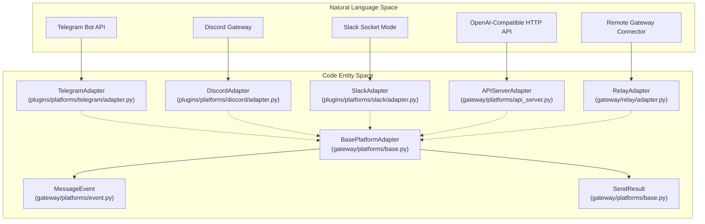
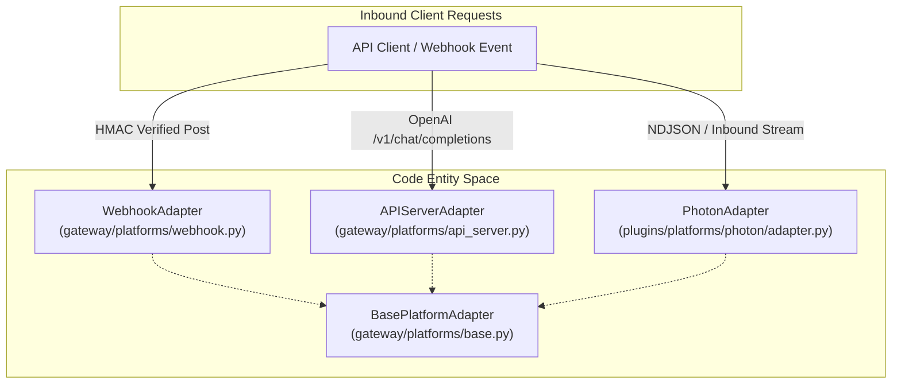
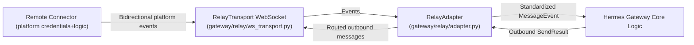

# Platform Adapters

<details>
<summary>Relevant source files</summary>

The following files were used as context for generating this wiki page:

- [contributors/emails/5716896+NoTimeforInfinity@users.noreply.github.com](contributors/emails/5716896+NoTimeforInfinity@users.noreply.github.com)
- [contributors/emails/Cryptodombili@gmail.com](contributors/emails/Cryptodombili@gmail.com)
- [contributors/emails/boni.alessandro997@gmail.com](contributors/emails/boni.alessandro997@gmail.com)
- [contributors/emails/chinmayrawat15@gmail.com](contributors/emails/chinmayrawat15@gmail.com)
- [contributors/emails/chris@scalelean.com](contributors/emails/chris@scalelean.com)
- [contributors/emails/gc@erek.ai](contributors/emails/gc@erek.ai)
- [contributors/emails/hermes@kortify.local](contributors/emails/hermes@kortify.local)
- [contributors/emails/hunter.c.yeagley@outlook.com](contributors/emails/hunter.c.yeagley@outlook.com)
- [contributors/emails/mannnrachman@users.noreply.github.com](contributors/emails/mannnrachman@users.noreply.github.com)
- [contributors/emails/nanakoice@NanakoIces-Mac-mini.local](contributors/emails/nanakoice@NanakoIces-Mac-mini.local)
- [contributors/emails/nntruonghan@gmail.com](contributors/emails/nntruonghan@gmail.com)
- [contributors/emails/nyaruko@hermes](contributors/emails/nyaruko@hermes)
- [contributors/emails/stevehsu0524.ttlc@gmail.com](contributors/emails/stevehsu0524.ttlc@gmail.com)
- [contributors/emails/tom@clientspike.com](contributors/emails/tom@clientspike.com)
- [contributors/emails/yuvalfis@users.noreply.github.com](contributors/emails/yuvalfis@users.noreply.github.com)
- [gateway/assets/status_phrases.yaml](gateway/assets/status_phrases.yaml)
- [gateway/config.py](gateway/config.py)
- [gateway/config_env.py](gateway/config_env.py)
- [gateway/config_loader.py](gateway/config_loader.py)
- [gateway/display_config.py](gateway/display_config.py)
- [gateway/platform_registry.py](gateway/platform_registry.py)
- [gateway/platforms/_shared.py](gateway/platforms/_shared.py)
- [gateway/platforms/api_server.py](gateway/platforms/api_server.py)
- [gateway/platforms/api_server_authority_runs.py](gateway/platforms/api_server_authority_runs.py)
- [gateway/platforms/api_server_memory_sessions.py](gateway/platforms/api_server_memory_sessions.py)
- [gateway/platforms/api_server_openai_routes.py](gateway/platforms/api_server_openai_routes.py)
- [gateway/platforms/api_server_response_admissions.py](gateway/platforms/api_server_response_admissions.py)
- [gateway/platforms/api_server_room_dispatch.py](gateway/platforms/api_server_room_dispatch.py)
- [gateway/platforms/api_server_room_grants.py](gateway/platforms/api_server_room_grants.py)
- [gateway/platforms/api_server_run_idempotency.py](gateway/platforms/api_server_run_idempotency.py)
- [gateway/platforms/api_server_runs.py](gateway/platforms/api_server_runs.py)
- [gateway/platforms/base.py](gateway/platforms/base.py)
- [gateway/platforms/shared_ingress.py](gateway/platforms/shared_ingress.py)
- [gateway/platforms/tcp_site.py](gateway/platforms/tcp_site.py)
- [gateway/platforms/webhook.py](gateway/platforms/webhook.py)
- [gateway/relay/__init__.py](gateway/relay/__init__.py)
- [gateway/relay/adapter.py](gateway/relay/adapter.py)
- [gateway/relay/adapter_discord_interaction.py](gateway/relay/adapter_discord_interaction.py)
- [gateway/relay/auth.py](gateway/relay/auth.py)
- [gateway/relay/command_manifest.py](gateway/relay/command_manifest.py)
- [gateway/relay/descriptor.py](gateway/relay/descriptor.py)
- [gateway/relay/media.py](gateway/relay/media.py)
- [gateway/relay/transport.py](gateway/relay/transport.py)
- [gateway/relay/ws_transport.py](gateway/relay/ws_transport.py)
- [gateway/session_api.py](gateway/session_api.py)
- [gateway/session_api_turn.py](gateway/session_api_turn.py)
- [gateway/session_ingress_burst.py](gateway/session_ingress_burst.py)
- [hermes_cli/gateway_enroll.py](hermes_cli/gateway_enroll.py)
- [hermes_cli/skin_cmd.py](hermes_cli/skin_cmd.py)
- [hermes_cli/slack_cli.py](hermes_cli/slack_cli.py)
- [hermes_cli/slash_exec.py](hermes_cli/slash_exec.py)
- [hermes_cli/subcommands/skin.py](hermes_cli/subcommands/skin.py)
- [hermes_cli/subcommands/slack.py](hermes_cli/subcommands/slack.py)
- [hermes_cli/subcommands/webhook.py](hermes_cli/subcommands/webhook.py)
- [hermes_cli/webhook.py](hermes_cli/webhook.py)
- [hermes_state_terminal.py](hermes_state_terminal.py)
- [plugins/platforms/buzz/adapter.py](plugins/platforms/buzz/adapter.py)
- [plugins/platforms/buzz/buzz_cursors.py](plugins/platforms/buzz/buzz_cursors.py)
- [plugins/platforms/buzz/plugin.yaml](plugins/platforms/buzz/plugin.yaml)
- [plugins/platforms/dingtalk/adapter.py](plugins/platforms/dingtalk/adapter.py)
- [plugins/platforms/discord/adapter.py](plugins/platforms/discord/adapter.py)
- [plugins/platforms/discord/ffmpeg_utils.py](plugins/platforms/discord/ffmpeg_utils.py)
- [plugins/platforms/discord/onboarding.py](plugins/platforms/discord/onboarding.py)
- [plugins/platforms/discord/recovery.py](plugins/platforms/discord/recovery.py)
- [plugins/platforms/discord/voice_mixer.py](plugins/platforms/discord/voice_mixer.py)
- [plugins/platforms/feishu/adapter.py](plugins/platforms/feishu/adapter.py)
- [plugins/platforms/feishu/feishu_admission_diagnostics.py](plugins/platforms/feishu/feishu_admission_diagnostics.py)
- [plugins/platforms/feishu/feishu_comment.py](plugins/platforms/feishu/feishu_comment.py)
- [plugins/platforms/feishu/feishu_comment_rules.py](plugins/platforms/feishu/feishu_comment_rules.py)
- [plugins/platforms/feishu/feishu_meeting_invite.py](plugins/platforms/feishu/feishu_meeting_invite.py)
- [plugins/platforms/google_chat/__init__.py](plugins/platforms/google_chat/__init__.py)
- [plugins/platforms/google_chat/adapter.py](plugins/platforms/google_chat/adapter.py)
- [plugins/platforms/google_chat/oauth.py](plugins/platforms/google_chat/oauth.py)
- [plugins/platforms/google_chat/plugin.yaml](plugins/platforms/google_chat/plugin.yaml)
- [plugins/platforms/irc/adapter.py](plugins/platforms/irc/adapter.py)
- [plugins/platforms/irc/plugin.yaml](plugins/platforms/irc/plugin.yaml)
- [plugins/platforms/line/adapter.py](plugins/platforms/line/adapter.py)
- [plugins/platforms/matrix/adapter.py](plugins/platforms/matrix/adapter.py)
- [plugins/platforms/matrix/voice_mention.py](plugins/platforms/matrix/voice_mention.py)
- [plugins/platforms/mattermost/adapter.py](plugins/platforms/mattermost/adapter.py)
- [plugins/platforms/ntfy/adapter.py](plugins/platforms/ntfy/adapter.py)
- [plugins/platforms/photon/README.md](plugins/platforms/photon/README.md)
- [plugins/platforms/photon/__init__.py](plugins/platforms/photon/__init__.py)
- [plugins/platforms/photon/adapter.py](plugins/platforms/photon/adapter.py)
- [plugins/platforms/photon/auth.py](plugins/platforms/photon/auth.py)
- [plugins/platforms/photon/cli.py](plugins/platforms/photon/cli.py)
- [plugins/platforms/photon/plugin.yaml](plugins/platforms/photon/plugin.yaml)
- [plugins/platforms/photon/sidecar/README.md](plugins/platforms/photon/sidecar/README.md)
- [plugins/platforms/photon/sidecar/index.mjs](plugins/platforms/photon/sidecar/index.mjs)
- [plugins/platforms/photon/sidecar/package-lock.json](plugins/platforms/photon/sidecar/package-lock.json)
- [plugins/platforms/photon/sidecar/package.json](plugins/platforms/photon/sidecar/package.json)
- [plugins/platforms/photon/sidecar/patch-spectrum-mixed-attachments.mjs](plugins/platforms/photon/sidecar/patch-spectrum-mixed-attachments.mjs)
- [plugins/platforms/photon/sidecar_paths.py](plugins/platforms/photon/sidecar_paths.py)
- [plugins/platforms/raft/__init__.py](plugins/platforms/raft/__init__.py)
- [plugins/platforms/raft/adapter.py](plugins/platforms/raft/adapter.py)
- [plugins/platforms/raft/plugin.yaml](plugins/platforms/raft/plugin.yaml)
- [plugins/platforms/simplex/__init__.py](plugins/platforms/simplex/__init__.py)
- [plugins/platforms/simplex/adapter.py](plugins/platforms/simplex/adapter.py)
- [plugins/platforms/simplex/plugin.yaml](plugins/platforms/simplex/plugin.yaml)
- [plugins/platforms/slack/adapter.py](plugins/platforms/slack/adapter.py)
- [plugins/platforms/slack/adapter_slash_lane.py](plugins/platforms/slack/adapter_slash_lane.py)
- [plugins/platforms/sms/adapter.py](plugins/platforms/sms/adapter.py)
- [plugins/platforms/teams/adapter.py](plugins/platforms/teams/adapter.py)
- [plugins/platforms/teams/plugin.yaml](plugins/platforms/teams/plugin.yaml)
- [plugins/platforms/telegram/adapter.py](plugins/platforms/telegram/adapter.py)
- [plugins/platforms/telegram/plugin.yaml](plugins/platforms/telegram/plugin.yaml)
- [plugins/platforms/telegram/update_admission.py](plugins/platforms/telegram/update_admission.py)
- [plugins/platforms/wecom/adapter.py](plugins/platforms/wecom/adapter.py)
- [plugins/platforms/wecom/media.py](plugins/platforms/wecom/media.py)
- [plugins/platforms/wecom/send_queue.py](plugins/platforms/wecom/send_queue.py)
- [plugins/platforms/wecom/streaming.py](plugins/platforms/wecom/streaming.py)
- [plugins/platforms/wecom/wecom_crypto.py](plugins/platforms/wecom/wecom_crypto.py)
- [skills/autonomous-ai-agents/hermes-agent/references/webhooks.md](skills/autonomous-ai-agents/hermes-agent/references/webhooks.md)
- [tests/acp_adapter/test_session_reasoning_config.py](tests/acp_adapter/test_session_reasoning_config.py)
- [tests/agent/test_phantom_tool_references.py](tests/agent/test_phantom_tool_references.py)
- [tests/gateway/_plugin_adapter_loader.py](tests/gateway/_plugin_adapter_loader.py)
- [tests/gateway/conftest.py](tests/gateway/conftest.py)
- [tests/gateway/relay/__init__.py](tests/gateway/relay/__init__.py)
- [tests/gateway/relay/stub_connector.py](tests/gateway/relay/stub_connector.py)
- [tests/gateway/relay/test_auth.py](tests/gateway/relay/test_auth.py)
- [tests/gateway/relay/test_cold_opt_out.py](tests/gateway/relay/test_cold_opt_out.py)
- [tests/gateway/relay/test_descriptor.py](tests/gateway/relay/test_descriptor.py)
- [tests/gateway/relay/test_explicit_disable.py](tests/gateway/relay/test_explicit_disable.py)
- [tests/gateway/relay/test_identity_token_resolver.py](tests/gateway/relay/test_identity_token_resolver.py)
- [tests/gateway/relay/test_relay_adapter.py](tests/gateway/relay/test_relay_adapter.py)
- [tests/gateway/relay/test_relay_discord_interaction_labels.py](tests/gateway/relay/test_relay_discord_interaction_labels.py)
- [tests/gateway/relay/test_relay_follow_up.py](tests/gateway/relay/test_relay_follow_up.py)
- [tests/gateway/relay/test_relay_going_idle.py](tests/gateway/relay/test_relay_going_idle.py)
- [tests/gateway/relay/test_relay_media.py](tests/gateway/relay/test_relay_media.py)
- [tests/gateway/relay/test_relay_multiplatform.py](tests/gateway/relay/test_relay_multiplatform.py)
- [tests/gateway/relay/test_relay_passthrough.py](tests/gateway/relay/test_relay_passthrough.py)
- [tests/gateway/relay/test_relay_passthrough_authority.py](tests/gateway/relay/test_relay_passthrough_authority.py)
- [tests/gateway/relay/test_relay_policy_send.py](tests/gateway/relay/test_relay_policy_send.py)
- [tests/gateway/relay/test_relay_registration.py](tests/gateway/relay/test_relay_registration.py)
- [tests/gateway/relay/test_relay_roundtrip.py](tests/gateway/relay/test_relay_roundtrip.py)
- [tests/gateway/relay/test_relay_roundtrip_telegram.py](tests/gateway/relay/test_relay_roundtrip_telegram.py)
- [tests/gateway/relay/test_relay_slack_dm_streaming.py](tests/gateway/relay/test_relay_slack_dm_streaming.py)
- [tests/gateway/relay/test_relay_slack_prompt_dm_root.py](tests/gateway/relay/test_relay_slack_prompt_dm_root.py)
- [tests/gateway/relay/test_relay_slack_unfurl.py](tests/gateway/relay/test_relay_slack_unfurl.py)
- [tests/gateway/relay/test_self_provision.py](tests/gateway/relay/test_self_provision.py)
- [tests/gateway/relay/test_wire_voice_media.py](tests/gateway/relay/test_wire_voice_media.py)
- [tests/gateway/relay/test_ws_transport.py](tests/gateway/relay/test_ws_transport.py)
- [tests/gateway/relay/test_ws_transport_hardening.py](tests/gateway/relay/test_ws_transport_hardening.py)
- [tests/gateway/test_active_session_text_merge.py](tests/gateway/test_active_session_text_merge.py)
- [tests/gateway/test_admission_result_reply_once.py](tests/gateway/test_admission_result_reply_once.py)
- [tests/gateway/test_api_canonical_projection.py](tests/gateway/test_api_canonical_projection.py)
- [tests/gateway/test_api_cutover_results.py](tests/gateway/test_api_cutover_results.py)
- [tests/gateway/test_api_hosted_binding.py](tests/gateway/test_api_hosted_binding.py)
- [tests/gateway/test_api_idempotency_after_delete.py](tests/gateway/test_api_idempotency_after_delete.py)
- [tests/gateway/test_api_implicit_session_after_delete.py](tests/gateway/test_api_implicit_session_after_delete.py)
- [tests/gateway/test_api_runs_native_session_refusal.py](tests/gateway/test_api_runs_native_session_refusal.py)
- [tests/gateway/test_api_server.py](tests/gateway/test_api_server.py)
- [tests/gateway/test_api_server_bind_guard.py](tests/gateway/test_api_server_bind_guard.py)
- [tests/gateway/test_api_server_memory_sessions.py](tests/gateway/test_api_server_memory_sessions.py)
- [tests/gateway/test_api_server_reasoning_nonstream.py](tests/gateway/test_api_server_reasoning_nonstream.py)
- [tests/gateway/test_api_server_runs.py](tests/gateway/test_api_server_runs.py)
- [tests/gateway/test_api_source_binding.py](tests/gateway/test_api_source_binding.py)
- [tests/gateway/test_api_store_error_status.py](tests/gateway/test_api_store_error_status.py)
- [tests/gateway/test_api_terminal_http.py](tests/gateway/test_api_terminal_http.py)
- [tests/gateway/test_api_unknown_resolution.py](tests/gateway/test_api_unknown_resolution.py)
- [tests/gateway/test_approval_boundary.py](tests/gateway/test_approval_boundary.py)
- [tests/gateway/test_base_topic_sessions.py](tests/gateway/test_base_topic_sessions.py)
- [tests/gateway/test_busy_burst_serial_reader.py](tests/gateway/test_busy_burst_serial_reader.py)
- [tests/gateway/test_busy_session_ack.py](tests/gateway/test_busy_session_ack.py)
- [tests/gateway/test_buzz_adapter.py](tests/gateway/test_buzz_adapter.py)
- [tests/gateway/test_buzz_mention_resolution.py](tests/gateway/test_buzz_mention_resolution.py)
- [tests/gateway/test_buzz_websocket.py](tests/gateway/test_buzz_websocket.py)
- [tests/gateway/test_chat_completions_tool_progress_optout.py](tests/gateway/test_chat_completions_tool_progress_optout.py)
- [tests/gateway/test_command_bypass_active_session.py](tests/gateway/test_command_bypass_active_session.py)
- [tests/gateway/test_config.py](tests/gateway/test_config.py)
- [tests/gateway/test_derived_generation_after_sweep.py](tests/gateway/test_derived_generation_after_sweep.py)
- [tests/gateway/test_derived_session_after_delete.py](tests/gateway/test_derived_session_after_delete.py)
- [tests/gateway/test_dingtalk.py](tests/gateway/test_dingtalk.py)
- [tests/gateway/test_discord_channel_controls.py](tests/gateway/test_discord_channel_controls.py)
- [tests/gateway/test_discord_channel_obfuscation.py](tests/gateway/test_discord_channel_obfuscation.py)
- [tests/gateway/test_discord_connect.py](tests/gateway/test_discord_connect.py)
- [tests/gateway/test_discord_event_silence.py](tests/gateway/test_discord_event_silence.py)
- [tests/gateway/test_discord_free_response.py](tests/gateway/test_discord_free_response.py)
- [tests/gateway/test_discord_liveness.py](tests/gateway/test_discord_liveness.py)
- [tests/gateway/test_discord_missed_message_backfill.py](tests/gateway/test_discord_missed_message_backfill.py)
- [tests/gateway/test_discord_plugin_setup.py](tests/gateway/test_discord_plugin_setup.py)
- [tests/gateway/test_discord_reactions.py](tests/gateway/test_discord_reactions.py)
- [tests/gateway/test_discord_slash_commands.py](tests/gateway/test_discord_slash_commands.py)
- [tests/gateway/test_discord_username_allowlist_env_reload.py](tests/gateway/test_discord_username_allowlist_env_reload.py)
- [tests/gateway/test_discord_voice_mixer.py](tests/gateway/test_discord_voice_mixer.py)
- [tests/gateway/test_display_config.py](tests/gateway/test_display_config.py)
- [tests/gateway/test_document_context_note.py](tests/gateway/test_document_context_note.py)
- [tests/gateway/test_env_override_explicit_disable.py](tests/gateway/test_env_override_explicit_disable.py)
- [tests/gateway/test_feishu.py](tests/gateway/test_feishu.py)
- [tests/gateway/test_feishu_group_policy_surfacing.py](tests/gateway/test_feishu_group_policy_surfacing.py)
- [tests/gateway/test_feishu_profile_scope_hops.py](tests/gateway/test_feishu_profile_scope_hops.py)
- [tests/gateway/test_feishu_ws_multiplex_isolation.py](tests/gateway/test_feishu_ws_multiplex_isolation.py)
- [tests/gateway/test_gateway_platform_event_hook.py](tests/gateway/test_gateway_platform_event_hook.py)
- [tests/gateway/test_google_chat.py](tests/gateway/test_google_chat.py)
- [tests/gateway/test_google_chat_oauth_dependencies.py](tests/gateway/test_google_chat_oauth_dependencies.py)
- [tests/gateway/test_irc_adapter.py](tests/gateway/test_irc_adapter.py)
- [tests/gateway/test_line_plugin.py](tests/gateway/test_line_plugin.py)
- [tests/gateway/test_local_display_key.py](tests/gateway/test_local_display_key.py)
- [tests/gateway/test_matrix.py](tests/gateway/test_matrix.py)
- [tests/gateway/test_matrix_mention.py](tests/gateway/test_matrix_mention.py)
- [tests/gateway/test_matrix_message_length.py](tests/gateway/test_matrix_message_length.py)
- [tests/gateway/test_matrix_recovery_key_scope.py](tests/gateway/test_matrix_recovery_key_scope.py)
- [tests/gateway/test_matrix_voice.py](tests/gateway/test_matrix_voice.py)
- [tests/gateway/test_mattermost.py](tests/gateway/test_mattermost.py)
- [tests/gateway/test_messaging_slash_command_fifo.py](tests/gateway/test_messaging_slash_command_fifo.py)
- [tests/gateway/test_mixed_attachment_routing.py](tests/gateway/test_mixed_attachment_routing.py)
- [tests/gateway/test_multiplex_profile_authz.py](tests/gateway/test_multiplex_profile_authz.py)
- [tests/gateway/test_native_admission_arrival_order.py](tests/gateway/test_native_admission_arrival_order.py)
- [tests/gateway/test_ntfy_plugin.py](tests/gateway/test_ntfy_plugin.py)
- [tests/gateway/test_ogg_opus_transcode_routing.py](tests/gateway/test_ogg_opus_transcode_routing.py)
- [tests/gateway/test_platform_base.py](tests/gateway/test_platform_base.py)
- [tests/gateway/test_platform_reconnect.py](tests/gateway/test_platform_reconnect.py)
- [tests/gateway/test_platform_registry.py](tests/gateway/test_platform_registry.py)
- [tests/gateway/test_raft_adapter.py](tests/gateway/test_raft_adapter.py)
- [tests/gateway/test_readiness.py](tests/gateway/test_readiness.py)
- [tests/gateway/test_reload_skills_discord_resync.py](tests/gateway/test_reload_skills_discord_resync.py)
- [tests/gateway/test_responses_chain_api_content.py](tests/gateway/test_responses_chain_api_content.py)
- [tests/gateway/test_retained_response_chain_after_delete.py](tests/gateway/test_retained_response_chain_after_delete.py)
- [tests/gateway/test_run_progress_topics.py](tests/gateway/test_run_progress_topics.py)
- [tests/gateway/test_runner_fatal_adapter.py](tests/gateway/test_runner_fatal_adapter.py)
- [tests/gateway/test_send_retry_hooks.py](tests/gateway/test_send_retry_hooks.py)
- [tests/gateway/test_session_api.py](tests/gateway/test_session_api.py)
- [tests/gateway/test_shared_platform_boilerplate.py](tests/gateway/test_shared_platform_boilerplate.py)
- [tests/gateway/test_signal.py](tests/gateway/test_signal.py)
- [tests/gateway/test_signal_format.py](tests/gateway/test_signal_format.py)
- [tests/gateway/test_signal_rate_limit.py](tests/gateway/test_signal_rate_limit.py)
- [tests/gateway/test_simplex_plugin.py](tests/gateway/test_simplex_plugin.py)
- [tests/gateway/test_slack.py](tests/gateway/test_slack.py)
- [tests/gateway/test_slack_approval_buttons.py](tests/gateway/test_slack_approval_buttons.py)
- [tests/gateway/test_slack_thread_require_mention.py](tests/gateway/test_slack_thread_require_mention.py)
- [tests/gateway/test_sms.py](tests/gateway/test_sms.py)
- [tests/gateway/test_status_phrases.py](tests/gateway/test_status_phrases.py)
- [tests/gateway/test_stream_consumer_tool_progress.py](tests/gateway/test_stream_consumer_tool_progress.py)
- [tests/gateway/test_stream_consumer_wecom_native.py](tests/gateway/test_stream_consumer_wecom_native.py)
- [tests/gateway/test_teams.py](tests/gateway/test_teams.py)
- [tests/gateway/test_teams_dotenv_isolation.py](tests/gateway/test_teams_dotenv_isolation.py)
- [tests/gateway/test_telegram_conflict.py](tests/gateway/test_telegram_conflict.py)
- [tests/gateway/test_telegram_group_gating.py](tests/gateway/test_telegram_group_gating.py)
- [tests/gateway/test_telegram_lazy_install_typehandler.py](tests/gateway/test_telegram_lazy_install_typehandler.py)
- [tests/gateway/test_telegram_network_reconnect.py](tests/gateway/test_telegram_network_reconnect.py)
- [tests/gateway/test_telegram_polling_progress.py](tests/gateway/test_telegram_polling_progress.py)
- [tests/gateway/test_telegram_reactions.py](tests/gateway/test_telegram_reactions.py)
- [tests/gateway/test_telegram_rich_messages.py](tests/gateway/test_telegram_rich_messages.py)
- [tests/gateway/test_telegram_start_polling_timeout.py](tests/gateway/test_telegram_start_polling_timeout.py)
- [tests/gateway/test_telegram_video_metadata.py](tests/gateway/test_telegram_video_metadata.py)
- [tests/gateway/test_tts_media_routing.py](tests/gateway/test_tts_media_routing.py)
- [tests/gateway/test_unauthorized_dm_behavior.py](tests/gateway/test_unauthorized_dm_behavior.py)
- [tests/gateway/test_unknown_receipt_boundaries.py](tests/gateway/test_unknown_receipt_boundaries.py)
- [tests/gateway/test_verbose_command.py](tests/gateway/test_verbose_command.py)
- [tests/gateway/test_webhook_adapter.py](tests/gateway/test_webhook_adapter.py)
- [tests/gateway/test_webhook_cron_trigger.py](tests/gateway/test_webhook_cron_trigger.py)
- [tests/gateway/test_webhook_deliver_only.py](tests/gateway/test_webhook_deliver_only.py)
- [tests/gateway/test_webhook_integration.py](tests/gateway/test_webhook_integration.py)
- [tests/gateway/test_webhook_profile_egress.py](tests/gateway/test_webhook_profile_egress.py)
- [tests/gateway/test_webhook_route_toolsets.py](tests/gateway/test_webhook_route_toolsets.py)
- [tests/gateway/test_wecom.py](tests/gateway/test_wecom.py)
- [tests/gateway/test_wecom_double_send.py](tests/gateway/test_wecom_double_send.py)
- [tests/gateway/test_wecom_per_turn.py](tests/gateway/test_wecom_per_turn.py)
- [tests/gateway/test_wecom_stream_dup_fix.py](tests/gateway/test_wecom_stream_dup_fix.py)
- [tests/gateway/test_ws_auth_retry.py](tests/gateway/test_ws_auth_retry.py)
- [tests/gateway/test_ws_auth_retry_verifier_probe.py](tests/gateway/test_ws_auth_retry_verifier_probe.py)
- [tests/hermes_cli/test_config_edit_seed.py](tests/hermes_cli/test_config_edit_seed.py)
- [tests/hermes_cli/test_gateway_enroll_multiplex_warning.py](tests/hermes_cli/test_gateway_enroll_multiplex_warning.py)
- [tests/hermes_cli/test_setup_agent_settings.py](tests/hermes_cli/test_setup_agent_settings.py)
- [tests/hermes_cli/test_setup_blank_slate.py](tests/hermes_cli/test_setup_blank_slate.py)
- [tests/hermes_cli/test_skin_cmd.py](tests/hermes_cli/test_skin_cmd.py)
- [tests/hermes_cli/test_slack_cli.py](tests/hermes_cli/test_slack_cli.py)
- [tests/hermes_cli/test_tools_disable_enable.py](tests/hermes_cli/test_tools_disable_enable.py)
- [tests/hermes_cli/test_webhook_cli.py](tests/hermes_cli/test_webhook_cli.py)
- [tests/hermes_cli/test_webhook_cron_profile.py](tests/hermes_cli/test_webhook_cron_profile.py)
- [tests/plugins/platforms/matrix/test_blank_config_env_fallback.py](tests/plugins/platforms/matrix/test_blank_config_env_fallback.py)
- [tests/plugins/platforms/matrix/test_event_size.py](tests/plugins/platforms/matrix/test_event_size.py)
- [tests/plugins/platforms/photon/test_auth.py](tests/plugins/platforms/photon/test_auth.py)
- [tests/plugins/platforms/photon/test_check_requirements_risks.py](tests/plugins/platforms/photon/test_check_requirements_risks.py)
- [tests/plugins/platforms/photon/test_fatal_notify_self_cancel.py](tests/plugins/platforms/photon/test_fatal_notify_self_cancel.py)
- [tests/plugins/platforms/photon/test_inbound.py](tests/plugins/platforms/photon/test_inbound.py)
- [tests/plugins/platforms/photon/test_mention_gating.py](tests/plugins/platforms/photon/test_mention_gating.py)
- [tests/plugins/platforms/photon/test_npm_error_log_regression.py](tests/plugins/platforms/photon/test_npm_error_log_regression.py)
- [tests/plugins/platforms/photon/test_outbound_media.py](tests/plugins/platforms/photon/test_outbound_media.py)
- [tests/plugins/platforms/photon/test_overflow_recovery.py](tests/plugins/platforms/photon/test_overflow_recovery.py)
- [tests/plugins/platforms/photon/test_rich_links.py](tests/plugins/platforms/photon/test_rich_links.py)
- [tests/plugins/platforms/photon/test_runtime_record.py](tests/plugins/platforms/photon/test_runtime_record.py)
- [tests/plugins/platforms/photon/test_setup_access.py](tests/plugins/platforms/photon/test_setup_access.py)
- [tests/plugins/platforms/photon/test_sidecar_lifecycle.py](tests/plugins/platforms/photon/test_sidecar_lifecycle.py)
- [tests/plugins/platforms/photon/test_sidecar_paths.py](tests/plugins/platforms/photon/test_sidecar_paths.py)
- [tests/plugins/platforms/photon/test_spectrum_patch.py](tests/plugins/platforms/photon/test_spectrum_patch.py)
- [tests/plugins/platforms/slack/test_slash_command_channel_prompt.py](tests/plugins/platforms/slack/test_slash_command_channel_prompt.py)
- [tests/plugins/platforms/test_interactive_setup_reconfigure_gate.py](tests/plugins/platforms/test_interactive_setup_reconfigure_gate.py)
- [tests/plugins/test_telegram_update_admission.py](tests/plugins/test_telegram_update_admission.py)
- [tests/test_agent_close_lifecycle.py](tests/test_agent_close_lifecycle.py)
- [tests/tools/test_pre_transcription_hook.py](tests/tools/test_pre_transcription_hook.py)
- [tests/tools/test_qqbot_send_message_media.py](tests/tools/test_qqbot_send_message_media.py)
- [tests/tools/test_reaction_session_identity.py](tests/tools/test_reaction_session_identity.py)
- [tests/tools/test_send_message_target_parse.py](tests/tools/test_send_message_target_parse.py)
- [tests/tools/test_send_message_tool.py](tests/tools/test_send_message_tool.py)
- [tests/tools/test_stt_cloud_trim.py](tests/tools/test_stt_cloud_trim.py)
- [tests/tools/test_stt_silence_hallucinations.py](tests/tools/test_stt_silence_hallucinations.py)
- [tests/tools/test_telegram_send_message_video_metadata.py](tests/tools/test_telegram_send_message_video_metadata.py)
- [tests/tools/test_tts_opus_routing.py](tests/tools/test_tts_opus_routing.py)
- [tests/website/test_check_doc_links.py](tests/website/test_check_doc_links.py)
- [tools/react_to_message_tool.py](tools/react_to_message_tool.py)
- [tools/send_message_senders.py](tools/send_message_senders.py)
- [tools/send_message_targets.py](tools/send_message_targets.py)
- [tools/send_message_tool.py](tools/send_message_tool.py)
- [website/README.md](website/README.md)
- [website/docs/developer-guide/extending-the-cli.md](website/docs/developer-guide/extending-the-cli.md)
- [website/docs/developer-guide/programmatic-integration.md](website/docs/developer-guide/programmatic-integration.md)
- [website/docs/developer-guide/relay-connector-contract.md](website/docs/developer-guide/relay-connector-contract.md)
- [website/docs/guides/github-pr-review-agent.md](website/docs/guides/github-pr-review-agent.md)
- [website/docs/guides/webhook-github-pr-review.md](website/docs/guides/webhook-github-pr-review.md)
- [website/docs/user-guide/features/api-server.md](website/docs/user-guide/features/api-server.md)
- [website/docs/user-guide/messaging/buzz.md](website/docs/user-guide/messaging/buzz.md)
- [website/docs/user-guide/messaging/discord.md](website/docs/user-guide/messaging/discord.md)
- [website/docs/user-guide/messaging/feishu.md](website/docs/user-guide/messaging/feishu.md)
- [website/docs/user-guide/messaging/google_chat.md](website/docs/user-guide/messaging/google_chat.md)
- [website/docs/user-guide/messaging/matrix.md](website/docs/user-guide/messaging/matrix.md)
- [website/docs/user-guide/messaging/ntfy.md](website/docs/user-guide/messaging/ntfy.md)
- [website/docs/user-guide/messaging/open-webui.md](website/docs/user-guide/messaging/open-webui.md)
- [website/docs/user-guide/messaging/photon.md](website/docs/user-guide/messaging/photon.md)
- [website/docs/user-guide/messaging/raft.md](website/docs/user-guide/messaging/raft.md)
- [website/docs/user-guide/messaging/relay.md](website/docs/user-guide/messaging/relay.md)
- [website/docs/user-guide/messaging/simplex.md](website/docs/user-guide/messaging/simplex.md)
- [website/docs/user-guide/messaging/slack.md](website/docs/user-guide/messaging/slack.md)
- [website/docs/user-guide/messaging/teams.md](website/docs/user-guide/messaging/teams.md)
- [website/docs/user-guide/messaging/telegram.md](website/docs/user-guide/messaging/telegram.md)
- [website/docs/user-guide/messaging/webhooks.md](website/docs/user-guide/messaging/webhooks.md)
- [website/docs/user-guide/messaging/whatsapp-cloud.md](website/docs/user-guide/messaging/whatsapp-cloud.md)
- [website/i18n/zh-Hans/docusaurus-plugin-content-docs/current/user-guide/features/api-server.md](website/i18n/zh-Hans/docusaurus-plugin-content-docs/current/user-guide/features/api-server.md)
- [website/i18n/zh-Hans/docusaurus-plugin-content-docs/current/user-guide/messaging/discord.md](website/i18n/zh-Hans/docusaurus-plugin-content-docs/current/user-guide/messaging/discord.md)
- [website/i18n/zh-Hans/docusaurus-plugin-content-docs/current/user-guide/messaging/feishu.md](website/i18n/zh-Hans/docusaurus-plugin-content-docs/current/user-guide/messaging/feishu.md)
- [website/i18n/zh-Hans/docusaurus-plugin-content-docs/current/user-guide/messaging/google_chat.md](website/i18n/zh-Hans/docusaurus-plugin-content-docs/current/user-guide/messaging/google_chat.md)
- [website/i18n/zh-Hans/docusaurus-plugin-content-docs/current/user-guide/messaging/matrix.md](website/i18n/zh-Hans/docusaurus-plugin-content-docs/current/user-guide/messaging/matrix.md)
- [website/i18n/zh-Hans/docusaurus-plugin-content-docs/current/user-guide/messaging/open-webui.md](website/i18n/zh-Hans/docusaurus-plugin-content-docs/current/user-guide/messaging/open-webui.md)
- [website/i18n/zh-Hans/docusaurus-plugin-content-docs/current/user-guide/messaging/sms.md](website/i18n/zh-Hans/docusaurus-plugin-content-docs/current/user-guide/messaging/sms.md)
- [website/i18n/zh-Hans/docusaurus-plugin-content-docs/current/user-guide/messaging/teams.md](website/i18n/zh-Hans/docusaurus-plugin-content-docs/current/user-guide/messaging/teams.md)
- [website/i18n/zh-Hans/docusaurus-plugin-content-docs/current/user-guide/messaging/telegram.md](website/i18n/zh-Hans/docusaurus-plugin-content-docs/current/user-guide/messaging/telegram.md)
- [website/i18n/zh-Hans/docusaurus-plugin-content-docs/current/user-guide/messaging/webhooks.md](website/i18n/zh-Hans/docusaurus-plugin-content-docs/current/user-guide/messaging/webhooks.md)
- [website/scripts/check_doc_links.py](website/scripts/check_doc_links.py)
- [website/src/remark/relativeDocLinks.js](website/src/remark/relativeDocLinks.js)

</details>


Platform adapters provide a unified interface to integrate Hermes Agent with messaging platforms, web services, and remote gateways. They handle protocol-specific connection management, message authentication, media caching, and text formatting. This page documents the `BasePlatformAdapter` interface, the stream consumer delivery mechanism, and the implementations for multiple platforms including Telegram, Discord, Slack, WhatsApp, Matrix, Feishu, Signal, Photon, Buzz, webhooks, the API server, agent-to-agent (A2A) adapters, and the relay connector.

---

## 1. BasePlatformAdapter Interface

The cornerstone of all platform adapters is the abstract base class `BasePlatformAdapter`, defined in `[gateway/platforms/base.py:1-157]()`. This class establishes a standardized contract for connection lifecycles, message transmission, typing indicators, and media attachment delivery across different protocols.

### Key Features and Responsibilities

- Declares abstract methods such as `start()`, `stop()`, `send()`, and `edit_message()` that all platform adapters implement to handle lifecycle events and message exchanges.
- Supports outbound message delivery for multiple content types: text, images, audio, video, documents, with platform-specific threading metadata.
- Defines audio/video/image MIME types and extensions to aid media handling consistency.
- Implements helper functions such as `transcode_to_ogg_opus()` for voice audio transcoding to ensure cross-platform compatibility.
- Provides utility functions like `classify_send_error()` for consistent error categorization and `unauthorized_action_notice()` for standardized unauthorized response messages.
- Supports proxy URL normalization and proxy bypass detection to facilitate deployments in varied network environments.

The interface also standardizes a message event model (`MessageEvent`) and send result (`SendResult`) object to unify messaging semantics.

### Core Architecture and Code Entities



Sources: `[gateway/platforms/base.py:1-157]`, `[plugins/platforms/telegram/adapter.py:1-158]`, `[plugins/platforms/discord/adapter.py:1-144]`, `[plugins/platforms/slack/adapter.py:1-170]`, `[gateway/platforms/api_server.py:1-143]`, `[gateway/relay/adapter.py:1-150]`

---

## 2. Stream Consumer Delivery (`GatewayStreamConsumer`)

Hermes Agent supports real-time streaming of token completions during agent processing through a dedicated consumer, typically called `GatewayStreamConsumer`. This consumer bridges the agent's synchronous token emission (`on_delta()`) with asynchronous, platform-specific in-place message edits via `edit_message()`.

### Architecture Overview

- Tokens emitted by LLM inference are enqueued in a thread-safe queue together with control sentinels like `_DONE` (stream end), `_NEW_SEGMENT` (new stream segment), `_COMMENTARY` (meta comments), `_TOOL_PROGRESS`, and `_FINAL_TEXT`.
- Periodically, buffered tokens are batched and dispatched as progressive edits via the platform adapters' `edit_message()` for a live user experience.
- Rate limiting and time budget constraints prevent flooding platforms with too-frequent edits.
- Supports commentary injection overlaying regular text to provide tool progress updates or meta indicators.

### Diagram of Data Flow

```mermaid
graph TB
    subgraph NaturalLanguageSpace["Streaming Feedback Loop"]
        AgentWorker["AIAgent LLM Execution"]
    end

    subgraph CodeEntitySpace["Code Entity Space"]
        Consumer["GatewayStreamConsumer<br/>(gateway/stream_consumer.py)"]
        Config["StreamConsumerConfig<br/>(gateway/stream_consumer.py)"]
        Queue["_queue (thread-safe) with sentinels"]
        Adapter["BasePlatformAdapter.edit_message()<br/>(gateway/platforms/base.py)"]
    end

    AgentWorker -->|on_delta() calls| Consumer
    Consumer -->|push tokens and events to| Queue
    Config --> Consumer
    Queue -->|consumer waits and drains| Consumer
    Consumer -->|progressively calls edits| Adapter
```

Sources: `[gateway/platforms/base.py:1-157]`

---

## 3. Specific Platform Adapter Implementations

Hermes Agent includes adapters for many messaging platforms, each subclassing `BasePlatformAdapter`. Below is a summary highlighting their implementations, supported features, and key characteristics.

| Platform       | Adapter Class & Location                        | Description & Key Features                                                                                                                                                                |
|----------------|------------------------------------------------|--------------------------------------------------------------------------------------------------------------------------------------------------------------------------------------------|
| **Telegram**   | `TelegramAdapter`<br>`plugins/platforms/telegram/adapter.py:1-158` | Uses `python-telegram-bot`. Handles inbound messages, commands, and media; outbound replies. Incorporates initialization with bounded deadlines to avoid blocking, error redaction, and thread-aware message metadata (e.g. DM topic fallback). Includes native audio transcoding to .ogg/opus.                           |
| **Discord**    | `DiscordAdapter`<br>`plugins/platforms/discord/adapter.py:1-144` | Uses `discord.py`. Supports server/DM messages, threads, slash commands with argument parsing and locale-aware descriptions, voice channel integration, markdown escaping, and compliant message formatting. Manages rate limits and retries.                             |
| **Slack**      | `SlackAdapter`<br>`plugins/platforms/slack/adapter.py:1-170` | Implements Slack Socket Mode using `AsyncApp`. Supports messages, slash commands, rich Block Kit-based UI elements (model picker, provider selector), threading, message link unfurling controls, markdown sanitization, and outbound channel ignore filtering.                  |
| **WhatsApp**   | `WhatsAppAdapter`<br>`plugins/platforms/whatsapp/adapter.py` | Integrates WhatsApp Cloud API with message sending and receiving mechanisms.                                                                                                                                                                                      |
| **Signal**     | `SignalAdapter`<br>`gateway/platforms/signal.py` | Implements Signal protocol messaging integration over Signal's protocol stack.                                                                                                                                                                    |
| **API Server** | `APIServerAdapter`<br>`gateway/platforms/api_server.py:1-143` | OpenAI-compatible API server. Supports `/v1/chat/completions`, `/v1/models`, `/api/sessions`, and related endpoints. Features idempotent request caching via an in-memory LRU cache, context-aware profile multiplexing (`/p/<profile>/` URL prefix), strict error redaction for secrets, and comprehensive server capability advertisement. |
| **Photon (iMessage)** | `PhotonAdapter`<br>`plugins/platforms/photon/adapter.py:1-160` | Integrates with Apple iMessage using a Node.js sidecar exposing Spectrum TS SDK. Sidecar communicates over loopback HTTP with NDJSON streams for inbound and outbound messaging. Handles runtime sidecar record persistence, retries, voice metadata extraction and waveform generation using `ffmpeg`/`ffprobe`.                            |
| **Matrix**     | `MatrixAdapter`<br>`plugins/platforms/matrix/adapter.py:1-139` | Supports Matrix homeservers via `mautrix` library, optionally with E2EE. Handles room and thread classification, mentions, DM auto-threading, voice bubble metadata extraction (including waveform sampling), and bang-style commands (`!command`).                                                                     |
| **Webhook**    | `WebhookAdapter`<br>`gateway/platforms/webhook.py:1-160` | Generic HMAC-signed webhook platform supporting GitHub, GitLab, Svix, and others. Handles dynamic webhook routes, secret validation, cron job triggering, event coalescing, per-route rate limiting, and delivery to target platforms (forwarding responses).                                                               |
| **Buzz (Nostr Relay)** | `BuzzAdapter`<br>`plugins/platforms/buzz/adapter.py:1-140` | Connects to Block's decentralized Nostr relay network using CLI and WebSocket subscriptions with NIP-42 authentication. Manages relay communication, poll intervals, DM discovery, and mention resolution for channel members.                                                                            |
| **Feishu / Lark** | `FeishuAdapter`<br>`plugins/platforms/feishu/adapter.py` | Connects to Feishu/Lark enterprise messaging and bot APIs via WebSocket or HTTP webhook modes. Implements fully interactive message normalization, websocket close semantics to avoid stale events, and channel user permission caching.                                                       |

### Platform Integration Architecture



Sources: 
`[plugins/platforms/telegram/adapter.py:1-158]`, 
`[plugins/platforms/discord/adapter.py:1-144]`, 
`[plugins/platforms/slack/adapter.py:1-170]`, 
`[gateway/platforms/api_server.py:1-143]`, 
`[plugins/platforms/photon/adapter.py:1-160]`, 
`[gateway/platforms/webhook.py:1-160]`, 
`[plugins/platforms/matrix/adapter.py:1-139]`, 
`[plugins/platforms/buzz/adapter.py:1-140]`

---

## 4. Relay Connector and Remote Gateway Bridging

The `RelayAdapter` (`[gateway/relay/adapter.py:1-150]()`) provides an architectural extension to Hermes Agent where a remote connector front-ends the gateway, managing platform credentials and protocols externally. This allows a core gateway instance to operate generically without knowledge of platform-specific logic.

### Core Concepts and Components

- **CapabilityDescriptor:** Declares supported platforms and gateway capabilities that the connector exposes to the gateway during handshake.
- **RelayTransport:** A WebSocket transport manager maintains bidirectional event streams between the connector and the gateway.
- **State Management:**  
  - `_scope_by_chat` maps chat identifiers to user/profile multiplexing scopes to isolate multi-tenant usage.  
  - `_platform_by_chat` stores platform fingerprints for each chat session.  
  - `_open_draft_by_chat` caches current message drafts to support editing and threading operations on relay-connected chats.
- **Event Deduplication:** Maintains bounded FIFO caches for inbound event IDs and message seeds to discard duplicates triggered by network reconnects or upstream retries.
- **Egress Authorization:** The `_authorize_relay_target()` guard consults relay egress policies to validate outgoing send requests, failing closed on errors for security.

### Data Flow Diagram



Sources: `[gateway/relay/adapter.py:1-150]`, `[tools/send_message_tool.py:66-146]()`

---

## 5. A2A (Agent-to-Agent) Protocol Adapter

The Agent-to-Agent (A2A) protocol adapter is implemented as a plugin in `[plugins/platforms/a2a]()`. It enables Hermes Agents to communicate and collaborate directly over a secure, authenticated peer-to-peer protocol.

### Features

- Validates inbound tasks signed with peer tokens via HMAC signatures to ensure authenticity.
- Applies SSRF (Server-Side Request Forgery) protection on inbound requests, mitigating external threat vectors.
- Provides tooling commands `a2a_call` and `a2a_orchestrate` to enable outbound task delegation programs.
- Persists conversation state per agent in a dedicated directory (`a2a_conversations/`), ensuring session continuity.
- Tracks and manages conversation threads to support multi-turn dialogues and complex task workflows between collaborating agents.

Sources: `[plugins/platforms/a2a]()`