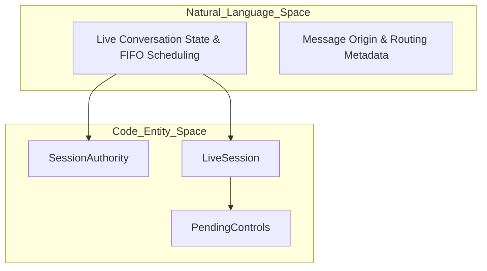
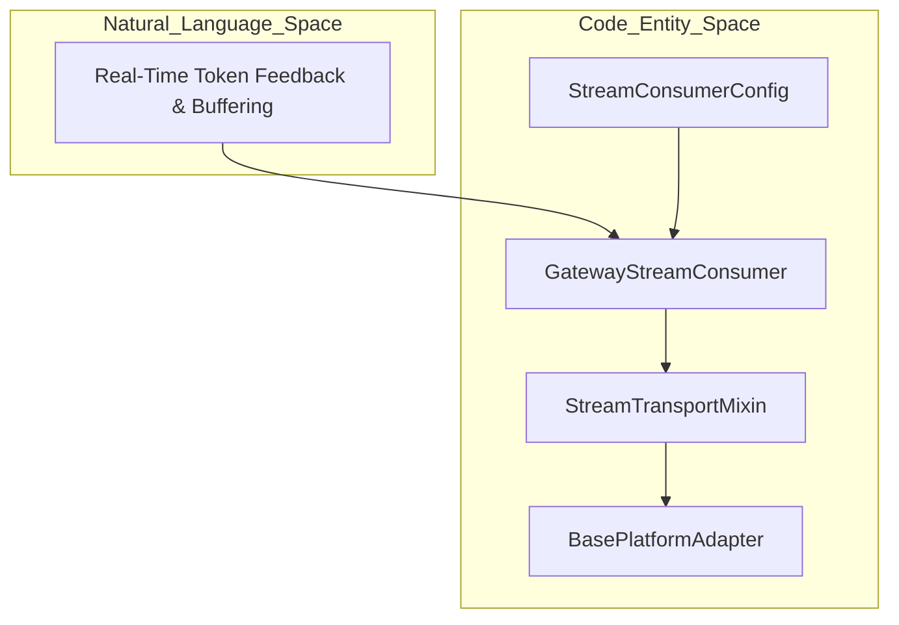

# Session and Media Management

Relevant source files

The following files were used as context for generating this wiki page:

- [agent/inline_tool_executors.py](agent/inline_tool_executors.py)
- [agent/onboarding_facts.py](agent/onboarding_facts.py)
- [agent/onboarding_record.py](agent/onboarding_record.py)
- [agent/onboarding_session.py](agent/onboarding_session.py)
- [apps/desktop/src/api/canonical-live-pick.test.ts](apps/desktop/src/api/canonical-live-pick.test.ts)
- [apps/desktop/src/app/capabilities/plugins/plugins-tab.test.tsx](apps/desktop/src/app/capabilities/plugins/plugins-tab.test.tsx)
- [apps/desktop/src/app/capabilities/plugins/plugins-tab.tsx](apps/desktop/src/app/capabilities/plugins/plugins-tab.tsx)
- [apps/desktop/src/app/session/hooks/use-message-stream/gateway-event/deferred-pick.test.ts](apps/desktop/src/app/session/hooks/use-message-stream/gateway-event/deferred-pick.test.ts)
- [apps/desktop/src/app/session/hooks/use-message-stream/gateway-event/deferred-pick.ts](apps/desktop/src/app/session/hooks/use-message-stream/gateway-event/deferred-pick.ts)
- [apps/desktop/src/app/settings/plugin-install-modal.test.tsx](apps/desktop/src/app/settings/plugin-install-modal.test.tsx)
- [apps/desktop/src/app/settings/plugin-install-modal.tsx](apps/desktop/src/app/settings/plugin-install-modal.tsx)
- [apps/desktop/src/store/agent-plugins.test.ts](apps/desktop/src/store/agent-plugins.test.ts)
- [apps/desktop/src/store/agent-plugins.ts](apps/desktop/src/store/agent-plugins.ts)
- [apps/shared/src/gateway-contract.generated.ts](apps/shared/src/gateway-contract.generated.ts)
- [apps/shared/src/gateway-contract.openrpc.json](apps/shared/src/gateway-contract.openrpc.json)
- [contributors/emails/HaisamAbbas@outlook.com](contributors/emails/HaisamAbbas@outlook.com)
- [gateway/run_turn_persistence.py](gateway/run_turn_persistence.py)
- [gateway/run_turn_prepare.py](gateway/run_turn_prepare.py)
- [gateway/session_authority.py](gateway/session_authority.py)
- [gateway/session_automation.py](gateway/session_automation.py)
- [gateway/session_controls.py](gateway/session_controls.py)
- [gateway/session_deferred_pick.py](gateway/session_deferred_pick.py)
- [gateway/session_execution.py](gateway/session_execution.py)
- [gateway/session_ingress.py](gateway/session_ingress.py)
- [gateway/session_local.py](gateway/session_local.py)
- [gateway/session_mutation_model.py](gateway/session_mutation_model.py)
- [gateway/session_mutation_policy.py](gateway/session_mutation_policy.py)
- [gateway/session_mutations.py](gateway/session_mutations.py)
- [gateway/session_onboarding.py](gateway/session_onboarding.py)
- [gateway/session_policy.py](gateway/session_policy.py)
- [gateway/session_policy_refresh.py](gateway/session_policy_refresh.py)
- [gateway/session_server_requests.py](gateway/session_server_requests.py)
- [gateway/session_setting_commands.py](gateway/session_setting_commands.py)
- [gateway/session_usage.py](gateway/session_usage.py)
- [gateway/stream_consumer.py](gateway/stream_consumer.py)
- [gateway/stream_consumer_fallback.py](gateway/stream_consumer_fallback.py)
- [gateway/stream_consumer_fences.py](gateway/stream_consumer_fences.py)
- [gateway/stream_consumer_think.py](gateway/stream_consumer_think.py)
- [gateway/stream_consumer_transport.py](gateway/stream_consumer_transport.py)
- [gateway/stream_dispatch.py](gateway/stream_dispatch.py)
- [gateway/stream_events.py](gateway/stream_events.py)
- [hermes_cli/gateway_chat.py](hermes_cli/gateway_chat.py)
- [hermes_cli/gateway_chat_view.py](hermes_cli/gateway_chat_view.py)
- [hermes_cli/plugin_catalog_presence.py](hermes_cli/plugin_catalog_presence.py)
- [hermes_cli/plugins_settings.py](hermes_cli/plugins_settings.py)
- [hermes_state_mutation_branch.py](hermes_state_mutation_branch.py)
- [hermes_state_mutation_guards.py](hermes_state_mutation_guards.py)
- [hermes_state_mutation_prepared.py](hermes_state_mutation_prepared.py)
- [hermes_state_mutations.py](hermes_state_mutations.py)
- [hermes_state_runtime.py](hermes_state_runtime.py)
- [tests/gateway/test_api_model_lock_fallback.py](tests/gateway/test_api_model_lock_fallback.py)
- [tests/gateway/test_automation_compression_media.py](tests/gateway/test_automation_compression_media.py)
- [tests/gateway/test_automation_notification_category.py](tests/gateway/test_automation_notification_category.py)
- [tests/gateway/test_bot_chat_follows_profile.py](tests/gateway/test_bot_chat_follows_profile.py)
- [tests/gateway/test_branch_secondary_profile_origin.py](tests/gateway/test_branch_secondary_profile_origin.py)
- [tests/gateway/test_feishu_sdk_executor.py](tests/gateway/test_feishu_sdk_executor.py)
- [tests/gateway/test_hosted_clarification_refusal.py](tests/gateway/test_hosted_clarification_refusal.py)
- [tests/gateway/test_local_desktop_identity.py](tests/gateway/test_local_desktop_identity.py)
- [tests/gateway/test_local_producer_admission.py](tests/gateway/test_local_producer_admission.py)
- [tests/gateway/test_local_viewer_usage.py](tests/gateway/test_local_viewer_usage.py)
- [tests/gateway/test_mcp_reload_new_server.py](tests/gateway/test_mcp_reload_new_server.py)
- [tests/gateway/test_model_alias_credential.py](tests/gateway/test_model_alias_credential.py)
- [tests/gateway/test_model_alias_credential_restart.py](tests/gateway/test_model_alias_credential_restart.py)
- [tests/gateway/test_native_fifo_context_exhaustion.py](tests/gateway/test_native_fifo_context_exhaustion.py)
- [tests/gateway/test_onboarding_on_the_authority.py](tests/gateway/test_onboarding_on_the_authority.py)
- [tests/gateway/test_retired_media_ownership.py](tests/gateway/test_retired_media_ownership.py)
- [tests/gateway/test_session_deferred_pick_restart.py](tests/gateway/test_session_deferred_pick_restart.py)
- [tests/gateway/test_session_edit_policy.py](tests/gateway/test_session_edit_policy.py)
- [tests/gateway/test_session_model_command_commits.py](tests/gateway/test_session_model_command_commits.py)
- [tests/gateway/test_session_mutation_branch_boundary.py](tests/gateway/test_session_mutation_branch_boundary.py)
- [tests/gateway/test_session_mutation_model.py](tests/gateway/test_session_mutation_model.py)
- [tests/gateway/test_session_mutation_model_busy.py](tests/gateway/test_session_mutation_model_busy.py)
- [tests/gateway/test_session_mutation_model_provider_identity.py](tests/gateway/test_session_mutation_model_provider_identity.py)
- [tests/gateway/test_session_mutation_model_provider_replacement.py](tests/gateway/test_session_mutation_model_provider_replacement.py)
- [tests/gateway/test_session_mutation_model_route.py](tests/gateway/test_session_mutation_model_route.py)
- [tests/gateway/test_session_policy.py](tests/gateway/test_session_policy.py)
- [tests/gateway/test_session_resume_config_refresh.py](tests/gateway/test_session_resume_config_refresh.py)
- [tests/gateway/test_stale_finalize_suppression.py](tests/gateway/test_stale_finalize_suppression.py)
- [tests/gateway/test_stream_consumer.py](tests/gateway/test_stream_consumer.py)
- [tests/gateway/test_stream_consumer_continuation_cut.py](tests/gateway/test_stream_consumer_continuation_cut.py)
- [tests/gateway/test_stream_consumer_draft.py](tests/gateway/test_stream_consumer_draft.py)
- [tests/gateway/test_stream_consumer_fresh_final.py](tests/gateway/test_stream_consumer_fresh_final.py)
- [tests/gateway/test_stream_consumer_oversized_leftover.py](tests/gateway/test_stream_consumer_oversized_leftover.py)
- [tests/gateway/test_stream_consumer_thread_routing.py](tests/gateway/test_stream_consumer_thread_routing.py)
- [tests/gateway/test_stream_edit_flood_retry_after.py](tests/gateway/test_stream_edit_flood_retry_after.py)
- [tests/gateway/test_telegram_final_delivery.py](tests/gateway/test_telegram_final_delivery.py)
- [tests/gateway/test_telegram_overflow_partial.py](tests/gateway/test_telegram_overflow_partial.py)
- [tests/gateway/test_telegram_shared_outbound_budget.py](tests/gateway/test_telegram_shared_outbound_budget.py)
- [tests/gateway/test_telegram_typing_retrigger.py](tests/gateway/test_telegram_typing_retrigger.py)
- [tests/hermes_cli/test_gateway_chat.py](tests/hermes_cli/test_gateway_chat.py)
- [tests/hermes_cli/test_gateway_chat_blocking_controls.py](tests/hermes_cli/test_gateway_chat_blocking_controls.py)
- [tests/hermes_cli/test_gateway_chat_failures.py](tests/hermes_cli/test_gateway_chat_failures.py)
- [tests/hermes_cli/test_oneshot_streamed_live.py](tests/hermes_cli/test_oneshot_streamed_live.py)
- [tests/hermes_cli/test_plugin_presence_by_name.py](tests/hermes_cli/test_plugin_presence_by_name.py)
- [tests/hermes_state/test_ledger_delete_consistency.py](tests/hermes_state/test_ledger_delete_consistency.py)
- [tests/hermes_state/test_runtime_adoption.py](tests/hermes_state/test_runtime_adoption.py)
- [tests/hermes_state/test_runtime_destructive_mutations.py](tests/hermes_state/test_runtime_destructive_mutations.py)
- [tests/hermes_state/test_runtime_rewind_mutations.py](tests/hermes_state/test_runtime_rewind_mutations.py)
- [tests/hermes_state/test_runtime_worker.py](tests/hermes_state/test_runtime_worker.py)
- [tests/tools/test_mcp_restart_on_new_inputs.py](tests/tools/test_mcp_restart_on_new_inputs.py)
- [tests/tools/test_process_heartbeat.py](tests/tools/test_process_heartbeat.py)
- [tests/tui_gateway/test_onboarding_endings.py](tests/tui_gateway/test_onboarding_endings.py)
- [tests/tui_gateway/test_onboarding_run_rpc.py](tests/tui_gateway/test_onboarding_run_rpc.py)
- [tests/tui_gateway/test_onboarding_session.py](tests/tui_gateway/test_onboarding_session.py)
- [tests/tui_gateway/test_onboarding_welcome_claim.py](tests/tui_gateway/test_onboarding_welcome_claim.py)
- [tests/tui_gateway/test_plugins_manage_settings.py](tests/tui_gateway/test_plugins_manage_settings.py)
- [tui_gateway/agent_factory.py](tui_gateway/agent_factory.py)
- [tui_gateway/contracts/canonical.py](tui_gateway/contracts/canonical.py)
- [tui_gateway/contracts/canonical_sessions.py](tui_gateway/contracts/canonical_sessions.py)
- [tui_gateway/contracts/common.py](tui_gateway/contracts/common.py)
- [tui_gateway/contracts/events.py](tui_gateway/contracts/events.py)
- [tui_gateway/contracts/profiles_vault_complete_foreign_subagents.py](tui_gateway/contracts/profiles_vault_complete_foreign_subagents.py)
- [tui_gateway/contracts/server_requests.py](tui_gateway/contracts/server_requests.py)
- [tui_gateway/contracts/sessions.py](tui_gateway/contracts/sessions.py)
- [tui_gateway/contracts/tools_mcp_plugins.py](tui_gateway/contracts/tools_mcp_plugins.py)
- [tui_gateway/methods_onboarding.py](tui_gateway/methods_onboarding.py)

**Purpose**:  
This page details the core implementation of session storage, live session authority scheduling, media caching, delivery tracking, interrupt handling, and message formatting within the Hermes messaging gateway and state subsystems. It explains how user conversations and associated media are persistently managed, indexed, and routed across multiple platforms, ensuring correct session isolation, privacy, and smooth streaming operations.

**Scope**:  
Covers session tracking, persistent storage infrastructure (`SessionDB`), live session management (`SessionAuthority` and `LiveSession` in [gateway/session_authority.py:38-126]()), media extraction and caching in platform adapters (`BasePlatformAdapter` in [gateway/platforms/base.py]()), streaming consumer progressive updates (`GatewayStreamConsumer` in [gateway/stream_consumer.py:1-140]()), and interrupt handling.

---

## Session Identity, Authority, and Context

Hermes separates passive session message metadata from active runtime session scheduling. Live session control and durable FIFO scheduling are managed centrally by the `SessionAuthority` class [gateway/session_authority.py:121-137]().

### SessionSource and LiveSession

- **LiveSession**: Represents an active conversation state within the gateway authority [gateway/session_authority.py:43-89](). It tracks underlying execution tasks, subscribers, event streams (`SessionEvents`), and synchronization locks (`mutation_lock`, `claim_gate`) [gateway/session_authority.py:47-58]().
- **Session Key Safety**: Sessions are internally keyed by composite identifiers, protecting disk storage and route access [gateway/session_authority.py:76-81]().

### Dynamic Context Injection

- The session source populates system prompt context via context builders to inform the AI model of its operational environment.
- Sender and chat IDs are hashed deterministically to protect user privacy [gateway/session.py:32-40]().

Diagram: Session Authority to Code Mapping

Sources: [gateway/session_authority.py:38-137](), [gateway/session.py:32-40]()

---

## Session Storage Architecture

Hermes employs a centralized SQLite database as the persistent store for all session data, message history, and search indexing, driven by canonical runtime transactions in `hermes_state_runtime.py` [hermes_state_runtime.py:1-5]() and `gateway/session_mutations.py` [gateway/session_mutations.py:1-121]().

### SessionDB and State Runtime

- The state layer ensures that every mutation uses the `SessionDB` transaction owner, including inode guards and SQLite retry policies [hermes_state_runtime.py:1-5]().
- Implements robust error handling via `RuntimeStoreError` with explicit bounded wire codes, fields, and details [hermes_state_runtime.py:23-33]().
- `admit_session_input()` manages durable message and intent queuing behind session locks [hermes_state_runtime.py:124-145]().

Sources: [hermes_state_runtime.py:1-145](), [gateway/session_mutations.py:1-121]()

---

## Media Management and Caching

Media is an integral part of multi-platform messaging; the gateway manages extraction, caching, transcoding, and presentation.

### Media Extraction

The platform adapter base class provides media extraction and parsing utilities:
- `extract_media()` parses custom `MEDIA:<path>` tags and inline attachments from message strings, extracting paths for outbound delivery.
- `filter_media_delivery_paths()` validates local file paths against safety policies before outbound dispatch, rejecting unsafe or disallowed paths [gateway/platforms/base.py:30-72]().

### Transcoding and Audio Handling

- `transcode_to_ogg_opus()` runs an optional best-effort `ffmpeg` transcode to Ogg/Opus format for native voice bubble delivery.
- Audio and media extension mappings categorize MIME types and file extensions appropriately [gateway/platforms/base.py:39-48]().

Sources: [gateway/platforms/base.py:30-72]()

---

## Streaming and Progressive Edits

For supported platforms, Hermes uses a streaming consumer to provide real-time token feedback as the LLM generates responses.

### GatewayStreamConsumer

- Implemented in [gateway/stream_consumer.py:99-142](), `GatewayStreamConsumer` bridges synchronous agent deltas to asynchronous platform delivery using a thread-safe queue [gateway/stream_consumer.py:1-10]().
- Controlled via the `StreamConsumerConfig` dataclass [gateway/stream_consumer.py:60-78](), allowing configuration of edit intervals, buffer thresholds, cursor tokens, and transport modes (`edit`, `draft`, or `auto`) [gateway/stream_consumer.py:73-76]().
- The essential message sending and editing logic is provided by `StreamTransportMixin` [gateway/stream_consumer_transport.py:1-20]() and fallback handlers [gateway/stream_consumer_fallback.py:1-20]().
- Helper functions strip internal markers (such as `MEDIA:` tags) from visible output to ensure clean presentation [tests/gateway/test_stream_consumer.py:21-61]().
- Handles graceful finalization of streams, including platform-specific requirements such as mandatory explicit finalize calls for DingTalk AI Cards [tests/gateway/test_stream_consumer.py:75-109]().

Diagram: Real-Time Token Streaming Architecture

Sources: [gateway/stream_consumer.py:1-142](), [tests/gateway/test_stream_consumer.py:21-109]()

---

## Interrupt Handling, Delivery Ledger, and Session Lifecycle

### Ingress and Admission Management

- `admit_message()` handles trusted messaging admission and coordinates with the active turn execution boundary [gateway/session_ingress.py:35-92]().
- Tracks execution outcomes, queue fullness, and content clause validations [gateway/session_ingress.py:25-58]().
- Manages turn marker handoffs to ensure resilient execution recovery across process boundaries [gateway/session_ingress.py:104-120]().

Sources: [gateway/session_ingress.py:35-120]()

---

## Message Formatting per Platform

Hermes adapts message content to platform-specific formatting rules, ensuring proper rendering of text, code, and rich media.

### Platform-Specific Formatting and Adapters

- Concrete platform adapters (such as Telegram, Discord, Slack, Matrix, Mattermost, Feishu, WhatsApp, and DingTalk) implement standardized edit signatures that accept `finalize` kwargs [tests/gateway/test_stream_consumer.py:111-146]().
- Internal directives such as `MEDIA:` and voice markers are stripped before presentation via `_clean_for_display()` [tests/gateway/test_stream_consumer.py:21-61]().

Sources: [tests/gateway/test_stream_consumer.py:21-146]()