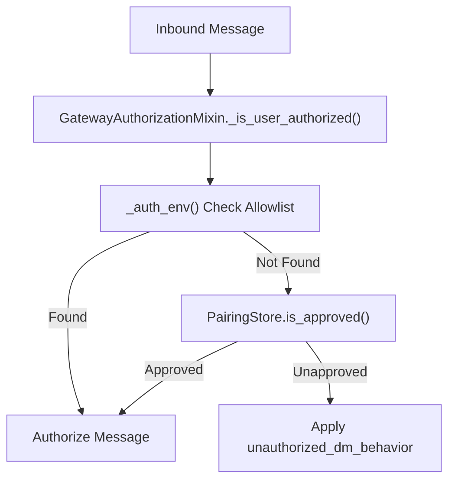
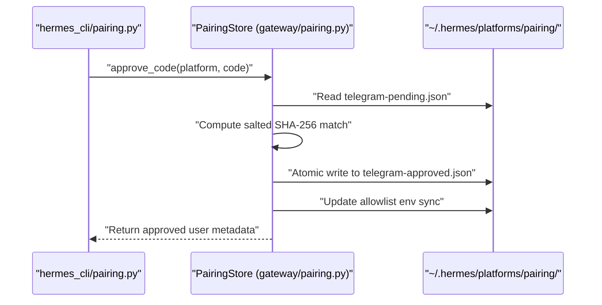
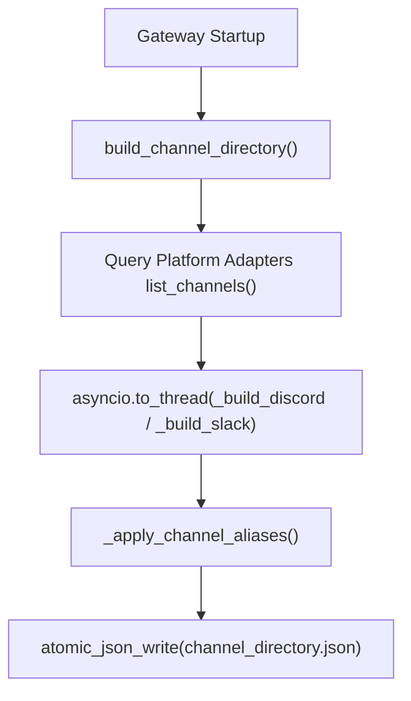

# Security and Pairing

Relevant source files

The following files were used as context for generating this wiki page:

- [apps/shared/src/billing-policy.ts](apps/shared/src/billing-policy.ts)
- [apps/shared/src/charge-settlement.ts](apps/shared/src/charge-settlement.ts)
- [contributors/emails/fangliquan@qq.com](contributors/emails/fangliquan@qq.com)
- [contributors/emails/finance@fasttvltd.com](contributors/emails/finance@fasttvltd.com)
- [gateway/authz_mixin.py](gateway/authz_mixin.py)
- [gateway/channel_directory.py](gateway/channel_directory.py)
- [gateway/pairing.py](gateway/pairing.py)
- [gateway/platforms/whatsapp_common.py](gateway/platforms/whatsapp_common.py)
- [hermes_cli/nous_billing.py](hermes_cli/nous_billing.py)
- [hermes_cli/pairing.py](hermes_cli/pairing.py)
- [hermes_cli/process_identity.py](hermes_cli/process_identity.py)
- [plugins/platforms/whatsapp_cloud/__init__.py](plugins/platforms/whatsapp_cloud/__init__.py)
- [plugins/platforms/whatsapp_cloud/plugin.yaml](plugins/platforms/whatsapp_cloud/plugin.yaml)
- [plugins/platforms/whatsapp_cloud/setup_wizard.py](plugins/platforms/whatsapp_cloud/setup_wizard.py)
- [tests/agent/test_auxiliary_runtime_cache_key.py](tests/agent/test_auxiliary_runtime_cache_key.py)
- [tests/gateway/test_channel_directory.py](tests/gateway/test_channel_directory.py)
- [tests/gateway/test_media_cache.py](tests/gateway/test_media_cache.py)
- [tests/gateway/test_pairing.py](tests/gateway/test_pairing.py)
- [tests/gateway/test_pairing_allowlist_bypass.py](tests/gateway/test_pairing_allowlist_bypass.py)
- [tests/gateway/test_whatsapp_allowlist_lid_resolution.py](tests/gateway/test_whatsapp_allowlist_lid_resolution.py)
- [tests/gateway/test_whatsapp_cloud_allowed_users.py](tests/gateway/test_whatsapp_cloud_allowed_users.py)
- [tests/gateway/test_whatsapp_group_gating.py](tests/gateway/test_whatsapp_group_gating.py)
- [tests/hermes_cli/test_nous_billing_request.py](tests/hermes_cli/test_nous_billing_request.py)
- [tests/hermes_cli/test_process_identity.py](tests/hermes_cli/test_process_identity.py)
- [web/src/lib/mcp-server-create.test.ts](web/src/lib/mcp-server-create.test.ts)
- [web/src/lib/mcp-server-create.ts](web/src/lib/mcp-server-create.ts)
- [web/src/pages/McpPage.tsx](web/src/pages/McpPage.tsx)
- [web/src/pages/PairingPage.tsx](web/src/pages/PairingPage.tsx)
- [web/src/pages/ProfileBuilderPage.tsx](web/src/pages/ProfileBuilderPage.tsx)
- [web/src/pages/WebhooksPage.tsx](web/src/pages/WebhooksPage.tsx)

This page explains the gateway security architecture, user authorization mechanisms, allowlist filtering, the channel directory cache, and the Direct Message (DM) pairing system in Hermes Agent. It covers the technical implementation of access controls across messaging platform adapters, cryptographic pairing code generation, secure permission handling, and runtime secret-scope isolation.

---

## 1. Security Model and Authorization Hierarchy

Hermes enforces multi-tiered authorization through `GatewayAuthorizationMixin`, which integrates into `GatewayRunner` to gate incoming messages before routing them to the core agent [gateway/authz_mixin.py:1-7]().

The evaluation hierarchy resolves inbound requests via the following order:
1. **Platform Adapters & Upstream Trust**: Certain adapters manage their own policy or allowlists at intake, which the gateway can trust if configured [gateway/authz_mixin.py:160-166]().
2. **Environment Allowlist**: Platform-specific allowlists loaded from environment variables or profile settings (e.g., `TELEGRAM_ALLOWED_USERS`) [gateway/authz_mixin.py:26-41](). For decentralized platforms like Nostr (Buzz), bech32 `npub1…` keys are automatically normalized to 64-character hex pubkeys via `_npub_to_hex()` to unify identity matching [gateway/authz_mixin.py:89-163]().
3. **DM Pairing Store**: If a user is not present in the static allowlist, the dynamic pairing subsystem (`PairingStore`) is queried for an explicit approval record [gateway/pairing.py:284-319]().
4. **Default Deny / Unauthorized Behavior**: If no matching authorization rule is met, the gateway applies the configured `unauthorized_dm_behavior` to drop or reject the message [gateway/authz_mixin.py:160-185]().

Profile multiplexing is supported via isolated environment readers (`_platform_gate_env()`), which query the active secret scope to prevent allowlist variable leakage across isolated configuration profiles [gateway/authz_mixin.py:38-45](). WhatsApp identifiers also undergo automatic alias expansion (`_expand_whatsapp_auth_aliases`) to map phone numbers and JIDs correctly [gateway/authz_mixin.py:164-171]().

Title: Authorization Evaluation Flow (Code Entity Space)

Sources: [gateway/authz_mixin.py:1-171](), [gateway/pairing.py:99-118]()

---

## 2. DM Pairing System

The Direct Message (DM) pairing system (`gateway/pairing.py`) provides an interactive workflow for onboarding unknown users via cryptographically secure, time-limited verification codes.

### Cryptographic Properties and Storage Limits
- **Code Generation**: Codes are 8 characters long, selected from a 32-character unambiguous alphabet (`ALPHABET = "ABCDEFGHJKLMNPQRSTUVWXYZ23456789"`, excluding `0/O`, `1/I`) using `secrets.choice()` [gateway/pairing.py:28-31]().
- **TTL and Rate Limiting**: Codes expire after 1 hour (`CODE_TTL_SECONDS = 3600`) [gateway/pairing.py:32](). Rate limits restrict requests to 1 per user per 10 minutes (`RATE_LIMIT_SECONDS = 600`) [gateway/pairing.py:33]().
- **Lockout Protection**: Exceeding 5 failed approval attempts (`MAX_FAILED_ATTEMPTS = 5`) triggers a 1-hour platform lockout (`LOCKOUT_SECONDS = 3600`) [gateway/pairing.py:34-36]().
- **Hashed Storage**: Plaintext codes are never stored. Entries are persisted as salted SHA-256 hashes inside JSON files under `~/.hermes/platforms/pairing/` [gateway/pairing.py:1-8]().
- **File Permissions**: Files are written using `_save_json_file()`, enforcing POSIX `0600` permissions where supported [tests/gateway/test_pairing.py:92-100]().

### Pairing Workflow Implementation

The `PairingStore` class manages state transitions for pending and approved principals [gateway/pairing.py:1-660]():
- `generate_code(platform, user_id, user_name)`: Creates a hashed pending entry [gateway/pairing.py:245-282]().
- `approve_code(platform, code)` / `approve_request(platform, request_id)`: Validates input and transitions the principal to the approved registry [gateway/pairing.py:321-345]().
- `_normalize_user_id()`: Normalizes variant identities (such as WhatsApp phone numbers or JIDs via `gateway/whatsapp_identity.py`) before comparison [gateway/pairing.py:90-94]().

Title: Pairing Approval Sequence

Sources: [gateway/pairing.py:1-660](), [hermes_cli/pairing.py:1-99]()

---

## 3. Allowlist Filtering and Platform Integration

Allowlist filtering serves as the primary declarative barrier for platform access.

- **Environment Mapping**: `_allowlist_env_for_platform()` maps platform names to corresponding environment keys (e.g., `TELEGRAM_ALLOWED_USERS`, `WHATSAPP_ALLOWED_USERS`) [gateway/pairing.py:62-78]().
- **Allowlist Synchronization**: Approving a pairing code automatically appends the user ID to the platform's allowlist environment variable when configured, keeping the operator's static config aligned with dynamic grants [gateway/pairing.py:62-78]().
- **WhatsApp Identity Expansion**: WhatsApp adapters rely on `_user_id_aliases()` to ensure phone numbers, LID records, and full JIDs resolve equivalently during allowlist evaluation [gateway/pairing.py:96-105]().

Title: User Identity Normalization Pipeline

Sources: [gateway/pairing.py:62-122](), [gateway/authz_mixin.py:85-96]()

---

## 4. Channel Directory and Discovery

The channel directory module (`gateway/channel_directory.py`) maintains a cached map of reachable communication channels and contacts per platform to support target resolution for commands like `send_message` [gateway/channel_directory.py:1-15]().

- **Persistence**: Cached at `~/.hermes/channel_directory.json` and overlaid with friendly names from `channel_aliases.json` [gateway/channel_directory.py:21-46]().
- **Background Refresh**: Built on gateway startup and updated on a recurring schedule [gateway/channel_directory.py:3-5]().
- **Async Thread Offloading**: Network-heavy directory builders (such as Discord and Slack integrations) execute off the main event loop thread via `asyncio.to_thread()` to prevent blocking message routing [tests/gateway/test_channel_directory.py:97-114]().

Title: Channel Directory Build Process (Code Entity Space)

Sources: [gateway/channel_directory.py:130-156](), [tests/gateway/test_channel_directory.py:97-114]()

---

## 5. Gateway Security Model

The gateway security model is designed with defense-in-depth, encompassing several layers to protect against various threats, from unauthorized access to process isolation.

### 5.1. Process Identity and Isolation
Hermes incorporates robust process identity tracking via `hermes_cli/process_identity.py` to ensure long-lived background services (such as gateways, servers, and daemons) are positively identifiable and cleanable during updates [hermes_cli/process_identity.py:1-8]().
- **Spawn Tags (`HERMES_SPAWN`)**: Spawners stamp child processes with versioned environment tags containing the installation ID, purpose, spawner PID, and birth timestamp [hermes_cli/process_identity.py:102-136]().
- **Spawn Ledger**: Long-lived processes self-register in a machine-wide `spawn-ledger.json` file, allowing automated reapers to safely manage orphaned backends [hermes_cli/process_identity.py:141-172]().
- **Job Objects (Windows)**: On Windows, background worker trees attach to kernel job objects with `KILL_ON_JOB_CLOSE` to prevent stray processes or locked binary files upon termination [hermes_cli/process_identity.py:42-47]().

Sources: [hermes_cli/process_identity.py:1-172]()