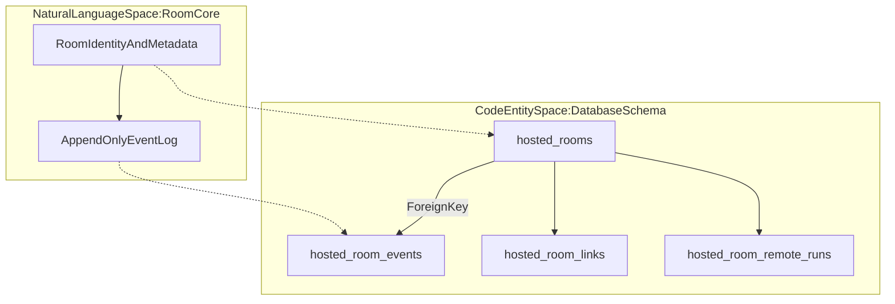
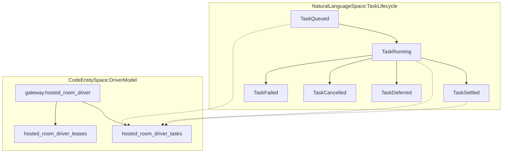
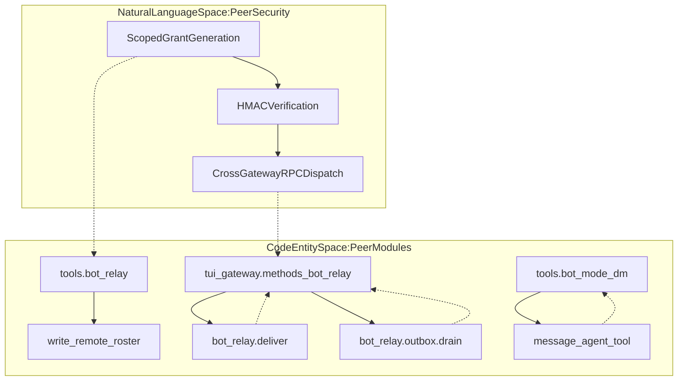
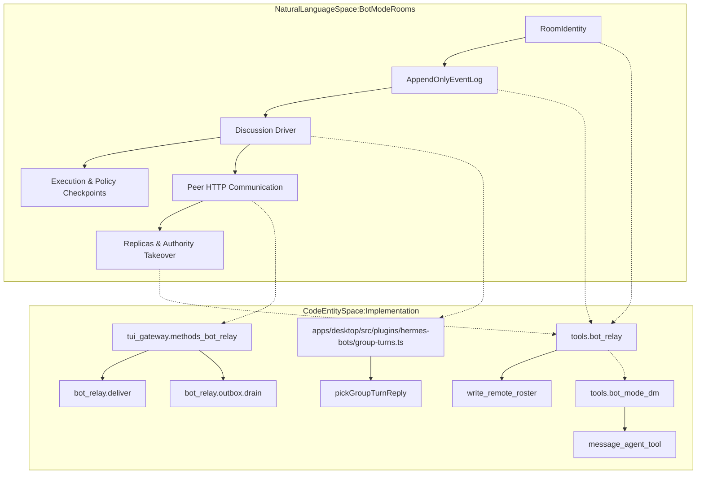

# Hosted Rooms and Group Chat

Relevant source files

The following files were used as context for generating this wiki page:

- [agent/turn_author.py](agent/turn_author.py)
- [apps/desktop/e2e/group-turn-integrity.spec.ts](apps/desktop/e2e/group-turn-integrity.spec.ts)
- [apps/desktop/src/app/chat/composer/contrib.ts](apps/desktop/src/app/chat/composer/contrib.ts)
- [apps/desktop/src/app/chat/composer/hooks/completion-route.ts](apps/desktop/src/app/chat/composer/hooks/completion-route.ts)
- [apps/desktop/src/app/chat/composer/hooks/use-at-completions-contrib.test.tsx](apps/desktop/src/app/chat/composer/hooks/use-at-completions-contrib.test.tsx)
- [apps/desktop/src/app/chat/composer/hooks/use-at-completions.test.ts](apps/desktop/src/app/chat/composer/hooks/use-at-completions.test.ts)
- [apps/desktop/src/app/chat/composer/hooks/use-at-completions.ts](apps/desktop/src/app/chat/composer/hooks/use-at-completions.ts)
- [apps/desktop/src/app/chat/composer/hooks/use-completions-owner-route.test.tsx](apps/desktop/src/app/chat/composer/hooks/use-completions-owner-route.test.tsx)
- [apps/desktop/src/app/gateway/hooks/use-gateway-boot-update-hold.test.tsx](apps/desktop/src/app/gateway/hooks/use-gateway-boot-update-hold.test.tsx)
- [apps/desktop/src/components/assistant-ui/thread/user-edit-composer-owner-route.test.tsx](apps/desktop/src/components/assistant-ui/thread/user-edit-composer-owner-route.test.tsx)
- [apps/desktop/src/lib/slash-completion-cache.ts](apps/desktop/src/lib/slash-completion-cache.ts)
- [apps/desktop/src/plugins/hermes-bots/bot-row.test.tsx](apps/desktop/src/plugins/hermes-bots/bot-row.test.tsx)
- [apps/desktop/src/plugins/hermes-bots/bot-row.tsx](apps/desktop/src/plugins/hermes-bots/bot-row.tsx)
- [apps/desktop/src/plugins/hermes-bots/group-activity.test.ts](apps/desktop/src/plugins/hermes-bots/group-activity.test.ts)
- [apps/desktop/src/plugins/hermes-bots/group-activity.ts](apps/desktop/src/plugins/hermes-bots/group-activity.ts)
- [apps/desktop/src/plugins/hermes-bots/group-chat-view.tsx](apps/desktop/src/plugins/hermes-bots/group-chat-view.tsx)
- [apps/desktop/src/plugins/hermes-bots/group-chat.test.ts](apps/desktop/src/plugins/hermes-bots/group-chat.test.ts)
- [apps/desktop/src/plugins/hermes-bots/group-chat.ts](apps/desktop/src/plugins/hermes-bots/group-chat.ts)
- [apps/desktop/src/plugins/hermes-bots/group-membership.test.ts](apps/desktop/src/plugins/hermes-bots/group-membership.test.ts)
- [apps/desktop/src/plugins/hermes-bots/group-membership.ts](apps/desktop/src/plugins/hermes-bots/group-membership.ts)
- [apps/desktop/src/plugins/hermes-bots/group-pin.test.ts](apps/desktop/src/plugins/hermes-bots/group-pin.test.ts)
- [apps/desktop/src/plugins/hermes-bots/group-pin.ts](apps/desktop/src/plugins/hermes-bots/group-pin.ts)
- [apps/desktop/src/plugins/hermes-bots/group-round-members.ts](apps/desktop/src/plugins/hermes-bots/group-round-members.ts)
- [apps/desktop/src/plugins/hermes-bots/group-round-prompt.ts](apps/desktop/src/plugins/hermes-bots/group-round-prompt.ts)
- [apps/desktop/src/plugins/hermes-bots/group-rounds.addressed.test.ts](apps/desktop/src/plugins/hermes-bots/group-rounds.addressed.test.ts)
- [apps/desktop/src/plugins/hermes-bots/group-rounds.primary-alias.test.ts](apps/desktop/src/plugins/hermes-bots/group-rounds.primary-alias.test.ts)
- [apps/desktop/src/plugins/hermes-bots/group-rounds.test.ts](apps/desktop/src/plugins/hermes-bots/group-rounds.test.ts)
- [apps/desktop/src/plugins/hermes-bots/group-rounds.ts](apps/desktop/src/plugins/hermes-bots/group-rounds.ts)
- [apps/desktop/src/plugins/hermes-bots/group-turns.test.ts](apps/desktop/src/plugins/hermes-bots/group-turns.test.ts)
- [apps/desktop/src/plugins/hermes-bots/group-turns.ts](apps/desktop/src/plugins/hermes-bots/group-turns.ts)
- [apps/desktop/src/plugins/hermes-bots/i18n.ts](apps/desktop/src/plugins/hermes-bots/i18n.ts)
- [apps/desktop/src/plugins/hermes-bots/plugin.mentions.test.ts](apps/desktop/src/plugins/hermes-bots/plugin.mentions.test.ts)
- [apps/desktop/src/plugins/hermes-bots/plugin.tsx](apps/desktop/src/plugins/hermes-bots/plugin.tsx)
- [apps/desktop/src/plugins/hermes-bots/roster-pane.tsx](apps/desktop/src/plugins/hermes-bots/roster-pane.tsx)
- [apps/desktop/src/plugins/hermes-bots/roster-sections.tsx](apps/desktop/src/plugins/hermes-bots/roster-sections.tsx)
- [apps/desktop/src/plugins/hermes-bots/types.ts](apps/desktop/src/plugins/hermes-bots/types.ts)
- [apps/desktop/src/plugins/hermes-bots/user-sections-ui.test.tsx](apps/desktop/src/plugins/hermes-bots/user-sections-ui.test.tsx)
- [apps/desktop/src/plugins/hermes-bots/user-sections-ui.tsx](apps/desktop/src/plugins/hermes-bots/user-sections-ui.tsx)
- [apps/desktop/src/plugins/hermes-bots/user-sections.test.ts](apps/desktop/src/plugins/hermes-bots/user-sections.test.ts)
- [apps/desktop/src/plugins/hermes-bots/user-sections.ts](apps/desktop/src/plugins/hermes-bots/user-sections.ts)
- [apps/desktop/src/store/composer-actions.ts](apps/desktop/src/store/composer-actions.ts)
- [apps/desktop/src/test/fake-gateway-socket.ts](apps/desktop/src/test/fake-gateway-socket.ts)
- [contributors/emails/12357213+Halldrix@users.noreply.github.com](contributors/emails/12357213+Halldrix@users.noreply.github.com)
- [contributors/emails/lucasyee999@gmail.com](contributors/emails/lucasyee999@gmail.com)
- [contributors/emails/michaelalexanderknaap@gmail.com](contributors/emails/michaelalexanderknaap@gmail.com)
- [evals/botmode-dm-delivery/README.md](evals/botmode-dm-delivery/README.md)
- [evals/botmode-dm-delivery/mock-trigger.patch](evals/botmode-dm-delivery/mock-trigger.patch)
- [evals/botmode-dm-delivery/probe-cron-root.spec.ts](evals/botmode-dm-delivery/probe-cron-root.spec.ts)
- [evals/botmode-dm-delivery/probe-dm-delivery.spec.ts](evals/botmode-dm-delivery/probe-dm-delivery.spec.ts)
- [gateway/bot_loop_guard.py](gateway/bot_loop_guard.py)
- [hermes_cli/quiet_single_query.py](hermes_cli/quiet_single_query.py)
- [tests/agent/test_bot_chat_toolset_refresh.py](tests/agent/test_bot_chat_toolset_refresh.py)
- [tests/agent/test_system_prompt_restore.py](tests/agent/test_system_prompt_restore.py)
- [tests/agent/test_turn_author.py](tests/agent/test_turn_author.py)
- [tests/cron/test_cron_live_bot_delivery.py](tests/cron/test_cron_live_bot_delivery.py)
- [tests/gateway/test_bot_loop_guard.py](tests/gateway/test_bot_loop_guard.py)
- [tests/gateway/test_peer_dm_transient_retry.py](tests/gateway/test_peer_dm_transient_retry.py)
- [tests/hermes_cli/test_chat_c_fail_loudly.py](tests/hermes_cli/test_chat_c_fail_loudly.py)
- [tests/hermes_cli/test_gateway_chat_title_live.py](tests/hermes_cli/test_gateway_chat_title_live.py)
- [tests/hermes_cli/test_quiet_turn_author.py](tests/hermes_cli/test_quiet_turn_author.py)
- [tests/tools/test_bot_failure_reasons.py](tests/tools/test_bot_failure_reasons.py)
- [tests/tools/test_bot_legacy_producer.py](tests/tools/test_bot_legacy_producer.py)
- [tests/tools/test_bot_live_owner_delivery.py](tests/tools/test_bot_live_owner_delivery.py)
- [tests/tools/test_bot_mode_dm.py](tests/tools/test_bot_mode_dm.py)
- [tests/tools/test_bot_mode_probe.py](tests/tools/test_bot_mode_probe.py)
- [tests/tools/test_bot_mode_refusal_contract.py](tests/tools/test_bot_mode_refusal_contract.py)
- [tests/tools/test_bot_no_fallback.py](tests/tools/test_bot_no_fallback.py)
- [tests/tools/test_bot_relay.py](tests/tools/test_bot_relay.py)
- [tests/tools/test_bot_relay_windows_paths.py](tests/tools/test_bot_relay_windows_paths.py)
- [tests/tools/test_bot_retry_policy.py](tests/tools/test_bot_retry_policy.py)
- [tests/tools/test_bot_turn_lock.py](tests/tools/test_bot_turn_lock.py)
- [tests/tui_gateway/test_bot_live_owner_delivery.py](tests/tui_gateway/test_bot_live_owner_delivery.py)
- [tests/tui_gateway/test_bot_mode_silence_delivery.py](tests/tui_gateway/test_bot_mode_silence_delivery.py)
- [tests/tui_gateway/test_bot_relay_methods.py](tests/tui_gateway/test_bot_relay_methods.py)
- [tests/tui_gateway/test_detached_process_notify_keepalive.py](tests/tui_gateway/test_detached_process_notify_keepalive.py)
- [tests/tui_gateway/test_heartbeat_tui_tick.py](tests/tui_gateway/test_heartbeat_tui_tick.py)
- [tests/tui_gateway/test_hosted_room_turn_slot_release.py](tests/tui_gateway/test_hosted_room_turn_slot_release.py)
- [tests/tui_gateway/test_prompt_accept_logging.py](tests/tui_gateway/test_prompt_accept_logging.py)
- [tests/tui_gateway/test_relay_live_author.py](tests/tui_gateway/test_relay_live_author.py)
- [tests/tui_gateway/test_turn_finished_failure_cause.py](tests/tui_gateway/test_turn_finished_failure_cause.py)
- [tools/bot_failure_reasons.py](tools/bot_failure_reasons.py)
- [tools/bot_live_delivery.py](tools/bot_live_delivery.py)
- [tools/bot_mode_dm.py](tools/bot_mode_dm.py)
- [tools/bot_mode_probe.py](tools/bot_mode_probe.py)
- [tools/bot_relay.py](tools/bot_relay.py)
- [tools/process_registry_awaiting.py](tools/process_registry_awaiting.py)
- [tui_gateway/methods_bot_relay.py](tui_gateway/methods_bot_relay.py)
- [tui_gateway/session_notifications.py](tui_gateway/session_notifications.py)
- [website/docs/user-guide/bot-mode.md](website/docs/user-guide/bot-mode.md)

## Purpose and Scope

The gateway-hosted Bot Mode rooms subsystem in Hermes Agent provides a robust foundation for durable group chat rooms, enabling multi-party agent interactions, cross-gateway collaboration, and distributed execution of agent turns. It incorporates durable room identity management, an append-only event log for immutable event history, replicas, peer HTTP communication, a discussion driver, and execution/policy checkpoints.

This system is crucial for Bot Mode, where named Bots (agent profiles) participate in permanent group conversations ("rooms") managed durably by the gateway [website/docs/user-guide/bot-mode.md:3-4](). It supports fire-and-forget messaging between agents on the same or different gateways via `message_agent`, coordination of group discussions with fine-grained member mentions, and fault-tolerant recovery in distributed environments [tools/bot_mode_dm.py:1-14]().

Sources: [website/docs/user-guide/bot-mode.md:3-4](), [tools/bot_mode_dm.py:1-14]()

---

## Durable Room Identity and Append-Only Event Log

At the core of hosted rooms is a durable identity system with an append-only event log stored in SQLite tables. The following diagram illustrates the relationship between natural language concepts and database entities:

**Figure 1: Room identity and event log mapped to SQLite schema entities**

- **`hosted_rooms`**: Each row corresponds to a unique room, with fields such as `room_id` (primary key), `name` (canonical room name), `members_json` (JSON list of member identifiers), `authority_gateway_id` (which gateway acts as authority), `authority_epoch` (monotonically increasing version), `next_seq` (sequence number for next event), and timestamps.
- **`hosted_room_events`**: Stores an append-only, strictly ordered sequence of events partitioned by `room_id` and `seq` (sequence number). Each event has a unique `event_id`, a string `kind` identifier, actor metadata in JSON (`actor_json`), the `epoch` version, and the payload in JSON (`payload_json`).
- Additional tables such as `hosted_room_links` and `hosted_room_remote_runs` support cross-room linkage and remote execution metadata.

Sources: [website/docs/user-guide/bot-mode.md:3-4](), [tools/bot_mode_dm.py:1-14]()

---

## Task State Machine and Driver Lease

Execution of agent turns and background tasks inside rooms is managed via a fenced task state machine and lease-based driver control. This design prevents race conditions and stale state updates in a distributed multi-gateway environment.

**Figure 2: Task lifecycle states and underlying driver control tables**

- **Lease Management**: The `hosted_room_driver_leases` table records which gateway currently holds exclusive rights to process tasks in a room, identified by `gateway_id` and scoped by the room's `authority_epoch`. Leases have expiration timestamps to allow failover.
- **Task States and Transitions**: Tasks in the `hosted_room_driver_tasks` table transition through explicit states — `queued`, `running`, `settled`, `failed`, `cancelled`, `indeterminate`, `deferred`, and `stopping` — modeled as a finite state machine. State transitions are guarded by `execution_generation` fencing to prevent stale workers from overwriting newer results.

Sources: [tools/bot_relay.py:40-67](), [tools/bot_live_delivery.py:26-30]()

---

## Replicas and Authority Takeover

To scale reliability and availability, non-authority gateways maintain local replicas of room state by ingesting event pages asynchronously.

- **Replica Ingestion**: Ingestion functions accept contiguous ranges of ordered events, detecting gaps in sequence numbers and epoch regressions, enforcing strict append-only semantics and version monotonicity during ingestion.
- **Authority Epoch Handling**: Gateway replication handles replica promotion by incrementing `authority_epoch` and appending a provenance event of kind `authority.claimed`, while demoting stale authorities if necessary.

Sources: [tui_gateway/methods_bot_relay.py:26-30](), [tests/tui_gateway/test_bot_relay_methods.py:53-70]()

---

## Peer HTTP and Cross-Gateway Communication

Hosted room members communicate across gateways using scoped grants authenticated by HMAC and managed peer HTTP requests, coordinated via the relay subsystem in `tools/bot_relay.py` and JSON-RPC methods in `tui_gateway/methods_bot_relay.py` [tools/bot_relay.py:1-12](), [tui_gateway/methods_bot_relay.py:1-7]().

**Figure 3: Peer HTTP security and cross-connection relay architecture**

- **Cross-Gateway Relay via Desktop**:
  - The application orchestrates a relay with two main loops:
    - **Roster Loop** broadcasts the combined roster of agents across connections (`bot_relay.roster.sync`) [tui_gateway/methods_bot_relay.py:31-54]().
    - **Drain Loop** consumes envelopes queued for delivery (`bot_relay.outbox.drain`), delivers them via `bot_relay.deliver`, and writes reply acknowledgments back via `bot_relay.reply` [tui_gateway/methods_bot_relay.py:56-126]().
- **`message_agent` Tool**: Injected only into Bot Mode canonical "Bot Chat" sessions on managed installs, allowing asynchronous fire-and-forget messages to other agents [tools/bot_mode_dm.py:67-120](), [tools/bot_mode_dm.py:123-137]().

Sources: [tools/bot_relay.py:1-67](), [tui_gateway/methods_bot_relay.py:1-126](), [tools/bot_mode_dm.py:67-137]()

---

## Discussion Driver and Policy Checkpoints

Group discussion dynamics and policy enforcement are governed by the discussion driver and checkpointing subsystems, providing deterministic turn ordering and member mention resolution.

- **Discussion Policy Driver**:
  - Implemented in frontend components and companion modules such as `apps/desktop/src/plugins/hermes-bots/group-rounds.ts` and `apps/desktop/src/plugins/hermes-bots/group-turns.ts`, it evaluates room rosters, enumerates turns, and parses member mentions [apps/desktop/src/plugins/hermes-bots/group-rounds.test.ts:74-146](), [apps/desktop/src/plugins/hermes-bots/group-turns.ts:38-108]().
  - Handles mention resolution scenarios including display titles, `hermes` alias, and previous names/aliases [apps/desktop/src/plugins/hermes-bots/group-rounds.test.ts:96-170]().

Sources: [apps/desktop/src/plugins/hermes-bots/group-rounds.test.ts:74-170](), [apps/desktop/src/plugins/hermes-bots/group-turns.ts:38-157]()

---

## TUI Gateway Hosted Room Service

The hosted room subsystem is integrated into the gateway JSON-RPC server via `tui_gateway/methods_bot_relay.py` and related routers [tui_gateway/methods_bot_relay.py:1-151]().

- **RPC Methods**: These modules expose hosted room operations such as room creation, membership changes, replica ingestion, message broadcasting, and roster synchronization [tui_gateway/methods_bot_relay.py:31-64]().
- **Delivery Handling**: The `bot_relay.deliver` method performs delivery of relayed direct messages into Bot Chat sessions on the host gateway [tui_gateway/methods_bot_relay.py:67-122]().

Sources: [tui_gateway/methods_bot_relay.py:1-151]()

---

# Summary Diagram: End-to-End Hosted Rooms Components

*Figure 4: Mapping the conceptual Bot Mode room architecture to major code modules.*

Sources: [tools/bot_relay.py:1-152](), [tui_gateway/methods_bot_relay.py:1-151](), [tools/bot_mode_dm.py:67-137](), [apps/desktop/src/plugins/hermes-bots/group-turns.ts:38-157]()