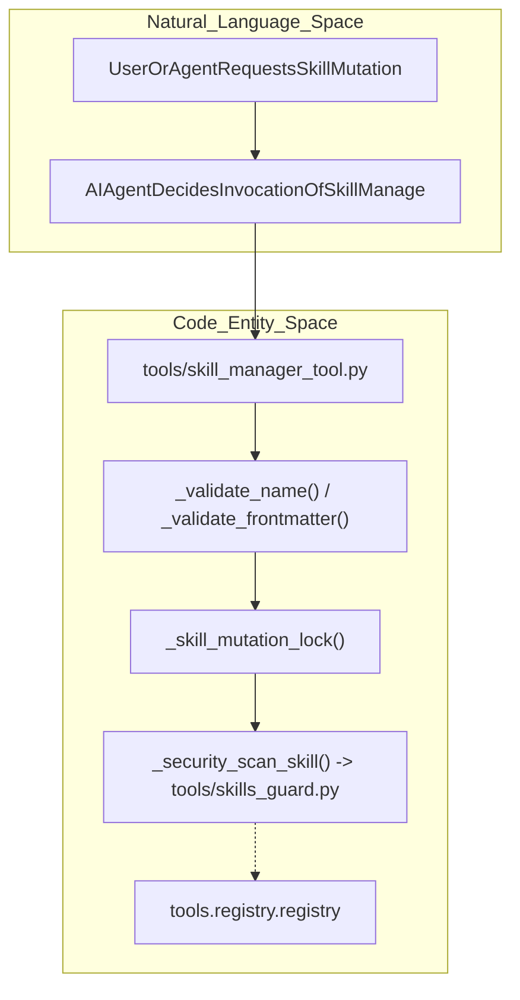
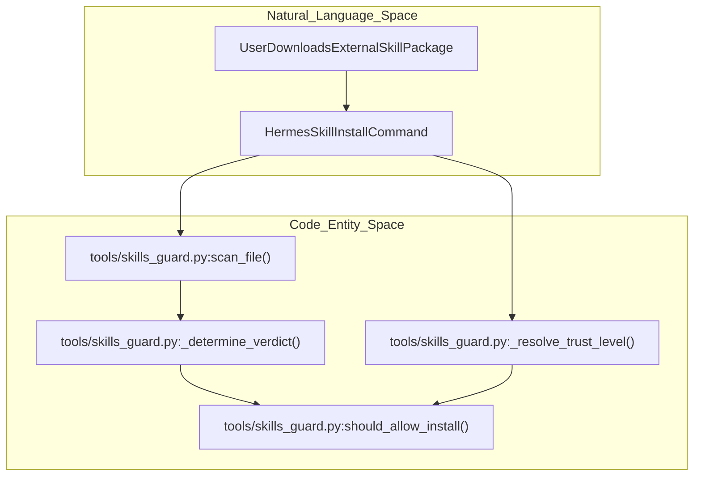

# Skills Management and Security

<details>
<summary>Relevant source files</summary>

The following files were used as context for generating this wiki page:

- [agent/coding_context.py](agent/coding_context.py)
- [agent/curator.py](agent/curator.py)
- [agent/curator_backup.py](agent/curator_backup.py)
- [agent/prompt_builder.py](agent/prompt_builder.py)
- [agent/skill_commands.py](agent/skill_commands.py)
- [agent/skill_utils.py](agent/skill_utils.py)
- [agent/surface_switch.py](agent/surface_switch.py)
- [agent/system_prompt.py](agent/system_prompt.py)
- [contributors/emails/southpawinmusic@gmail.com](contributors/emails/southpawinmusic@gmail.com)
- [hermes_cli/curator.py](hermes_cli/curator.py)
- [tests/agent/test_coding_context.py](tests/agent/test_coding_context.py)
- [tests/agent/test_compaction_prompt_rebuild.py](tests/agent/test_compaction_prompt_rebuild.py)
- [tests/agent/test_curator.py](tests/agent/test_curator.py)
- [tests/agent/test_curator_backup.py](tests/agent/test_curator_backup.py)
- [tests/agent/test_curator_classification.py](tests/agent/test_curator_classification.py)
- [tests/agent/test_curator_reports.py](tests/agent/test_curator_reports.py)
- [tests/agent/test_curator_rollback_staging.py](tests/agent/test_curator_rollback_staging.py)
- [tests/agent/test_curator_run_hygiene.py](tests/agent/test_curator_run_hygiene.py)
- [tests/agent/test_prompt_builder.py](tests/agent/test_prompt_builder.py)
- [tests/agent/test_skill_commands.py](tests/agent/test_skill_commands.py)
- [tests/agent/test_skill_utils.py](tests/agent/test_skill_utils.py)
- [tests/agent/test_system_prompt.py](tests/agent/test_system_prompt.py)
- [tests/agent/test_system_prompt_switch_invalidation.py](tests/agent/test_system_prompt_switch_invalidation.py)
- [tests/agent/test_tool_arg_coercion.py](tests/agent/test_tool_arg_coercion.py)
- [tests/cron/test_rewrite_skill_refs.py](tests/cron/test_rewrite_skill_refs.py)
- [tests/gateway/test_session_policy_coding_posture.py](tests/gateway/test_session_policy_coding_posture.py)
- [tests/hermes_cli/test_curator_archive_prune.py](tests/hermes_cli/test_curator_archive_prune.py)
- [tests/hermes_cli/test_curator_run.py](tests/hermes_cli/test_curator_run.py)
- [tests/hermes_cli/test_curator_status.py](tests/hermes_cli/test_curator_status.py)
- [tests/hermes_cli/test_session_system_prompt_dedup.py](tests/hermes_cli/test_session_system_prompt_dedup.py)
- [tests/tools/test_plugin_guard.py](tests/tools/test_plugin_guard.py)
- [tests/tools/test_project_tools.py](tests/tools/test_project_tools.py)
- [tests/tools/test_registry.py](tests/tools/test_registry.py)
- [tests/tools/test_schema_sanitizer.py](tests/tools/test_schema_sanitizer.py)
- [tests/tools/test_self_repo_guard.py](tests/tools/test_self_repo_guard.py)
- [tests/tools/test_skill_ledger.py](tests/tools/test_skill_ledger.py)
- [tests/tools/test_skill_ledger_delta.py](tests/tools/test_skill_ledger_delta.py)
- [tests/tools/test_skill_linter.py](tests/tools/test_skill_linter.py)
- [tests/tools/test_skill_manage_batch.py](tests/tools/test_skill_manage_batch.py)
- [tests/tools/test_skill_manage_schema_diet.py](tests/tools/test_skill_manage_schema_diet.py)
- [tests/tools/test_skill_manager_tool.py](tests/tools/test_skill_manager_tool.py)
- [tests/tools/test_skill_usage.py](tests/tools/test_skill_usage.py)
- [tests/tools/test_skills_guard.py](tests/tools/test_skills_guard.py)
- [tests/tools/test_skills_guard_agent_config.py](tests/tools/test_skills_guard_agent_config.py)
- [tests/tools/test_skills_tool.py](tests/tools/test_skills_tool.py)
- [tests/tools/test_terminal_requirements.py](tests/tools/test_terminal_requirements.py)
- [tests/tools/test_terminal_self_repo_guard.py](tests/tools/test_terminal_self_repo_guard.py)
- [tests/tools/test_terminal_tool_requirements.py](tests/tools/test_terminal_tool_requirements.py)
- [tests/tools/test_tts_path_traversal.py](tests/tools/test_tts_path_traversal.py)
- [tools/arg_coercion.py](tools/arg_coercion.py)
- [tools/blueprints.py](tools/blueprints.py)
- [tools/path_security.py](tools/path_security.py)
- [tools/plugin_guard.py](tools/plugin_guard.py)
- [tools/plugin_guard_context.py](tools/plugin_guard_context.py)
- [tools/project_tools.py](tools/project_tools.py)
- [tools/registry.py](tools/registry.py)
- [tools/schema_sanitizer.py](tools/schema_sanitizer.py)
- [tools/self_repo_guard.py](tools/self_repo_guard.py)
- [tools/skill_ledger.py](tools/skill_ledger.py)
- [tools/skill_linter.py](tools/skill_linter.py)
- [tools/skill_manager_batch.py](tools/skill_manager_batch.py)
- [tools/skill_manager_guards.py](tools/skill_manager_guards.py)
- [tools/skill_manager_tool.py](tools/skill_manager_tool.py)
- [tools/skill_usage.py](tools/skill_usage.py)
- [tools/skills_guard.py](tools/skills_guard.py)
- [tools/skills_tool.py](tools/skills_tool.py)
- [website/docs/developer-guide/gateway-classic-cli.md](website/docs/developer-guide/gateway-classic-cli.md)
- [website/docs/developer-guide/gateway-local-sessions.md](website/docs/developer-guide/gateway-local-sessions.md)
- [website/docs/user-guide/features/curator.md](website/docs/user-guide/features/curator.md)

</details>


This page documents the skills management system, which allows the agent to create, modify, patch, and delete skills—reusable procedural knowledge for recurring task types. Skills serve as the agent's procedural memory, capturing “how to do X” workflows and solutions that can be applied repeatedly.

It covers programmatic skill management, validation, linting, security scanning, the skill ledger, the `skill_manage` tool, bundled and optional skills directories, synchronization, and background review. For hub browsing and installation, see **8.2 Skills Hub**.

---

## Purpose and Scope

The skills system provides:

- **Programmatic skill creation & editing**: The `skill_manage` tool enables the agent to create, modify, patch, and delete skills and supporting files dynamically [tools/skill_manager_tool.py:1-154]().
- **Validation and linting**: Name, category, content length, and frontmatter validation enforce correctness and prompt suitability [tools/skill_manager_tool.py:100-156]().
- **Security scanning**: Static threat-pattern scanning of skill contents for injection, exfiltration, destructive commands, and persistence risk. Enforcement varies by trust level (`builtin`, `trusted`, `community`, `agent-created`) [tools/skills_guard.py:1-137](), [tools/skill_manager_tool.py:40-63]().
- **Skill ledger and telemetry**: Usage provenance, modification history, view counts, and per-skill lock guarding coordinated access [tools/skill_usage.py:1-81]().
- **Support files inside each skill directory**: `references/`, `templates/`, `scripts/`, and `assets/` are optional language assets related to a skill [tools/skill_manager_tool.py:113-117]().
- **Bundled vs. optional skill catalogs**: `skills/` directory for shipped skills, synced on install, and `optional-skills/` for officially curated but user-installed extras [agent/skill_utils.py:1-32]().
- **Synchronization**: Detects differences between bundled and user skills using manifest files tracking hashes and respecting user edits.
- **Background skill review and curation**: Automated archival, consolidation, and pinning managed by the curator process during idle periods [agent/curator.py:1-175]().

All skills reside under the unified user skills directory (`~/.hermes/skills/`) and follow a standardized directory and file layout [tools/skills_tool.py:60-75](), [agent/skill_utils.py:90-130]().

Sources:  
[tools/skill_manager_tool.py:1-156]()  
[tools/skills_guard.py:1-137]()  
[tools/skill_usage.py:1-81]()  
[tools/skills_tool.py:60-75]()  
[agent/skill_utils.py:1-130]()  
[agent/curator.py:1-175]()  

---

## Skills Directory Structure

Skills are stored under the active profile’s skills directory (`SKILLS_DIR`), typically accessed via `_skills_dir()` in `tools/skill_manager_tool.py` and `tools/skills_tool.py` which defaults to `~/.hermes/skills/` [tools/skill_manager_tool.py:67-83](), [tools/skills_tool.py:66-76](). The directory layout is:

```text
~/.hermes/skills/
├── .bundled_manifest         # Manifest tracking hashes of bundled skills
├── .hub/                     # State, locks, and quarantine for installed hub skills
├── .curator_state            # Persistent state for background skill maintenance (Curator)
├── .usage.json               # Telemetry and usage ledger sidecar
├── my-skill/                 # A skill directory
│   ├── SKILL.md              # Required: primary skill definition (YAML frontmatter + instructions)
│   ├── references/           # Optional docs or references
│   ├── templates/            # Optional reusable templates
│   ├── scripts/              # Optional helper scripts
│   └── assets/               # Optional assets such as images or examples
└── category-name/            # Optional category subdirectory
    └── another-skill/
        └── SKILL.md
```

- Categories are a single directory name (no slashes) and appear as subfolders for organizational purposes, validated by `_validate_category` [tools/skill_manager_tool.py:133-145]().

The `SKILL.md` file is mandatory for a skill and central to all operations.

Sources:  
[tools/skills_tool.py:66-76]()  
[tools/skill_manager_tool.py:67-145]()  
[agent/curator.py:39-41]()  

### SKILL.md Format and Constraints

Each `SKILL.md` starts with a YAML frontmatter block parsed via `parse_frontmatter` [agent/skill_utils.py:66-86](), defining:

| Field        | Requirement                                  | Notes                                                           |
|--------------|----------------------------------------------|-----------------------------------------------------------------|
| `name`       | Required, max 64 characters                  | Lowercase alphanumeric, hyphens, dots, underscores; slug safe   |
| `description`| Required, max 1024 characters                | Brief human summary, used in prompts and skill indices          |
| `platforms`  | Optional list (e.g., `["linux", "windows"]`)| Used to filter skills by OS/platform (`skill_matches_platform`) |
| `environments`| Optional list (e.g., `["kanban", "docker"]`) | Relevance filter for offer surfaces (`skill_matches_environment`) |
| `version`    | Optional string                              | Skill version metadata                                           |
| `license`    | Optional string                              | SPDX license identifier                                          |

- The frontmatter must parse correctly as YAML and include at least `name` and `description` [tools/skill_manager_tool.py:146-154]().
- Skill content total character size is limited (`MAX_SKILL_CONTENT_CHARS = 100_000`) to keep model context manageable [tools/skill_manager_tool.py:110-111]().
- Path names are validated for disallowed characters and max length via `_validate_name` and `_check_identifier` [tools/skill_manager_tool.py:120-131]().

Sources:  
[agent/skill_utils.py:66-107]()  
[tools/skill_manager_tool.py:108-154]()  

---

## Skill Management and the `skill_manage` Tool

The `skill_manage` tool is the agent's interface to procedural memory management, exposing skill CRUD and supporting file operations as command handlers implemented in `tools/skill_manager_tool.py`.

### Key API Operations

- `_create_skill()`: adds a new skill with its initial `SKILL.md` and runs frontmatter/name validation [tools/skill_manager_tool.py:120-154]().
- `_edit_skill()`: overwrites or replaces skill content under locking control.
- `_patch_skill()`: applies unified-text-patch-style diffs to skill files via `tools/skill_manager_batch.py` [tools/skill_manager_batch.py:30-36]().
- `_delete_skill()`: safely removes a skill directory, respecting pinned and curated state via `tools/skill_manager_guards.py` [tools/skill_manager_guards.py:30-33]().
- `_write_file()` / `_remove_file()`: create, update, or remove support files inside approved subdirectories (`references/`, `templates/`, `scripts/`, `assets/`) [tools/skill_manager_tool.py:113-117]().

### Concurrency and Locking

- All mutations on a skill acquire an exclusive per-skill file lock via `_skill_mutation_lock(name)` in the `.locks/` directory, preventing concurrent modifications. Locks are keyed by the SHA256 digest of the relative skill name to avoid filesystem naming limits [tools/skill_manager_tool.py:84-98]().
- Multi-skill batches acquire locks in a stable sorted path order via `_skill_mutation_locks(names)` to eliminate deadlocks [tools/skill_manager_tool.py:99-106]().

### Validation and Security Scan

- Each edit and creation operation validates naming, category, frontmatter, file sizes, and path safety.
- After mutation, `_security_scan_skill(skill_dir)` runs if `skills.guard_agent_created` is enabled, blocking dangerous contributions [tools/skill_manager_tool.py:41-64]().

### Diagram: Skill Management and Execution Flow

Sources:  
[tools/skill_manager_tool.py:1-154, 41-98]()  
[tools/skills_guard.py:1-37]()  
[tools/registry.py:1-25]()  

---

## Security Scanning, Linting, and Ledger

Hermes includes multi-layered security scanning and validation to protect from prompt injection, malicious skill content, and unsafe skill manipulations.

### 1. Context File Scanning (Prompt Injection Prevention)

- `agent/prompt_builder.py` reads sensitive context files (`AGENTS.md`, `.cursorrules`, `SOUL.md`) with a non-blocking timeout reader (`_read_text_with_timeout`) and scans them via `_scan_context_content` [agent/prompt_builder.py:52-110]().
- Detected injections in project-scoped files cause hard blocking (`_scan_for_threats(content, scope="context")`); user-authored identity files (`SOUL.md` in `HERMES_HOME`) are loaded with a warning instead [agent/prompt_builder.py:83-110]().

### 2. Skills Guard

- Implements regex-based threat pattern scanning on all files inside a skill directory (`scan_skill`) [tools/skills_guard.py:1-59]().
- Categorizes findings by severity (`critical`, `high`, `medium`, `low`) and type (`exfiltration`, `injection`, `destructive`, etc.) [tools/skills_guard.py:39-48]().
- Enforces an installation policy (`INSTALL_POLICY`) mapped against trust levels (`builtin`, `trusted`, `community`, `agent-created`) [tools/skills_guard.py:26-33]().

### 3. Skill Ledger and Usage Telemetry

- The skill usage subsystem (`tools/skill_usage.py`) tracks skill read/write counts, view counts, enabled/suppressed state, and archives telemetry sidecars under `.usage.json`.
- Access is guarded with thread and process file locks.

### Diagram: Skills Guard Trust Resolution and Scan Flow

Sources:  
[agent/prompt_builder.py:52-110]()  
[tools/skills_guard.py:1-137]()  
[tools/skill_usage.py:1-81]()  

---

## Bundled (`skills/`) and Optional (`optional-skills/`) Skills

### Bundled Skills (`skills/`)

- Shipped directly within the Hermes repository under the root `skills/` directory, representing a trusted baseline for core procedures.
- Seeded into the user skills directory on startup/update.

### Optional Skills (`optional-skills/`)

- An additional catalog of curated but optional skills shipped in `optional-skills/`.
- These are not seeded automatically and require explicit user installation or taps.

Sources:  
[agent/skill_utils.py:1-32]()  

---

## Background Review and Maintenance (Curator)

Hermes performs continuous background health monitoring and maintenance of the skill system via the Curator (`agent/curator.py`):

- **Curator Lifecycle Management**: Triggered on agent idle intervals (`interval_hours`, default 7 days; `min_idle_hours`, default 2 hours) [agent/curator.py:31-35]().
- **Automatic Transitions**: Automatically updates skill states (`active`, `stale`, `archived`) based on activity timestamps (`apply_automatic_transitions`), archiving unvisited skills after configurable thresholds (`stale_after_days` default 14, `archive_after_days` default 30) [agent/curator.py:32]().
- **State Persistence**: Stores scheduler state, last run duration, and summaries in `.curator_state` under the skills directory [agent/curator.py:38-65]().
- **Pinning & Safety**: Pinned skills bypass all auto-transitions; curator actions never permanently delete files, only archive them [agent/curator.py:5-7]().

Sources:  
[agent/curator.py:1-175]()  
[hermes_cli/curator.py:104-142]()