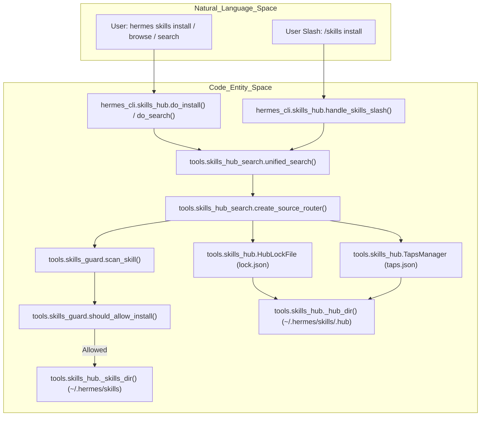
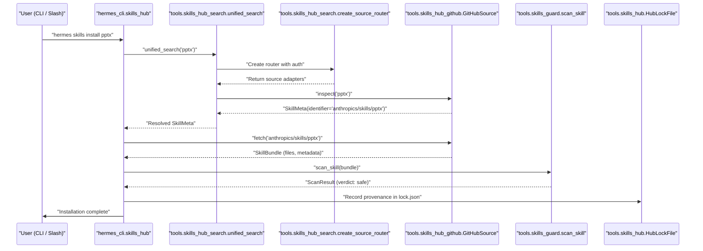
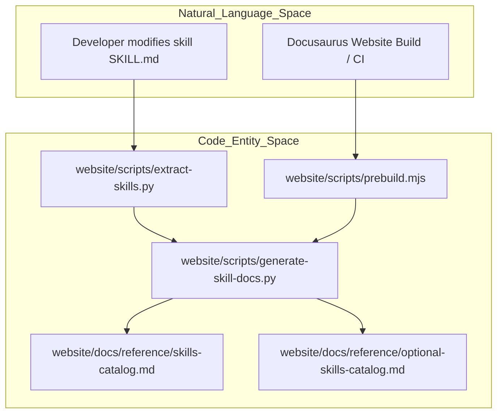
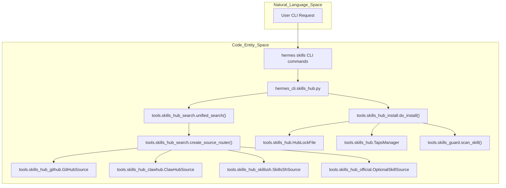
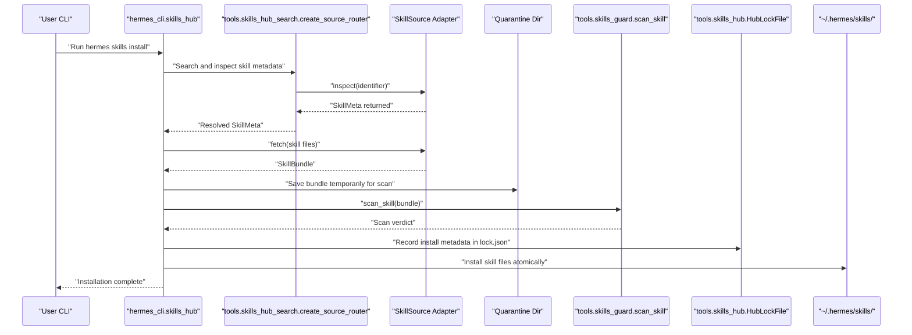

# Skills Hub

Relevant source files

The following files were used as context for generating this wiki page:

- [agent/skill_preprocessing.py](agent/skill_preprocessing.py)
- [apps/desktop/src/store/hub-actions.blocked.test.ts](apps/desktop/src/store/hub-actions.blocked.test.ts)
- [contributors/emails/dborodchuk@gmail.com](contributors/emails/dborodchuk@gmail.com)
- [hermes_cli/skills_hub.py](hermes_cli/skills_hub.py)
- [optional-skills/creative/impeccable/SKILL.md](optional-skills/creative/impeccable/SKILL.md)
- [optional-skills/software-development/grill-me/SKILL.md](optional-skills/software-development/grill-me/SKILL.md)
- [optional-skills/software-development/subagent-driven-development/SKILL.md](optional-skills/software-development/subagent-driven-development/SKILL.md)
- [scripts/build_skills_index.py](scripts/build_skills_index.py)
- [skills/autonomous-ai-agents/hermes-agent/SKILL.md](skills/autonomous-ai-agents/hermes-agent/SKILL.md)
- [skills/creative/songwriting-and-ai-music/SKILL.md](skills/creative/songwriting-and-ai-music/SKILL.md)
- [skills/software-development/simplify-code/SKILL.md](skills/software-development/simplify-code/SKILL.md)
- [tests/agent/test_skill_inline_shell_trust.py](tests/agent/test_skill_inline_shell_trust.py)
- [tests/hermes_cli/test_skills_failure_exit_code.py](tests/hermes_cli/test_skills_failure_exit_code.py)
- [tests/hermes_cli/test_skills_hub.py](tests/hermes_cli/test_skills_hub.py)
- [tests/hermes_cli/test_skills_provider_filter.py](tests/hermes_cli/test_skills_provider_filter.py)
- [tests/scripts/test_build_skills_index_health.py](tests/scripts/test_build_skills_index_health.py)
- [tests/scripts/test_build_skills_index_resolve.py](tests/scripts/test_build_skills_index_resolve.py)
- [tests/skills/test_authoring_standards.py](tests/skills/test_authoring_standards.py)
- [tests/tools/test_clawhub_owner_http.py](tests/tools/test_clawhub_owner_http.py)
- [tests/tools/test_clawhub_zip_stream.py](tests/tools/test_clawhub_zip_stream.py)
- [tests/tools/test_skill_bundle_provenance.py](tests/tools/test_skill_bundle_provenance.py)
- [tests/tools/test_skills_hub.py](tests/tools/test_skills_hub.py)
- [tests/tools/test_skills_hub_clawhub.py](tests/tools/test_skills_hub_clawhub.py)
- [tests/tools/test_skills_hub_github_fetch.py](tests/tools/test_skills_hub_github_fetch.py)
- [tests/website/__init__.py](tests/website/__init__.py)
- [tests/website/test_generate_skill_docs.py](tests/website/test_generate_skill_docs.py)
- [tools/skills_hub.py](tools/skills_hub.py)
- [tools/skills_hub_clawhub.py](tools/skills_hub_clawhub.py)
- [tools/skills_hub_github.py](tools/skills_hub_github.py)
- [tools/skills_hub_install.py](tools/skills_hub_install.py)
- [tools/skills_hub_models.py](tools/skills_hub_models.py)
- [tools/skills_hub_official.py](tools/skills_hub_official.py)
- [tools/skills_hub_search.py](tools/skills_hub_search.py)
- [tools/skills_hub_skillssh.py](tools/skills_hub_skillssh.py)
- [tools/skills_hub_sources.py](tools/skills_hub_sources.py)
- [website/docs/developer-guide/creating-skills.md](website/docs/developer-guide/creating-skills.md)
- [website/docs/reference/optional-skills-catalog.md](website/docs/reference/optional-skills-catalog.md)
- [website/docs/reference/skills-catalog.md](website/docs/reference/skills-catalog.md)
- [website/docs/user-guide/features/skills.md](website/docs/user-guide/features/skills.md)
- [website/docs/user-guide/skills/bundled/autonomous-ai-agents/autonomous-ai-agents-hermes-agent.md](website/docs/user-guide/skills/bundled/autonomous-ai-agents/autonomous-ai-agents-hermes-agent.md)
- [website/docs/user-guide/skills/bundled/creative/creative-p5js.md](website/docs/user-guide/skills/bundled/creative/creative-p5js.md)
- [website/docs/user-guide/skills/bundled/creative/creative-songwriting-and-ai-music.md](website/docs/user-guide/skills/bundled/creative/creative-songwriting-and-ai-music.md)
- [website/docs/user-guide/skills/bundled/productivity/productivity-notion.md](website/docs/user-guide/skills/bundled/productivity/productivity-notion.md)
- [website/docs/user-guide/skills/bundled/software-development/software-development-simplify-code.md](website/docs/user-guide/skills/bundled/software-development/software-development-simplify-code.md)
- [website/docs/user-guide/skills/optional/creative/creative-audiocraft-audio-generation.md](website/docs/user-guide/skills/optional/creative/creative-audiocraft-audio-generation.md)
- [website/docs/user-guide/skills/optional/creative/creative-heartmula.md](website/docs/user-guide/skills/optional/creative/creative-heartmula.md)
- [website/docs/user-guide/skills/optional/creative/creative-impeccable.md](website/docs/user-guide/skills/optional/creative/creative-impeccable.md)
- [website/docs/user-guide/skills/optional/mlops/mlops-evaluation-evaluating-llms-harness.md](website/docs/user-guide/skills/optional/mlops/mlops-evaluation-evaluating-llms-harness.md)
- [website/docs/user-guide/skills/optional/mlops/mlops-models-segment-anything-model.md](website/docs/user-guide/skills/optional/mlops/mlops-models-segment-anything-model.md)
- [website/docs/user-guide/skills/optional/mlops/mlops-tensorrt-llm.md](website/docs/user-guide/skills/optional/mlops/mlops-tensorrt-llm.md)
- [website/docs/user-guide/skills/optional/software-development/software-development-grill-me.md](website/docs/user-guide/skills/optional/software-development/software-development-grill-me.md)
- [website/i18n/zh-Hans/docusaurus-plugin-content-docs/current/developer-guide/creating-skills.md](website/i18n/zh-Hans/docusaurus-plugin-content-docs/current/developer-guide/creating-skills.md)
- [website/i18n/zh-Hans/docusaurus-plugin-content-docs/current/reference/optional-skills-catalog.md](website/i18n/zh-Hans/docusaurus-plugin-content-docs/current/reference/optional-skills-catalog.md)
- [website/i18n/zh-Hans/docusaurus-plugin-content-docs/current/reference/skills-catalog.md](website/i18n/zh-Hans/docusaurus-plugin-content-docs/current/reference/skills-catalog.md)
- [website/i18n/zh-Hans/docusaurus-plugin-content-docs/current/user-guide/skills/bundled/autonomous-ai-agents/autonomous-ai-agents-hermes-agent.md](website/i18n/zh-Hans/docusaurus-plugin-content-docs/current/user-guide/skills/bundled/autonomous-ai-agents/autonomous-ai-agents-hermes-agent.md)
- [website/i18n/zh-Hans/docusaurus-plugin-content-docs/current/user-guide/skills/bundled/creative/creative-songwriting-and-ai-music.md](website/i18n/zh-Hans/docusaurus-plugin-content-docs/current/user-guide/skills/bundled/creative/creative-songwriting-and-ai-music.md)
- [website/i18n/zh-Hans/docusaurus-plugin-content-docs/current/user-guide/skills/optional/creative/creative-heartmula.md](website/i18n/zh-Hans/docusaurus-plugin-content-docs/current/user-guide/skills/optional/creative/creative-heartmula.md)
- [website/scripts/generate-skill-docs.py](website/scripts/generate-skill-docs.py)
- [website/sidebars.ts](website/sidebars.ts)

## Purpose and Scope

The Skills Hub is a user-driven discovery, distribution, and installation subsystem for extending Hermes Agent capabilities [tools/skills_hub.py:3-14](). It connects to multiple registries—including official optional skills, GitHub repositories, taps, the `skills.sh` marketplace, and `ClawHub`—providing a unified interface for searching, inspecting, installing, and managing skills [tools/skills_hub.py:3-14](), [hermes_cli/skills_hub.py:2-12]().

**Key Principle:** The Skills Hub is exclusively user-operated. Agents themselves cannot autonomously install, modify, or delete hub skills without user interaction. Users manage the skill library via the `hermes skills` CLI or `/skills` slash commands [hermes_cli/skills_hub.py:3-11]().

**Security Model:** Every external skill passes through the `Skills Guard` scanner (`tools/skills_guard.py`) [tools/skills_guard.py:2-8](). Any detected dangerous patterns, such as data exfiltration, prompt injection, or destructive commands, trigger a block or require explicit user override depending on the source trust level [tools/skills_guard.py:26-34]().

Sources: [tools/skills_hub.py:3-14](), [hermes_cli/skills_hub.py:2-12](), [tools/skills_guard.py:2-8](), [tools/skills_guard.py:26-34]()

---

## Architecture Overview

The Skills Hub implements a layered architecture linking remote skill registries with local installations under `~/.hermes/skills/`, managed through CLI commands and slash handlers [tools/skills_hub.py:33-66](), [hermes_cli/skills_hub.py:2-15]().

### Skills Hub System Architecture

Sources: [tools/skills_hub.py:33-66](), [hermes_cli/skills_hub.py:2-15](), [tools/skills_guard.py:26-34]()

---

## Skill Resolution and Installation Data Flow

The flow from a user command to skill installation involves resolving short names, querying adapter registries, sandboxed quarantine, security scanning, and atomic installation [hermes_cli/skills_hub.py:48-95](), [tools/skills_guard.py:50-59]().

### Skill Installation Sequence

Sources: [hermes_cli/skills_hub.py:48-95](), [tools/skills_hub_models.py:24-80](), [tools/skills_guard.py:50-59]()

---

## Key Classes and Functions

| Entity | Code Location | Description |
|---|---|---|
| `SkillSource` (ABC) | [tools/skills_hub_models.py:24-80]() | Abstract base class defining the interface for all skill registry adapters with methods `search()`, `inspect()`, and `fetch()`. |
| `GitHubAuth` | [tools/skills_hub_github.py:73-108]() | Manages GitHub authentication via PAT, `gh` CLI, or GitHub App tokens. |
| `GitHubSource` | [tools/skills_hub_github.py:307-389]() | Skill adapter querying GitHub repositories using the Contents API, supporting trusted repos and caching. |
| `OptionalSkillSource` | [tools/skills_hub_official.py:245-275]() | Adapter providing access to official optional skills bundled in the repo, tagged as builtin trust with no scanning. |
| `HubLockFile` | [tools/skills_hub.py:200-202]() | Manages install provenance state for installed skills, tracking content hashes and metadata in `lock.json`. |
| `TapsManager` | [tools/skills_hub.py:200-202]() | Manages user-defined GitHub "taps" (external skill repositories) via persistent `taps.json`. |
| `unified_search()` | [tools/skills_hub_search.py:268]() | Performs aggregated search across multiple adapters for skill discovery with filtering. |
| `scan_skill()` | [tools/skills_guard.py:300-340]() | Regex-based static security scanner that applies threat patterns to skill bundles and computes verdicts. |
| `should_allow_install()` | [tools/skills_guard.py:85-110]() | Policy function determining if skill installation is allowed based on source trust level and scan verdict. |

Sources: [tools/skills_hub_models.py:24-80](), [tools/skills_hub_github.py:73-108](), [tools/skills_hub_github.py:307-389](), [tools/skills_hub_official.py:245-275](), [tools/skills_hub.py:200-202](), [tools/skills_guard.py:85-110](), [tools/skills_guard.py:300-340](), [tools/skills_hub_search.py:268]()

---

## Source Adapters

The Skills Hub integrates with multiple registry sources through pluggable adapters:

- **`GitHubSource`**: Queries GitHub repositories and sub-paths via the Contents API [tools/skills_hub_github.py:307-320](). It handles trusted repositories (`openai/skills`, `anthropics/skills`, `NVIDIA/skills`) [tools/skills_guard.py:24-25](), user taps, `skills.sh.json` grouping sidecars for category tagging [tests/tools/test_skills_hub.py:56-78](), and index caching with a 1-hour TTL [tools/skills_hub.py:43]().
- **`SkillsShSource`**: Proxies the `skills.sh` public AI skill marketplace API, returning unified JSON listings and forwarding fetches to `GitHubSource` [tools/skills_hub_skillssh.py:379]().
- **`ClawHubSource` & `LobeHubSource`**: Interface with ClawHub and LobeHub APIs/indices respectively to fetch community skill metadata, display names, tags, and file bundles [tests/tools/test_skills_hub_clawhub.py:37-67]().
- **`OptionalSkillSource`**: Exposes official optional skills delivered in the repository under `optional-skills/` [tools/skills_hub_official.py:245-255](). These carry `builtin` trust and bypass static scanning [tools/skills_guard.py:26-28]().

Sources: [tools/skills_hub.py:43](), [tools/skills_hub_official.py:245-275](), [tools/skills_hub_github.py:307-389](), [tools/skills_guard.py:24-28](), [tests/tools/test_skills_hub.py:56-78](), [tests/tools/test_skills_hub_clawhub.py:37-67](), [tools/skills_hub_skillssh.py:379]()

---

## Security, Provenance, and Skills Guard

Every external skill installed from a remote hub source is evaluated by `tools/skills_guard.py` [tools/skills_guard.py:2-6]() before writing to disk.

### Scan Verdicts and Install Policy

The `scan_skill()` function [tools/skills_guard.py:26-34]() checks files against regex threat patterns covering exfiltration (secret interpolation in `curl`/`wget`), prompt injection, destructive shell commands, and agent config modifications (`AGENTS.md`, `SOUL.md`) [tools/skills_guard.py:64-151]().

The installation policy enforced by `should_allow_install()` maps trust levels and verdicts [tools/skills_guard.py:26-34]():

| Trust Level | Safe | Caution | Dangerous |
| :---------- | :--- | :------ | :-------- |
| `builtin` | allow | allow | allow |
| `trusted` | allow | allow | block |
| `community` | allow | block | block |
| `agent-created` | allow | allow | ask |

The hub maintains installation provenance in `~/.hermes/skills/.hub/lock.json` via `HubLockFile`, tracking installed skill versions, content hashes, and source identifiers to prevent cross-registry hijacking and enable safe updates [tools/skills_hub.py:61](), [tests/hermes_cli/test_skills_hub.py:130-183]().

Sources: [tools/skills_guard.py:26-34](), [tools/skills_guard.py:64-151](), [tools/skills_hub.py:61](), [tests/hermes_cli/test_skills_hub.py:130-183]()

---

## Skills Catalog and Documentation Generation Pipeline

Hermes ships with extensive built-in and optional skill catalogs whose markdown documentation is maintained and automatically verified through dedicated repository scripts [website/docs/reference/skills-catalog.md:13-14](), [website/docs/reference/optional-skills-catalog.md:9-20]().

### Catalog Generation Pipeline

Sources: [website/docs/reference/skills-catalog.md:13-14](), [website/docs/reference/optional-skills-catalog.md:9-20]()

### Pipeline Detail

- **`website/scripts/extract-skills.py`**: Extracts inline skill definitions from markdown and JSON skill metadata, validating them against the [agentskills.io](https://agentskills.io/specification) standard for consistency and discoverability.
- **`website/scripts/generate-skill-docs.py`**: Parses `SKILL.md` files from `skills/` and `optional-skills/` directories, extracting frontmatter, descriptions, categories, tags, and source references. It generates the markdown skill catalog index files as well as individual skill documentation pages.
- **`website/scripts/prebuild.mjs`**: Integrates skill docs generation into the Docusaurus pre-build process, ensuring the static website docs and catalogs are always up-to-date with the code repository.

This pipeline ensures latest skill docs and metadata are published and consistent for both in-agent browsing and web-based skills browsing.

Sources: [website/docs/reference/skills-catalog.md:13-14](), [website/docs/reference/optional-skills-catalog.md:9-20]()

---

## Additional Diagrams Linking Natural Language to Code Entities

### User Interaction to Skill Source Resolution

Sources: [hermes_cli/skills_hub.py:1-1731](), [tools/skills_hub_search.py:1-268](), [tools/skills_hub_github.py:1-618](), [tools/skills_hub_clawhub.py:1-175](), [tools/skills_hub_skillssh.py:1-379](), [tools/skills_hub_official.py:1-275](), [tools/skills_hub.py:1-454](), [tools/skills_guard.py:1-340]()

### Skill Installation Flow Bridging CLI to Filesystem State

Sources: [hermes_cli/skills_hub.py:1-1731](), [tools/skills_hub_search.py:1-268](), [tools/skills_hub_github.py:1-618](), [tools/skills_hub_clawhub.py:1-175](), [tools/skills_hub_skillssh.py:1-379](), [tools/skills_hub_official.py:1-275](), [tools/skills_hub_install.py:1-100](), [tools/skills_hub.py:1-454](), [tools/skills_guard.py:1-340]()