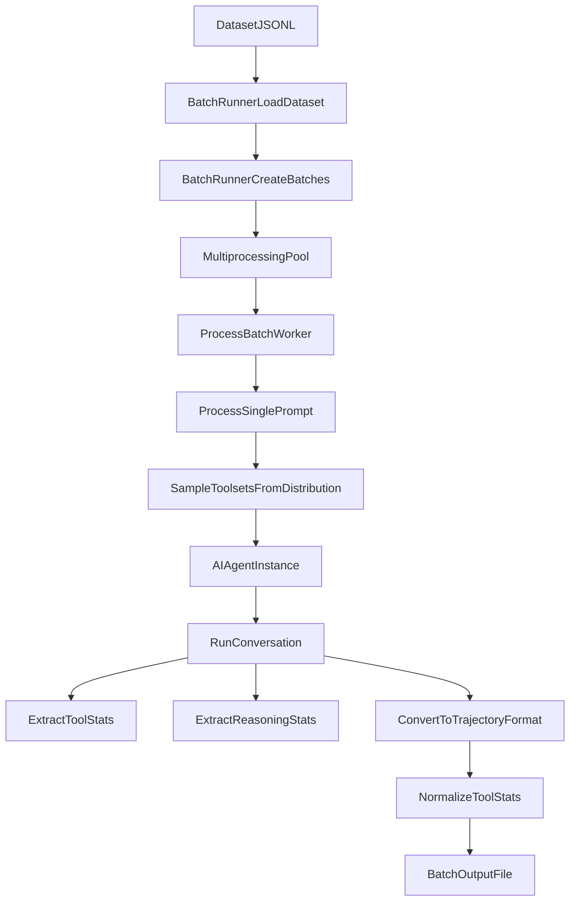
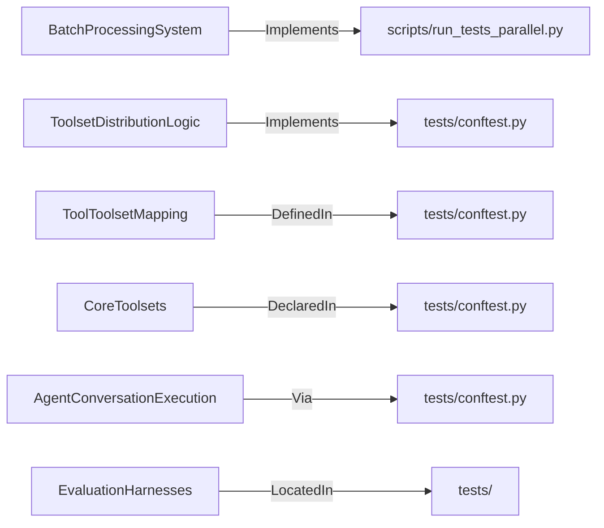

# Batch Processing and Evaluation

<details>
<summary>Relevant source files</summary>

The following files were used as context for generating this wiki page:

- [.github/CODEOWNERS](.github/CODEOWNERS)
- [.github/actionlint.yaml](.github/actionlint.yaml)
- [.github/actions/check-clean-worktree/action.yml](.github/actions/check-clean-worktree/action.yml)
- [.github/actions/detect-changes/action.yml](.github/actions/detect-changes/action.yml)
- [.github/actions/get-app-token/action.yml](.github/actions/get-app-token/action.yml)
- [.github/actions/nix-setup/action.yml](.github/actions/nix-setup/action.yml)
- [.github/workflows/catalog-tests.yml](.github/workflows/catalog-tests.yml)
- [.github/workflows/ci.yaml](.github/workflows/ci.yaml)
- [.github/workflows/contributor-check.yml](.github/workflows/contributor-check.yml)
- [.github/workflows/deploy-site.yml](.github/workflows/deploy-site.yml)
- [.github/workflows/docker-lint.yml](.github/workflows/docker-lint.yml)
- [.github/workflows/docs-site-checks.yml](.github/workflows/docs-site-checks.yml)
- [.github/workflows/history-check.yml](.github/workflows/history-check.yml)
- [.github/workflows/js-autofix.yml](.github/workflows/js-autofix.yml)
- [.github/workflows/label-rerun.yml](.github/workflows/label-rerun.yml)
- [.github/workflows/lint.yml](.github/workflows/lint.yml)
- [.github/workflows/live-providers.yml](.github/workflows/live-providers.yml)
- [.github/workflows/lockfile-diff.yml](.github/workflows/lockfile-diff.yml)
- [.github/workflows/nix.yml](.github/workflows/nix.yml)
- [.github/workflows/osv-scanner.yml](.github/workflows/osv-scanner.yml)
- [.github/workflows/profile-artifact-check.yml](.github/workflows/profile-artifact-check.yml)
- [.github/workflows/prompt-surface-diff.yml](.github/workflows/prompt-surface-diff.yml)
- [.github/workflows/remote-backends.yml](.github/workflows/remote-backends.yml)
- [.github/workflows/skills-index-freshness.yml](.github/workflows/skills-index-freshness.yml)
- [.github/workflows/skills-index.yml](.github/workflows/skills-index.yml)
- [.github/workflows/supply-chain-audit.yml](.github/workflows/supply-chain-audit.yml)
- [.github/workflows/tests-os.yml](.github/workflows/tests-os.yml)
- [.github/workflows/tests.yml](.github/workflows/tests.yml)
- [.github/workflows/uv-lockfile-check.yml](.github/workflows/uv-lockfile-check.yml)
- [scripts/ci/catalog_test_files.py](scripts/ci/catalog_test_files.py)
- [scripts/ci/check_catalog_cors.py](scripts/ci/check_catalog_cors.py)
- [scripts/ci/check_profile_archive_boundary.py](scripts/ci/check_profile_archive_boundary.py)
- [scripts/ci/classify_changes.py](scripts/ci/classify_changes.py)
- [scripts/ci/prompt_surface.py](scripts/ci/prompt_surface.py)
- [scripts/ci/required_results.py](scripts/ci/required_results.py)
- [scripts/ci/start_test_sshd.sh](scripts/ci/start_test_sshd.sh)
- [scripts/ci/test_sshd_container_setup.sh](scripts/ci/test_sshd_container_setup.sh)
- [scripts/run_tests.sh](scripts/run_tests.sh)
- [scripts/run_tests_parallel.py](scripts/run_tests_parallel.py)
- [tests/ci/test_check_catalog_cors.py](tests/ci/test_check_catalog_cors.py)
- [tests/ci/test_classify_changes.py](tests/ci/test_classify_changes.py)
- [tests/ci/test_clean_worktree_check.py](tests/ci/test_clean_worktree_check.py)
- [tests/ci/test_prompt_surface.py](tests/ci/test_prompt_surface.py)
- [tests/ci/test_required_results.py](tests/ci/test_required_results.py)
- [tests/ci/test_update_ci_routing.py](tests/ci/test_update_ci_routing.py)
- [tests/ci/test_update_transitive_routing.py](tests/ci/test_update_transitive_routing.py)
- [tests/ci/workflow_steps.py](tests/ci/workflow_steps.py)
- [tests/conftest.py](tests/conftest.py)
- [tests/hermes_cli/test_reasoning_effort_menu.py](tests/hermes_cli/test_reasoning_effort_menu.py)
- [tests/scripts/install/test_install_ps1_native_calls.py](tests/scripts/install/test_install_ps1_native_calls.py)
- [tests/scripts/test_run_tests_parallel.py](tests/scripts/test_run_tests_parallel.py)
- [tests/test_basetemp_isolation.py](tests/test_basetemp_isolation.py)
- [tests/tools/test_browser_supervisor_capture.py](tests/tools/test_browser_supervisor_capture.py)
- [tests/tools/test_browser_supervisor_capture_dispatch.py](tests/tools/test_browser_supervisor_capture_dispatch.py)
- [tests/tools/test_docker_backend_real.py](tests/tools/test_docker_backend_real.py)
- [tests/website/test_fetch_plugin_stars.py](tests/website/test_fetch_plugin_stars.py)
- [tools/browser_supervisor_capture.py](tools/browser_supervisor_capture.py)
- [website/scripts/fetch-plugin-stars.py](website/scripts/fetch-plugin-stars.py)
- [website/scripts/prebuild.mjs](website/scripts/prebuild.mjs)

</details>


## Purpose and Scope

This page provides a high-level overview of the batch processing system and evaluation harnesses within Hermes Agent. The batch system orchestrates running the agent over many prompt inputs in parallel, sampling tool configurations, managing checkpoints, trajectory compression, data collection, and producing structured output data suitable for training and analysis. In addition, evaluation harnesses under `evals/` validate agent capabilities such as compaction recall, browser automation, codebase navigation, core tool deferral, and resource benchmarking.

As a parent page, this document outlines the high-level architecture. For detailed implementations, consult the child pages:

- [Batch Runner](#9.1) — Document BatchRunner architecture (`batch_runner.py`), parallelization, checkpointing, durability, and fault tolerance
- [Toolset Distributions](#9.2) — Explain toolset distribution sampling, probability-based selection, and tool configuration for batch runs
- [Data Generation and Trajectories](#9.3) — Cover trajectory format, tool statistics extraction, reasoning metrics, data normalization, datagen config examples, trajectory compression, and `mini_swe_runner`
- [Evaluation Harnesses](#9.4) — Document the `evals/` directory harnesses: compaction recall, browser-use, codebase navigability, core tool deferral, readtool, session search schema, and fanout resource benchmark

Sources: [tests/conftest.py:1-20]()

---

## Overview

The batch processing system enables large-scale generation of conversation trajectories by running the `AIAgent` over numerous prompt inputs in parallel worker pools. It samples toolset configurations according to defined probabilistic distributions, runs agent conversations that log tool call activities and reasoning progress, aggregates usage statistics, and outputs structured datasets for evaluation or training.

Key points include:

- The core batch processing is driven by `batch_runner.py`, which handles dataset reading, batch splitting, multiprocessing, checkpointing, and output file management [tests/conftest.py:1-15]().
- Toolsets are sampled per prompt based on configured distributions to diversify tool availability and usage patterns [tests/conftest.py:10-25]().
- The orchestration uses the `AIAgent` class to perform inference loops, conversation steps, and trajectory conversion.
- Specialized runners gather targeted benchmark data with sandboxed backend execution support.

Sources: [tests/conftest.py:1-20]()

---

## Batch Runner Architecture

### Pipeline and Parallelization

The batch runner operates by reading prompt data from datasets, splitting them into batches of prompt indices paired with corresponding prompt details. Worker pools distribute these batches among background processes to achieve concurrent execution and increased throughput [scripts/run_tests_parallel.py:45-59]().

Within each worker process:
- An isolated agent instance is created, configured to omit extraneous memory or session storage states to ensure runs are stateless and isolated.
- Toolsets are randomly sampled according to configured probabilities.
- The agent is run on the prompt, returning a stream of messages enriched with metadata about tool calls and assistant internal scratchpads.
- Tool call statistics including counts, successes, failures, and timing are extracted and normalized.
- Batch results are checkpointed after processing to support resumability and fault tolerance.

For details, see [Batch Runner](#9.1).

Sources: [scripts/run_tests_parallel.py:45-59]()

---

## Toolset Distributions

To diversify agent behavior and tool usage patterns across batch runs, Hermes implements a probabilistic sampling mechanism for toolsets to enable on a per-prompt basis.

### Sampling Process

- Each toolset in a distribution has an associated probability; the sampling function iterates over them and includes each toolset if a uniform random roll is below the target probability.
- If no toolsets get selected by sampling, a fallback ensures that the most probable toolset is included, preventing empty toolset runs.
- The resulting sampled toolsets are used to assemble the effective tool configuration injected into the agent runtime.

For details, see [Toolset Distributions](#9.2).

Sources: [tests/conftest.py:1-15]()

---

## Data Generation, Trajectories, and Statistics

The conversation trajectories generated during batch runs record structured information regarding each prompt interaction, including:

- The agent's messages, tool call invocations, and their results.
- Tool usage statistics such as the number of calls, successes, failures, and related counts grouped by toolset and individual tool keys.
- Reasoning metrics extracted by detecting assistant latent scratchpad tokens and progress markers.

The batch runner normalizes the tool statistics schema according to the union of all known tools and toolsets, ensuring consistency across samples.

For configurations and examples involving the trajectory format, tool statistics, reasoning metrics extraction, data normalization, as well as specialized runners used for software engineering benchmark data, see [Data Generation and Trajectories](#9.3).

Sources: [tests/conftest.py:1-15]()

---

## Evaluation Harnesses

The evaluation system under the `evals/` directory comprises several specialized harnesses that test and benchmark agent performance in practical and technical domains:

- **Compaction Recall:** Assesses the agent’s ability to recall persistent information after context compression events.
- **Browser-Use:** Tests automated web navigation and interaction tools.
- **Codebase Navigability:** Measures the agent’s capacity to find code symbols, traverse file system paths, and work with LSP semantic diagnostics.
- **Core Tool Deferral:** Evaluates whether the agent properly defers non-core knowledge tasks to external tools.
- **Readtool & Session Search:** Benchmarks file reading operation speeds and effectiveness of session search.
- **Fanout Resource Benchmark:** Evaluates the resource consumption of parallel task execution in the agent environment.

For implementation details and usage patterns, see [Evaluation Harnesses](#9.4).

Sources: [tests/conftest.py:1-20]()

---

## Architecture Bridging Natural Language Concepts to Code Entities

### Batch Processing Component Relationships Diagram

Title: "Batch Processing Component Relationships"



Sources: [scripts/run_tests_parallel.py:45-59]()

### Domain Terminology to Code Mapping Diagram

Title: "Domain Terminology to Code Mapping"



Sources: [tests/conftest.py:1-20]()

---

## Usage Examples

### Running a batch with specified options

```bash
python batch_runner.py \
  --dataset_file=data/prompts.jsonl \
  --batch_size=10 \
  --run_name=science_run \
  --distribution=image_gen \
  --num_workers=4
```

This command runs batch inference on prompts from `data/prompts.jsonl` in batches of 10, selecting toolsets based on the `image_gen` distribution, using 4 parallel worker processes. Results are checkpointed and saved under a run name `science_run`.

### Resuming a batch run safely after interruption

```bash
python batch_runner.py \
  --dataset_file=data/prompts.jsonl \
  --batch_size=10 \
  --run_name=science_run \
  --resume
```

Using the `--resume` flag, the batch runner picks up from the last saved checkpoint, saving prior work and avoiding redundant computation.

Sources: [tests/conftest.py:1-20]()

---

# Child Pages

- [Batch Runner](#9.1)
- [Toolset Distributions](#9.2)
- [Data Generation and Trajectories](#9.3)
- [Evaluation Harnesses](#9.4)