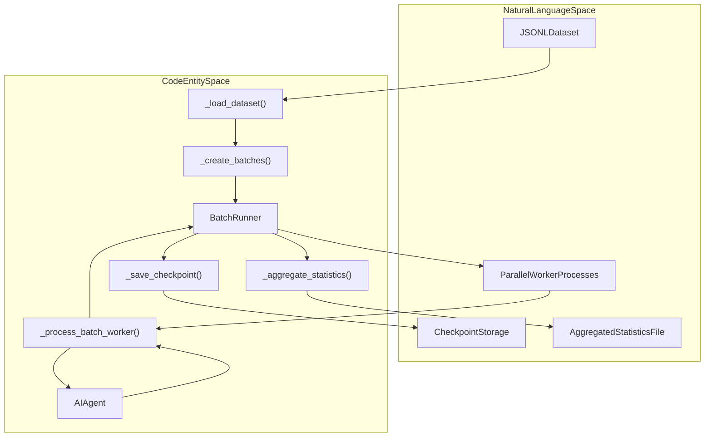
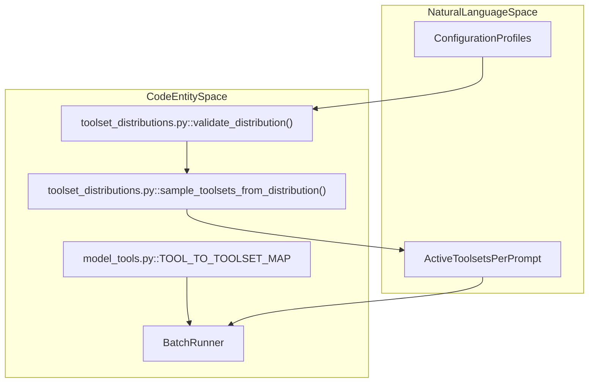

# Batch Runner

Relevant source files

The following files were used as context for generating this wiki page:

- [.github/CODEOWNERS](.github/CODEOWNERS)
- [.github/actionlint.yaml](.github/actionlint.yaml)
- [.github/actions/check-clean-worktree/action.yml](.github/actions/check-clean-worktree/action.yml)
- [.github/actions/detect-changes/action.yml](.github/actions/detect-changes/action.yml)
- [.github/actions/get-app-token/action.yml](.github/actions/get-app-token/action.yml)
- [.github/actions/nix-setup/action.yml](.github/actions/nix-setup/action.yml)
- [.github/workflows/catalog-tests.yml](.github/workflows/catalog-tests.yml)
- [.github/workflows/ci.yaml](.github/workflows/ci.yaml)
- [.github/workflows/contributor-check.yml](.github/workflows/contributor-check.yml)
- [.github/workflows/deploy-site.yml](.github/workflows/deploy-site.yml)
- [.github/workflows/docker-lint.yml](.github/workflows/docker-lint.yml)
- [.github/workflows/docs-site-checks.yml](.github/workflows/docs-site-checks.yml)
- [.github/workflows/history-check.yml](.github/workflows/history-check.yml)
- [.github/workflows/js-autofix.yml](.github/workflows/js-autofix.yml)
- [.github/workflows/label-rerun.yml](.github/workflows/label-rerun.yml)
- [.github/workflows/lint.yml](.github/workflows/lint.yml)
- [.github/workflows/live-providers.yml](.github/workflows/live-providers.yml)
- [.github/workflows/lockfile-diff.yml](.github/workflows/lockfile-diff.yml)
- [.github/workflows/nix.yml](.github/workflows/nix.yml)
- [.github/workflows/osv-scanner.yml](.github/workflows/osv-scanner.yml)
- [.github/workflows/profile-artifact-check.yml](.github/workflows/profile-artifact-check.yml)
- [.github/workflows/prompt-surface-diff.yml](.github/workflows/prompt-surface-diff.yml)
- [.github/workflows/remote-backends.yml](.github/workflows/remote-backends.yml)
- [.github/workflows/skills-index-freshness.yml](.github/workflows/skills-index-freshness.yml)
- [.github/workflows/skills-index.yml](.github/workflows/skills-index.yml)
- [.github/workflows/supply-chain-audit.yml](.github/workflows/supply-chain-audit.yml)
- [.github/workflows/tests-os.yml](.github/workflows/tests-os.yml)
- [.github/workflows/tests.yml](.github/workflows/tests.yml)
- [.github/workflows/uv-lockfile-check.yml](.github/workflows/uv-lockfile-check.yml)
- [agent/tool_dispatch_helpers.py](agent/tool_dispatch_helpers.py)
- [agent/tool_executor.py](agent/tool_executor.py)
- [model_tools.py](model_tools.py)
- [scripts/ci/catalog_test_files.py](scripts/ci/catalog_test_files.py)
- [scripts/ci/check_catalog_cors.py](scripts/ci/check_catalog_cors.py)
- [scripts/ci/check_profile_archive_boundary.py](scripts/ci/check_profile_archive_boundary.py)
- [scripts/ci/classify_changes.py](scripts/ci/classify_changes.py)
- [scripts/ci/prompt_surface.py](scripts/ci/prompt_surface.py)
- [scripts/ci/required_results.py](scripts/ci/required_results.py)
- [scripts/ci/start_test_sshd.sh](scripts/ci/start_test_sshd.sh)
- [scripts/ci/test_sshd_container_setup.sh](scripts/ci/test_sshd_container_setup.sh)
- [scripts/run_tests.sh](scripts/run_tests.sh)
- [scripts/run_tests_parallel.py](scripts/run_tests_parallel.py)
- [tests/agent/test_tool_dispatch_helpers.py](tests/agent/test_tool_dispatch_helpers.py)
- [tests/ci/test_check_catalog_cors.py](tests/ci/test_check_catalog_cors.py)
- [tests/ci/test_classify_changes.py](tests/ci/test_classify_changes.py)
- [tests/ci/test_clean_worktree_check.py](tests/ci/test_clean_worktree_check.py)
- [tests/ci/test_prompt_surface.py](tests/ci/test_prompt_surface.py)
- [tests/ci/test_required_results.py](tests/ci/test_required_results.py)
- [tests/ci/test_update_ci_routing.py](tests/ci/test_update_ci_routing.py)
- [tests/ci/test_update_transitive_routing.py](tests/ci/test_update_transitive_routing.py)
- [tests/ci/workflow_steps.py](tests/ci/workflow_steps.py)
- [tests/conftest.py](tests/conftest.py)
- [tests/hermes_cli/test_reasoning_effort_menu.py](tests/hermes_cli/test_reasoning_effort_menu.py)
- [tests/scripts/install/test_install_ps1_native_calls.py](tests/scripts/install/test_install_ps1_native_calls.py)
- [tests/scripts/test_run_tests_parallel.py](tests/scripts/test_run_tests_parallel.py)
- [tests/test_basetemp_isolation.py](tests/test_basetemp_isolation.py)
- [tests/tools/test_browser_supervisor_capture.py](tests/tools/test_browser_supervisor_capture.py)
- [tests/tools/test_browser_supervisor_capture_dispatch.py](tests/tools/test_browser_supervisor_capture_dispatch.py)
- [tests/tools/test_completed_process_results.py](tests/tools/test_completed_process_results.py)
- [tests/tools/test_docker_backend_real.py](tests/tools/test_docker_backend_real.py)
- [tests/tools/test_process_wait_auto_notify.py](tests/tools/test_process_wait_auto_notify.py)
- [tests/website/test_fetch_plugin_stars.py](tests/website/test_fetch_plugin_stars.py)
- [tools/__init__.py](tools/__init__.py)
- [tools/browser_supervisor_capture.py](tools/browser_supervisor_capture.py)
- [tools/process_registry_results.py](tools/process_registry_results.py)
- [tools/process_registry_wait_policy.py](tools/process_registry_wait_policy.py)
- [toolsets.py](toolsets.py)
- [website/docs/developer-guide/adding-tools.md](website/docs/developer-guide/adding-tools.md)
- [website/docs/developer-guide/tools-runtime.md](website/docs/developer-guide/tools-runtime.md)
- [website/docs/integrations/index.md](website/docs/integrations/index.md)
- [website/docs/reference/tools-reference.md](website/docs/reference/tools-reference.md)
- [website/docs/reference/toolsets-reference.md](website/docs/reference/toolsets-reference.md)
- [website/docs/user-guide/features/overview.md](website/docs/user-guide/features/overview.md)
- [website/docs/user-guide/features/tools.md](website/docs/user-guide/features/tools.md)
- [website/i18n/zh-Hans/docusaurus-plugin-content-docs/current/developer-guide/tools-runtime.md](website/i18n/zh-Hans/docusaurus-plugin-content-docs/current/developer-guide/tools-runtime.md)
- [website/i18n/zh-Hans/docusaurus-plugin-content-docs/current/reference/tools-reference.md](website/i18n/zh-Hans/docusaurus-plugin-content-docs/current/reference/tools-reference.md)
- [website/i18n/zh-Hans/docusaurus-plugin-content-docs/current/reference/toolsets-reference.md](website/i18n/zh-Hans/docusaurus-plugin-content-docs/current/reference/toolsets-reference.md)
- [website/i18n/zh-Hans/docusaurus-plugin-content-docs/current/user-guide/features/browser.md](website/i18n/zh-Hans/docusaurus-plugin-content-docs/current/user-guide/features/browser.md)
- [website/i18n/zh-Hans/docusaurus-plugin-content-docs/current/user-guide/features/tools.md](website/i18n/zh-Hans/docusaurus-plugin-content-docs/current/user-guide/features/tools.md)
- [website/scripts/fetch-plugin-stars.py](website/scripts/fetch-plugin-stars.py)
- [website/scripts/prebuild.mjs](website/scripts/prebuild.mjs)

The Batch Runner provides parallel batch processing capabilities for running the `AIAgent` across multiple prompts sourced from datasets. It enables scalable execution with multiprocessing, checkpointing for fault tolerance, probabilistic toolset distribution sampling, and aggregation of detailed tool usage and reasoning statistics. The output consists of trajectory files formatted for training or analysis.

This page documents the Batch Runner architecture, key classes/functions, data flow, parallelization strategy, checkpointing and resume mechanisms, and statistical post-processing.

Sources: [batch_runner.py:1-21](), [batch_runner.py:231-508](), [batch_runner.py:511-619](), [batch_runner.py:667-833](), [batch_runner.py:712-754](), [batch_runner.py:870-916](), [toolset_distributions.py:50-54](), [model_tools.py:14]()

---

## BatchRunner Class

The `BatchRunner` class is the core orchestrator of the batch processing pipeline. It manages dataset loading, batching, parallel prompt execution, checkpointing state, and statistics aggregation.

### Initialization

The constructor of `BatchRunner` takes several key parameters:

| Parameter | Type | Default | Description |
|-----------|------|---------|-------------|
| `dataset_file` | `str` | required | Path to a JSONL file containing input prompts |
| `batch_size` | `int` | required | Number of prompts to process in one batch |
| `run_name` | `str` | required | Unique identifier for the run, used for checkpoint and output storage |
| `distribution` | `str` | `"default"` | Toolset distribution name to define the enabled toolsets per prompt |
| `max_iterations` | `int` | `10` | Maximum number of iterations per prompt for the agent |
| `model` | `str` | `"claude-opus-4-20250514"` | Model ID for the LLM to be used |
| `num_workers` | `int` | `4` | Number of parallel worker processes (multiprocessing) |
| `ephemeral_system_prompt` | `Optional[str]` | `None` | A system prompt to inject but omit from trajectory logs |
| `max_samples` | `Optional[int]` | `None` | Optional limit on the number of dataset samples to load |
| `prefill_messages` | `Optional[List[dict]]` | `None` | Few-shot messages prepended to all conversations |

On initialization, the `BatchRunner`:
- Validates that the chosen toolset distribution exists and is valid by calling `validate_distribution()` from `toolset_distributions.py`.
- Loads and parses the input dataset JSONL file into memory and truncates if `max_samples` is specified.
- Splits the dataset into multiple batches, each of size `batch_size`, maintaining the original prompt indices for reference.

Sources: [batch_runner.py:511-619](), [toolset_distributions.py:53-54]()

### Key Methods

- `_load_dataset()`: Loads the JSONL dataset from `dataset_file` and converts it into a list of samples. [batch_runner.py:560-579]()
- `_create_batches()`: Divides the list of loaded samples into batches, each holding up to `batch_size` prompts. [batch_runner.py:581-590]()
- `_load_checkpoint()`: Reads and parses an existing checkpoint file (`checkpoint.json`) if resuming a previous run. [batch_runner.py:667-691]()
- `_scan_completed_prompts_by_content()`: Implements a content-based resume logic by hashing prompt text to avoid re-processing prompts even if dataset ordering or indices change. [batch_runner.py:712-754]()
- `run(resume: bool = False)`: Entry point to execute the batch run either fresh or resuming from checkpoint. Manages the multiprocessing pool and result aggregation. [batch_runner.py:870-916]()
- `_process_batch_worker()`: The worker function executed in subprocesses. For each prompt in the batch, it instantiates an `AIAgent` and runs the conversation loop, isolating state per prompt using a unique `task_id`. [batch_runner.py:231-508]()

Sources: [batch_runner.py:231-508](), [batch_runner.py:560-579](), [batch_runner.py:581-590](), [batch_runner.py:667-691](), [batch_runner.py:712-754](), [batch_runner.py:870-916]()

---

## System Architecture and Data Flow

The Batch Runner processes are organized as follows:
- Dataset JSONL file is loaded and split into batches.
- A multiprocessing pool dispatches batches to separate worker processes.
- Each worker runs all prompts in its assigned batch sequentially.
- Results and statistics are returned to the main process.
- Checkpoint files are written atomically to enable resume on failure.
- Aggregated statistics from all batches are combined and saved.

### Natural Language to Code Entity Mapping: Data Flow

Sources: [batch_runner.py:231-508](), [batch_runner.py:511-998](), [batch_runner.py:712-754]()

---

## Parallelization and Fault Tolerance

### Multiprocessing Architecture
The `BatchRunner` leverages Python's `multiprocessing.Pool` to parallelize batch execution:
- The full prompt dataset is partitioned into batches of `batch_size`. [batch_runner.py:581-590]()
- Each batch is dispatched independently to a worker process. [batch_runner.py:870-916]()
- Within a worker, prompts are executed sequentially. [batch_runner.py:231-508]()
- Results are asynchronously collected using `imap_unordered()` from the multiprocessing pool. [batch_runner.py:899]()

### Task Isolation
- Each prompt's execution is fully isolated with a `task_id` incorporated in session prefixes and container overrides to prevent state contamination between parallel runs. [batch_runner.py:245-300]()
- The `_process_batch_worker` function creates a fresh `AIAgent` instance per prompt, with all memory and session state scoped by `task_id`. [batch_runner.py:302-303]()

### Checkpointing and Resume
- Checkpoint files (`checkpoint.json`) track finished prompt indices and aggregate batch statistics. [batch_runner.py:667-691]()
- Checkpoint writes are atomic using a tempfile + rename pattern to avoid corruption. [batch_runner.py:796-833]()
- Resuming a batch run reads this checkpoint, preserving last known state. [batch_runner.py:667-691]()
- A content-based resume mechanism hashes prompt texts to detect already completed prompts by content rather than index. [batch_runner.py:712-754]()

Sources: [batch_runner.py:245-300](), [batch_runner.py:302-303](), [batch_runner.py:581-590](), [batch_runner.py:667-691](), [batch_runner.py:712-754](), [batch_runner.py:796-833](), [batch_runner.py:816-833](), [batch_runner.py:870-916](), [batch_runner.py:899]()

---

## Toolset Distribution Sampling

The Batch Runner supports multiple toolset distributions, defining which tools are active for each prompt during execution.
- Toolset distributions are defined in `toolset_distributions.py` and validated by `validate_distribution()` upon initialization. [toolset_distributions.py:52-54]()
- The function `sample_toolsets_from_distribution(distribution)` probabilistically selects toolsets for each prompt run. [toolset_distributions.py:50-54]()
- Underlying tool-to-toolset mappings are maintained in `model_tools.py` as `TOOL_TO_TOOLSET_MAP`. [model_tools.py:14]()

### Toolset Mapping Diagram

Sources: [batch_runner.py:231-508](), [model_tools.py:14](), [toolset_distributions.py:50-54](), [toolset_distributions.py:52-54]()

---

## Statistics Extraction and Normalization

### Tool Usage Statistics
- The method `_extract_tool_stats(messages)` aggregates counts of total tool calls, successes, and failures. [batch_runner.py:71-122]()
- The helper `_normalize_tool_stats()` merges these counts with a canonical master list (`ALL_POSSIBLE_TOOLS`). [batch_runner.py:125-192]()

### Reasoning Turn Coverage
- `_extract_reasoning_stats(messages)` inspects conversation messages to detect explicit or internal reasoning turns. [batch_runner.py:195-228]()
- Samples lacking reasoning coverage are discarded at run time to ensure high-quality trajectory data. [batch_runner.py:439-444]()

Sources: [batch_runner.py:71-122](), [batch_runner.py:125-192](), [batch_runner.py:195-228](), [batch_runner.py:439-444]()

---

## Output and Trajectory Format

### Trajectory Saving
- After processing each prompt, internal conversation data is converted into trajectory formats. [agent/trajectory.py]()
- Trajectory files are saved under the output directory with filenames preserving prompt indices. [batch_runner.py:457-467]()

### Summary Statistics File
- Upon batch completion, aggregated run statistics are saved as `statistics.json`. [batch_runner.py:962-998]()

Sources: [batch_runner.py:457-467](), [batch_runner.py:962-998](), [agent/trajectory.py]()

---

# Summary

The `BatchRunner` enables scalable, fault-tolerant batch execution of Hermes Agent conversations on large prompt datasets through multiprocessing, per-prompt task isolation, atomic checkpointing, and detailed statistical extraction.

Sources: [batch_runner.py:1-1000](), [toolset_distributions.py:50-54](), [model_tools.py:14]()