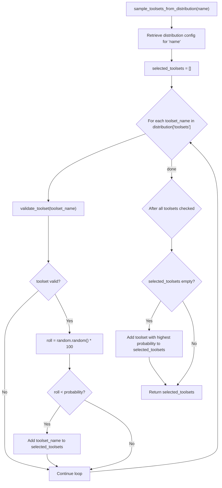
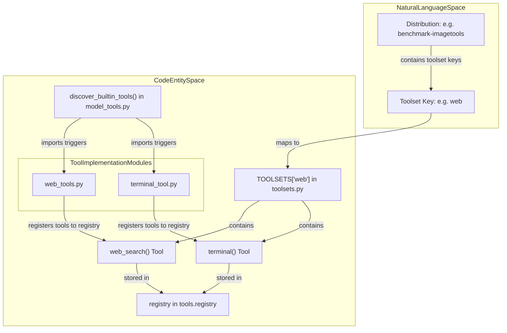

# Toolset Distributions

<details>
<summary>Relevant source files</summary>

The following files were used as context for generating this wiki page:

- [.dockerignore](.dockerignore)
- [.gitignore](.gitignore)
- [.hadolint.yaml](.hadolint.yaml)
- [Dockerfile](Dockerfile)
- [agent/tool_dispatch_helpers.py](agent/tool_dispatch_helpers.py)
- [agent/tool_executor.py](agent/tool_executor.py)
- [contributors/emails/dstkwll@users.noreply.github.com](contributors/emails/dstkwll@users.noreply.github.com)
- [docker-compose.yml](docker-compose.yml)
- [docker/cont-init.d/02-reconcile-profiles](docker/cont-init.d/02-reconcile-profiles)
- [docker/entrypoint-dispatch.sh](docker/entrypoint-dispatch.sh)
- [docker/entrypoint.sh](docker/entrypoint.sh)
- [docker/main-wrapper.sh](docker/main-wrapper.sh)
- [docker/s6-rc.d/dashboard/run](docker/s6-rc.d/dashboard/run)
- [docker/stage2-hook.sh](docker/stage2-hook.sh)
- [hermes_cli/container_boot.py](hermes_cli/container_boot.py)
- [hermes_cli/copilot_auth.py](hermes_cli/copilot_auth.py)
- [hermes_cli/dashboard_register.py](hermes_cli/dashboard_register.py)
- [hermes_cli/main_profile_recovery.py](hermes_cli/main_profile_recovery.py)
- [hermes_cli/service_manager.py](hermes_cli/service_manager.py)
- [hermes_time.py](hermes_time.py)
- [model_tools.py](model_tools.py)
- [registration_lifecycle.py](registration_lifecycle.py)
- [scripts/docker_rebootstrap_nous_session.py](scripts/docker_rebootstrap_nous_session.py)
- [setup.py](setup.py)
- [tests/agent/test_tool_dispatch_helpers.py](tests/agent/test_tool_dispatch_helpers.py)
- [tests/cron/test_timezone.py](tests/cron/test_timezone.py)
- [tests/dashboard/test_ws_client_host.py](tests/dashboard/test_ws_client_host.py)
- [tests/docker/__init__.py](tests/docker/__init__.py)
- [tests/docker/conftest.py](tests/docker/conftest.py)
- [tests/docker/test_container_restart.py](tests/docker/test_container_restart.py)
- [tests/docker/test_dashboard.py](tests/docker/test_dashboard.py)
- [tests/docker/test_gateway_run_supervised.py](tests/docker/test_gateway_run_supervised.py)
- [tests/docker/test_interactive_logging.py](tests/docker/test_interactive_logging.py)
- [tests/docker/test_main_invocation.py](tests/docker/test_main_invocation.py)
- [tests/docker/test_profile_gateway.py](tests/docker/test_profile_gateway.py)
- [tests/docker/test_s6_profile_gateway_integration.py](tests/docker/test_s6_profile_gateway_integration.py)
- [tests/docker/test_tui_passthrough.py](tests/docker/test_tui_passthrough.py)
- [tests/docker/test_zombie_reaping.py](tests/docker/test_zombie_reaping.py)
- [tests/hermes_cli/test_apply_profile_override.py](tests/hermes_cli/test_apply_profile_override.py)
- [tests/hermes_cli/test_container_boot.py](tests/hermes_cli/test_container_boot.py)
- [tests/hermes_cli/test_copilot_auth.py](tests/hermes_cli/test_copilot_auth.py)
- [tests/hermes_cli/test_copilot_token_exchange.py](tests/hermes_cli/test_copilot_token_exchange.py)
- [tests/hermes_cli/test_credential_pool_off_loop.py](tests/hermes_cli/test_credential_pool_off_loop.py)
- [tests/hermes_cli/test_dashboard_register.py](tests/hermes_cli/test_dashboard_register.py)
- [tests/hermes_cli/test_doctor_terminal_backends.py](tests/hermes_cli/test_doctor_terminal_backends.py)
- [tests/hermes_cli/test_gateway_s6_dispatch.py](tests/hermes_cli/test_gateway_s6_dispatch.py)
- [tests/hermes_cli/test_profile_export_default_path.py](tests/hermes_cli/test_profile_export_default_path.py)
- [tests/hermes_cli/test_profiles_s6_hooks.py](tests/hermes_cli/test_profiles_s6_hooks.py)
- [tests/hermes_cli/test_service_manager.py](tests/hermes_cli/test_service_manager.py)
- [tests/hermes_cli/test_setup_terminal.py](tests/hermes_cli/test_setup_terminal.py)
- [tests/hermes_cli/test_terminal_backend_docker_probe.py](tests/hermes_cli/test_terminal_backend_docker_probe.py)
- [tests/hermes_cli/test_update_flat_install_state_gitignore.py](tests/hermes_cli/test_update_flat_install_state_gitignore.py)
- [tests/tools/test_completed_process_results.py](tests/tools/test_completed_process_results.py)
- [tests/tools/test_docker_find.py](tests/tools/test_docker_find.py)
- [tests/tools/test_docker_rebootstrap_nous_session.py](tests/tools/test_docker_rebootstrap_nous_session.py)
- [tests/tools/test_process_wait_auto_notify.py](tests/tools/test_process_wait_auto_notify.py)
- [tests/tools/test_stage2_hook_api_server_keygen.py](tests/tools/test_stage2_hook_api_server_keygen.py)
- [tests/tools/test_stage2_hook_nous_routing_env.py](tests/tools/test_stage2_hook_nous_routing_env.py)
- [tests/tools/test_stage2_hook_seed_one_symlinks.py](tests/tools/test_stage2_hook_seed_one_symlinks.py)
- [tests/tools/test_stage2_hook_symlink_chown.py](tests/tools/test_stage2_hook_symlink_chown.py)
- [tests/tui_gateway/test_cold_start_gil_stall.py](tests/tui_gateway/test_cold_start_gil_stall.py)
- [tests/tui_gateway/test_entry_sys_path.py](tests/tui_gateway/test_entry_sys_path.py)
- [tests/tui_gateway/test_subprocess_encoding.py](tests/tui_gateway/test_subprocess_encoding.py)
- [tools/__init__.py](tools/__init__.py)
- [tools/process_registry_results.py](tools/process_registry_results.py)
- [tools/process_registry_wait_policy.py](tools/process_registry_wait_policy.py)
- [toolset_distributions.py](toolset_distributions.py)
- [toolsets.py](toolsets.py)
- [website/docs/developer-guide/adding-tools.md](website/docs/developer-guide/adding-tools.md)
- [website/docs/developer-guide/tools-runtime.md](website/docs/developer-guide/tools-runtime.md)
- [website/docs/integrations/index.md](website/docs/integrations/index.md)
- [website/docs/reference/tools-reference.md](website/docs/reference/tools-reference.md)
- [website/docs/reference/toolsets-reference.md](website/docs/reference/toolsets-reference.md)
- [website/docs/user-guide/docker.md](website/docs/user-guide/docker.md)
- [website/docs/user-guide/features/overview.md](website/docs/user-guide/features/overview.md)
- [website/docs/user-guide/features/tools.md](website/docs/user-guide/features/tools.md)
- [website/i18n/zh-Hans/docusaurus-plugin-content-docs/current/developer-guide/tools-runtime.md](website/i18n/zh-Hans/docusaurus-plugin-content-docs/current/developer-guide/tools-runtime.md)
- [website/i18n/zh-Hans/docusaurus-plugin-content-docs/current/reference/tools-reference.md](website/i18n/zh-Hans/docusaurus-plugin-content-docs/current/reference/tools-reference.md)
- [website/i18n/zh-Hans/docusaurus-plugin-content-docs/current/reference/toolsets-reference.md](website/i18n/zh-Hans/docusaurus-plugin-content-docs/current/reference/toolsets-reference.md)
- [website/i18n/zh-Hans/docusaurus-plugin-content-docs/current/user-guide/docker.md](website/i18n/zh-Hans/docusaurus-plugin-content-docs/current/user-guide/docker.md)
- [website/i18n/zh-Hans/docusaurus-plugin-content-docs/current/user-guide/features/browser.md](website/i18n/zh-Hans/docusaurus-plugin-content-docs/current/user-guide/features/browser.md)
- [website/i18n/zh-Hans/docusaurus-plugin-content-docs/current/user-guide/features/tools.md](website/i18n/zh-Hans/docusaurus-plugin-content-docs/current/user-guide/features/tools.md)

</details>


This document provides a technical overview of the toolset distribution system within Hermes Agent. It details how toolsets are sampled probabilistically during batch evaluation runs, how these distributions are defined, and how the agent resolves these definitions into executable code entities.

---

## Purpose and Overview

Toolset distributions enable flexible, probability-based sampling of tool availability during batch runs to produce diverse evaluation trajectories `[toolset_distributions.py:10-15]()`. Each distribution defines multiple toolsets mapped to independent inclusion probabilities (0–100%) `[toolset_distributions.py:100-106]()`. This simulates realistic scenarios where different sets of agent tools might be available at different times, which is critical for training and evaluating robust agents.

**Key properties:**
- Independent Bernoulli sampling of each toolset according to specified probabilities `[toolset_distributions.py:100-106]()`.
- Support for multiple toolsets being enabled simultaneously in a single run `[toolset_distributions.py:100-106]()`.
- Ensures at least one toolset is selected by forcibly enabling the one with the highest chance if all random draws fail `[toolset_distributions.py:100-106]()`.
- Used primarily by batch evaluation runners to vary enabled toolsets for trajectory generation `[toolset_distributions.py:10-15]()`.

Sources: `[toolset_distributions.py:10-15]()`, `[toolset_distributions.py:100-106]()`

---

## Distribution Configuration

Toolset distributions are statically defined as dictionaries keyed by descriptive names `[toolset_distributions.py:17-26]()`. Each distribution includes a textual description and a map of toolset keys to their independent selection probability percentages `[toolset_distributions.py:100-106]()`.

**Example distribution snippet:**
```python
{
    "description": "Heavy focus on image generation with vision and web support",
    "toolsets": {
        "image_gen": 90,
        "vision": 90,
        "web": 55,
        "terminal": 45
    }
}
```

- The probabilities indicate the **independent chance** a given toolset is enabled `[toolset_distributions.py:100-106]()`.
- These are not weights normalized to sum 100%; each toolset's inclusion is sampled separately `[toolset_distributions.py:100-106]()`.
- Usually, distributions map to task focuses or experimental conditions for benchmarking `[toolset_distributions.py:17-26]()`.

Sources: `[toolset_distributions.py:17-26]()`, `[toolset_distributions.py:100-106]()`

---

## Sampling Mechanism

The runtime entry point for sampling toolsets by distribution is the function `sample_toolsets_from_distribution(name: str)` found in `toolset_distributions.py` `[toolset_distributions.py:100-101]()`.

The function operates as follows:

1. Retrieves the specified distribution configuration by name `[toolset_distributions.py:100-101]()`.
2. Iterates over all toolsets listed in the distribution `[toolset_distributions.py:103]()`.
3. For each toolset:
   - Validates toolset existence via `validate_toolset(toolset_key)` `[toolset_distributions.py:104]()`, `[toolsets.py:1-3]()`.
   - Generates a random number between 0 and 100 `[toolset_distributions.py:105]()`.
   - Includes the toolset if the random roll is less than the configured probability `[toolset_distributions.py:106]()`.
4. If no toolsets are selected by chance, forcibly includes the toolset with the highest configuration probability to guarantee at least one toolset is enabled `[toolset_distributions.py:106]()`.
5. Returns the final list of sampled toolsets `[toolset_distributions.py:106]()`.

### Sampling Logic Flowchart



Sources: `[toolset_distributions.py:100-106]()`, `[toolsets.py:1-3]()`

---

## Toolset Registry and Resolution

Hermes Agent maintains a central registry of toolsets, which are groups of related tools organized by functional domain `[toolsets.py:1-4]()`. These toolsets serve as building blocks for agent capabilities during batch runs `[toolset_distributions.py:10-15]()`.

### Configurable Toolsets Registry

The `toolsets.py` file defines core tool collections like `_HERMES_CORE_TOOLS` and mapping dictionaries like `TOOLSETS` `[toolsets.py:11-36]()`, `[toolsets.py:71-133]()`. Configurable toolsets include:

| Toolset Key | Label | Representative Tools |
|-------------|-------|---------------------|
| `web` | Web research and content extraction tools | `web_search`, `web_extract` `[toolsets.py:73]()` |
| `search` | Web search only | `web_search` `[toolsets.py:74]()` |
| `x_search` | Search X (Twitter) posts and threads | `x_search` `[toolsets.py:75-82]()` |
| `vision` | Image analysis and vision tools | `vision_analyze` `[toolsets.py:83]()` |
| `video` | Video analysis and understanding tools | `video_analyze` `[toolsets.py:84]()` |
| `image_gen` | Creative generation tools (images) | `image_generate` `[toolsets.py:85]()` |
| `video_gen` | Video generation tools | `video_generate`, `xai_video_edit`, `xai_video_extend` `[toolsets.py:86-92]()` |
| `computer_use` | Background desktop control via cua-driver | `computer_use` `[toolsets.py:93-98]()` |
| `terminal` | Terminal execution and process management | `terminal`, `process_manage` `[toolsets.py:99()`] |
| `skills` | Skill document management | `skills_list`, `skill_view`, `skill_manage` `[toolsets.py:100-104]()` |
| `browser` | Browser automation | `browser_exec`, `browser_cdp`, etc. `[toolsets.py:109-113]()` |
| `cronjob` | Cronjob management | `cronjob_manage` `[toolsets.py:114-118]()` |
| `file` | File manipulation tools | `read_file`, `write_file`, `patch`, `search_files` `[toolsets.py:119-123]()` |

Certain toolsets require explicit opt-in via configuration or tools commands `[toolsets.py:84]()`.

Sources: `[toolsets.py:11-133]()`

---

### Mapping Toolsets to Code Entities

The `TOOLSETS` dictionary maps keys to lists of tool names `[toolsets.py:71-133]()`. Tool registration is triggered automatically when `model_tools.py` imports and executes discovery functions `[model_tools.py:1-7]()`, `[model_tools.py:147-150]()`.



Sources: `[toolsets.py:71-133]()`, `[model_tools.py:1-150]()`

---

## Integration with Batch Processing

Batch processing workflows utilize toolset distributions to generate robust evaluation datasets:
1. **Initialization:** Batch execution engines specify target distributions `[toolset_distributions.py:10-15]()`.
2. **Sampling:** For each evaluation prompt, `sample_toolsets_from_distribution()` is invoked `[toolset_distributions.py:100-106]()`.
3. **Agent Setup:** The `AIAgent` is instantiated with the sampled tool configuration.
4. **Metadata Logging:** Sampled toolsets are persisted in trajectory metadata for downstream analysis.

Sources: `[toolset_distributions.py:10-15]`, `[toolset_distributions.py:100-106]()`

---

## Validation and Error Handling

Integrity checks protect batch evaluation runs against invalid configurations:
- **Toolset Validation:** Validates toolset names through `validate_toolset()` to prevent malformed runtime states `[toolsets.py:1-3]()`.
- **Runtime Requirements:** Tools verify execution requirements via `check_fn` decorators `[model_tools.py:21-22]()`.
- **Profile Name Checks:** Profile names utilized in service management and tool scoping are verified via `validate_profile_name()` `[hermes_cli/service_manager.py:22-30]()`.

Sources: `[toolsets.py:1-3]()`, `[model_tools.py:21-22]()`, `[hermes_cli/service_manager.py:22-30]()`

---

# References

- `toolset_distributions.py`
- `toolsets.py`
- `model_tools.py`
- `hermes_cli/tools_config.py`
- `hermes_cli/service_manager.py`

Sources: `[toolset_distributions.py]()`, `[toolsets.py]()`, `[model_tools.py]()`, `[hermes_cli/tools_config.py]()`, `[hermes_cli/service_manager.py]()`