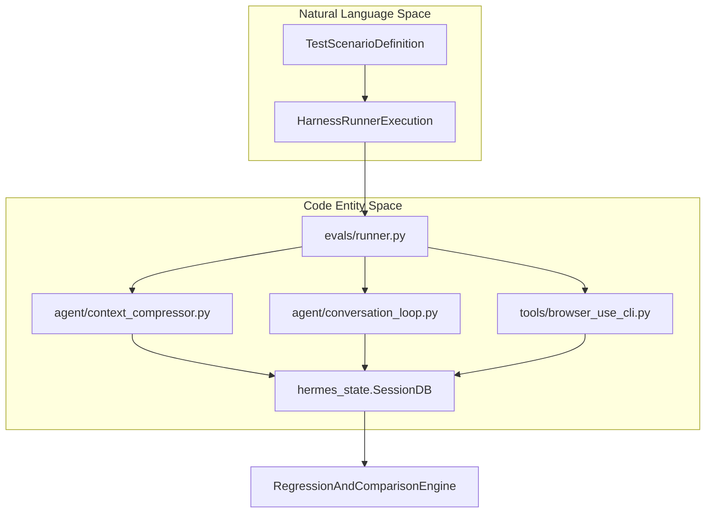
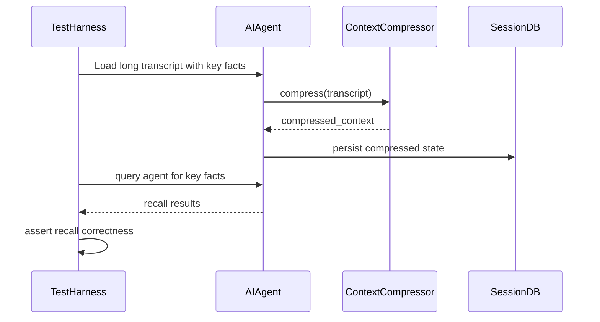
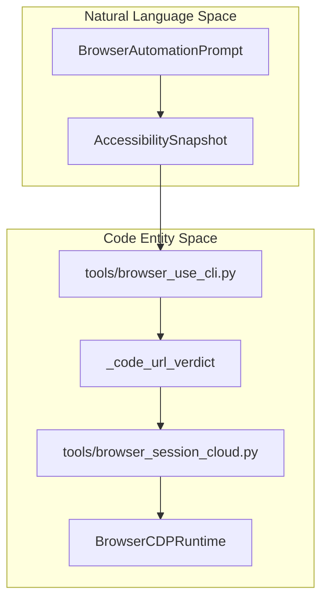
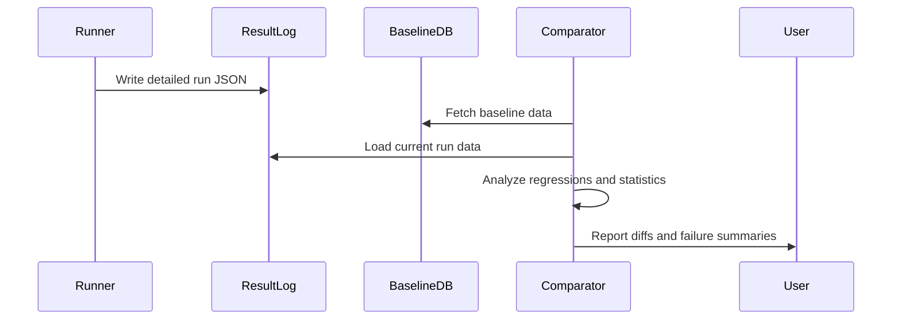

# Evaluation Harnesses

<details>
<summary>Relevant source files</summary>

The following files were used as context for generating this wiki page:

- [.github/CODEOWNERS](.github/CODEOWNERS)
- [.github/actionlint.yaml](.github/actionlint.yaml)
- [.github/actions/check-clean-worktree/action.yml](.github/actions/check-clean-worktree/action.yml)
- [.github/actions/detect-changes/action.yml](.github/actions/detect-changes/action.yml)
- [.github/actions/get-app-token/action.yml](.github/actions/get-app-token/action.yml)
- [.github/actions/nix-setup/action.yml](.github/actions/nix-setup/action.yml)
- [.github/workflows/catalog-tests.yml](.github/workflows/catalog-tests.yml)
- [.github/workflows/ci.yaml](.github/workflows/ci.yaml)
- [.github/workflows/contributor-check.yml](.github/workflows/contributor-check.yml)
- [.github/workflows/deploy-site.yml](.github/workflows/deploy-site.yml)
- [.github/workflows/docker-lint.yml](.github/workflows/docker-lint.yml)
- [.github/workflows/docs-site-checks.yml](.github/workflows/docs-site-checks.yml)
- [.github/workflows/history-check.yml](.github/workflows/history-check.yml)
- [.github/workflows/js-autofix.yml](.github/workflows/js-autofix.yml)
- [.github/workflows/label-rerun.yml](.github/workflows/label-rerun.yml)
- [.github/workflows/lint.yml](.github/workflows/lint.yml)
- [.github/workflows/live-providers.yml](.github/workflows/live-providers.yml)
- [.github/workflows/lockfile-diff.yml](.github/workflows/lockfile-diff.yml)
- [.github/workflows/nix.yml](.github/workflows/nix.yml)
- [.github/workflows/osv-scanner.yml](.github/workflows/osv-scanner.yml)
- [.github/workflows/profile-artifact-check.yml](.github/workflows/profile-artifact-check.yml)
- [.github/workflows/prompt-surface-diff.yml](.github/workflows/prompt-surface-diff.yml)
- [.github/workflows/remote-backends.yml](.github/workflows/remote-backends.yml)
- [.github/workflows/skills-index-freshness.yml](.github/workflows/skills-index-freshness.yml)
- [.github/workflows/skills-index.yml](.github/workflows/skills-index.yml)
- [.github/workflows/supply-chain-audit.yml](.github/workflows/supply-chain-audit.yml)
- [.github/workflows/tests-os.yml](.github/workflows/tests-os.yml)
- [.github/workflows/tests.yml](.github/workflows/tests.yml)
- [.github/workflows/uv-lockfile-check.yml](.github/workflows/uv-lockfile-check.yml)
- [agent/agent_init.py](agent/agent_init.py)
- [agent/agent_runtime_helpers.py](agent/agent_runtime_helpers.py)
- [agent/chat_completion_helpers.py](agent/chat_completion_helpers.py)
- [agent/compaction_display.py](agent/compaction_display.py)
- [agent/compaction_events.py](agent/compaction_events.py)
- [agent/compression_facade.py](agent/compression_facade.py)
- [agent/context_compressor.py](agent/context_compressor.py)
- [agent/context_compressor_telemetry.py](agent/context_compressor_telemetry.py)
- [agent/conversation_compression.py](agent/conversation_compression.py)
- [agent/conversation_compression_archive.py](agent/conversation_compression_archive.py)
- [agent/conversation_compression_codex.py](agent/conversation_compression_codex.py)
- [agent/conversation_compression_manual.py](agent/conversation_compression_manual.py)
- [agent/conversation_compression_telemetry.py](agent/conversation_compression_telemetry.py)
- [agent/conversation_loop.py](agent/conversation_loop.py)
- [agent/micro_compaction.py](agent/micro_compaction.py)
- [agent/model_metadata_token_memo.py](agent/model_metadata_token_memo.py)
- [agent/relay_compaction.py](agent/relay_compaction.py)
- [agent/turn_context.py](agent/turn_context.py)
- [agent/turn_finalizer.py](agent/turn_finalizer.py)
- [apps/desktop/e2e/core/reply-painted-once.spec.ts](apps/desktop/e2e/core/reply-painted-once.spec.ts)
- [apps/desktop/src/app/session/hooks/use-message-stream/reused-final-after-tool.test.tsx](apps/desktop/src/app/session/hooks/use-message-stream/reused-final-after-tool.test.tsx)
- [apps/desktop/src/app/session/hooks/use-message-stream/test-harness.tsx](apps/desktop/src/app/session/hooks/use-message-stream/test-harness.tsx)
- [contributors/emails/kuangmi@nudge.com.cn](contributors/emails/kuangmi@nudge.com.cn)
- [contributors/emails/yinz7032@gmail.com](contributors/emails/yinz7032@gmail.com)
- [hermes_cli/observability/shared_metrics_loop.py](hermes_cli/observability/shared_metrics_loop.py)
- [scripts/ci/catalog_test_files.py](scripts/ci/catalog_test_files.py)
- [scripts/ci/check_catalog_cors.py](scripts/ci/check_catalog_cors.py)
- [scripts/ci/check_profile_archive_boundary.py](scripts/ci/check_profile_archive_boundary.py)
- [scripts/ci/classify_changes.py](scripts/ci/classify_changes.py)
- [scripts/ci/prompt_surface.py](scripts/ci/prompt_surface.py)
- [scripts/ci/required_results.py](scripts/ci/required_results.py)
- [scripts/ci/start_test_sshd.sh](scripts/ci/start_test_sshd.sh)
- [scripts/ci/test_sshd_container_setup.sh](scripts/ci/test_sshd_container_setup.sh)
- [scripts/micro_compaction_report.py](scripts/micro_compaction_report.py)
- [scripts/run_tests.sh](scripts/run_tests.sh)
- [scripts/run_tests_parallel.py](scripts/run_tests_parallel.py)
- [tests/agent/test_413_compression.py](tests/agent/test_413_compression.py)
- [tests/agent/test_compaction_events.py](tests/agent/test_compaction_events.py)
- [tests/agent/test_compression_attempt_effect.py](tests/agent/test_compression_attempt_effect.py)
- [tests/agent/test_compression_attempt_telemetry.py](tests/agent/test_compression_attempt_telemetry.py)
- [tests/agent/test_compression_commit_fence_race.py](tests/agent/test_compression_commit_fence_race.py)
- [tests/agent/test_compression_concurrent_fork.py](tests/agent/test_compression_concurrent_fork.py)
- [tests/agent/test_compression_refusal_restores_transcript.py](tests/agent/test_compression_refusal_restores_transcript.py)
- [tests/agent/test_compression_stall_fallback.py](tests/agent/test_compression_stall_fallback.py)
- [tests/agent/test_compression_stall_interrupt.py](tests/agent/test_compression_stall_interrupt.py)
- [tests/agent/test_compressor_truncated_summary_guard.py](tests/agent/test_compressor_truncated_summary_guard.py)
- [tests/agent/test_context_compressor.py](tests/agent/test_context_compressor.py)
- [tests/agent/test_conversation_compression_manual.py](tests/agent/test_conversation_compression_manual.py)
- [tests/agent/test_empty_response_recovery_persistence.py](tests/agent/test_empty_response_recovery_persistence.py)
- [tests/agent/test_in_place_merged_user_rows.py](tests/agent/test_in_place_merged_user_rows.py)
- [tests/agent/test_message_sequence_repair.py](tests/agent/test_message_sequence_repair.py)
- [tests/agent/test_micro_compaction.py](tests/agent/test_micro_compaction.py)
- [tests/agent/test_proactive_prune_restart_safety.py](tests/agent/test_proactive_prune_restart_safety.py)
- [tests/agent/test_relay_compaction.py](tests/agent/test_relay_compaction.py)
- [tests/agent/test_relay_runtime_bounded_scope_ops.py](tests/agent/test_relay_runtime_bounded_scope_ops.py)
- [tests/agent/test_token_memo_release_on_close.py](tests/agent/test_token_memo_release_on_close.py)
- [tests/agent/test_tool_call_args_sanitizer.py](tests/agent/test_tool_call_args_sanitizer.py)
- [tests/agent/test_turn_finalizer_cleanup_guard.py](tests/agent/test_turn_finalizer_cleanup_guard.py)
- [tests/agent/test_turn_finalizer_final_response_persistence.py](tests/agent/test_turn_finalizer_final_response_persistence.py)
- [tests/agent/test_turn_finalizer_iteration_limit_exit.py](tests/agent/test_turn_finalizer_iteration_limit_exit.py)
- [tests/agent/test_unicode_ascii_codec.py](tests/agent/test_unicode_ascii_codec.py)
- [tests/ci/test_check_catalog_cors.py](tests/ci/test_check_catalog_cors.py)
- [tests/ci/test_classify_changes.py](tests/ci/test_classify_changes.py)
- [tests/ci/test_clean_worktree_check.py](tests/ci/test_clean_worktree_check.py)
- [tests/ci/test_prompt_surface.py](tests/ci/test_prompt_surface.py)
- [tests/ci/test_required_results.py](tests/ci/test_required_results.py)
- [tests/ci/test_update_ci_routing.py](tests/ci/test_update_ci_routing.py)
- [tests/ci/test_update_transitive_routing.py](tests/ci/test_update_transitive_routing.py)
- [tests/ci/workflow_steps.py](tests/ci/workflow_steps.py)
- [tests/conftest.py](tests/conftest.py)
- [tests/gateway/test_api_server_compaction_projection.py](tests/gateway/test_api_server_compaction_projection.py)
- [tests/gateway/test_queued_native_image_session_key.py](tests/gateway/test_queued_native_image_session_key.py)
- [tests/hermes_cli/test_gateway_agent_compress.py](tests/hermes_cli/test_gateway_agent_compress.py)
- [tests/hermes_cli/test_kanban_comment_queries.py](tests/hermes_cli/test_kanban_comment_queries.py)
- [tests/hermes_cli/test_reasoning_effort_menu.py](tests/hermes_cli/test_reasoning_effort_menu.py)
- [tests/hermes_cli/test_shared_metrics_loop.py](tests/hermes_cli/test_shared_metrics_loop.py)
- [tests/scripts/install/test_install_ps1_native_calls.py](tests/scripts/install/test_install_ps1_native_calls.py)
- [tests/scripts/test_run_tests_parallel.py](tests/scripts/test_run_tests_parallel.py)
- [tests/test_basetemp_isolation.py](tests/test_basetemp_isolation.py)
- [tests/tools/test_browser_cdp_override.py](tests/tools/test_browser_cdp_override.py)
- [tests/tools/test_browser_cdp_tool.py](tests/tools/test_browser_cdp_tool.py)
- [tests/tools/test_browser_cloud_provider_cache.py](tests/tools/test_browser_cloud_provider_cache.py)
- [tests/tools/test_browser_command_timeout_race.py](tests/tools/test_browser_command_timeout_race.py)
- [tests/tools/test_browser_config_effective.py](tests/tools/test_browser_config_effective.py)
- [tests/tools/test_browser_hardening.py](tests/tools/test_browser_hardening.py)
- [tests/tools/test_browser_headed_mode.py](tests/tools/test_browser_headed_mode.py)
- [tests/tools/test_browser_lightpanda.py](tests/tools/test_browser_lightpanda.py)
- [tests/tools/test_browser_secret_exfil.py](tests/tools/test_browser_secret_exfil.py)
- [tests/tools/test_browser_ssrf_local.py](tests/tools/test_browser_ssrf_local.py)
- [tests/tools/test_browser_supervisor.py](tests/tools/test_browser_supervisor.py)
- [tests/tools/test_browser_supervisor_capture.py](tests/tools/test_browser_supervisor_capture.py)
- [tests/tools/test_browser_supervisor_capture_dispatch.py](tests/tools/test_browser_supervisor_capture_dispatch.py)
- [tests/tools/test_browser_supervisor_reconnect.py](tests/tools/test_browser_supervisor_reconnect.py)
- [tests/tools/test_browser_use_cli.py](tests/tools/test_browser_use_cli.py)
- [tests/tools/test_browser_use_harness.py](tests/tools/test_browser_use_harness.py)
- [tests/tools/test_docker_backend_real.py](tests/tools/test_docker_backend_real.py)
- [tests/tools/test_kanban_comment_injection.py](tests/tools/test_kanban_comment_injection.py)
- [tests/tools/test_kanban_persisted_identity.py](tests/tools/test_kanban_persisted_identity.py)
- [tests/tools/test_url_safety.py](tests/tools/test_url_safety.py)
- [tests/tui_gateway/test_manual_compress_history_fence.py](tests/tui_gateway/test_manual_compress_history_fence.py)
- [tests/tui_gateway/test_turn_payload_reused_final.py](tests/tui_gateway/test_turn_payload_reused_final.py)
- [tests/website/test_fetch_plugin_stars.py](tests/website/test_fetch_plugin_stars.py)
- [tools/browser_cdp_tool.py](tools/browser_cdp_tool.py)
- [tools/browser_dialog_tool.py](tools/browser_dialog_tool.py)
- [tools/browser_session_cloud.py](tools/browser_session_cloud.py)
- [tools/browser_supervisor.py](tools/browser_supervisor.py)
- [tools/browser_supervisor_capture.py](tools/browser_supervisor_capture.py)
- [tools/browser_supervisor_dialogs.py](tools/browser_supervisor_dialogs.py)
- [tools/browser_supervisor_frames.py](tools/browser_supervisor_frames.py)
- [tools/browser_use_cli.py](tools/browser_use_cli.py)
- [tools/browser_vault_tool.py](tools/browser_vault_tool.py)
- [tools/url_safety.py](tools/url_safety.py)
- [website/docs/developer-guide/browser-supervisor.md](website/docs/developer-guide/browser-supervisor.md)
- [website/docs/developer-guide/context-compression-and-caching.md](website/docs/developer-guide/context-compression-and-caching.md)
- [website/scripts/fetch-plugin-stars.py](website/scripts/fetch-plugin-stars.py)
- [website/scripts/prebuild.mjs](website/scripts/prebuild.mjs)

</details>


The evaluation harnesses located in the `evals/` directory provide automated benchmarking, regression testing, and capability validation for Hermes Agent. These harnesses rigorously measure core agent functionalities—such as compaction recall, browser-use, codebase navigability, core tool deferral, readtool, session search schema, and fanout resource benchmark—to ensure that modifications to core subsystems do not degrade reasoning quality, context retention, or tool invocation safety.

---

## Evaluation Harness Architecture

The evaluation harness subsystem follows a standardized execution pattern matching natural language inputs against structured code entities. The data flow connects scenario definitions to the core execution loops and state persistence layers:

- **Test scenarios** are defined via structured configurations or natural language specifications describing target prompts, expected tool calls, and assertions.
- A **HarnessRunner** loads and drives each scenario against an instrumented `AIAgent` or mocked LLM backend.
- The execution relies on core components such as `ContextCompressor` (`agent/context_compressor.py:1-35`) and the conversation orchestration loop (`agent/conversation_loop.py:1-50`).
- Results and trajectory traces are captured and verified against baselines stored in SQLite session databases.



Sources: [agent/context_compressor.py:1-35](), [agent/conversation_loop.py:1-50](), [tools/browser_use_cli.py:1-50](), [tests/conftest.py:1-50]()

---

## Specific Harnesses

### Compaction Recall Harness

This harness validates the quality and integrity of the context compression subsystem managed by the `ContextCompressor` class (`agent/context_compressor.py:1-144`). It tests the agent's ability to:
- Process long conversation transcripts containing dense key-value facts (`tests/agent/test_context_compressor.py:37-51`).
- Apply iterative summarization or micro-compaction routines while protecting head and tail message turns.
- Query compressed conversation states to verify factual recall and prevent regression in reasoning across token boundary limits.



Sources: [agent/context_compressor.py:1-144](), [tests/agent/test_context_compressor.py:37-51]()

---

### Browser-Use Harness

This harness exercises the agent's browser automation tools, specifically testing the integration with the Browser Use CLI engine (`tools/browser_use_cli.py:1-50`). Key evaluation vectors include:
- CDP connection establishment, route resolution, and environment scrubbing (`tools/browser_use_cli.py:123-143`).
- Safety verification of URL literals through `_code_url_verdict` and local sidecar routing (`tools/browser_use_cli.py:145-158`).
- Validation of screenshot captures, DOM accessibility trees, and task state serialization.



Sources: [tools/browser_use_cli.py:1-158]()

---

### Codebase Navigability Harness

This harness evaluates the agent's multi-file traversal efficiency and symbol resolution accuracy across large codebases. It ensures that semantic indexing, file searching, and patch-application routines function correctly even under aggressive context compression and token constraints (`agent/context_compressor.py:1-35`).

Sources: [agent/context_compressor.py:1-35]()

---

### Core Tool Deferral Harness

This harness measures the effectiveness of dynamic tool discovery, deferred loading, and schema sanitization. It guarantees that core tools remain immediately available while secondary plugins or skills are progressively disclosed to conserve context space during initial conversation turns (`agent/conversation_loop.py:1-60`).

Sources: [agent/conversation_loop.py:1-60]()

---

### Readtool, Session Search Schema, and Fanout Resource Benchmarks

- **Readtool Harness:** Benchmarks file reading robustness, chunk pagination, spill guardrails, and error recovery during large file traversals.
- **Session Search Schema Harness:** Verifies SQLite FTS5 table configurations and indexing consistency for session search and transcript retrieval.
- **Fanout Resource Benchmark:** Quantifies concurrent task execution limits, thread pool resource pressure, and lock contention during asynchronous subagent fanouts (`agent/turn_context.py:1-50`, `agent/turn_finalizer.py:1-50`).

Sources: [agent/turn_context.py:1-50](), [agent/turn_finalizer.py:1-50]()

---

## Results Recording and Comparison

Evaluation runs export structured JSON artifacts detailing token consumption, latency metrics, tool call counts, and heuristic success scores. 

```
evals/results/
├── run_YYYYMMDD_HHMMSS.json
└── baseline_comparison.json
```

Post-run analyzers compare output artifacts against established baselines to flag regressions in prompt compression, memory recall, or tool dispatch logic (`agent/conversation_compression.py:1-50`).



Sources: [agent/conversation_compression.py:1-50]()

---

# Summary

Hermes Agent's evaluation harnesses enforce strict regression controls and telemetry validation across core subsystems, including context compression (`agent/context_compressor.py:1-35`), browser automation (`tools/browser_use_cli.py:1-50`), tool lifecycle orchestration (`agent/conversation_loop.py:1-50`), and concurrent execution limits.