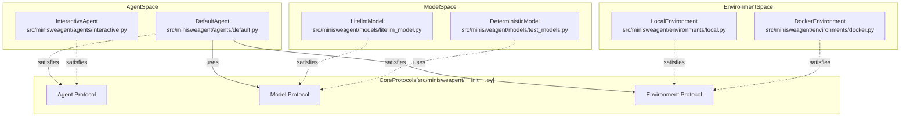
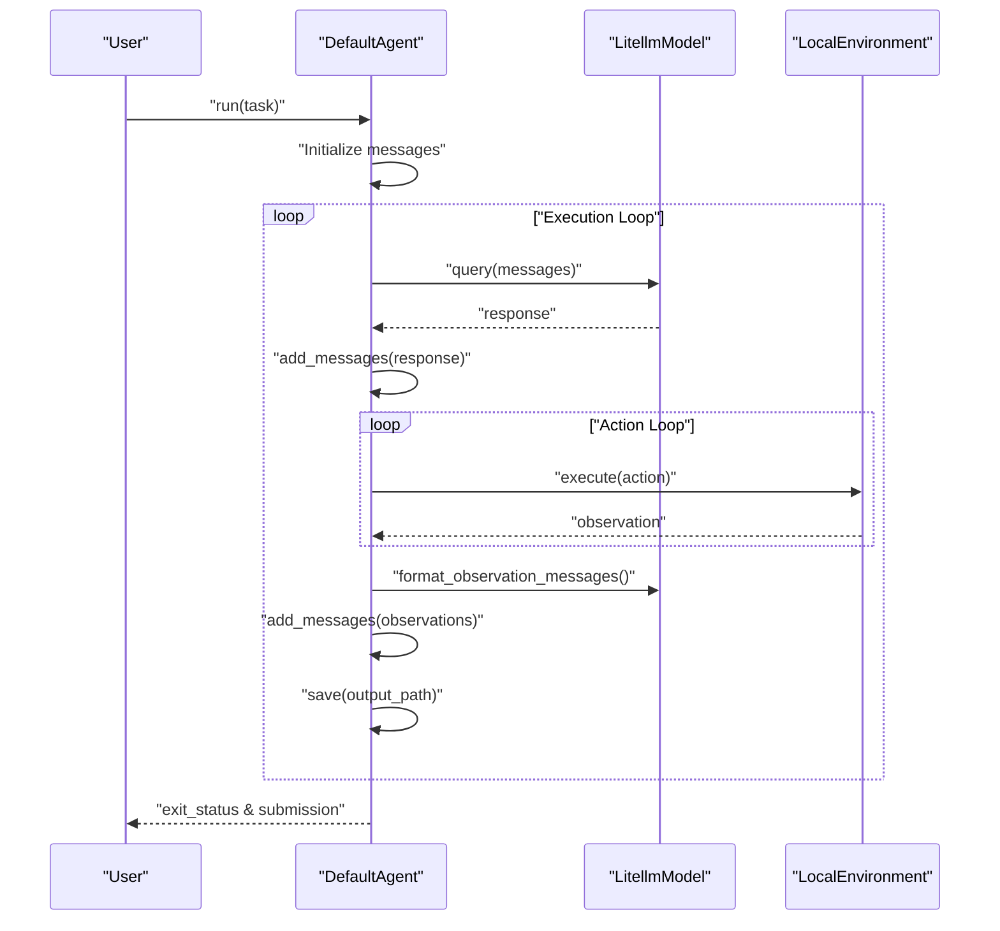

# Overview

Relevant source files

The following files were used as context for generating this wiki page:

- [README.md](README.md)
- [docs/faq.md](docs/faq.md)
- [docs/index.md](docs/index.md)
- [docs/quickstart.md](docs/quickstart.md)
- [mkdocs.yml](mkdocs.yml)

This document provides a high-level introduction to **mini-swe-agent**, a minimalist AI agent framework designed for software engineering tasks. It covers the system's purpose, core design principles, and architectural components. For detailed information on specific subsystems, see the architecture overview ([Architecture Overview](#1.1)), design principles ([Key Features and Design Principles](#1.2)), and system components ([System Components](#1.3)).

Sources: [README.md:1-80](), [docs/index.md:1-97]()

## What is mini-swe-agent?

mini-swe-agent is an AI-powered autonomous agent that solves software engineering tasks using only bash commands. The core agent implementation is approximately 100 lines of Python code [src/minisweagent/agents/default.py:33-155](), with supporting components (environment, model, and entry scripts) designed to be similarly lightweight [README.md:25-27]().

**Key Statistics:**
- **Core agent**: ~100 lines [src/minisweagent/agents/default.py:33-155]()
- **Minimal Dependencies**: Focuses on standard libraries and essential integrations like `litellm` [README.md:26-30]().
- **Performance**: Scores >74% on the SWE-bench verified benchmark [README.md:28]().
- **Versatility**: Supports local environments, Docker, Singularity, Bubblewrap, and more [README.md:29]().

**Target Audiences:**

| User Type | Use Case | Benefit |
|-----------|----------|---------|
| **Researchers** | Benchmarking, fine-tuning, RL | No agent scaffold overfitting; transparent linear history [README.md:41-54]() |
| **Developers** | Daily development tasks | Simple, readable, hackable tool [README.md:63-78]() |
| **Engineers** | Production deployment | Trivial sandboxing; stateless execution [README.md:48-50]() |

Sources: [README.md:1-80](), [docs/index.md:1-97](), [src/minisweagent/agents/default.py:33-155]()

## Core Design Philosophy

mini-swe-agent follows three foundational principles that distinguish it from other agent frameworks:

### 1. Bash-Only Tools
The agent executes **only bash commands**—it does not require a tool-calling interface or custom Python-defined tools [README.md:41-43](). This design choice:
- Enables compatibility with any LLM, even those without native tool support [README.md:41-43]().
- Eliminates the need to install specific packages in the target environment [docs/index.md:49]().
- Encourages the LLM to utilize the full power of the shell [docs/index.md:71-74]().

### 2. Linear History
The agent maintains a simple linear message list where every step appends to the history [README.md:45-47]().
- The trajectory **is** the prompt history, making it easy to understand what the model "sees" [docs/index.md:77-78]().
- Simplifies debugging and the creation of fine-tuning datasets [README.md:47]().

### 3. Stateless Execution
Every action is executed independently, typically via `subprocess.run` or equivalent container commands [README.md:48-50]().
- Avoids the flakiness and state management issues of persistent shell sessions [README.md:50]().
- Makes it trivial to swap execution environments (e.g., from `LocalEnvironment` to `DockerEnvironment`) [README.md:48-49]().

Sources: [README.md:41-50](), [docs/index.md:43-54](), [docs/faq.md:102-120]()

## System Architecture

The system is built around three core Protocols defined in `src/minisweagent/__init__.py`. This duck typing approach allows for easy extension and component swapping.

Core Protocols and Code Entities

Sources: [src/minisweagent/__init__.py:39-73](), [src/minisweagent/agents/default.py:33-34](), [src/minisweagent/models/test_models.py:104-144]()

## Execution Flow

The `DefaultAgent` implements a simple loop that bridges natural language instructions to code execution.

Agent Execution Sequence

**Key Code Pointers:**
- **Initialization**: `DefaultAgent.__init__` [src/minisweagent/agents/default.py:34-43]()
- **Main Loop**: `DefaultAgent.run` [src/minisweagent/agents/default.py:77-97]()
- **Single Step**: `DefaultAgent.step` [src/minisweagent/agents/default.py:99-101]()
- **Action Execution**: `DefaultAgent.execute_actions` [src/minisweagent/agents/default.py:119-122]()

Sources: [src/minisweagent/agents/default.py:77-122](), [src/minisweagent/__init__.py:43-73]()

## Component Overview

mini-swe-agent is highly modular. For more details on each, see the [System Components](#1.3) child page.

### Agent
The `Agent` manages the state (linear history) and the execution loop. 
- **DefaultAgent**: The standard autonomous loop [src/minisweagent/agents/default.py:33-155]().
- **InteractiveAgent**: Adds human-in-the-loop features like command confirmation and slash commands.

### Model
The `Model` handles communication with LLMs and formatting messages.
- **LitellmModel**: Supports hundreds of models via LiteLLM [src/minisweagent/models/litellm_model.py:1-50]().
- **DeterministicModel**: Used for testing with pre-defined outputs [src/minisweagent/models/test_models.py:104-144]().

### Environment
The `Environment` provides a standard `execute` method to run bash commands.
- **LocalEnvironment**: Runs commands directly on the host machine [src/minisweagent/environments/local.py:1-50]().
- **DockerEnvironment**: Runs commands inside a Docker container for isolation.

Sources: [src/minisweagent/__init__.py:39-73](), [src/minisweagent/models/test_models.py:104-144]()

## Next Steps

- **Architecture Overview**: Deep dive into the protocol-based design and minimalism philosophy ([Architecture Overview](#1.1)).
- **Key Features**: Detailed look at stateless execution and linear history ([Key Features and Design Principles](#1.2)).
- **System Components**: Quick reference for all implemented Agents, Models, and Environments ([System Components](#1.3)).
- **Quick Start**: Get the agent running in minutes ([Getting Started](#2)).

Sources: [mkdocs.yml:61-86]()