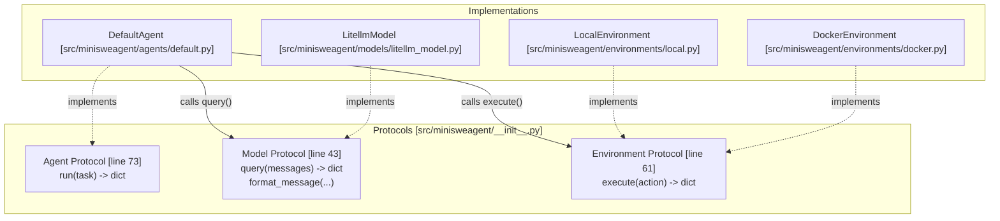
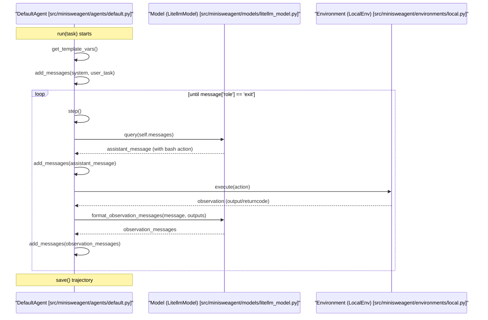
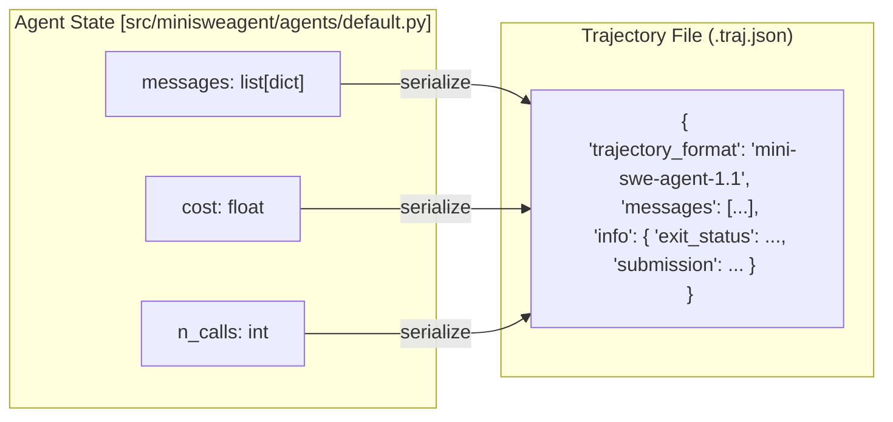

# Architecture Overview

Relevant source files

The following files were used as context for generating this wiki page:

- [README.md](README.md)
- [docs/faq.md](docs/faq.md)
- [docs/index.md](docs/index.md)
- [src/minisweagent/__init__.py](src/minisweagent/__init__.py)
- [src/minisweagent/models/test_models.py](src/minisweagent/models/test_models.py)

This document explains the high-level architecture of `mini-swe-agent`, focusing on the protocol-based design that enables its "100-line" minimalism while maintaining high performance on benchmarks like SWE-bench and ProgramBench.

## Core Design Philosophy: Minimalism

The architecture is built on three pillars of minimalism designed to maximize stability and debuggability:
1.  **No Tools but Bash**: The agent does not use specialized tool-calling interfaces by default. It interacts primarily through standard bash blocks in text, allowing it to work with any model [README.md:41-43](), [docs/index.md:46-49](), [docs/faq.md:33-34]().
2.  **Linear History**: Every step of the agent (thoughts, actions, and observations) is simply appended to a single list of messages. There is no complex history processing or hidden state [README.md:44-46](), [docs/index.md:50-52](), [docs/faq.md:35]().
3.  **Stateless Execution**: Actions are executed via `subprocess.run` (or equivalent). Every command is independent, avoiding the "flaky shell" problem where long-running sessions become desynchronized or crash [README.md:47-49](), [docs/index.md:53-54](), [docs/faq.md:36-37](), [docs/faq.md:102-120]().

Sources: [README.md:41-50](), [docs/index.md:46-54](), [docs/faq.md:33-37]()

## Three-Component Protocol Architecture

The system is organized into three abstract layers defined by Python `Protocols` in `src/minisweagent/__init__.py`. This allows for "duck typing" where any class implementing the required methods can be swapped in [src/minisweagent/__init__.py:7-9]().

### Protocol Interaction Diagram

Sources: [src/minisweagent/__init__.py:39-82](), [README.md:25-30]()

### Component Responsibilities

| Component | Protocol Definition | Key Responsibilities |
| :--- | :--- | :--- |
| **Agent** | `Agent` [src/minisweagent/__init__.py:73-81]() | Manages the control loop, maintains `self.messages`, and handles exceptions. |
| **Model** | `Model` [src/minisweagent/__init__.py:43-59]() | Handles API calls, tracks costs/usage, and formats observations into model-specific message structures. |
| **Environment** | `Environment` [src/minisweagent/__init__.py:61-71]() | Executes bash commands in a specific context (Local, Docker, etc.) and returns output/exit codes. |

Sources: [src/minisweagent/__init__.py:43-81]()

## The DefaultAgent Control Loop

The `DefaultAgent` implements the core logic in approximately 100 lines of code. It follows a cyclic "Query-Execute-Observe" pattern.

### Sequence of Operations

Sources: [src/minisweagent/agents/default.py:77-122]()

### Key Methods in `DefaultAgent`
- `run(task)`: The entry point. Initializes history and loops `step()` until a message with `role: "exit"` appears [src/minisweagent/agents/default.py:77-97]().
- `step()`: A single iteration consisting of a `query()` followed by `execute_actions()` [src/minisweagent/agents/default.py:99-101]().
- `query()`: Checks limits (cost/steps), calls `self.model.query()`, updates internal cost tracking, and appends the response to history [src/minisweagent/agents/default.py:103-117]().
- `execute_actions(message)`: Iterates over actions found in the model response, runs them via `self.env.execute()`, and uses the model to format the resulting observations [src/minisweagent/agents/default.py:119-122]().

Sources: [src/minisweagent/agents/default.py:77-122]()

## Data Flow and State Management

### Linear History and Serialization
The state of the agent is entirely contained within `self.messages`. When saving a trajectory, the agent serializes this list along with metadata about the model and environment.

Sources: [src/minisweagent/agents/default.py:124-155]()

### Template System
The agent uses Jinja2 to render prompts. It merges variables from the agent config, environment, and model into a single context for the templates.

- **Source of Variables**: `get_template_vars()` recursively merges dictionaries from `self.config`, `self.env`, and `self.model` [src/minisweagent/agents/default.py:45-53]().
- **Strict Rendering**: Uses `StrictUndefined` to ensure the agent crashes if a required template variable (like `{{ task }}`) is missing, preventing silent prompt corruption [src/minisweagent/agents/default.py:55-56]().

Sources: [src/minisweagent/agents/default.py:45-56]()

## Exception Handling
Control flow transitions (like finishing a task or hitting a limit) are handled via the `InterruptAgentFlow` exception hierarchy.

- **`LimitsExceeded`**: Raised in `query()` if `step_limit` or `cost_limit` is reached [src/minisweagent/agents/default.py:105-112]().
- **Uncaught Exceptions**: Handled by `handle_uncaught_exception()`, which appends a final "exit" message containing the traceback to the history before the agent terminates [src/minisweagent/agents/default.py:63-75]().

Sources: [src/minisweagent/agents/default.py:63-92]()