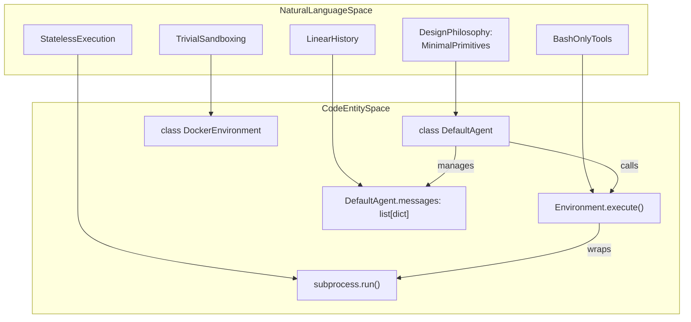
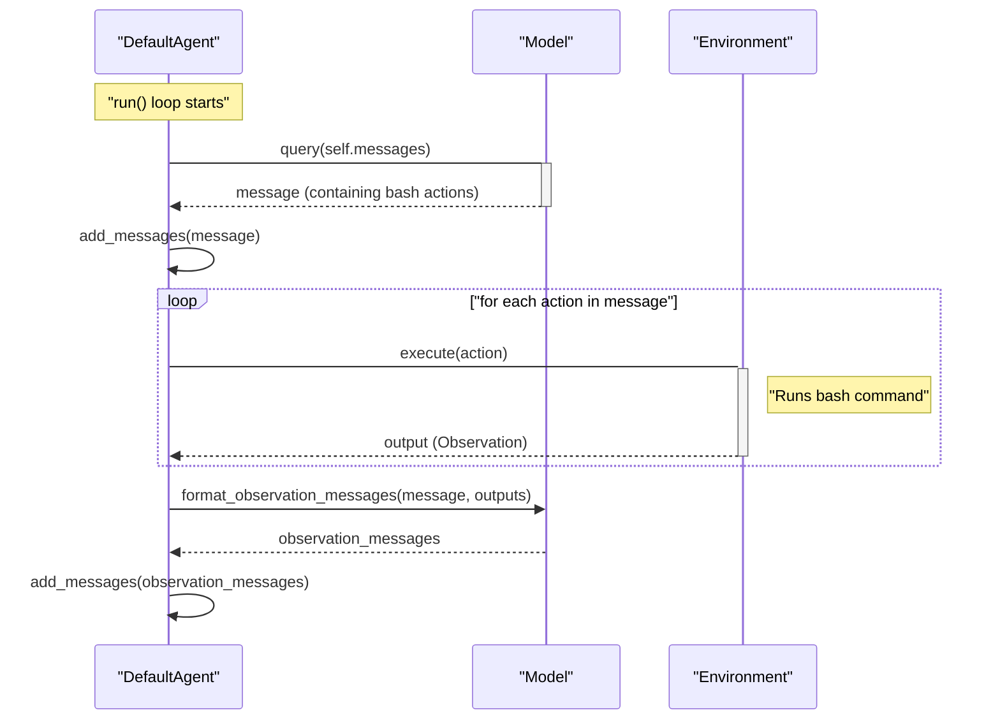
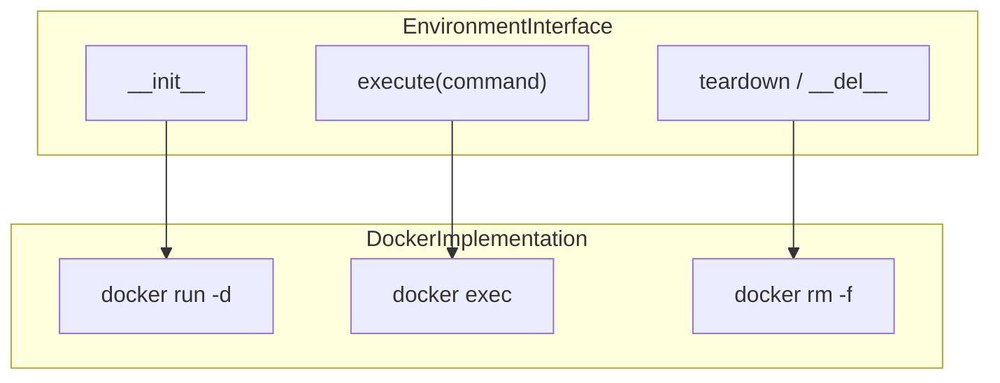

# Key Features and Design Principles

Relevant source files

The following files were used as context for generating this wiki page:

- [README.md](README.md)
- [docs/advanced/control_flow.md](docs/advanced/control_flow.md)
- [docs/advanced/cookbook.md](docs/advanced/cookbook.md)
- [docs/faq.md](docs/faq.md)
- [docs/index.md](docs/index.md)
- [docs/reference/agents/default.md](docs/reference/agents/default.md)
- [docs/usage/python_bindings.md](docs/usage/python_bindings.md)
- [tests/models/test_test_models.py](tests/models/test_test_models.py)

This document details the core design principles and architectural features that enable `mini-swe-agent` to provide a minimal, highly performant, and robust software engineering agent. The system relies on five foundational principles: bash-only execution, stateless command execution via `subprocess.run`, linear history transparency, trivial sandboxing, and universal model compatibility.

These design decisions minimize internal complexity while maximizing reliability, allowing the agent to achieve strong performance on benchmarks like SWE-bench verified [README.md:28]().

## Core Design Philosophy

`mini-swe-agent` operates on the principle that modern language models are sufficiently capable to manage complex software engineering tasks directly through shell primitives, eliminating the need for elaborate custom tool interfaces or stateful execution layers. The core agent logic is contained within a compact implementation in `DefaultAgent` [src/minisweagent/agents/default.py:38-173]().

### Philosophy to Code Mapping

The following diagram bridges the high-level design principles to the specific Python classes and methods that implement them.

Sources: [README.md:21-32](), [README.md:41-54](), [src/minisweagent/agents/default.py:38-173]()

---

## Bash-Only Tool Interface

`mini-swe-agent` utilizes bash as its sole tool interface, removing the requirement for complex tool-calling schemas or custom function registries [README.md:42-44](). Actions are extracted from model responses (typically formatted within markdown code blocks) [docs/faq.md:44-45]().

### Action Execution Flow

The sequence below illustrates how `DefaultAgent` coordinates between the model generation step and environment execution.

### Implementation Details

The agent does not require native tool-calling abstractions provided by specific model vendors [README.md:71](). Instead, it prompts the language model to use the shell directly. Within `DefaultAgent.execute_actions`, the agent iterates over commands extracted from the model's message payload and dispatches them to the underlying environment [src/minisweagent/agents/default.py:154-157]().

Sources: [README.md:41-44](), [README.md:71-74](), [src/minisweagent/agents/default.py:154-157](), [docs/faq.md:44-48](), [src/minisweagent/agents/default.py:86-104]()

---

## Stateless Execution with subprocess.run

Every action is executed as an isolated, independent command rather than maintaining a persistent, stateful shell session [README.md:48](). Across local environments, this is implemented via `subprocess.run` [docs/faq.md:114-116]().

### Why No Shell Session?

Persistent shell sessions introduce several failure modes in automated agent workflows:
1. **Termination Heuristics**: Determining when a command has completed without a blocking prompt is difficult and error-prone [docs/faq.md:108-110]().
2. **Session Corruption**: Malformed or destructive commands can terminate the shell process entirely [docs/faq.md:111]().
3. **Interrupt Handling**: Signal propagation during interruptions can corrupt subsequent I/O extraction streams [docs/faq.md:112]().

### Stateless Logic and Model Adaptation

Because each execution is stateless (e.g., via `subprocess.run` in `LocalEnvironment`), commands do not inherit working directory changes or exported environment variables from prior steps unless explicitly chained [docs/faq.md:117-118](). Language models natively adapt to this by stringing commands together (e.g., prefixing with `cd /path/to/project && ...`) [docs/faq.md:118-119]().

Sources: [README.md:48-50](), [README.md:75-76](), [docs/faq.md:102-121](), [src/minisweagent/agents/default.py:156]()

---

## Linear History Transparency

`mini-swe-agent` maintains a strictly linear message history where every execution step appends new message dictionaries to a single list [README.md:45](). There is no divergence between the internal trajectory log and the messages supplied to the language model.

### Implementation in DefaultAgent

History management is centralized in `DefaultAgent.messages` [src/minisweagent/agents/default.py:42]():
*   `add_messages()`: Appends new conversational or execution turns to the history [src/minisweagent/agents/default.py:69-72]().
*   `query()`: Transmits the entire current `self.messages` array to the model [src/minisweagent/agents/default.py:149]().

This transparency simplifies debugging, logging, fine-tuning (FT), and reinforcement learning (RL) workflows [README.md:45-47]().

Sources: [README.md:45-47](), [src/minisweagent/agents/default.py:42](), [src/minisweagent/agents/default.py:69-72](), [src/minisweagent/agents/default.py:149]()

---

## Trivial Sandboxing

The stateless execution model allows sandboxing to be implemented by swapping out environment drivers [README.md:49-50](). Since every command execution is isolated via an `execute()` call, transitioning between execution backends requires only changing the environment class instance.

### Environment Implementation Comparison

| Environment Class | Core Mechanism | Primary Use Case |
|-------------------|----------------|------------------|
| `LocalEnvironment` | `subprocess.run` | Local development and testing [README.md:29]() |
| `DockerEnvironment` | `docker exec` | Standard containerized isolation [README.md:29]() |
| `SingularityEnvironment` | `singularity exec` | High-performance computing (HPC) clusters [README.md:29]() |
| `BubblewrapEnvironment` | `bwrap` | Unprivileged Linux sandboxing [README.md:29]() |

### Sandbox Lifecycle

Sources: [README.md:29](), [README.md:48-50](), [src/minisweagent/agents/default.py:44]()

---

## Universal Model Compatibility

By avoiding custom tool-calling schema requirements and maintaining a linear message structure, `mini-swe-agent` integrates with any model provider supported by `litellm`, `openrouter`, or `portkey` [README.md:30]().

### Action Parsing Strategies

The system supports multiple action parsing mechanisms through its model abstractions:
1. **Text-based Regex**: Extracting commands directly from markdown code blocks in raw text responses [docs/faq.md:45-46]().
2. **Standard Tool Calls**: Leveraging vendor-native function-calling APIs via `LitellmModel` and related classes [tests/models/test_test_models.py:111-126]().
3. **Responses API**: Utilizing specialized response endpoints implemented in testing and production providers [tests/models/test_test_models.py:160-175]().

Sources: [README.md:30](), [docs/index.md:37](), [docs/faq.md:45-46](), [tests/models/test_test_models.py:111-175]()