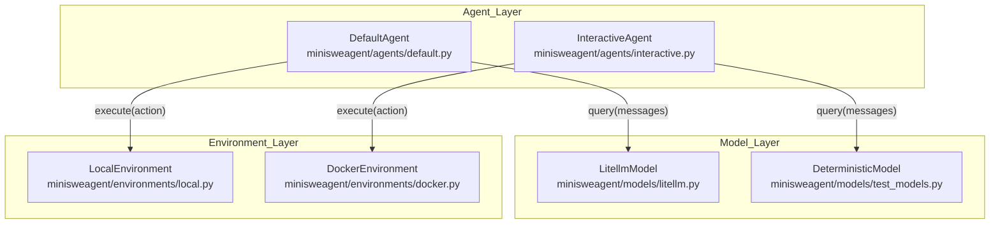
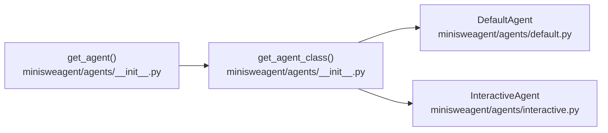
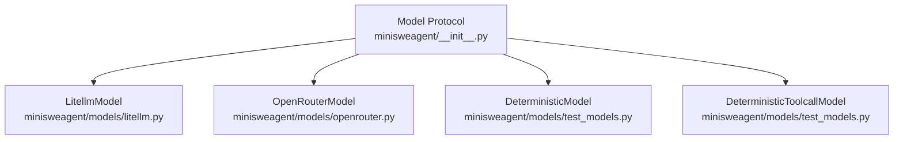
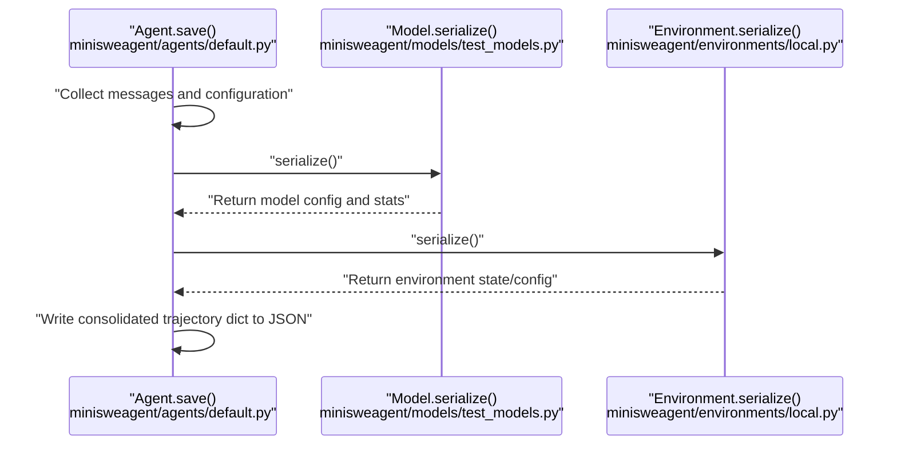

# System Components

Relevant source files

The following files were used as context for generating this wiki page:

- [docs/reference/environments/swerex_modal.md](docs/reference/environments/swerex_modal.md)
- [docs/reference/index.md](docs/reference/index.md)
- [src/minisweagent/__init__.py](src/minisweagent/__init__.py)
- [src/minisweagent/agents/__init__.py](src/minisweagent/agents/__init__.py)
- [src/minisweagent/environments/README.md](src/minisweagent/environments/README.md)
- [src/minisweagent/environments/__init__.py](src/minisweagent/environments/__init__.py)
- [src/minisweagent/models/test_models.py](src/minisweagent/models/test_models.py)
- [tests/agents/test_init.py](tests/agents/test_init.py)

This page provides a quick technical reference to the three primary components of `mini-swe-agent`—**Agent**, **Model**, and **Environment**—as defined by their respective protocols in `[src/minisweagent/__init__.py:43-81]()`. It details their responsibilities, implementations, interaction patterns, and data serialization flows.

Sources: `[src/minisweagent/__init__.py:39-82]()`

---

## Component Architecture Overview

The codebase relies on a protocol-based architecture with duck typing via `Protocol` classes defined in `[src/minisweagent/__init__.py:43-81]()`. This design decouples orchestration (`Agent`), intelligence (`Model`), and execution (`Environment`).

**Diagram: Component architecture bridging system roles to concrete class names and file paths.**

| Component Protocol | Interface Definition | Core Responsibility |
| :--- | :--- | :--- |
| `Agent` | `[src/minisweagent/__init__.py:73-81]()` | Orchestrates the `run()` loop, step execution, and trajectory saving. |
| `Model` | `[src/minisweagent/__init__.py:43-59]()` | Interfaces with LLM APIs via `query()`, formats messages and observations. |
| `Environment` | `[src/minisweagent/__init__.py:61-70]()` | Executes actions in a sandboxed or local runtime via `execute()`. |

Sources: `[src/minisweagent/__init__.py:39-82]`, `[src/minisweagent/agents/__init__.py:8-11]`, `[src/minisweagent/environments/__init__.py:8-16]()`

---

## Agent Components

Agents manage the task execution lifecycle. The agent loop invokes `Model.query()` to get actions, parses them, runs them via `Environment.execute()`, and aggregates results.

### Agent Factory and Mapping
The function `get_agent(model, env, config, default_type)` in `[src/minisweagent/agents/__init__.py:25-28]()` instantiates agent implementations based on `_AGENT_MAPPING` `[src/minisweagent/agents/__init__.py:8-11]()`.

**Diagram: Agent resolution flow via `get_agent` and `get_agent_class`.**

| Agent Class | Module Path | Description |
| :--- | :--- | :--- |
| `DefaultAgent` | `[src/minisweagent/agents/default.py]()` | Autonomous execution loop for benchmark and script runs. |
| `InteractiveAgent` | `[src/minisweagent/agents/interactive.py]()` | Human-in-the-loop agent with confirmation prompts and slash commands. |

Sources: `[src/minisweagent/agents/__init__.py:1-28]`, `[src/minisweagent/__init__.py:73-81]()`

---

## Model Components

Models abstract language model providers. They handle provider-specific request structuring, API communication, and response parsing.

### Model Protocol & Test Models
The `Model` protocol requires `query()`, `format_message()`, `format_observation_messages()`, `get_template_vars()`, and `serialize()` `[src/minisweagent/__init__.py:43-59]()`. For testing, `DeterministicModel` and `DeterministicToolcallModel` in `[src/minisweagent/models/test_models.py:104-165]()` replay pre-configured outputs and track costs using `GLOBAL_MODEL_STATS` `[src/minisweagent/models/test_models.py:115]()`.

**Diagram: Model protocol implementations and module mappings.**

Sources: `[src/minisweagent/__init__.py:43-59]`, `[src/minisweagent/models/test_models.py:104-165]()`

---

## Environment Components

Environments manage command execution contexts. The `Environment` protocol defines `execute()`, `get_template_vars()`, and `serialize()` `[src/minisweagent/__init__.py:61-70]()`.

### Environment Mapping
Environments are dynamically loaded via `get_environment()` using `_ENVIRONMENT_MAPPING` in `[src/minisweagent/environments/__init__.py:8-33]()`. Supported runtimes include `local`, `docker`, `singularity`, `swerex_docker`, `swerex_modal`, `bubblewrap`, and `contree` `[src/minisweagent/environments/__init__.py:8-16]()`.

| Environment Spec | Implementation Path | Execution Mechanism |
| :--- | :--- | :--- |
| `local` | `[src/minisweagent/environments/local.py]()` | `subprocess.run` on host OS |
| `docker` | `[src/minisweagent/environments/docker.py]()` | Docker / Podman container exec |
| `singularity` | `[src/minisweagent/environments/singularity.py]()` | Singularity / Apptainer HPC sandbox |

Sources: `[src/minisweagent/__init__.py:61-70]`, `[src/minisweagent/environments/__init__.py:8-33]()`

---

## Data Flow and Serialization

The trajectory of an execution run is captured across components. When `Agent.save()` is invoked, it aggregates states from all three protocol implementations.

**Diagram: Serialization sequence across agent, model, and environment components.**

### Template Context Integration
Before execution, prompt templates are populated with variables contributed by each component via `get_template_vars()` methods (`[src/minisweagent/__init__.py:56,68]()`).

Sources: `[src/minisweagent/__init__.py:43-82]`, `[src/minisweagent/models/test_models.py:135-144]()`