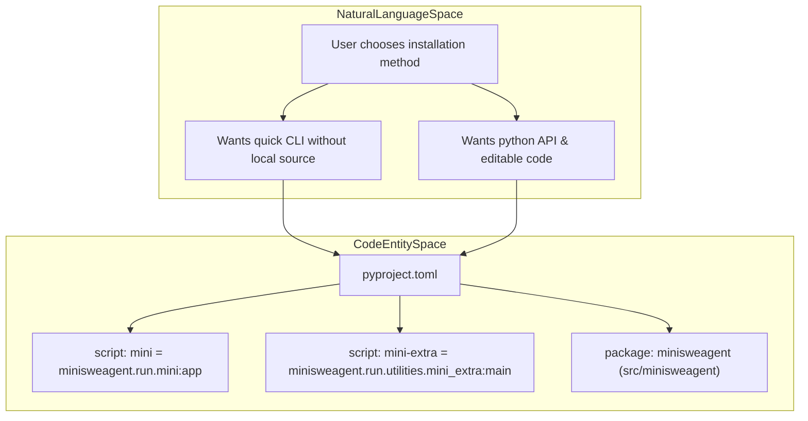
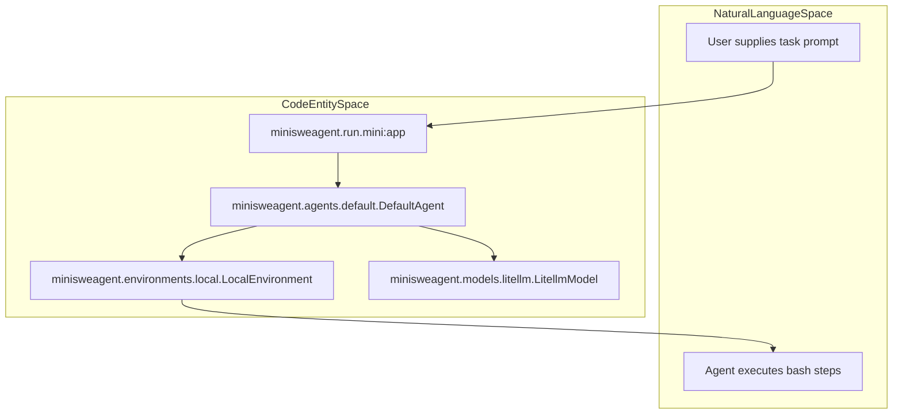

# Getting Started

Relevant source files

The following files were used as context for generating this wiki page:

- [docs/quickstart.md](docs/quickstart.md)
- [mkdocs.yml](mkdocs.yml)

This page serves as a high-level guide to help users install `mini-swe-agent`, configure their environment, and run their first agentic task. As a parent page, it provides an overview of the initial setup workflow, with detailed instructions available in the child pages.

For comprehensive installation methods, see [Installation](#2.1). For running tasks and interactive walkthroughs, see [Quick Start Guide](#2.2). For API key configuration and setup commands, see [Configuration Setup](#2.3).

---

## 2.1 Installation

`mini-swe-agent` provides multiple installation methods depending on whether you require Python library bindings, environment isolation, or source code access for development. Packages can be installed via standard `pip`, isolated `uv`/`uvx`, `pipx`, or directly from source code repositories.

### Installation Methods Comparison

| Method | Target Use Case | Python Bindings | Environment Isolation | Update Command |
|--------|----------------|-----------------|------------------------|----------------|
| **pip** | Development & Python API usage | Yes (`src/minisweagent`) | Current environment | `pip install -U mini-swe-agent` |
| **uv/uvx** | Quick CLI testing | No | Anonymous virtual environment | Automatic on execution (`uvx`) |
| **pipx** | Persistent CLI usage | No | Isolated virtual environment | `pipx upgrade mini-swe-agent` |
| **Source** | Contributing & customization | Yes (Editable mode) | Editable workspace | `git pull && pip install -e .` |

Sources: [docs/quickstart.md:3-103](), [pyproject.toml:63-83]()

### Installation Strategy to Code Mapping

The following diagram bridges the user installation choices to the corresponding package scripts and entry points defined in `pyproject.toml`.

Sources: [docs/quickstart.md:3-103](), [pyproject.toml:89-94]()

For step-by-step instructions and optional dependency groups (such as `[dev]` or `[full]`), see [Installation](#2.1).

---

## 2.2 Quick Start Guide

Once installed, running your first task involves executing the `mini` command-line interface and providing a natural language prompt. The agent connects to an LLM provider and an execution environment (`LocalEnvironment` or `DockerEnvironment`) to perform tasks such as bug fixing or script generation.

### Execution Flow

Sources: [docs/quickstart.md:112-134](), [pyproject.toml:89-94]()

For details on running sample prompts, handling interactive confirmation modes, and interpreting agent outputs, see [Quick Start Guide](#2.2).

---

## 2.3 Configuration Setup

`mini-swe-agent` relies on language model API keys and model name configurations. If configuration is missing upon first execution, the interactive setup wizard can be triggered via utility scripts.

### Configuration Workflow

- **Setup Wizard**: Invoked via `mini-extra config setup` to configure default models and keys [docs/quickstart.md:122-125]().
- **Environment Management**: Configuration variables and API keys (such as `ANTHROPIC_API_KEY`) are saved locally via `python-dotenv` into a `.env` file.
- **Model Selection**: Providers must be explicitly prefixed in model names (e.g., `anthropic/claude-opus-4-6-20260205` or `openai/gpt-5.4`) [docs/quickstart.md:128-133]().

For details on configuration keys, YAML overrides, and environment variables, see [Configuration Setup](#2.3).

Sources: [docs/quickstart.md:120-134](), [pyproject.toml:41-43]()