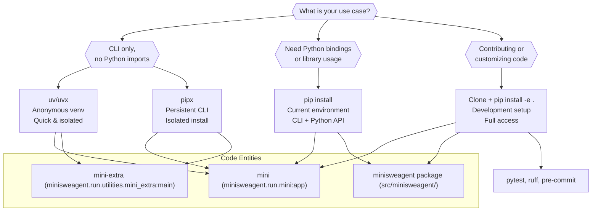
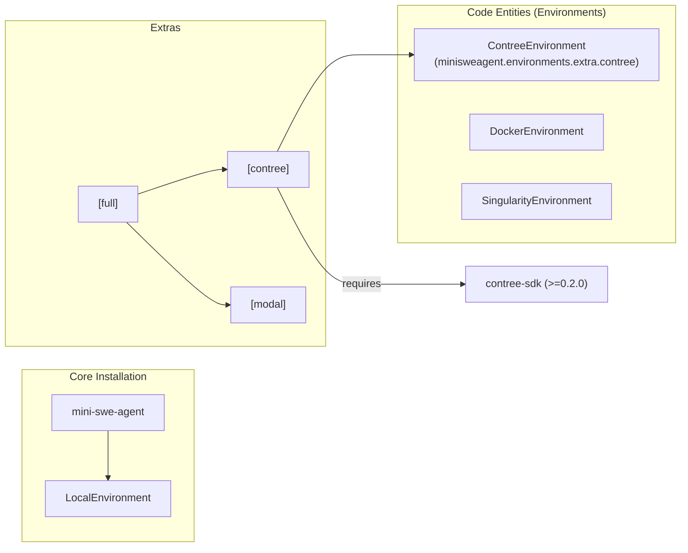

# Installation

<details>
<summary>Relevant source files</summary>

The following files were used as context for generating this wiki page:

- [.gitignore](.gitignore)
- [docs/quickstart.md](docs/quickstart.md)
- [docs/reference/environments/contree.md](docs/reference/environments/contree.md)
- [mkdocs.yml](mkdocs.yml)
- [pyproject.toml](pyproject.toml)
- [src/minisweagent/environments/extra/contree.py](src/minisweagent/environments/extra/contree.py)
- [tests/environments/extra/test_contree.py](tests/environments/extra/test_contree.py)

</details>


This page explains the different methods for installing `mini-swe-agent`. Choose the method that best fits your use case: isolated CLI-only installation (`uv`/`uvx` or `pipx`), standard installation with Python bindings (`pip`), or development setup (from source).

## System Requirements

`mini-swe-agent` requires:

- **Python 3.10 or later**: Specified in the project metadata [pyproject.toml:11-11]().
- **Bash-compatible shell**: The agent relies on bash for command execution across its environment implementations [src/minisweagent/environments/extra/contree.py:38-39]().
- **Container Runtime (Optional)**: Required for sandboxed execution modes such as Docker, Singularity, or ConTree [src/minisweagent/environments/extra/contree.py:57-58]().

Sources: [pyproject.toml:11-11](), [src/minisweagent/environments/extra/contree.py:38-39](), [src/minisweagent/environments/extra/contree.py:57-58]()

## Installation Method Comparison

The following diagram maps user needs to the appropriate installation workflow and the resulting code entities made available.



Sources: [pyproject.toml:89-93](), [pyproject.toml:101-103](), [docs/quickstart.md:5-95]()

## Installation Methods

### uv/uvx (Isolated CLI, Anonymous Environment)

Use `uv`/`uvx` to directly run the CLI. This is ideal if you want to use the tool without managing a persistent virtual environment. This method is used for fast, isolated execution [docs/quickstart.md:20-30]().

**Quick run:**
```bash
uvx mini-swe-agent  # Runs the 'mini' command
uvx --from mini-swe-agent mini-extra  # Runs utility commands
```

**Permanent install as a tool:**
```bash
uv tool install mini-swe-agent
```

Sources: [pyproject.toml:7-7](), [docs/quickstart.md:20-39]()

### pipx (Isolated CLI, Persistent)

`pipx` installs the package into an isolated environment while exposing the executable scripts to your `PATH` [docs/quickstart.md:41-45]().

```bash
# Install
pipx install mini-swe-agent

# Use
mini
mini-extra
```

Sources: [pyproject.toml:89-93](), [docs/quickstart.md:46-62]()

### pip (Standard Installation)

Use `pip` to install the package in your active environment. This is required if you intend to use the Python API or integrate `mini-swe-agent` into other scripts [docs/quickstart.md:5-11]().

```bash
pip install mini-swe-agent
```

This makes core dependencies available, including `litellm` (for model interaction), `pydantic` (for configuration validation), and `jinja2` (for templating) [pyproject.toml:33-48]().

Sources: [pyproject.toml:33-48](), [docs/quickstart.md:9-11]()

### From Source (Developer Setup)

For developers wanting to modify the agent or contribute back to the repository [docs/quickstart.md:66-74]().

```bash
git clone https://github.com/SWE-agent/mini-swe-agent.git
cd mini-swe-agent
pip install -e .
```

To install development tools (testing, linting, docs) and all environment providers:
```bash
pip install -e '.[full]'
```

Sources: [pyproject.toml:50-56](), [pyproject.toml:63-78](), [docs/quickstart.md:89-95]()

## Package Entry Points

The `pyproject.toml` defines several entry points that map CLI commands to specific Python functions [pyproject.toml:89-93]().

| Command | Target Function | Purpose |
| :--- | :--- | :--- |
| `mini` | `minisweagent.run.mini:app` | Primary entry point for the agent |
| `mini-swe-agent` | `minisweagent.run.mini:app` | Alias for the primary command |
| `mini-extra` | `minisweagent.run.utilities.mini_extra:main` | Access to configuration, SWE-bench, and inspector |
| `mini-e` | `minisweagent.run.utilities.mini_extra:main` | Shorthand for utility commands |

Sources: [pyproject.toml:89-93]()

## Optional Dependencies

The package supports several optional dependency groups for specialized environments or development tasks [pyproject.toml:50-82]().

| Group | Dependencies | Purpose |
| :--- | :--- | :--- |
| `full` | `dev`, `swe-rex`, `modal`, `contree` | All features and environments |
| `modal` | `modal`, `boto3` | For running in Modal-based environments |
| `dev` | `pytest`, `ruff`, `mkdocs`, etc. | Testing and documentation development |
| `contree` | `contree-sdk>=0.2.0` | For using `ContreeEnvironment` |

To install an extra, use: `pip install "mini-swe-agent[group_name]"`.

Sources: [pyproject.toml:50-82](), [src/minisweagent/environments/extra/contree.py:9-11]()

## Dependency Flow and Environment Logic

The following diagram illustrates how the installation of specific extras enables different `Environment` implementations, specifically highlighting the `ContreeEnvironment` which requires the `contree` extra.



Sources: [pyproject.toml:50-82](), [src/minisweagent/environments/extra/contree.py:55-58](), [src/minisweagent/environments/extra/contree.py:9-11]()

## Verification

To verify the installation, you can run the internal test suite if you installed with `[dev]` dependencies [docs/quickstart.md:97-98]():

```bash
pytest -n auto
```

Alternatively, verify the CLI is responsive:
```bash
mini --help
mini-extra --help
```

Sources: [pyproject.toml:63-67](), [docs/quickstart.md:79-81](), [docs/quickstart.md:97-98]()