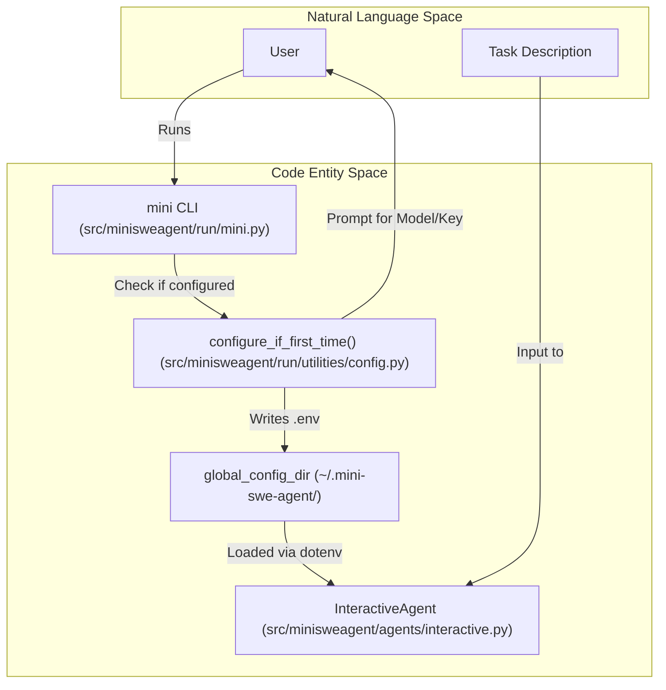
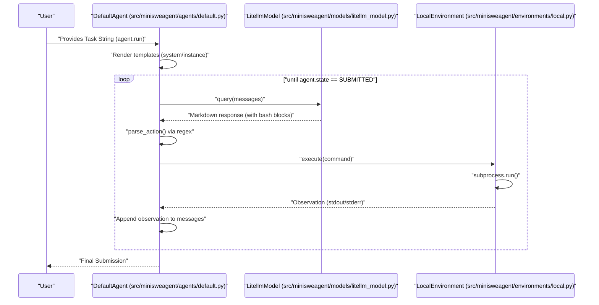

# Quick Start Guide

<details>
<summary>Relevant source files</summary>

The following files were used as context for generating this wiki page:

- [docs/quickstart.md](docs/quickstart.md)
- [mkdocs.yml](mkdocs.yml)
- [src/minisweagent/run/hello_world.py](src/minisweagent/run/hello_world.py)

</details>


This guide walks you through running `mini` for the first time, completing the setup wizard, selecting a model, and executing your first task using the provided CLI tools and Python bindings.

## First Run Experience

When you run `mini` for the first time, the system checks for existing configuration. If none is found, it automatically launches a setup wizard via `configure_if_first_time()` [src/minisweagent/run/mini.py:68]() to configure your environment and model provider.

### Configuration Wizard Flow

The logic for the first-time setup is primarily handled in the configuration management utilities.

Title: "First-time Configuration and Execution Flow"


Sources: [src/minisweagent/run/mini.py:68](), [docs/quickstart.md:122-129](), [src/minisweagent/run/utilities/config.py:1-20]()

The setup wizard performs the following:
1. Prompts for a model name (e.g., `anthropic/claude-3-5-sonnet-20241022`).
2. Prompts for the corresponding API key (e.g., `ANTHROPIC_API_KEY`).
3. Writes these values to the global config file.
4. If you miss the wizard, you can manually trigger it with `mini-extra config setup`. [docs/quickstart.md:124]()

Sources: [src/minisweagent/run/mini.py:68](), [docs/quickstart.md:122-129](), [src/minisweagent/run/utilities/config.py:1-20]()

## Available Commands

The package provides two primary entry points for users: `mini` and `mini-extra`. [docs/quickstart.md:13-18]()

| Command | Purpose | Implementation |
| :--- | :--- | :--- |
| `mini` | Main entry point for solving tasks interactively. | [src/minisweagent/run/mini.py:55]() |
| `mini-extra` | Utilities for config, SWE-bench, and inspection. | [src/minisweagent/run/mini_extra.py]() |

### Common CLI Flags for `mini`
- `-t` / `--task`: Provide the task directly via command line. [src/minisweagent/run/mini.py:60]()
- `-m` / `--model`: Override the default model for a single run. [src/minisweagent/run/mini.py:56]()
- `-y` / `--yolo`: Run in "You Only Look Once" mode (no confirmation for actions). [src/minisweagent/run/mini.py:61]()
- `-c` / `--config`: Path to config files or key-value pairs for recursive merging. [src/minisweagent/run/mini.py:63]()
- `-o` / `--output`: Specify the output trajectory file path. [src/minisweagent/run/mini.py:64]()

Sources: [src/minisweagent/run/mini.py:55-66](), [docs/quickstart.md:13-18]()

## Running Your First Task

### 1. Model Setup
Before running a task, ensure your model is configured. We recommend using `anthropic/claude-opus-4-6-20260205` for most tasks. Always include the provider prefix. [docs/quickstart.md:128-134]()

### 2. Execution via CLI
To start an interactive session:
```bash
mini
```
If no task is provided via `-t`, the agent will prompt: `What do you want to do?` using `_multiline_prompt()`. [src/minisweagent/run/mini.py:94-96]() You can then enter a prompt such as:
> "Implement a Sudoku solver in python in the sudoku folder. Make sure the codebase is modular and well tested with pytest." [docs/quickstart.md:115-116]()

Sources: [src/minisweagent/run/mini.py:94-96](), [docs/quickstart.md:115-116](), [docs/quickstart.md:128-134]()

### 3. Execution via Python API
For developers wanting to integrate `mini` into their own scripts, use the `DefaultAgent` or `InteractiveAgent` classes.

**Minimal Example: `hello_world.py`**
The following script demonstrates the basic data flow from a task string to an agent execution using `DefaultAgent`, `LitellmModel`, and `LocalEnvironment`. [src/minisweagent/run/hello_world.py:1-42]()

```python
from minisweagent.agents.default import DefaultAgent
from minisweagent.environments.local import LocalEnvironment
from minisweagent.models.litellm_model import LitellmModel

# 1. Initialize Model
model = LitellmModel(model_name="anthropic/claude-3-5-sonnet-20241022")

# 2. Initialize Environment
env = LocalEnvironment()

# 3. Run Agent
agent = DefaultAgent(model, env)
agent.run("Create a file named hello.txt with content 'Hello World'")
```

Sources: [src/minisweagent/run/hello_world.py:21-38](), [docs/quickstart.md:85-87]()

## Data Flow and Execution Loop

The core of `mini-swe-agent` is a linear history loop where the agent queries a model, parses a bash command, and executes it in a sandboxed environment.

Title: "Task-to-Execution Pipeline"


Sources: [src/minisweagent/run/mini.py:70-105](), [src/minisweagent/utils/serialize.py:20](), [docs/quickstart.md:112-119]()

### Key Implementation Details
- **Configuration Merging**: `mini` uses `recursive_merge` to combine default configs with CLI overrides from `config_spec`. [src/minisweagent/run/mini.py:72-92](), [src/minisweagent/utils/serialize.py:20]()
- **Stateless Commands**: The `LocalEnvironment` uses `subprocess.run` for every command. Because each call is a fresh process, state like `cd` or `export` does not persist between steps unless combined in a single command (e.g., `cd dir && ls`).
- **Linear History**: All interactions are stored in a flat list of messages, which are passed back to the model in every turn to maintain context.
- **Factory Methods**: The system uses `get_model` [src/minisweagent/models/__init__.py](), `get_environment` [src/minisweagent/environments/__init__.py](), and `get_agent` [src/minisweagent/agents/__init__.py]() to instantiate components based on the merged configuration. [src/minisweagent/run/mini.py:99-101]()

Sources: [src/minisweagent/run/mini.py:70-105](), [src/minisweagent/utils/serialize.py:20](), [docs/quickstart.md:112-119]()

## Example Prompts for Testing
To verify your installation and model setup, try these tasks:
1. **Fixing Tests**: "Please run pytest on the current project, discover failing unittests and help me fix them. Always make sure to test the final solution." [docs/quickstart.md:117]()
2. **Documentation**: "Help me document & type my codebase by adding short docstrings and type hints." [docs/quickstart.md:118]()

Sources: [docs/quickstart.md:112-119]()