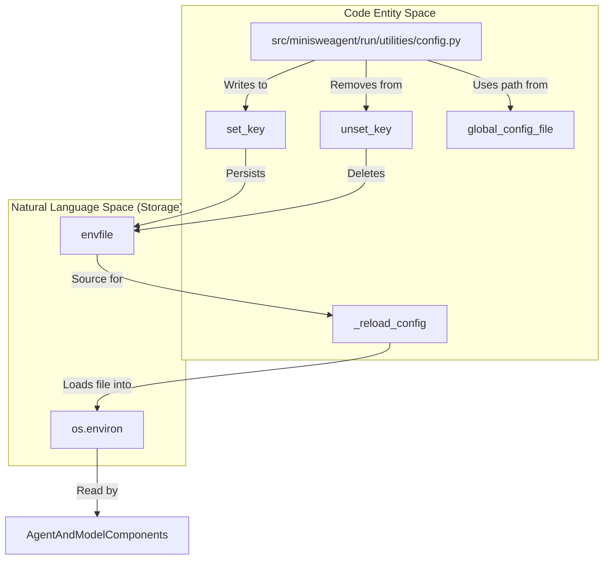
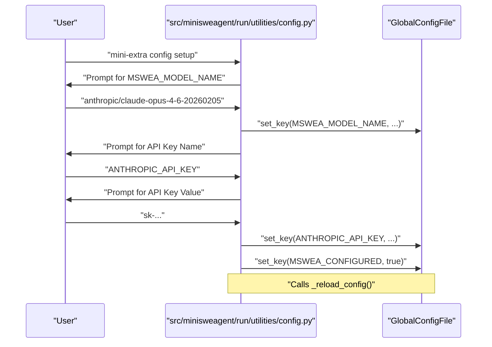

# Configuration Setup

Relevant source files

The following files were used as context for generating this wiki page:

- [.pre-commit-config.yaml](.pre-commit-config.yaml)
- [docs/usage/config.md](docs/usage/config.md)
- [src/minisweagent/agents/utils/__init__.py](src/minisweagent/agents/utils/__init__.py)
- [src/minisweagent/agents/utils/prompt_user.py](src/minisweagent/agents/utils/prompt_user.py)
- [src/minisweagent/run/utilities/config.py](src/minisweagent/run/utilities/config.py)
- [tests/run/test_extra_config.py](tests/run/test_extra_config.py)

This page details the technical implementation and usage of the configuration system in `mini-swe-agent`. It covers the global configuration lifecycle, the `mini-extra config` utility, and how API keys and default models are persisted.

---

## Overview

The configuration system manages persistent settings across sessions. It primarily interacts with a global `.env` file located in the user's configuration directory. This system ensures that sensitive information like API keys and preference-based settings like default models are available to the `Agent`, `Model`, and `Environment` components without requiring repetitive CLI arguments.

### Key Components

| Entity | Role | Code Reference |
| :--- | :--- | :--- |
| `global_config_file` | Path to the persistent `.env` storage. | [src/minisweagent/run/utilities/config.py:18-18]() |
| `configure_if_first_time` | Logic to trigger the setup wizard if `MSWEA_CONFIGURED` is missing. | [src/minisweagent/run/utilities/config.py:62-67]() |
| `_reload_config` | Function to refresh `os.environ` from the disk file using `load_dotenv`. | [src/minisweagent/run/utilities/config.py:21-22]() |
| `app` | The `Typer` application defining the `config` CLI subcommands. | [src/minisweagent/run/utilities/config.py:25-30]() |

Sources: [src/minisweagent/run/utilities/config.py:1-30]()

---

## Configuration Data Flow

The following diagram illustrates how the configuration utility interacts with the operating system and the persistent storage to provide settings to the agent.

Sources: [src/minisweagent/run/utilities/config.py:18-22](), [src/minisweagent/run/utilities/config.py:109-110](), [src/minisweagent/run/utilities/config.py:118-119]()

---

## Setup Wizard (`setup`)

The `setup` command provides an interactive walkthrough for new users. It is designed to be idempotent and can be re-run to update existing settings. It is automatically triggered by `configure_if_first_time` if the `MSWEA_CONFIGURED` environment variable is not set [src/minisweagent/run/utilities/config.py:62-67]().

### Implementation Details
- **Model Selection**: Prompts for a default model name. If the user provides one, it is saved as `MSWEA_MODEL_NAME` [src/minisweagent/run/utilities/config.py:73-78]().
- **API Key Mapping**: Allows users to specify an environment variable name (e.g., `ANTHROPIC_API_KEY`) and its corresponding value [src/minisweagent/run/utilities/config.py:82-87]().
- **Validation**: If a key name is provided without a value, the system warns the user but continues, assuming the key might be set in the shell environment already [src/minisweagent/run/utilities/config.py:88-91]().
- **Persistence**: Upon completion, it sets `MSWEA_CONFIGURED='true'` to prevent the wizard from auto-triggering on subsequent runs [src/minisweagent/run/utilities/config.py:92-92]().

Sources: [src/minisweagent/run/utilities/config.py:62-96](), [tests/run/test_extra_config.py:17-36]()

---

## Configuration Management CLI

The `mini-extra config` utility provides granular control over the global configuration via four primary subcommands.

### Command Reference

| Command | Function Name | Description |
| :--- | :--- | :--- |
| `setup` | `setup()` | Runs the full interactive initialization wizard. |
| `set` | `set(key, value)` | Sets a specific key-value pair. Prompts if arguments are missing. |
| `unset` | `unset(key)` | Removes a key from the `.env` file using `unset_key`. |
| `edit` | `edit()` | Opens the `.env` file in the system editor (defined by `$EDITOR` or `nano`). |

### Key Functions

#### `set` and `unset`
These functions wrap `python-dotenv` utilities (`set_key`, `unset_key`) to modify the file on disk. After every modification, `_reload_config()` is called to ensure the current process environment reflects the changes.
- **Source:** [src/minisweagent/run/utilities/config.py:100-120]()
- **Test Reference:** [tests/run/test_extra_config.py:117-173]()

#### `edit`
The `edit` function uses `subprocess.run` to launch a text editor [src/minisweagent/run/utilities/config.py:126-126](). This allows for manual batch updates or cleaning up the configuration file. It defaults to `nano` if the `EDITOR` environment variable is not set [src/minisweagent/run/utilities/config.py:125-125]().
- **Source:** [src/minisweagent/run/utilities/config.py:123-127]()

Sources: [src/minisweagent/run/utilities/config.py:100-127](), [tests/run/test_extra_config.py:117-173]()

---

## Configuration Precedence and Variables

Settings are resolved in the following order (highest priority first):
1. **Explicit CLI Arguments**: e.g., `mini --model <name>`
2. **Environment Variables**: Variables exported in the current shell (e.g., `export OPENAI_API_KEY=sk-...`).
3. **Global Config File**: Values stored in the `.env` file managed by `config.py`.

### Common Configuration Keys

| Variable | Usage |
| :--- | :--- |
| `MSWEA_MODEL_NAME` | The default model identifier (e.g., `anthropic/claude-opus-4-6-20260205`). |
| `MSWEA_CONFIGURED` | Boolean flag indicating setup completion. |
| `ANTHROPIC_API_KEY` | Credential for Anthropic models. |
| `OPENAI_API_KEY` | Credential for OpenAI models. |
| `GEMINI_API_KEY` | Credential for Google Gemini models. |

Sources: [src/minisweagent/run/utilities/config.py:42-44](), [src/minisweagent/run/utilities/config.py:78-92]()

---

## Interactive History

For interactive agent modes, the system maintains a command history separate from the configuration file. This is managed using `prompt_toolkit` to provide features like history searching (`Ctrl+R`) and multiline input.

- **History File**: `{global_config_dir}/interactive_history.txt` [src/minisweagent/agents/utils/prompt_user.py:7-7]()
- **Entity**: `FileHistory` object used by `PromptSession` [src/minisweagent/agents/utils/prompt_user.py:8-9]().
- **Toolbar**: Provides UI hints for submitting messages (`Esc, then Enter`) [src/minisweagent/agents/utils/prompt_user.py:15-19]().

Sources: [src/minisweagent/agents/utils/prompt_user.py:5-20]()