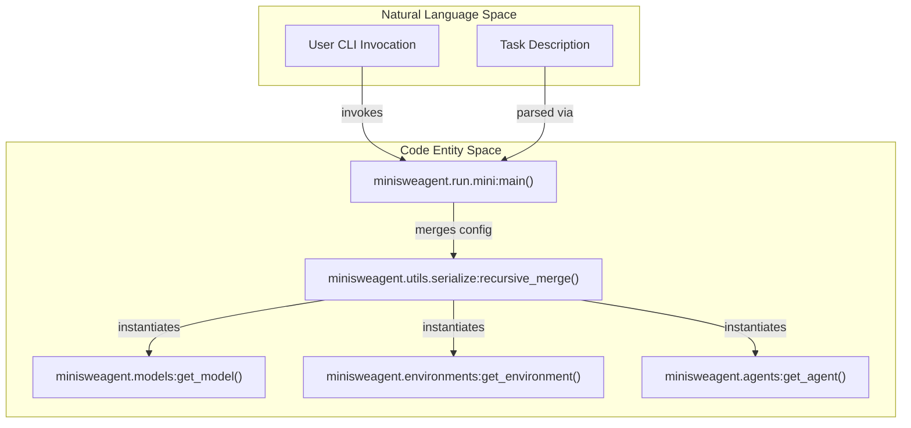
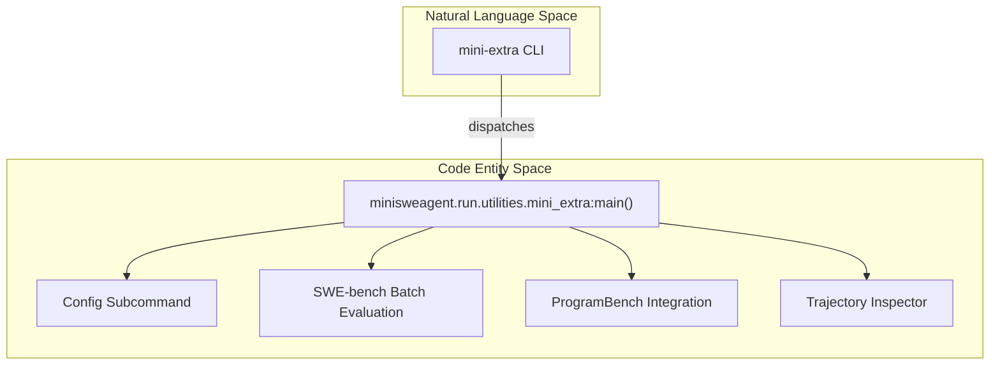

# Command Line Interface

Relevant source files

The following files were used as context for generating this wiki page:

- [src/minisweagent/run/mini.py](src/minisweagent/run/mini.py)
- [tests/run/test_cli_integration.py](tests/run/test_cli_integration.py)
- [tests/run/test_local.py](tests/run/test_local.py)
- [tests/run/test_run_hello_world.py](tests/run/test_run_hello_world.py)
- [tests/test_data/update_outputs_local.py](tests/test_data/update_outputs_local.py)

The Command Line Interface (CLI) provides the primary entry point for interacting with `mini-swe-agent`. The system exposes two main executables: `mini` for running the agent interactively in a local environment, and `mini-extra` for administrative tasks, configuration management, batch evaluations, and trajectory inspection.

For details on individual sub-topics, see the child pages:
- [mini Command](#3.1)
- [mini-extra Utilities](#3.2)
- [Interactive Modes](#3.3)

---

## CLI Overview and Architecture

The CLI is built using `typer` and `rich` to provide an interactive and responsive terminal experience [src/minisweagent/run/mini.py:10-12](). The entry point script `src/minisweagent/run/mini.py` handles argument parsing, configuration loading, and component instantiation.

Sources: [src/minisweagent/run/mini.py:54-105](), [src/minisweagent/utils/serialize.py:20]()

---

## 3.1 mini Command

The `mini` command is the main execution engine of `mini-swe-agent`. It parses command-line arguments, merges configuration files and overrides using `recursive_merge` [src/minisweagent/run/mini.py:92](), acquires the task statement (either via `--task` or an interactive prompt) [src/minisweagent/run/mini.py:60](), [src/minisweagent/run/mini.py:94-97](), and initializes the agent run loop [src/minisweagent/run/mini.py:102]().

For comprehensive documentation on options (`--model`, `--task`, `--yolo`, `--config`, `--output`, etc.), configuration merging rules, and usage examples, see [mini Command](#3.1).

Sources: [src/minisweagent/run/mini.py:54-106]()

---

## 3.2 mini-extra Utilities

The `mini-extra` utility suite provides subcommands for workflows outside of standard single-instance execution. This includes global configuration management, batch execution on benchmarks like SWE-bench and ProgramBench, single-instance debugging, and trajectory inspection.

For detailed documentation on each utility subcommand (`config`, `swebench`, `swebench-single`, `programbench`, `inspector`), see [mini-extra Utilities](#3.2).

Sources: [src/minisweagent/run/utilities/mini_extra.py]()

---

## 3.3 Interactive Modes

When running `mini`, the agent operates within configurable execution modes that govern how actions are validated and executed. Users can dynamically switch between confirmation modes, fully autonomous YOLO modes, and human-in-the-loop control using built-in slash commands.

For details on confirm/yolo/human modes, available slash commands, and mode-switching behavior, see [Interactive Modes](#3.3).

Sources: [src/minisweagent/run/mini.py:61](), [src/minisweagent/run/mini.py:79]()