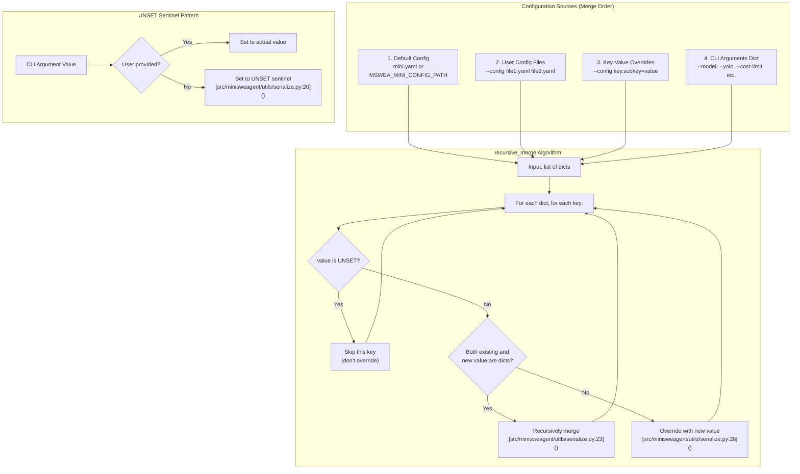
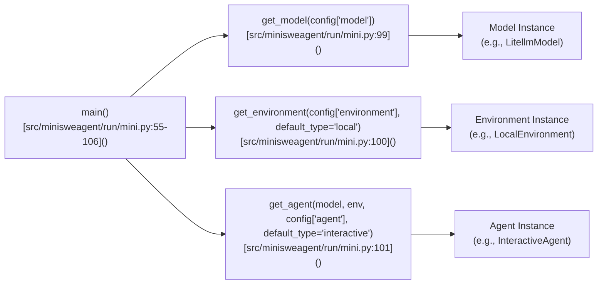

# mini Command

<details>
<summary>Relevant source files</summary>

The following files were used as context for generating this wiki page:

- [docs/contributing.md](docs/contributing.md)
- [docs/usage/mini.md](docs/usage/mini.md)
- [src/minisweagent/run/mini.py](src/minisweagent/run/mini.py)
- [tests/run/test_cli_integration.py](tests/run/test_cli_integration.py)
- [tests/run/test_local.py](tests/run/test_local.py)
- [tests/run/test_run_hello_world.py](tests/run/test_run_hello_world.py)
- [tests/test_data/update_outputs_local.py](tests/test_data/update_outputs_local.py)

</details>


The `mini` command is the primary entry point for running mini-SWE-agent in your local environment. It orchestrates the creation of a Model, Environment, and Agent, merges configuration from multiple sources, and executes the agent run loop.

For information about the `mini-extra` utilities, see [mini-extra Utilities](#3.2). For details about interactive modes (confirm, yolo, human), see [Interactive Modes](#3.3).

## Purpose and Scope

The `mini` command provides a command-line interface to run mini-SWE-agent on a specified task. It handles:

- Configuration loading and merging from multiple sources.
- Model, environment, and agent instantiation via factory functions.
- Task specification (via CLI or interactive prompt).
- Trajectory output to file.
- First-time setup initialization via `configure_if_first_time()`.

The command is implemented in [src/minisweagent/run/mini.py:54-106]() and exposed through the `mini` executable.

Sources: [src/minisweagent/run/mini.py:1-109](), [docs/usage/mini.md:1-13]()

## Command Syntax

```bash
mini [OPTIONS]
```

The command accepts options that override configuration values. All options are optional; if critical values are missing, the command will prompt for them or use defaults.

Sources: [src/minisweagent/run/mini.py:54-66]()

## CLI Options

The following table lists all CLI options accepted by the `mini` command:

| Option | Short | Type | Default | Description | Panel |
|--------|-------|------|---------|-------------|-------|
| `--model` | `-m` | `str` | None | Model to use (e.g., `gpt-4o`) | Basic |
| `--task` | `-t` | `str` | None | Task/problem statement to execute | Basic |
| `--yolo` | `-y` | `bool` | `False` | Run without confirmation (sets `agent.mode=yolo`) | Basic |
| `--cost-limit` | `-l` | `float` | None | Cost limit in USD; set to 0 to disable | Basic |
| `--config` | `-c` | `list[str]` | `["mini.yaml"]` | Config files or key-value overrides | Basic |
| `--output` | `-o` | `Path` | `last_mini_run.traj.json` | Output trajectory file path | Basic |
| `--model-class` | | `str` | None | Model class (e.g., `litellm`) | Advanced |
| `--agent-class` | | `str` | None | Agent class (e.g., `interactive`) | Advanced |
| `--environment-class` | | `str` | None | Environment class (e.g., `local`) | Advanced |
| `--exit-immediately` | | `bool` | `False` | Exit immediately on completion without prompting | Advanced |

**Important**: If `--config` is specified, the default config file (`mini.yaml`) is **not** automatically included. You must explicitly include it: `-c mini.yaml -c model.model_kwargs.temperature=0`. [src/minisweagent/run/mini.py:33-47]()

Sources: [src/minisweagent/run/mini.py:54-66](), [docs/usage/mini.md:16-25]()

## Execution Flow

The `mini` command follows a structured execution flow from CLI invocation to agent execution:

Title: "miniExecutionFlow"

```mermaid
graph TB
    CLIInvoke["CLI Invocation<br/>mini --model gpt-4 --task ..."]
    
    ConfigFirst["configure_if_first_time()<br/>First-run setup wizard<br/>[src/minisweagent/run/mini.py:68]()"]
    
    ParseConfig["Parse config_spec<br/>For each spec in --config<br/>[src/minisweagent/run/mini.py:72]()"]
    
    GetConfigSpec["get_config_from_spec(spec)<br/>Returns dict from YAML or key=value<br/>[src/minisweagent/run/mini.py:72]()"]
    
    BuildCLIDict["Build CLI overrides dict<br/>task, yolo, cost_limit, output, etc.<br/>[src/minisweagent/run/mini.py:73-91]()"]
    
    RecursiveMerge["recursive_merge(*configs)<br/>Merge all dicts with precedence<br/>[src/minisweagent/run/mini.py:92]()"]
    
    CheckTask{"Task provided?<br/>[src/minisweagent/run/mini.py:94]()"}
    
    PromptTask["_multiline_prompt()<br/>Interactive task input<br/>[src/minisweagent/run/mini.py:96]()"]
    
    GetModel["get_model(config['model'])<br/>Factory: instantiate Model<br/>[src/minisweagent/run/mini.py:99]()"]
    
    GetEnv["get_environment(config['environment'])<br/>Factory: instantiate Environment<br/>default_type='local'<br/>[src/minisweagent/run/mini.py:100]()"]
    
    GetAgent["get_agent(model, env, config['agent'])<br/>Factory: instantiate Agent<br/>default_type='interactive'<br/>[src/minisweagent/run/mini.py:101]()"]
    
    RunAgent["agent.run(run_task)<br/>Execute agent loop<br/>[src/minisweagent/run/mini.py:102]()"]
    
    SaveOutput["Save trajectory<br/>to config['agent']['output_path']<br/>[src/minisweagent/run/mini.py:103-104]()"]
    
    ReturnAgent["Return agent instance<br/>[src/minisweagent/run/mini.py:105]()"]
    
    CLIInvoke --> ConfigFirst
    ConfigFirst --> ParseConfig
    ParseConfig --> GetConfigSpec
    GetConfigSpec --> BuildCLIDict
    BuildCLIDict --> RecursiveMerge
    RecursiveMerge --> CheckTask
    CheckTask -->|No| PromptTask
    CheckTask -->|Yes| GetModel
    PromptTask --> GetModel
    GetModel --> GetEnv
    GetEnv --> GetAgent
    GetAgent --> RunAgent
    RunAgent --> SaveOutput
    SaveOutput --> ReturnAgent
```


**Key Implementation Details**:

1. **First-time configuration**: [src/minisweagent/run/mini.py:68]() calls `configure_if_first_time()` to run the setup wizard if `.env` or config doesn't exist.
2. **Config spec parsing**: [src/minisweagent/run/mini.py:72]() processes each `--config` argument through `get_config_from_spec()`.
3. **CLI overrides**: [src/minisweagent/run/mini.py:73-91]() builds a dict with all CLI options, using `UNSET` sentinel for unprovided values.
4. **Recursive merge**: [src/minisweagent/run/mini.py:92]() merges all configs with proper precedence using `recursive_merge`.
5. **Task prompt**: [src/minisweagent/run/mini.py:94-97]() prompts for task if not provided via `--task` using `_multiline_prompt`.
6. **Factory instantiation**: [src/minisweagent/run/mini.py:99-101]() uses factory functions `get_model`, `get_environment`, and `get_agent`.

Sources: [src/minisweagent/run/mini.py:68-105](), [tests/run/test_cli_integration.py:18-53]()

## Configuration Merging with UNSET Sentinel

The `mini` command implements a configuration merging strategy using the `UNSET` sentinel pattern. This enables proper precedence handling where CLI arguments override config files without accidentally setting values to `None`.

Title: "ConfigMergingAndUNSETPattern"


**UNSET Sentinel Pattern**: The `UNSET` object (defined in [src/minisweagent/utils/serialize.py:20]()) distinguishes "not specified" from "explicitly set to None". When a CLI argument is not provided, it's set to `UNSET` rather than `None`, causing `recursive_merge` to skip it during merge [src/minisweagent/run/mini.py:75-91]().

**Merge Precedence**: Later configs override earlier ones. The order is:
1. Default config file (lowest priority).
2. User-specified config files (in order).
3. Key-value overrides from `--config`.
4. Direct CLI arguments (highest priority).

**Recursive Behavior**: When both the existing result and new value are dicts, they're merged recursively [src/minisweagent/utils/serialize.py:20-29](). This enables fine-grained overrides like `--config model.model_kwargs.temperature=0.5` without replacing the entire `model` section.

Sources: [src/minisweagent/run/mini.py:68-92](), [src/minisweagent/utils/serialize.py:1-29]()

## Default Configuration Files

The `mini` command uses default configuration files that can be overridden:

| Configuration | Environment Variable | Default Path | Usage |
|---------------|---------------------|--------------|-------|
| Config file | `MSWEA_MINI_CONFIG_PATH` | `builtin_config_dir/mini.yaml` | Default config loaded if `--config` not specified |
| Output file | N/A | `global_config_dir/last_mini_run.traj.json` | Default trajectory output path |

The `builtin_config_dir` points to [src/minisweagent/config/]() and contains built-in configuration files. The `global_config_dir` is platform-specific.

Sources: [src/minisweagent/run/mini.py:22-23]()

## Usage Examples

### Basic Usage with Model and Task

```bash
mini --model gpt-4o --task "Fix the bug in parser.py"
```

This runs with the default `mini.yaml` config, GPT-4o model, and the specified task.

Sources: [tests/run/test_cli_integration.py:141-185]()

### YOLO Mode (No Confirmation)

```bash
mini -m gpt-4o -t "Add tests for authentication" -y
```

The `-y/--yolo` flag sets `agent.mode=yolo`, disabling action confirmation prompts [src/minisweagent/run/mini.py:79]().

Sources: [tests/run/test_cli_integration.py:187-227](), [docs/usage/mini.md:27-38]()

### Custom Config with Overrides

```bash
mini -c mini.yaml -c model.model_kwargs.temperature=0.7 --model gpt-4o --task "Refactor utils"
```

This loads `mini.yaml`, then applies key-value overrides, then applies CLI arguments.

Sources: [src/minisweagent/run/mini.py:33-47]()

### Interactive Task Input

```bash
mini --model gpt-4o
```

If `--task` is not provided, the command prompts for multi-line task input using `_multiline_prompt()` [src/minisweagent/run/mini.py:96]().

Sources: [tests/run/test_cli_integration.py:97-139](), [src/minisweagent/run/mini.py:94-97]()

## Output and Trajectory Files

The `mini` command saves execution results to a trajectory file in JSON format:

**Default Output Location**: `~/.config/mini-swe-agent/last_mini_run.traj.json` (platform-specific) [src/minisweagent/run/mini.py:23]()

**Custom Output**: Use `--output` or `-o` to specify a different path:
```bash
mini --model gpt-4o --task "Fix bug" --output /tmp/run.traj.json
```

On successful save, the command prints:
```
Saved trajectory to '/path/to/output.traj.json'
```

Sources: [src/minisweagent/run/mini.py:103-104](), [docs/usage/mini.md:42-43]()

## Integration with Factory Functions

The `mini` command uses three factory functions to instantiate components:

Title: "NaturalLanguageCLIToCodeEntities"


The `default_type` parameter specifies the fallback if no class is specified in config:
- Model: Determined by `get_model` factory [src/minisweagent/run/mini.py:99]().
- Environment: `'local'` (LocalEnvironment) [src/minisweagent/run/mini.py:100]().
- Agent: `'interactive'` (InteractiveAgent) [src/minisweagent/run/mini.py:101]().

Sources: [src/minisweagent/run/mini.py:99-101](), [tests/run/test_cli_integration.py:55-95]()