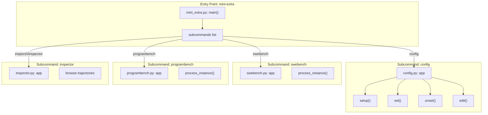
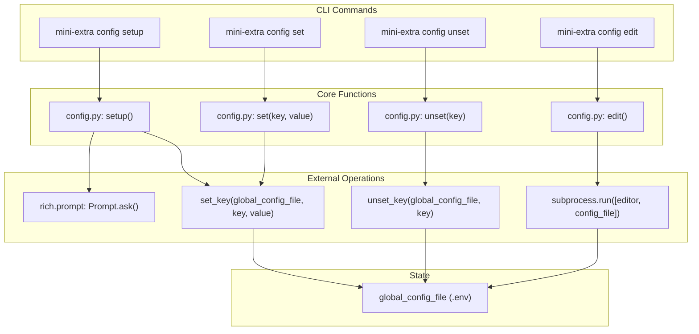
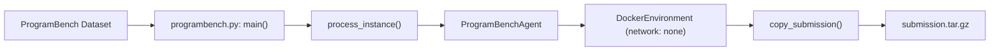

# mini-extra Utilities

Relevant source files

The following files were used as context for generating this wiki page:

- [docs/reference/models/requesty.md](docs/reference/models/requesty.md)
- [docs/reference/run/config.md](docs/reference/run/config.md)
- [docs/reference/run/inspector.md](docs/reference/run/inspector.md)
- [docs/reference/run/mini_extra.md](docs/reference/run/mini_extra.md)
- [src/minisweagent/run/benchmarks/programbench.py](src/minisweagent/run/benchmarks/programbench.py)
- [src/minisweagent/run/benchmarks/swebench.py](src/minisweagent/run/benchmarks/swebench.py)
- [src/minisweagent/run/benchmarks/utils/common.py](src/minisweagent/run/benchmarks/utils/common.py)
- [src/minisweagent/run/utilities/mini_extra.py](src/minisweagent/run/utilities/mini_extra.py)
- [tests/run/test_programbench.py](tests/run/test_programbench.py)

The `mini-extra` command provides a central entry point for additional utilities that support and extend the main `mini` agent functionality. These utilities handle configuration management, batch processing for SWE-bench and ProgramBench evaluations, trajectory inspection, and other administrative tasks.

[src/minisweagent/run/utilities/mini_extra.py:3-6]()

## Available Utilities Overview

The `mini-extra` utilities are organized into several distinct subcommands. The `mini-extra` script dynamically imports and invokes these subcommands based on the provided arguments using `import_module`.

[src/minisweagent/run/utilities/mini_extra.py:13-18](), [src/minisweagent/run/utilities/mini_extra.py:41-43]()

### mini-extra Command Structure

Sources: [src/minisweagent/run/utilities/mini_extra.py:13-19](), [src/minisweagent/run/utilities/mini_extra.py:35-45]()

## Configuration Management

The `config` utility manages the global `.env` file that stores API keys, default models, and system-wide settings. It is implemented using the `Typer` framework and interacts with the filesystem via configuration helpers.

[src/minisweagent/run/utilities/config.py:1-1](), [docs/reference/run/config.md:1-15]()

### Configuration Implementation Flow

Sources: [docs/reference/run/config.md:1-15]()

### Configuration Commands

| Command | Function | Purpose |
|---------|----------|---------|
| `mini-extra config setup` | `setup()` | Interactive wizard to set default model and API keys. Sets `MSWEA_CONFIGURED='true'`. |
| `mini-extra config set KEY [VALUE]` | `set(key, value)` | Set specific configuration values. Prompts for value if omitted. |
| `mini-extra config unset KEY` | `unset(key)` | Remove configuration keys from the global `.env` file. |
| `mini-extra config edit` | `edit()` | Opens the config file in the system editor (uses `$EDITOR` or `nano`). |

Sources: [docs/reference/run/config.md:1-15]()

## SWE-bench Integration

The SWE-bench utilities handle large-scale evaluation of software engineering tasks. They are split into batch processing (`swebench`) and single-instance debugging (`swebench-single`).

### Batch Evaluation (`swebench`)

The `swebench` command allows running the agent over multiple instances in parallel. It uses `process_instance` to handle the lifecycle of a single task.

*   **Parallelism**: Uses `concurrent.futures.ThreadPoolExecutor` to manage worker threads. [src/minisweagent/run/benchmarks/swebench.py:6-6]()
*   **Environment Setup**: `get_sb_environment` dynamically selects the image (e.g., `docker.io/swebench/sweb.eval.x86_64...`) based on the instance ID. [src/minisweagent/run/benchmarks/swebench.py:68-88]()
*   **Persistence**: Results are written to a central `preds.json` file, protected by `_OUTPUT_FILE_LOCK` to ensure thread safety. [src/minisweagent/run/benchmarks/swebench.py:65-65](), [src/minisweagent/run/benchmarks/swebench.py:97-108]()
*   **Dataset Mapping**: Supports multiple versions including `lite`, `verified`, `multimodal`, and `smith`. [src/minisweagent/run/benchmarks/swebench.py:53-62]()

### Single Instance Testing (`swebench-single`)

The `swebench-single` command is designed for interactive debugging. It launches an agent on a specific SWE-bench instance, allowing human-in-the-loop control and trajectory inspection during the run.

Sources: [src/minisweagent/run/benchmarks/swebench.py:122-178](), [src/minisweagent/run/benchmarks/swebench.py:68-94](), [src/minisweagent/run/benchmarks/swebench.py:97-108]()

## ProgramBench Integration

The `programbench` utility evaluates the agent on reverse-engineering tasks. It requires the `programbench` package and uses specialized logic to handle binary environments and workspace extraction.

### Data Flow and Submission

*   **Network Isolation**: The default `programbench.yaml` configures Docker with `--network none` in `run_args` to prevent the agent from accessing external resources during reverse engineering. [tests/run/test_programbench.py:97-103](), [tests/run/test_programbench.py:106-126]()
*   **Submission Handling**: The `copy_submission` function uses `tar -czf` inside the container followed by `docker cp` to extract the agent's workspace as a `submission.tar.gz` file for evaluation. [src/minisweagent/run/benchmarks/programbench.py:46-61](), [tests/run/test_programbench.py:61-83]()
*   **Trajectory Bloat Prevention**: `ProgramBenchAgent` overrides `serialize` to remove `raw_output` from messages and observations, keeping trajectory files manageable. [src/minisweagent/run/benchmarks/programbench.py:33-43]()

Sources: [src/minisweagent/run/benchmarks/programbench.py:63-117](), [src/minisweagent/run/benchmarks/programbench.py:46-61](), [src/minisweagent/run/benchmarks/programbench.py:33-43](), [tests/run/test_programbench.py:97-103]()

## Trajectory Inspector

The `inspector` utility (aliases: `inspect`, `i`, `inspector`) provides a terminal-based interface for browsing trajectory files (`.traj.json`).

### Key Features
*   **Navigation**: Allows users to browse through the linear history of an agent's run step-by-step.
*   **Content Analysis**: Displays reasoning, bash commands executed, and the resulting environment output.
*   **Stats**: Shows cost tracking and token usage per step, facilitating model performance analysis.

Sources: [src/minisweagent/run/utilities/mini_extra.py:15-15](), [docs/reference/run/inspector.md:1-13]()

## Batch Progress Tracking

Both `swebench` and `programbench` utilize the `RunBatchProgressManager` and `ProgressTrackingAgent` to provide feedback during execution.

*   **ProgressTrackingAgent**: A subclass of `DefaultAgent` that updates the UI with the current step number and accumulated cost during the `step()` call via the `progress_manager`. [src/minisweagent/run/benchmarks/utils/common.py:7-17]()
*   **UI**: Uses `rich.live.Live` to provide a real-time dashboard of all active worker threads and their current status (e.g., "Pulling/starting environment", "Step 5 ($0.12)"). [src/minisweagent/run/benchmarks/swebench.py:17-17](), [src/minisweagent/run/benchmarks/swebench.py:138-138](), [src/minisweagent/run/benchmarks/programbench.py:11-11]()

Sources: [src/minisweagent/run/benchmarks/utils/common.py:7-17](), [src/minisweagent/run/benchmarks/swebench.py:137-138](), [src/minisweagent/run/benchmarks/programbench.py:74-75]()