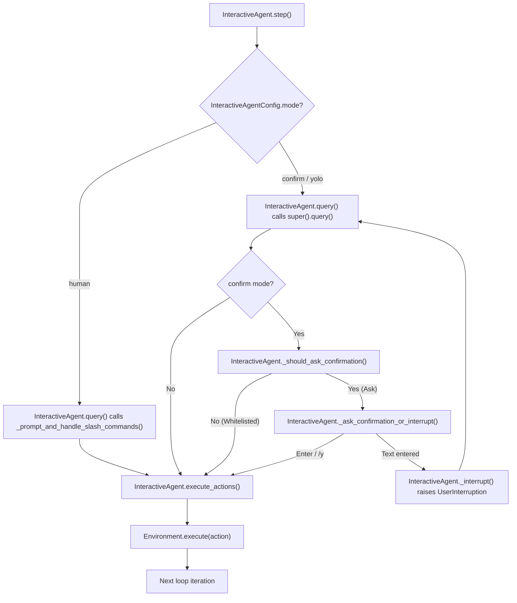
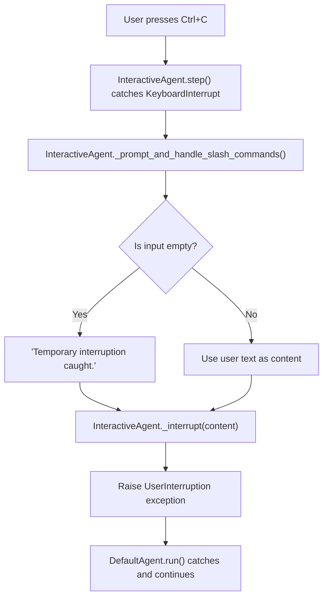
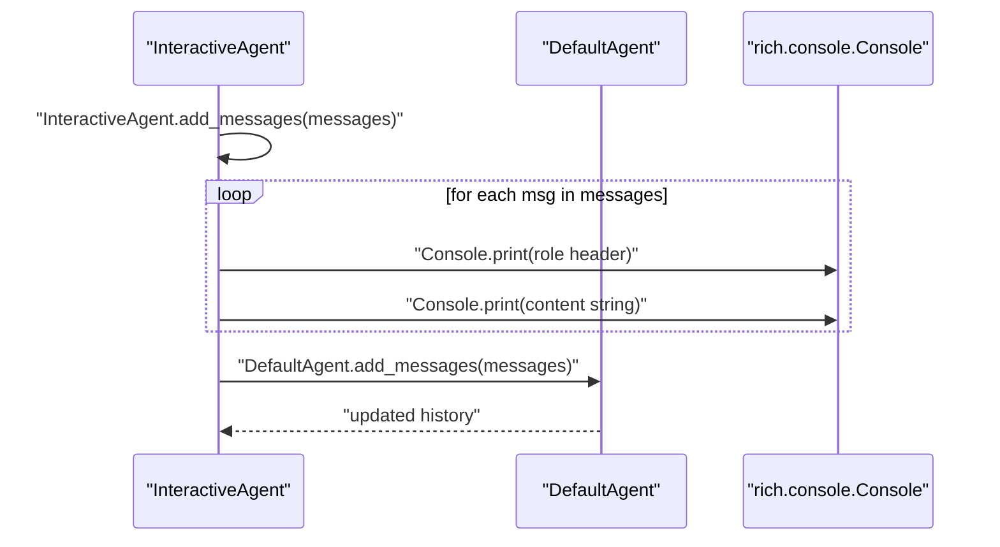

# Interactive Modes

<details>
<summary>Relevant source files</summary>

The following files were used as context for generating this wiki page:

- [src/minisweagent/agents/interactive.py](src/minisweagent/agents/interactive.py)
- [tests/agents/test_interactive.py](tests/agents/test_interactive.py)

</details>


The purpose of this page is to document the interactive capabilities provided by `InteractiveAgent` [src/minisweagent/agents/interactive.py:33](), which extends `DefaultAgent` to support user-in-the-loop workflows. This includes the three operational modes (**confirm**, **yolo**, and **human**), slash commands, mode switching, keyboard interrupt handling, and confirmation mechanisms.

## Mode Overview

The three modes control command generation and execution flow:

| Mode | Command Source | Execution | Configuration |
|------|---------------|-----------|---------------|
| **confirm** | LM generates | User approves (Enter) or rejects (type message) | `mode: "confirm"` (default) [src/minisweagent/agents/interactive.py:25]() |
| **yolo** | LM generates | Immediate, no prompt | `mode: "yolo"` or `-y` flag [src/minisweagent/run/mini.py:61]() |
| **human** | User types | Immediate | Switch via `/u` command [src/minisweagent/agents/interactive.py:34]() |

**Mode Flow Diagram**



Sources: [src/minisweagent/agents/interactive.py:1-7](), [src/minisweagent/agents/interactive.py:24-31](), [src/minisweagent/agents/interactive.py:60-94](), [src/minisweagent/agents/interactive.py:109-139]()

### Confirm Mode

The LM generates bash commands which must be approved before execution. The agent displays a prompt via `_ask_confirmation_or_interrupt` [src/minisweagent/agents/interactive.py:171-187]():
```
Execute 1 action(s)? [Enter to confirm], [type comment to reject], or [/h to show available commands]
> 
```

User responses handled in `_ask_confirmation_or_interrupt`:
- **Press Enter**: Execute the command [src/minisweagent/agents/interactive.py:183-184]()
- **Type message**: Reject with feedback, agent raises `UserInterruption` [src/minisweagent/agents/interactive.py:186-187]()
- **Type `/u`**: Reject and switch to human mode [src/minisweagent/agents/interactive.py:183-184]()
- **Type `/y`**: Accept command and switch to yolo mode for future actions [src/minisweagent/agents/interactive.py:183-184]()

**Whitelist Actions**: Commands matching regex patterns in `whitelist_actions` execute without confirmation. Example: `whitelist_actions: ["echo.*", "ls.*"]` allows all `echo` and `ls` commands. This logic is implemented in `_should_ask_confirmation` [src/minisweagent/agents/interactive.py:168-169]().

Sources: [src/minisweagent/agents/interactive.py:124-140](), [src/minisweagent/agents/interactive.py:168-187](), [src/minisweagent/agents/interactive.py:33-34]()

### Yolo Mode

The LM generates commands that execute immediately without user approval. This mode provides maximum automation speed for batch processing or trusted tasks. Set via `-y`/`--yolo` CLI flag or `mode: "yolo"` in config [src/minisweagent/run/mini.py:61](), [src/minisweagent/agents/interactive.py:25]().

The agent displays a status spinner `Waiting for the LM to respond...` [src/minisweagent/agents/interactive.py:73]() during query but does not pause for confirmation unless the agent wants to finish (if `confirm_exit: true`) [src/minisweagent/agents/interactive.py:146-153]().

Sources: [src/minisweagent/agents/interactive.py:72-74](), [src/minisweagent/agents/interactive.py:124-139](), [src/minisweagent/run/mini.py:61]()

### Human Mode

The user types bash commands directly instead of the LM generating them. The agent executes user commands via `self.env.execute`, observes output, and adds results to the conversation history, but does not query the LM for that step.

In human mode, `InteractiveAgent.query()` bypasses the model call and returns a message dictionary containing the user's manually entered command [src/minisweagent/agents/interactive.py:60-71](). Use `/c` or `/y` to return control to the LM.

Sources: [src/minisweagent/agents/interactive.py:60-71]()

## Slash Commands

Slash commands provide control over mode switching and help display. Commands are entered at any user prompt: confirmation prompts, human mode prompts, or after keyboard interrupts.

| Command | Action | Mapping |
|---------|--------|---------|
| `/c` | Switch to confirm mode | `"confirm"` |
| `/y` | Switch to yolo mode | `"yolo"` |
| `/u` | Switch to human mode | `"human"` |
| `/h` | Display help | N/A |
| `/m` | Enter multiline input mode | N/A |

**Implementation Details**

The `_prompt_and_handle_slash_commands` method processes slash commands using prompt sessions [src/minisweagent/agents/utils/prompt_user.py](). It checks for recognized slash prefixes, updates `self.config.mode` accordingly via `_MODE_COMMANDS_MAPPING` [src/minisweagent/agents/interactive.py:34](), or triggers multiline input/help displays.

Sources: [src/minisweagent/agents/interactive.py:34]()

## Keyboard Interrupts

Pressing `Ctrl+C` during the execution loop triggers a `KeyboardInterrupt`, which `InteractiveAgent` catches in its overridden `step()` method [src/minisweagent/agents/interactive.py:114]().

**Interrupt Handling Flow**



The interrupt prompt allows the user to inject a comment to the LM or switch modes. If the user just presses Enter, a default message is used [src/minisweagent/agents/interactive.py:120-121](). The `_interrupt` helper raises a `UserInterruption` exception containing the message with `role: "user"` and metadata `interrupt_type: "UserInterruption"` [src/minisweagent/agents/interactive.py:40-41]().

Sources: [src/minisweagent/agents/interactive.py:40-41](), [src/minisweagent/agents/interactive.py:109-122]()

## Configuration

The `InteractiveAgentConfig` class [src/minisweagent/agents/interactive.py:24-31]() defines the parameters for interactive behavior.

### Whitelist Actions

The `whitelist_actions` list [src/minisweagent/agents/interactive.py:27-28]() contains regex patterns for commands that bypass confirmation in `confirm` mode. The check is performed in `_should_ask_confirmation` [src/minisweagent/agents/interactive.py:168-169]():

```python
def _should_ask_confirmation(self, action: str) -> bool:
    return self.config.mode == "confirm" and not any(re.match(r, action) for r in self.config.whitelist_actions)
```

### Confirm Exit

The `confirm_exit` parameter (default `True`) [src/minisweagent/agents/interactive.py:29-30]() controls behavior when the agent attempts to submit a solution.

When the agent raises a `Submitted` exception, `execute_actions` catches it and calls `_check_for_new_task_or_submit` [src/minisweagent/agents/interactive.py:133-134](). If `confirm_exit` is enabled, the user is prompted to either:
1. Press **Enter** to allow the submission to proceed (re-raising the `Submitted` exception) [src/minisweagent/agents/interactive.py:162-163]().
2. Type a **new task** to continue execution, which raises a `UserInterruption` with `itype="UserNewTask"` [src/minisweagent/agents/interactive.py:165-166]().

Sources: [src/minisweagent/agents/interactive.py:24-31](), [src/minisweagent/agents/interactive.py:133-134](), [src/minisweagent/agents/interactive.py:144-166]()

## Data Flow: Interactive Message Handling

`InteractiveAgent` overrides `add_messages` to provide real-time terminal feedback while maintaining the internal message history.



The agent uses `get_content_string` [src/minisweagent/models/utils/content_string.py:1-20]() to handle different message formats (text vs tool calls) and formats the output using `rich` for better readability [src/minisweagent/agents/interactive.py:43-56]().

Sources: [src/minisweagent/agents/interactive.py:43-56](), [src/minisweagent/models/utils/content_string.py:1-20]()