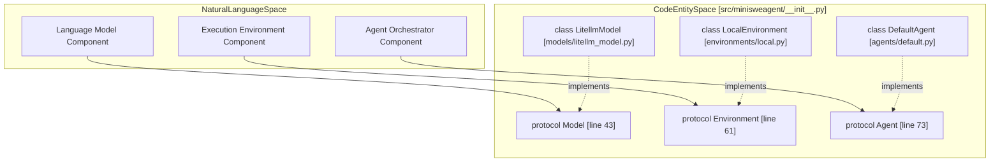
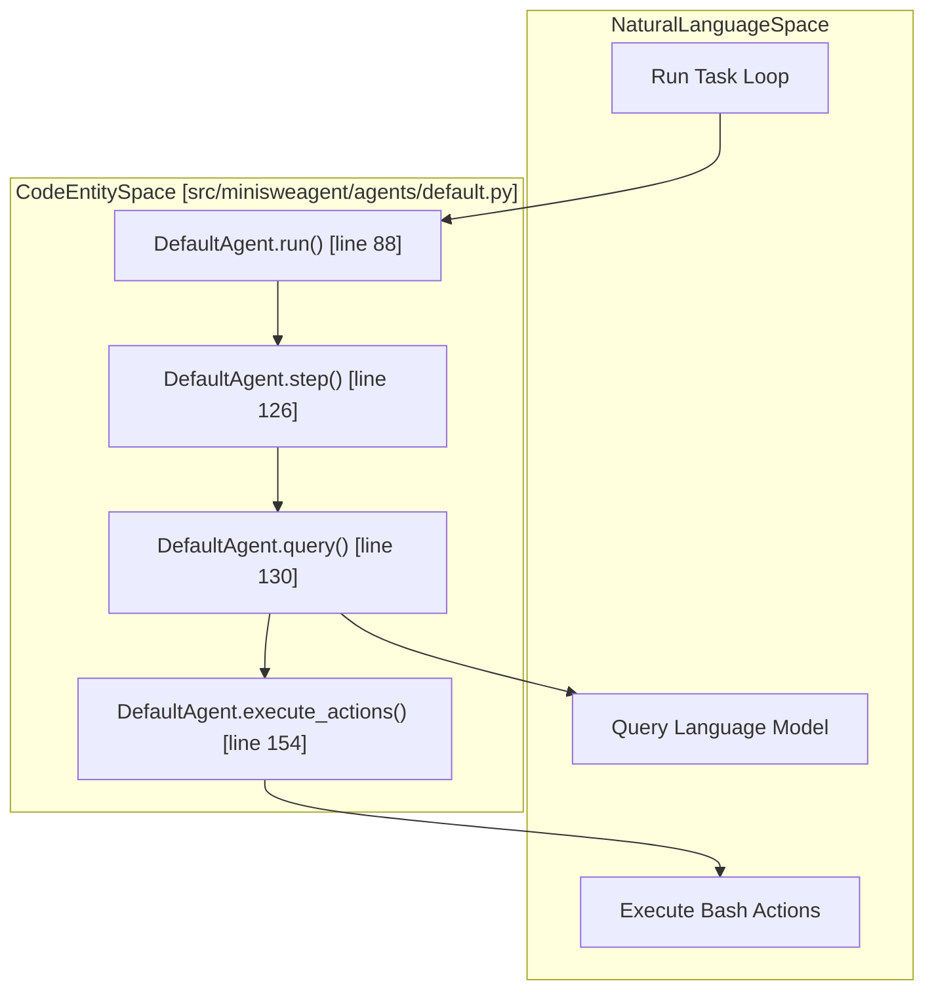

# Core Architecture

Relevant source files

The following files were used as context for generating this wiki page:

- [src/minisweagent/__init__.py](src/minisweagent/__init__.py)
- [src/minisweagent/agents/default.py](src/minisweagent/agents/default.py)
- [src/minisweagent/models/test_models.py](src/minisweagent/models/test_models.py)
- [tests/agents/test_default.py](tests/agents/test_default.py)

This document provides a high-level technical overview of mini-swe-agent's core system architecture. The architecture is designed around minimalism, protocol-based loose coupling, and a linear message history. 

This page serves as a parent overview. For detailed technical specifications, see the child sections:
- [Protocol System](#4.1) — Duck typing, protocols (`Model`, `Environment`, `Agent`), and extension points [src/minisweagent/__init__.py:39-82]()
- [Agent System](#4.2) — Orchestration logic, including `DefaultAgent` [src/minisweagent/agents/default.py:38]() and `InteractiveAgent`
- [Model Integration](#4.3) — Language model providers, factory functions, and action parsing strategies
- [Execution Environments](#4.4) — Sandboxing and command execution via `LocalEnvironment`, `DockerEnvironment`, and others
- [Message Flow and Linear History](#4.5) — Append-only message design and the `extra` metadata dictionary
- [Exception Handling](#4.6) — Control flow via `InterruptAgentFlow` and its subclasses [src/minisweagent/exceptions.py:1-26]()

---

## Protocol System

mini-swe-agent decouples its core components (`Model`, `Environment`, and `Agent`) using Python's structural subtyping via `typing.Protocol` [src/minisweagent/__init__.py:39-82](). This eliminates rigid class inheritance hierarchies, allowing custom implementations to integrate seamlessly as long as they satisfy the protocol signatures.

### Protocol Architecture

For details on protocol duck typing, method signatures, and extension points, see [Protocol System](#4.1).

**Sources:** [src/minisweagent/__init__.py:39-82]()

---

## Agent System

The agent system is responsible for orchestrating the task execution loop. The primary implementation is `DefaultAgent` [src/minisweagent/agents/default.py:38](), which handles configuration parsing, template rendering, history tracking, and the core step loop.

### Control Flow and Execution Loop

For detailed documentation on agent initialization, run loops, step execution, serialization, and interactive extensions, see [Agent System](#4.2), [DefaultAgent](#4.2.1), and [InteractiveAgent](#4.2.2).

**Sources:** [src/minisweagent/agents/default.py:38-165]()

---

## Model Integration

Model integration bridges the agent with external language model providers via `LitellmModel` and alternative adapters. It handles token queries, response parsing across multiple formats (text-based regex, tool calls, and Responses API), and global cost tracking.

For detailed information on model factories, provider configurations, action parsing strategies, and cost management, see [Model Integration](#4.3).

**Sources:** [src/minisweagent/models/__init__.py]()

---

## Execution Environments

Execution environments provide sandboxed or local runtimes where bash commands generated by the model are evaluated. Implementations range from direct subprocess execution (`LocalEnvironment`) to containerized isolations (`DockerEnvironment`, `SingularityEnvironment`, `BubblewrapEnvironment`).

For comprehensive documentation on environment lifecycles, configuration options, and specialized HPC/container backends, see [Execution Environments](#4.4).

**Sources:** [src/minisweagent/environments/local.py]()

---

## Message Flow and Linear History

The agent maintains state as a flat, append-only list of message dictionaries (`self.messages`) [src/minisweagent/agents/default.py:42](). Each turn appends new entries corresponding to system instructions, user prompts, assistant thoughts/actions, and environment observations. Metadata such as execution cost, timestamps, and return codes are encapsulated within an `extra` field on each message.

For a complete breakdown of message roles, structural patterns, and the linear history design, see [Message Flow and Linear History](#4.5).

**Sources:** [src/minisweagent/agents/default.py:42-157]()

---

## Exception Handling

Control flow anomalies and termination signals are managed via a dedicated exception hierarchy inheriting from `InterruptAgentFlow`. This includes signals for successful task completion (`Submitted`), resource boundaries (`LimitsExceeded`, `TimeExceeded`), user interrupts (`UserInterruption`), and malformed model outputs (`FormatError`).

For detailed documentation on exception classes, propagation rules, and recovery behaviors, see [Exception Handling](#4.6).

**Sources:** [src/minisweagent/exceptions.py:1-26](), [src/minisweagent/agents/default.py:96-121]()