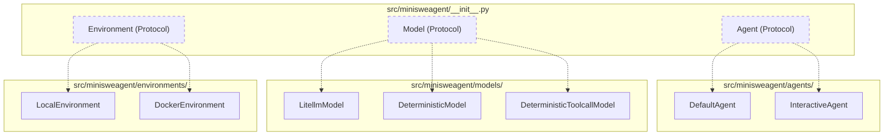
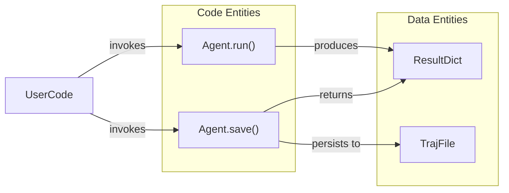
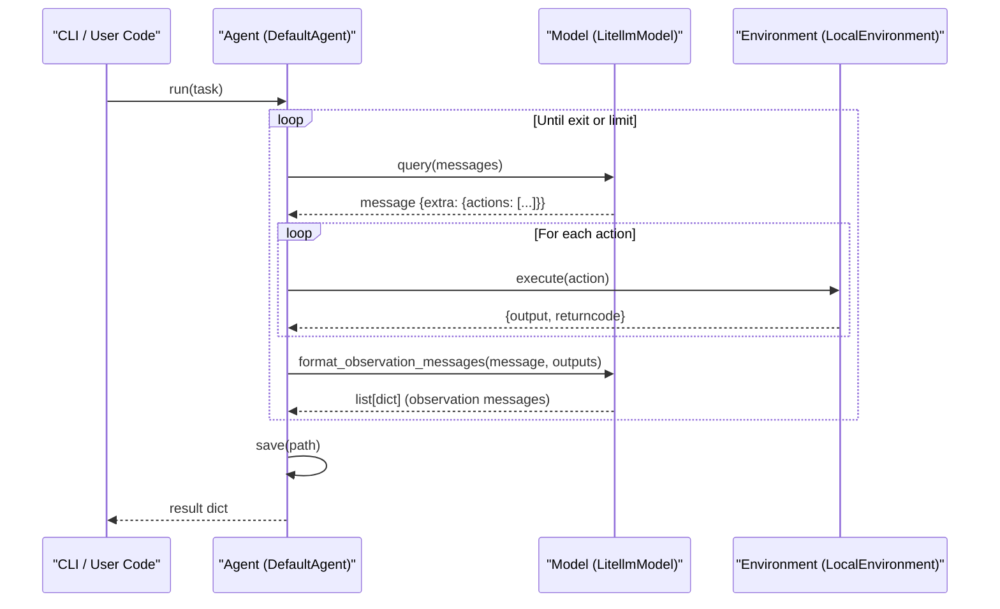

# Protocol System

Relevant source files

The following files were used as context for generating this wiki page:

- [src/minisweagent/__init__.py](src/minisweagent/__init__.py)
- [src/minisweagent/models/test_models.py](src/minisweagent/models/test_models.py)

This page explains mini-swe-agent's protocol-based architecture, which defines interfaces for the three core components: Agent, Model, and Environment. The protocol system enables loose coupling, extensibility, and component swapping through structural subtyping (duck typing) without requiring inheritance.

For implementation details of specific components, see [Agent System](#4.2), [Model Integration](#4.3), and [Execution Environments](#4.4).

## What are Protocols?

mini-swe-agent uses Python's `typing.Protocol` types to define interfaces via duck typing. A class can function as an Agent, Model, or Environment as long as it implements the required methods and attributes, eliminating the need for base class inheritance or explicit registry registration [src/minisweagent/__init__.py:7-8]().

The core protocols are defined in `src/minisweagent/__init__.py` [src/minisweagent/__init__.py:43-81]() and serve two main purposes:
1. **Static Type Checking**: Allowing static analysis tools to verify component compatibility [src/minisweagent/__init__.py:40]().
2. **Contract Documentation**: Explicitly outlining the required API surface for each component type.

**Sources**: [src/minisweagent/__init__.py:1-92]()

## Protocol Definitions Overview

The following diagram maps the high-level system protocols defined in `src/minisweagent/__init__.py` to their concrete implementations across the codebase.

### Component Mapping: Protocol to Implementation

**Sources**: [src/minisweagent/__init__.py:43-81](), [src/minisweagent/models/test_models.py:104-143](), [src/minisweagent/models/test_models.py:160-180]()

## Agent Protocol

The `Agent` protocol defines the interface for agent implementations that orchestrate model queries and environment execution loops [src/minisweagent/__init__.py:73-81]().

### Required Attributes

| Attribute | Type | Description |
|-----------|------|-------------|
| `config` | `Any` | Configuration object (typically an `AgentConfig` or subclass instance) |

### Required Methods

#### `run(task: str, **kwargs) -> dict`

Executes the agent loop until completion or interruption, returning a dictionary containing the final trajectory and execution metadata [src/minisweagent/__init__.py:78]().

#### `save(path: Path | None, *extra_dicts) -> dict`

Serializes the agent state and optionally writes it to disk. Accepts additional dictionaries to merge into the output structure [src/minisweagent/__init__.py:80]().

### Agent Execution and Serialization Flow

This diagram bridges natural language expectations of agent execution and persistence to the underlying code entities (`Agent.run` and `Agent.save`).

**Sources**: [src/minisweagent/__init__.py:73-81]()

## Model Protocol

The `Model` protocol defines the interface for language model wrappers. Models interact with LLM providers, parse executable actions from responses, and format observation messages [src/minisweagent/__init__.py:43-59]().

### Required Attributes

| Attribute | Type | Description |
|-----------|------|-------------|
| `config` | `Any` | Configuration object (typically a `ModelConfig` or subclass instance) |

### Required Methods

#### `query(messages: list[dict[str, str]], **kwargs) -> dict`

Sends a list of message dictionaries to the language model and returns the assistant's response dictionary, populated with parsed actions inside its `extra` field [src/minisweagent/__init__.py:48]().

#### `format_message(**kwargs) -> dict`

Creates a properly structured message dictionary for system, user, or exit messages [src/minisweagent/__init__.py:50]().

#### `format_observation_messages(message: dict, outputs: list[dict], template_vars: dict | None = None) -> list[dict]`

Formats raw execution outputs into observation messages compatible with the model's expected prompt or message history format (such as tool-call responses) [src/minisweagent/__init__.py:52-54]().

#### `get_template_vars(**kwargs) -> dict[str, Any]`

Returns model-specific key-value pairs for interpolation into Jinja2 templates [src/minisweagent/__init__.py:56]().

#### `serialize() -> dict`

Returns a JSON-serializable dictionary capturing the current model configuration and state for trajectory logging [src/minisweagent/__init__.py:58]().

**Sources**: [src/minisweagent/__init__.py:43-59](), [src/minisweagent/models/test_models.py:110-143]()

## Environment Protocol

The `Environment` protocol defines the interface for isolated command execution backends. Environments execute actions (such as bash commands) and return execution results [src/minisweagent/__init__.py:61-71]().

### Required Attributes

| Attribute | Type | Description |
|-----------|------|-------------|
| `config` | `Any` | Configuration object (typically an `EnvironmentConfig` or subclass instance) |

### Required Methods

#### `execute(action: dict, cwd: str = "") -> dict[sfr, Any]` (or `dict[str, Any]`)

Executes a given action dictionary (typically containing a `command` key) and returns output metrics [src/minisweagent/__init__.py:66]().

Returns a dictionary containing:
- `output`: Combined stdout and stderr string output.
- `returncode`: Integer exit code of the executed command.

#### `get_template_vars(**kwargs) -> dict[str, Any]`

Returns environment-specific variables (such as the current working directory) for template rendering [src/minisweagent/__init__.py:68]().

#### `serialize() -> dict`

Returns a JSON-serializable dictionary capturing environment state for trajectory persistence [src/minisweagent/__init__.py:70]().

**Sources**: [src/minisweagent/__init__.py:61-71]()

## Duck Typing and Component Extension

mini-swe-agent's protocol architecture relies entirely on structural typing. Classes do not need to inherit from `Agent`, `Model`, or `Environment` base classes.

### Extension Points

- **No Inheritance Required**: Developers can create custom components by implementing the required method signatures.
- **Static Verification**: Type checkers like `mypy` or `pyright` can verify structural compliance against the protocols defined in `src/minisweagent/__init__.py` [src/minisweagent/__init__.py:43-81]().
- **Testing & Mocking**: Custom test models (such as `DeterministicModel` in `src/minisweagent/models/test_models.py` [src/minisweagent/models/test_models.py:104-143]()) conform to the `Model` protocol without pulling in heavy API dependencies.

**Sources**: [src/minisweagent/__init__.py:1-92](), [src/minisweagent/models/test_models.py:104-180]()

## Protocol Method Call Flow

This sequence diagram illustrates how agent execution invokes methods across the `Agent`, `Model`, and `Environment` protocols during a single reasoning and execution step.

### Step Execution Sequence

**Sources**: [src/minisweagent/__init__.py:43-81]()