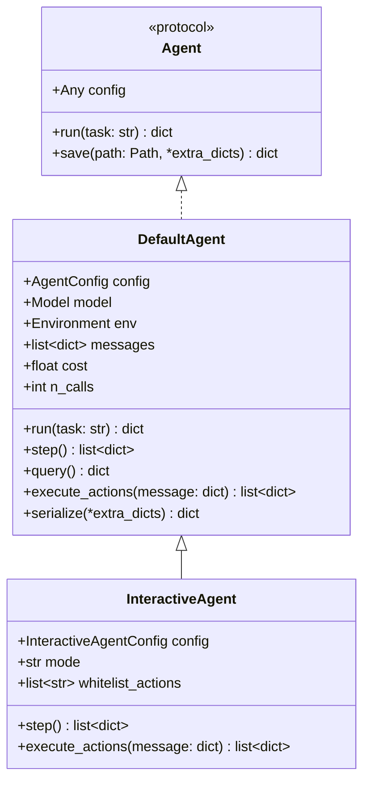
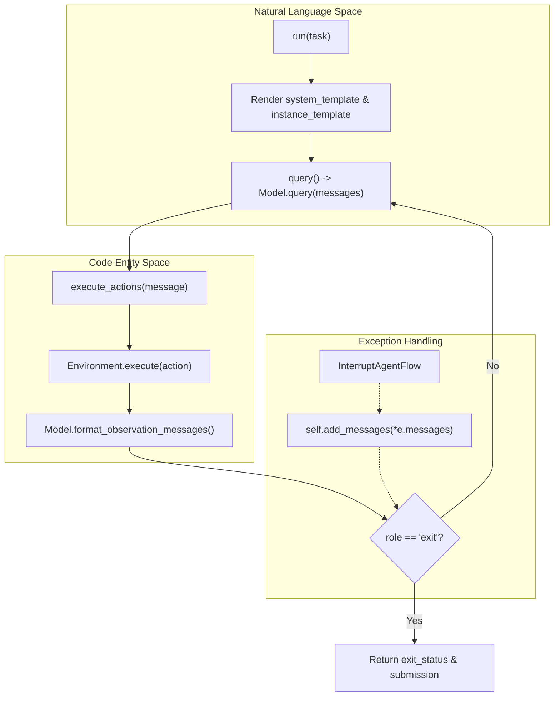

# Agent System

<details>
<summary>Relevant source files</summary>

The following files were used as context for generating this wiki page:

- [src/minisweagent/agents/README.md](src/minisweagent/agents/README.md)
- [src/minisweagent/agents/__init__.py](src/minisweagent/agents/__init__.py)
- [tests/agents/test_init.py](tests/agents/test_init.py)

</details>


The agent system orchestrates the interaction between language models and execution environments. Mini-swe-agent provides a modular architecture where agents manage the control loop, message history, and decision-making process.

This page provides an overview of the agent architecture and implementations. For detailed documentation of each agent, see:
- [DefaultAgent](#4.2.1) — Autonomous execution loop and core logic.
- [InteractiveAgent](#4.2.2) — Human-in-the-loop with confirmation modes and slash commands.

For model integration details, see [Model Integration](#4.3). For execution environment details, see [Execution Environments](#4.4).

## Agent Protocol

All agents should ideally implement the `Agent` protocol. This protocol ensures agents are interchangeable at the interface level, allowing the CLI and evaluation scripts to interact with different implementations uniformly.

**Agent Protocol Interface**

```python
class Agent(Protocol):
    """Protocol for agents."""

    config: Any

    def run(self, task: str, **kwargs) -> dict: ...

    def save(self, path: Path | None, *extra_dicts) -> dict: ...
```

Sources: [src/minisweagent/__init__.py:73-81]()

## Agent Implementations Hierarchy

The codebase provides two primary agent implementations. `DefaultAgent` handles the base logic of querying a model and executing actions in an environment, while `InteractiveAgent` extends this to support user intervention. Agents are typically instantiated via the `get_agent` factory function [src/minisweagent/agents/__init__.py:25-28]().

**Agent Implementation Hierarchy**



Sources: [src/minisweagent/agents/default.py:38-50](), [src/minisweagent/agents/interactive.py:33-38](), [src/minisweagent/agents/__init__.py:8-11]()

### Comparison Table

| Feature | DefaultAgent | InteractiveAgent |
|---------|--------------|------------------|
| **Primary Use Case** | Autonomous execution, SWE-bench evaluation | Human-guided debugging, interactive tasks |
| **User Interaction** | None | CLI prompts via `prompt_session` |
| **Mode Switching** | N/A | `/u` (human), `/c` (confirm), `/y` (yolo) |
| **Action Confirmation** | No | Yes (configurable via `mode`) |
| **Whitelist Support** | No | Yes (`whitelist_actions` regex) |
| **Interruption Handling**| Standard exceptions | Custom `UserInterruption` handling |
| **Config Class** | `AgentConfig` | `InteractiveAgentConfig` |

Sources: [src/minisweagent/agents/default.py:19-35](), [src/minisweagent/agents/interactive.py:24-30](), [src/minisweagent/agents/interactive.py:34-34]()

## DefaultAgent: Autonomous Execution

`DefaultAgent` is the base implementation providing the core control loop. It operates fully autonomously by alternating between querying the language model and executing the returned actions in the environment.

**Key Characteristics:**
- **Linear History**: Maintains a `self.messages` list containing the full trajectory of the interaction [src/minisweagent/agents/default.py:42]().
- **Template Rendering**: Uses Jinja2 to render `system_template` and `instance_template` with variables from the agent, model, and environment [src/minisweagent/agents/default.py:52-67]().
- **Limit Enforcement**: Automatically stops execution if `step_limit`, `cost_limit`, or `wall_time_limit_seconds` is exceeded [src/minisweagent/agents/default.py:130-145]().
- **Serialization**: Produces a standardized JSON trajectory format including `model_stats` and `config` [src/minisweagent/agents/default.py:159-173]().

For details, see [DefaultAgent](#4.2.1).

Sources: [src/minisweagent/agents/default.py:38-173]()

## InteractiveAgent: Human-in-the-Loop

`InteractiveAgent` extends `DefaultAgent` to allow real-time human intervention. It is the default agent used when running the `mini` CLI without specific automation flags.

**Key Characteristics:**
- **Execution Modes**: Supports `human` (user in control), `confirm` (user approves model actions), and `yolo` (autonomous) [src/minisweagent/agents/interactive.py:25-25]().
- **Slash Commands**: Users can change modes or interrupt the flow using commands like `/u`, `/c`, or `/y` [src/minisweagent/agents/interactive.py:34-34]().
- **Safety Whitelist**: Allows specific bash commands to execute without confirmation even in `confirm` mode via `whitelist_actions` regex [src/minisweagent/agents/interactive.py:27-28]().
- **Interactive Limits**: When limits are exceeded, the agent prompts the user to enter new limits instead of exiting [src/minisweagent/agents/interactive.py:88-94]().

For details, see [InteractiveAgent](#4.2.2).

Sources: [src/minisweagent/agents/interactive.py:33-156]()

## Execution Loop and Message Flow

The agent system bridges the "Natural Language Space" (messages/templates) and the "Code Entity Space" (shell commands/environment execution) through a structured loop.

### Control Flow Diagram



Sources: [src/minisweagent/agents/default.py:88-122](), [src/minisweagent/agents/default.py:126-128](), [src/minisweagent/agents/default.py:154-157]()

### Message State Transition

The agent manages the transition of state between the LLM and the environment by appending messages to the `messages` list.

| Step | Entity | Role | Content Source |
| :--- | :--- | :--- | :--- |
| 1 | `DefaultAgent` | `system` | `AgentConfig.system_template` [src/minisweagent/agents/default.py:93]() |
| 2 | `DefaultAgent` | `user` | `AgentConfig.instance_template` [src/minisweagent/agents/default.py:94]() |
| 3 | `Model` | `assistant` | `Model.query()` response [src/minisweagent/agents/default.py:149]() |
| 4 | `Environment` | `tool` / `user` | `Model.format_observation_messages()` [src/minisweagent/agents/default.py:157]() |
| 5 | `DefaultAgent` | `exit` | Triggered by `InterruptAgentFlow` subclasses [src/minisweagent/agents/default.py:108-111]() |

Sources: [src/minisweagent/agents/default.py:88-157](), [src/minisweagent/exceptions.py:1-26]()

## Exception Handling System

The agent uses a custom exception hierarchy, `InterruptAgentFlow`, to manage non-standard control transitions.

- **`Submitted`**: Raised when the agent detects a completion signal (e.g., `COMPLETE_TASK_AND_SUBMIT_FINAL_OUTPUT`) [src/minisweagent/exceptions.py:9-10]().
- **`LimitsExceeded`**: Raised when `step_limit` or `cost_limit` is reached [src/minisweagent/agents/default.py:132-139]().
- **`TimeExceeded`**: A specialized `LimitsExceeded` for wall-clock time [src/minisweagent/agents/default.py:140-147]().
- **`FormatError`**: Raised when the model output cannot be parsed into valid actions. It tracks `n_consecutive_format_errors` to avoid infinite loops [src/minisweagent/agents/default.py:100-112]().
- **`UserInterruption`**: Used by `InteractiveAgent` to signal manual interruption [src/minisweagent/agents/interactive.py:40-41]().

When these exceptions are caught in the `run()` loop, the agent adds the associated messages to history and terminates if an `exit` role is present [src/minisweagent/agents/default.py:96-123]().

Sources: [src/minisweagent/agents/default.py:96-123](), [src/minisweagent/exceptions.py:1-26]()