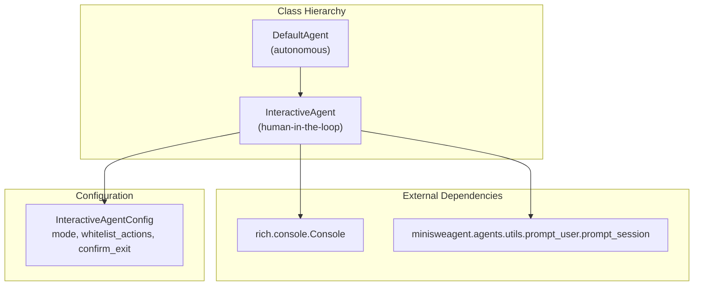
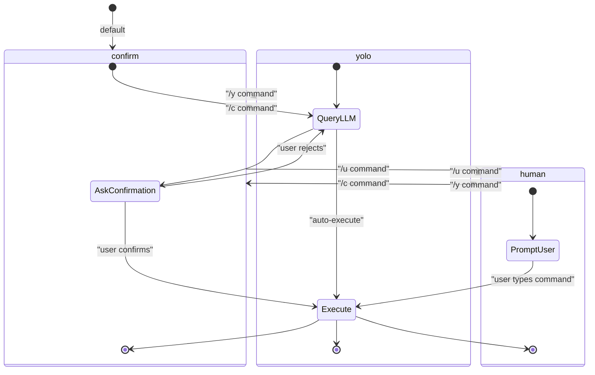
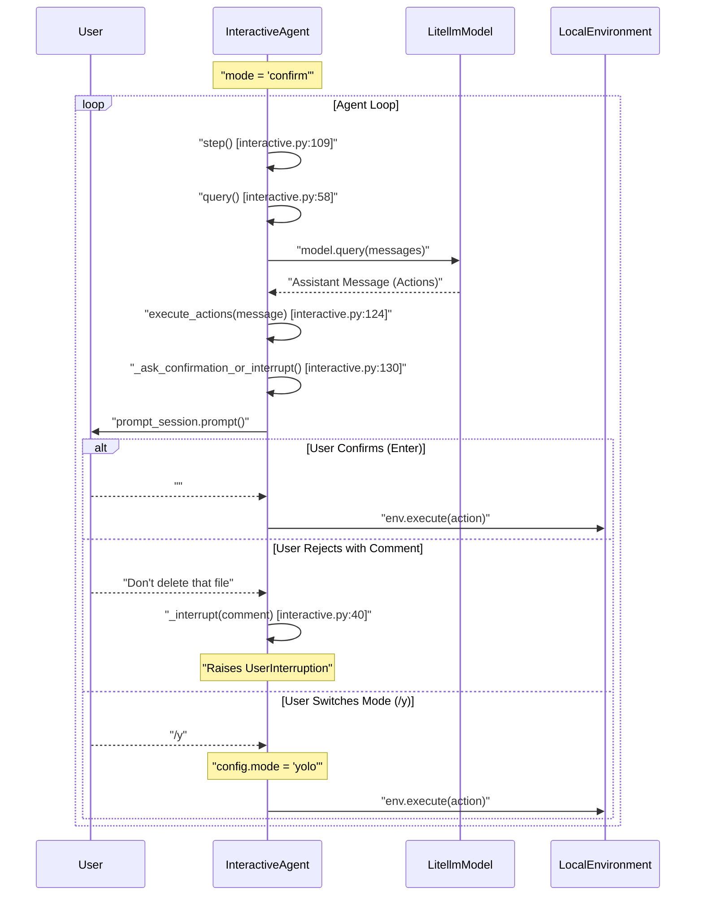

# InteractiveAgent

Relevant source files

The following files were used as context for generating this wiki page:

- [src/minisweagent/agents/interactive.py](src/minisweagent/agents/interactive.py)
- [src/minisweagent/agents/utils/__init__.py](src/minisweagent/agents/utils/__init__.py)
- [src/minisweagent/agents/utils/prompt_user.py](src/minisweagent/agents/utils/prompt_user.py)
- [src/minisweagent/run/utilities/config.py](src/minisweagent/run/utilities/config.py)
- [tests/agents/test_interactive.py](tests/agents/test_interactive.py)

The `InteractiveAgent` extends `DefaultAgent` to enable human-in-the-loop operation with three interaction modes: human command input, action confirmation, and autonomous execution. It provides a command-line interface where users can interactively control agent behavior, confirm or reject proposed actions, and switch between operational modes during execution.

## Class Overview

`InteractiveAgent` is defined in [src/minisweagent/agents/interactive.py:33]() and inherits from `DefaultAgent` [src/minisweagent/agents/default.py:72](). It overrides key methods to inject user interaction points into the agent control loop.

**Sources:** [src/minisweagent/agents/interactive.py:24-37](), [src/minisweagent/agents/default.py:72]()

## Configuration

The `InteractiveAgentConfig` dataclass extends `AgentConfig` with three additional fields:

| Field | Type | Default | Description |
|-------|------|---------|-------------|
| `mode` | `Literal["human", "confirm", "yolo"]` | `"confirm"` | Operational mode controlling action execution |
| `whitelist_actions` | `list[str]` | `[]` | Regex patterns for actions that bypass confirmation |
| `confirm_exit` | `bool` | `True` | Whether to confirm when agent signals completion |

**Sources:** [src/minisweagent/agents/interactive.py:24-31]()

## Operational Modes

The agent operates in one of three modes, switchable at runtime via slash commands defined in `_MODE_COMMANDS_MAPPING` [src/minisweagent/agents/interactive.py:34]():

### Mode Definitions

**Mode Behavior:**

- **`confirm`**: LLM proposes actions; user confirms or rejects each action (unless whitelisted) [src/minisweagent/agents/interactive.py:3-7](), [src/minisweagent/agents/interactive.py:124-132]().
- **`human`**: User types commands directly into the prompt; LLM is not queried for actions [src/minisweagent/agents/interactive.py:60-71]().
- **`yolo`**: LLM proposes actions that execute immediately without confirmation [src/minisweagent/agents/interactive.py:124-132]().

**Sources:** [src/minisweagent/agents/interactive.py:3-7](), [src/minisweagent/agents/interactive.py:34](), [src/minisweagent/agents/interactive.py:60-71](), [src/minisweagent/agents/interactive.py:124-132]()

## Method Overrides

### add_messages Override
[src/minisweagent/agents/interactive.py:43-56]()

Extends the base method to print messages to the console using `rich.console.Console`. It displays the current step number (`self.n_calls`) and total session cost (`self.cost`) in the header for assistant messages [src/minisweagent/agents/interactive.py:49]().

### query Override
[src/minisweagent/agents/interactive.py:58-94]()

Modifies LLM querying behavior:
1. **Human Mode**: If `self.config.mode == "human"`, it bypasses the LLM and prompts the user for a bash command using `_prompt_and_handle_slash_commands` [src/minisweagent/agents/interactive.py:60-61]().
2. **Limit Handling**: Catches `LimitsExceeded` exceptions. If stdin is interactive [src/minisweagent/agents/interactive.py:81](), it allows the user to manually increase `step_limit` and `cost_limit` to resume execution [src/minisweagent/agents/interactive.py:92-93]().

### step Override
[src/minisweagent/agents/interactive.py:109-122]()

Wraps the base `step()` method to handle `KeyboardInterrupt` (`Ctrl+C`). When interrupted, it prompts the user for a comment or command and raises a `UserInterruption` exception via `_interrupt` [src/minisweagent/agents/interactive.py:122]().

### execute_actions Override
[src/minisweagent/agents/interactive.py:124-139]()

Injects a confirmation step before execution. It calls `_ask_confirmation_or_interrupt` [src/minisweagent/agents/interactive.py:130](), which checks if any of the proposed commands require confirmation based on the `mode` and `whitelist_actions`. It uses a `try/finally` block to ensure observation messages are formatted even if execution is interrupted [src/minisweagent/agents/interactive.py:135-139]().

### _check_for_new_task_or_submit
[src/minisweagent/agents/interactive.py:144-151]()

Called when the agent attempts to finish (via `Submitted` exception). If `confirm_exit` is enabled [src/minisweagent/agents/interactive.py:146](), it prompts the user to either quit (Enter) or provide a new task to continue the trajectory [src/minisweagent/agents/interactive.py:149]().

**Sources:** [src/minisweagent/agents/interactive.py:43-151]()

## Slash Command Handling

The `_prompt_and_handle_slash_commands` method manages runtime state changes based on the `_MODE_COMMANDS_MAPPING` [src/minisweagent/agents/interactive.py:34]():

| Command | Mode / Action | Implementation |
|---------|---------------|----------------|
| `/h` | Show help | Displays available commands and current mode |
| `/y` | Switch to YOLO | Sets `self.config.mode = "yolo"` |
| `/c` | Switch to Confirm | Sets `self.config.mode = "confirm"` |
| `/u` | Switch to Human | Sets `self.config.mode = "human"` |

**Sources:** [src/minisweagent/agents/interactive.py:34](), [src/minisweagent/agents/interactive.py:61](), [src/minisweagent/agents/interactive.py:115]()

## Control Flow Diagram

This diagram bridges the Natural Language interaction with the code entities in `InteractiveAgent`.

**Sources:** [src/minisweagent/agents/interactive.py:40-132](), [src/minisweagent/agents/interactive.py:58-109]()