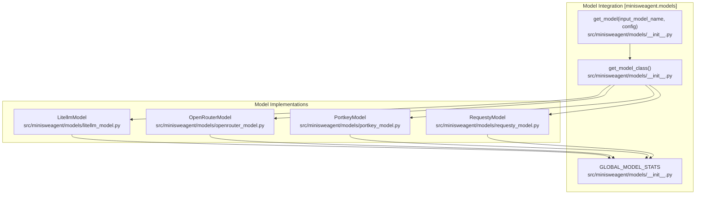

# Model Integration

Relevant source files

The following files were used as context for generating this wiki page:

- [docs/models/quickstart.md](docs/models/quickstart.md)
- [docs/reference/models/litellm_response_toolcall.md](docs/reference/models/litellm_response_toolcall.md)
- [docs/reference/models/overview.md](docs/reference/models/overview.md)
- [docs/reference/models/portkey.md](docs/reference/models/portkey.md)
- [src/minisweagent/models/README.md](src/minisweagent/models/README.md)
- [src/minisweagent/models/__init__.py](src/minisweagent/models/__init__.py)
- [tests/models/test_init.py](tests/models/test_init.py)

The purpose of this section is to provide a high-level overview of the model integration system in mini-SWE-agent. The codebase abstracts language model providers behind a unified protocol-based interface (`Model`), decoupling the core agent loop from specific LLM APIs. This allows agents to interact with virtually any LLM provider, ranging from direct API integrations and cloud gateways to local model endpoints.

For deep technical details, configuration parameters, and implementation specifics, refer to the child pages linked throughout this section.

## Model Protocol and Architecture

All model implementations adhere to a shared protocol that defines how messages are sent, formatted, and tracked [src/minisweagent/models/__init__.py:10-10](). The core method `query` accepts message histories and returns generated content along with metadata [src/minisweagent/models/litellm_model.py:81-105]().

**Model Integration Architecture**

Sources: [src/minisweagent/models/__init__.py:10-113](), [src/minisweagent/models/litellm_model.py:49-105]()

---

## 4.3.1 Overview and Model Selection

Model selection is managed by the `get_model` factory function and name resolution logic [src/minisweagent/models/__init__.py:45-75](). Model naming conventions typically require specifying the provider prefix (e.g., `anthropic/claude-...` or `openai/...`) so that downstream libraries can correctly route the requests. The system resolves model names through explicit parameters, configuration files, and environment variables with strict precedence [tests/models/test_init.py:10-47]().

For details, see [Overview and Model Selection](#4.3.1).

Sources: [src/minisweagent/models/__init__.py:45-75](), [tests/models/test_init.py:10-47]()

---

## 4.3.2 LitellmModel

`LitellmModel` serves as the primary model implementation, leveraging the `litellm` library to grant access to over 100 providers using a unified completion interface [docs/reference/models/overview.md:9-9](). It manages robust query execution, handles structured request formatting, and implements retry mechanisms for transient API failures.

For details, see [LitellmModel](#4.3.2).

Sources: [src/minisweagent/models/litellm_model.py:49-105](), [docs/reference/models/overview.md:9-9]()

---

## 4.3.3 Other Model Providers

Beyond standard LiteLLM bindings, the system supports specialized aggregators and gateways such as `OpenRouterModel`, `PortkeyModel`, and `RequestyModel` [src/minisweagent/models/__init__.py:78-89](). It also provides text-based regex parsing variants and response API wrappers to accommodate models requiring distinct invocation patterns or endpoint structures.

For details, see [Other Model Providers](#4.3.3).

Sources: [src/minisweagent/models/__init__.py:78-89]()

---

## 4.3.4 Action Parsing Strategies

Agents interact with models through different action parsing strategies depending on the backend capabilities [docs/reference/models/overview.md:7-12](). These include native tool/function calling, the OpenAI Responses API for advanced reasoning, and text-based regex parsing for models lacking native tool support. Utility functions also handle content modalities and cache-control configurations.

For details, see [Action Parsing Strategies](#4.3.4).

Sources: [docs/reference/models/overview.md:7-12]()

---

## 4.3.5 Cost Tracking

Model usage and expenditures are globally monitored via the `GlobalModelStats` class and its `GLOBAL_MODEL_STATS` singleton instance [src/minisweagent/models/__init__.py:13-42](). Thread-safe hooks accumulate invocation costs across parallel agent tasks [src/minisweagent/models/__init__.py:25-31](), enforcing global cost and call limits defined through environment variables.

For details, see [Cost Tracking](#4.3.5).

Sources: [src/minisweagent/models/__init__.py:13-42]()